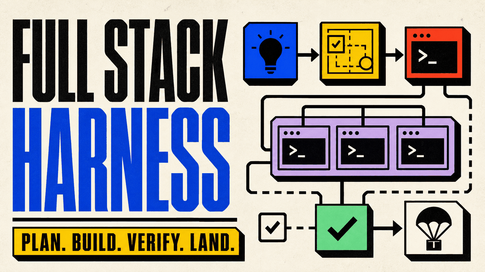

<p align="center">
  
</p>

<p align="center">
  <a href="README.md">English</a> | <a href="README.zh-TW.md">繁體中文</a> | <a href="README.zh-CN.md">简体中文</a> | <strong>Español</strong>
</p>

<p align="center">
  <a href="https://github.com/Phlegonlabs/product-delivery-harness/actions/workflows/harness-ci.yml"></a>
  
</p>

# Product Delivery Harness

Skills para convertir ideas de producto y solicitudes de cambio en software verificado con Codex, Claude Code, Pi u otro host compatible. Definición, diseño, implementación, seguridad y configuración externa conservan sus propias fuentes, pruebas y decisiones del owner.

## Instalación

Necesitas Python 3.10+, Git y un host que descubra `~/.agents/skills/`. En Windows, ejecuta `./install.sh` desde Git Bash.

```bash
git clone https://github.com/Phlegonlabs/product-delivery-harness.git
cd product-delivery-harness
./install.sh
```

El instalador bloquea el destino y prepara solo archivos del bundle registrados en el índice de Git. Guarda los IDs gestionados actuales y heredados bajo `~/.agents/skill-backups/product-delivery-harness/`; después verifica cada ruta y byte instalado.

Rechaza enlaces inseguros y archivos de origen inesperados. Los marcadores de propiedad limitan el rollback a ese intento y preservan rutas ajenas y backups anteriores. El recibo de origen registra el SHA y los cambios sin commit. Imprime el digest del contrato de los cinco skills recién instalado junto al que reemplazó y guarda ambos con el recibo; `harness_contract.py --skills-root <dir>` imprime el digest de cualquier árbol de skills.

El instalador copia scripts, referencias, assets y plantillas. Los tests quedan en el checkout de origen; ejecútalos allí. Instala las dependencias Python fijadas antes de validar:

```bash
python -m pip install -r skills/delivery-harness/requirements-test.txt
```

Actualiza con el mismo instalador, nunca mediante copia directa. Obtén autorización, detén las sesiones relevantes y conserva los backups; abre una sesión nueva tras verificar el éxito. Una instalación fallida se revierte. Si falla la verificación posterior, ejecuta el instalador desde el tag de la versión anterior. Después, un repositorio consumidor sigue la [adopción del bundle](skills/delivery-harness/references/bundle-adoption.md): actualiza las viñetas `## Harness Version` de su `AGENTS.md`, ejecuta `check_skill_bindings.py --previous-skill-dir <backup del instalador>` para marcar cada pin cambiado como `previous_release` u `owner_pin`, y registra una fila en el Change Log del Epic.

Al actualizar desde 0.23 o anterior, el instalador archiva los directorios heredados bajo sus IDs originales en el mismo backup: `full-harness` → `delivery-harness`, `prd-builder` → `product-definition-builder`, `product-design-builder` → `design-system-compiler`. Desde 0.73.0 el instalador también retira `code-security-review` (ahora `delivery-harness/references/security-review.md`), `product-activation` (ahora el registro de despliegue y `references/external-setup.md`) y `seo-growth-review` (ahora `growth-review`).

El trabajo UI también necesita los árboles externos exactos de `frontend-design` e `impeccable` fijados en el [manifest de dependencias](skills/delivery-harness/assets/external-skill-dependencies.json). Sigue las rutas de instalación registradas y ejecuta `check_external_skill_dependencies.py`. Revisa los cambios antes de actualizar los hashes del árbol completo. Los Skill Bindings conservan las elecciones del owner; nunca sustituyas un skill silenciosamente.

## Empieza aquí

| Punto de partida | Skill | Resultado |
| --- | --- | --- |
| Idea de producto | `product-definition-builder` | PRD, arquitectura, stack, obligaciones TEST y archivos feature de BDD, todos aprobados |
| Product Definition aprobada con UI (el diseño puede empezar tras el Product Thesis con una ronda de exploración opcional) | `ui-design-builder` | Direcciones, journey maps, HiFi completo, evidencia de navegador y Visual Approval |
| HiFi aprobado que requiere design system | `design-system-compiler` | Par congelado y HTML derivado vinculado al origen |
| Implementación o mantenimiento acotado | `delivery-harness` | Trabajo Direct o PLAN/RUN gestionado; escenarios de aceptación generados a partir de los archivos feature del PRD; las missions de UI siguen los journeys aprobados |
| Producto publicado con alguna superficie descubrible | `growth-review` | Revisión de crecimiento por superficie, de solo lectura, con seguimientos asignados |

Los cinco skills centrales y los cuatro independientes requieren una petición explícita que nombre el skill, como `$delivery-harness`. Se permite continuar un flujo ya solicitado. Las tareas ordinarias no inician rutas Harness, sincronización documental, registros Epic ni PLAN/RUN. La instalación y los documentos existentes no activan el flujo. El skill solicitado conserva sus controles y dependencias; una nueva etapa principal requiere una petición explícita. Codex usa `allow_implicit_invocation: false`; los demás hosts respetan el mismo límite.

Usa la [selección de referencias](skills/delivery-harness/references/reference-selection.md) y el [catálogo opcional](skills/delivery-harness/references/option-library/README.md) para decisiones pertinentes sin resolver o contexto de decisiones adoptadas. No son requisitos previos ni conceden autoridad para ejecutar; las decisiones y aprobaciones existentes siguen vigentes.

## Prompts típicos

Usa `$skill-name` en Codex o pide el skill por nombre en tu host. Indica el alcance exacto de escritura y el resultado local o remoto.

```text
Usa $product-definition-builder para definir este producto, incluyendo arquitectura frontend/backend completa, decisiones de data/auth/deployment, stack coherente, comportamiento UI, release targets, tests con sus archivos feature y Product Definition Approval. Detente antes del diseño de UI.
```

```text
La Product Definition está aprobada. Usa $ui-design-builder con el contrato `ui-design/3` y $frontend-design obligatorio. Ejecuta el preflight del producto, lee directamente el PRD UI Surface Contract y muestra tres direcciones materialmente distintas sobre los mismos casos representativos para que yo elija.
```

```text
Elegí una dirección. Continúa $ui-design-builder con $frontend-design: crea el HiFi conectado completo, ejecuta el preflight de completitud del HiFi y luego critique y audit de $impeccable solo con su autorización más scoring H1-H9. Pide una sola Visual Approval completa de texto, estructura, menús de producto, pestañas, visuales y tokens, después usa $design-system-compiler para el par obligatorio `design-system/4` y su HTML derivado congelado.
```

```text
Usa $delivery-harness para implementar el plan aprobado. Crea una branch y haz commit del cambio verificado, pero no hagas push ni abras un PR.
```

```text
La entrega está completa. Usa $delivery-harness para ejecutar las filas de configuración externa de docs/DEPLOYMENT.md para los targets de producción, configura solo las acciones exactas que apruebo, verifica cada resultado por read-back y registra el estado de Measurement Sources.
```

```text
Usa $growth-review para leer cada superficie de este producto publicado con su propia lente, reconciliar las fuentes de medición verificadas con el Growth Contract, priorizar oportunidades basadas en evidencia por superficie y enrutar cada cambio propuesto sin modificar el producto ni las cuentas externas.
```

## Qué incluye

| Skill | Responsabilidad |
| --- | --- |
| `product-definition-builder` | `PRD.md` con `## Ambition`, la fila `Shape` del At a Glance y `## Growth Contract`, `architecture.md`, `stack-decisions.md`, archivos feature en `docs/product/features/`, investigación, deltas de PRD por ronda y Product Definition Approval; el perfil de entrega `program` para productos de muchos módulos (PRD de programa más un [paquete por módulo](skills/product-definition-builder/assets/templates/PROGRAM_PRD.template.md), validado por módulo), el [contrato de funciones de IA](skills/product-definition-builder/references/ai-feature-contract.md) y el patrón de monolito modular para productos de muchos módulos; cada tabla de stack tiene una fila `BDD runner`, el bloque de aprobación lleva un digest `Feature files`, y el checker del paquete activa la cobertura de features, incluidos los ids de escenario de la eval-policy, cuando las Test Obligations nombran su archivo feature |
| `ui-design-builder` | `docs/design/ui-design.md` a partir de `UI_DESIGN.template.md`, estudios de dirección y paquete HiFi completo aprobado, con plantillas para el ledger consolidado de defectos (`UI_DEFECT_LEDGER.template.json`) y los paquetes del grader, del operador de Impeccable y de la re-revisión acotada (`UI_REVIEW_PACKET.template.md`); un alcance visual nuevo conserva además las capturas de su tablero de referencias en `docs/design/directions/<round>/references/` |
| `design-system-compiler` | `design-system.md` / `design-system.json` congelados y `design-system-preview.html`; `check_design_system_pair.py --write-bindings` rellena `sourceBindings` desde `ui-design.md`, `--write` escribe los ratios de `contrastPairs` y `typeSteps` en un bloque de evidencia generado, y un token JSON de `design-system/4` debe coincidir con la declaración del mismo nombre en el CSS del HiFi |
| `delivery-harness` | Selección de ruta, autorización, tareas, integración, verificación, el registro de aceptación de entrega generado a partir de los archivos feature del PRD y un perfil de ejecución, la regla del delta del PRD que exige un escenario nuevo o cambiado para cada Required TEST de un requisito nuevo o revisado, la lente de seguridad, configuración externa y fuentes de medición en `docs/DEPLOYMENT.md` (incluidas la [configuración de administración de GA4](skills/delivery-harness/references/ga4-admin-setup.md) y la del proveedor de IA), [presupuestos de rendimiento y coste](skills/delivery-harness/references/performance-and-cost-budget.md), verificación nativa que limpia lo que construyó, PLAN/RUN cuando hace falta, las stage cards del modo gestionado y el launch brief para ejecución autónoma; el `AGENTS.md` sembrado del proyecto con las secciones `Harness Version` y `Behavior Specs`, plantillas Direct de [asignación](skills/delivery-harness/assets/templates/ASSIGNMENT.template.md) y de [brief de revisión](skills/delivery-harness/assets/templates/DIRECT_REVIEW_BRIEF.template.md), archivos de [evidencia de entrega](skills/delivery-harness/assets/templates/DELIVERY_EVIDENCE.template.md) que `build_delivery_results.py` convierte en `delivery-results.json`, y el [refinamiento abierto](skills/delivery-harness/references/open-ended-refinement.md) de una app existente, empezando por la evidencia |
| `growth-review` | Una lente por superficie según el Surface Catalog: motores de búsqueda y de respuestas, listados de tiendas, registries y directorios, plataformas de bots, apps de escritorio y las cuentas que gestiona el equipo; modos `pre_launch`, `baseline`, `growth_review` de Day 7 y Day 30 y `traffic_drop`, salida inline; el texto publicado que contradice `docs/gtm/MESSAGING.md` es un hallazgo |

## Skills independientes

[Go To Market](standalone-skills/go-to-market/SKILL.md) selecciona canales y experimentos, mantiene un messaging record por proyecto, amplía la Launch Window del PRD en un launch runbook, redacta lifecycle messaging para los mecanismos de re-engagement del Growth Contract y prepara borradores, assets, calendarios y variantes por canal con dos hooks, incluidos canales de desarrolladores y listings de tiendas.

[Customer Discovery](standalone-skills/customer-discovery/SKILL.md) planifica entrevistas con usuarios, sintetiza notas anonimizadas y entrega hallazgos candidatos `RA-*` a la Product Definition. [README Studio](standalone-skills/readme-studio/SKILL.md) redacta READMEs con demostraciones reales y toma la primera línea del messaging record cuando existe. [Release Packager](standalone-skills/release-packager/SKILL.md) verifica artifacts de release y rutas de instalación del consumidor.

Estos cuatro directorios completos requieren registro separado en el host; `install.sh` instala solo los cinco skills centrales. Registro, builds, descargas, firmas, publicación, programación y cambios de cuenta conservan su autorización. Reutiliza los registros de producto y medición; no añadas una ronda de revisión.

## Cómo encaja el sistema

```mermaid
flowchart LR
  Product["Product Definition, Ambition, Growth Contract y archivos feature con aprobación del owner"] --> UI["Direcciones UI, journey maps y HiFi completo"] --> Design["Visual Approval y par de diseño obligatorio"]
  Product -.->|"ronda de exploración R0 opcional tras el Product Thesis"| UI
  Product -->|"sin UI o mejora o mantenimiento acotado"| Harness["Entrega Direct o gestionada"]
  Design -->|"las missions siguen los journeys aprobados"| Harness
  Harness --> Review["Una revisión conjunta sobre el SHA final"] --> Tests["Una validación final amplia y el registro de aceptación"] --> C["Candidato fijo C"]
  C -->|managed| A["Solo Managed: archivo A"] --> Publish["Publicación autorizada y Preview aplicable"]
  C -->|direct| Publish
  Publish --> Main["Landing main exact-SHA autorizado por separado"] --> Setup["Readback de configuración externa por target"] --> Outcome["Resultados medidos y growth review opcional"]
```



La entrega inicial con UI requiere diseño y todas las autorrevisiones aplicables antes de ejecutar Harness. Sigue la [autorrevisión del autor](skills/delivery-harness/references/pre-delivery-self-review.md) en las salidas existentes de Product, dirección y HiFi indicadas abajo.

## Reglas operativas

Las reglas siguientes se aplican dentro de flujos de skills solicitados explícitamente.

El núcleo toma una decisión de tamaño: un escritor y una secuencia coherente de verificación permanecen en Direct, y unas pocas partes independientes en archivos distintos se ejecutan como [Direct Fan-Out](skills/delivery-harness/references/direct-fan-out.md): un escritor por worktree, y cada uno se fusiona en cuanto pasa su merge check. Las missions que dependen entre sí, el handoff duradero o un grafo acotado de corrección usan PLAN/RUN. Las missions son lotes de funcionalidad; las tasks finas conservan commits atómicos. Con `Delivery profile: mvp` elegido por el owner, un proyecto pequeño o un MVP de una semana usa la ruta comprimida: aprobación de stack y producto en una sola llamada, HiFi solo para las superficies requeridas, una revisión de entrega combinada con Final UI Acceptance integrada y como máximo cuatro gates del owner; la evidencia, la seguridad y la protección de datos no cambian.

- [Entrada y handoff](skills/delivery-harness/references/governance/task-and-handoff.md): inspecciona instrucciones y fuentes actuales; la identidad cargada desconocida sigue siendo desconocida. El Epic actual es el que nombra la línea `Current Epic:` de `docs/DOCUMENTS.md`; el índice guarda una sola fila `docs/epics/` y cada Epic guarda su propio estado. El bootstrap crea un `.gitattributes` ausente a partir de `PROJECT_GITATTRIBUTES.template` para que los archivos vinculados por hash se guarden byte a byte ([contrato gitattributes](skills/delivery-harness/references/gitattributes-contract.md)), y `configure_project_context.py --check` informa sin escribir de los huecos de atributos, un diff por cada sección obsoleta de `AGENTS.md` y, con `--documents`, la deriva de `docs/DOCUMENTS.md`. Una run gestionada se reanuda desde el bloque `Next` del inspector; un RUN `running` estancado necesita antes una decisión del owner, y una run autónoma parte de un launch brief firmado.
- [Delegación](skills/delivery-harness/references/delegation-contract.md): la configuración de agentes y AGENTS eligen executor, modelo, esfuerzo y fallback. Un escritor posee cada checkout; los workers asignados nunca delegan. Los briefs y los paquetes de revisión se dimensionan antes del lanzamiento a los límites de tiempo, turnos y bytes de la ruta. Un plazo vencido sin veredicto queda bloqueado por entorno y se vuelve a despachar como llamadas acotadas más pequeñas. El diseño y la revisión de los límites cambiados siguen el [método de arquitectura](skills/delivery-harness/references/architecture-method.md).
- [Verificación](skills/delivery-harness/references/verification-gates.md): vincula la evidencia requerida al candidato exacto; capacidad o evidencia ausente sigue bloqueada. La revisión independiente de una matriz de navegador es verificar y luego muestrear: verifica los recibos, inspecciona las filas FAIL y las marcadas por diff, y muestrea las filas PASS. La sonda de capacidad del navegador se reutiliza durante el resto de la sesión. Un reviewer en sandbox que no puede ejecutar git prueba identidad y checkout limpio con el paquete de `review_input.py`. `build_verifier_request.py` construye las solicitudes de verifier de worker y de task a partir del lease vivo, y `security_review_result.py --result <file> --reviewed-sha <sha>` comprueba sin escribir un resultado de seguridad de la ruta Direct.
- [Aceptación de entrega](skills/delivery-harness/references/delivery-acceptance-contract.md): los archivos feature son contenido del PRD que aprueba el owner; las step definitions son código. El registro se genera a partir de los archivos feature y nunca se edita a mano. Cambiar el texto de un escenario es una decisión de producto y pasa por un delta del PRD; cambiar solo las step definitions es un arreglo menor en el Epic existente. El BDD runner es una decisión de stack. Los `variants` y el mapa `assign` de un perfil de ejecución generan un registro multiplataforma, y `render_delivery_acceptance.py --check` informa de la deriva sin escribir.
- [Publicación y promoción](skills/delivery-harness/references/branch-promotion-contract.md): conserva targets, autorizaciones y readback remoto exactos; nunca uses force-push. La [Card 8](skills/delivery-harness/references/stages/stage-cards.md#card-8-archive-publish-and-promote) lista en orden los comandos de archivo, publicación y promoción.
- [Mantenimiento del origen](skills/delivery-harness/references/governance/source-maintenance.md): verificaciones atómicas enfocadas y una matriz completa por candidato fijo.

Antes de cada handoff, comprueba hashes de origen (source hashes), el Epic y la coherencia documental, y reescribe el bloque `## Handoff` del Epic (etapa, aprobaciones vigentes, trabajo restante, siguiente acción); cada entrada de skill lee ese bloque primero. La sincronización documental calcula el hash de cada Epic sin ese bloque, así que reescribirlo no es drift. `docs/tasks.md` deriva de RUN, y `render_delivery_acceptance.py` genera el registro de aceptación de entrega a partir de los archivos feature; no se edita a mano el contenido generado. [Sincronización documental](skills/delivery-harness/references/document-sync-contract.md), [reparaciones acotadas](skills/delivery-harness/references/bounded-enhancement.md) y [aceptación de entrega](skills/delivery-harness/references/delivery-acceptance-contract.md) poseen estas reglas.

| Etapa | Revisión predeterminada y condición de parada |
| --- | --- |
| Product Definition | Una autorrevisión del paquete completo después de redactar y reconciliar la investigación; recheck de cambios afectados antes de la aprobación del owner; después una revisión independiente de solo lectura del PRD y un recheck acotado, y el owner decide con una guía de diez preguntas. Los defectos posteriores se vuelven reparaciones aisladas con revisión acotada. |
| Direcciones | Un alcance visual nuevo parte de un tablero de referencias de 9–12 capturas que el owner confirma. El autor de cada estudio comprueba y repara su estudio renderizado antes de la selección del owner, con una pasada de `slop_scan.py` y una hoja comparativa frente al tablero. Tres estudios, escritos a la vez por autores distintos cuando el host tiene capacidad; el owner elige. |
| HiFi | Se crea primero en estático y después con movimiento. Tras el preflight de completitud, el mismo autor revisa y repara antes de la revisión independiente, con una pasada de `slop_scan.py` y una hoja de `capture_sheet.py` que pone la dirección seleccionada junto al candidato. Visual Approval llega tras Impeccable `critique` **y** `audit` y una media H1–H9 redondeada **mínima de 85** con cada dimensión **mínima de 80**. |
| Entrega | `review_policy: final_candidate`: una revisión conjunta de código, visual si hay UI y seguridad en el SHA final fijo (navegador real para UI), más un recheck acotado. Después, cada defecto restante se vuelve una reparación acotada con una revisión acotada solo de su diff. |
| Release | Una instrucción del owner puede nombrar varias acciones exactas. El archivo A y el SHA main S con árbol idéntico heredan evidencia verificada según las reglas siguientes. Un árbol distinto es otro candidato. |
| Configuración externa | `docs/DEPLOYMENT.md` guarda una fila External Console Setup por acción, la tabla Measurement Sources y una fila del Release Log por release. Verifica autorización, readback independiente y comportamiento aplicable por target; preparación y readiness de producción siguen separados. Un target de tienda o instalador necesita prueba de instalación o descarga; una subida sola queda en `pending`. |

## Adaptador general de runtime

Los drivers actuales son `subagents` y `sequential_parent`; el [adaptador runtime](skills/delivery-harness/references/runtime-adapters.md) los relaciona con herramientas nativas observadas. La ejecución del parent no sustituye la revisión independiente. Los verifiers host usan permisos del usuario actual, sin confinamiento del sistema de archivos ni de red. La capacidad no concede acciones.

Conserva los doce [permisos de acción](skills/delivery-harness/references/execution-state-model.md#authorization-action-ledger):

```text
invoke_external_runtime, spawn_subagents, create_user_owned_tasks,
create_local_worktrees, create_app_managed_worktrees, create_local_branches,
create_local_commits, integrate_locally, push, archive_worker_tasks,
remove_worktrees, delete_branches
```

Los RUN actuales cierran en `local_only`, con `push` false y `pushed_head_sha` null. Publicación, landing protegido, despliegue, instalación, archivo y limpieza conservan sus autorizaciones separadas. Una misión que pasa devuelve `WORKER_RESULT`; una misión bloqueada o fallida devuelve el resultado del nodo del grafo con `worker_result: null`, y el parent conserva la autoridad de validación, revisión e integración.

## Estructura del repositorio

| Ruta | Propósito |
| --- | --- |
| `skills/` | Cinco skills canónicos, referencias, assets, plantillas y tests de origen |
| `standalone-skills/` | Skills opcionales registrados por separado |
| `assets/` | Portadas del README |
| `docs/` | Índice vigente y registros de tareas |
| `.github/workflows/harness-ci.yml` | CI del candidato exacto |
| `install.sh` | Instalación y actualización verificadas del bundle |

## Mantén los skills

Edita las fuentes canónicas y actualiza las descripciones de los cuatro READMEs en el mismo cambio. Selecciona pruebas enfocadas y casos negativos según los archivos cambiados. Ejecuta desde el checkout de origen:

```bash
python skills/delivery-harness/scripts/check_skill_spec.py
python -m unittest discover -s skills/delivery-harness/scripts/tests -p "test_skill_contract.py"
python skills/delivery-harness/scripts/docs_weight.py
python skills/delivery-harness/scripts/prepare_release.py --check
git diff --check
```

La [matriz requerida](skills/delivery-harness/references/governance/source-maintenance.md#required-verification) corre una vez en CI sobre el candidato fijo. Ejecútala localmente solo si CI no está disponible, con `python skills/delivery-harness/scripts/ci_test_shards.py matrix --base <released main SHA> --log-dir <new directory>`; escribe un log por paso y `summary.txt`. Conserva cobertura de navegador y nativa; fallos o entradas cambiadas requieren rechecks afectados. La evidencia reutilizada conserva su origen.

## Releasing

Sigue el [Git flow del origen](skills/delivery-harness/references/governance/source-maintenance.md#git-flow) y la [verificación requerida](skills/delivery-harness/references/governance/source-maintenance.md#required-verification). Lleva el candidato revisado mediante el PR requerido a `main` protegido y etiqueta ese commit con `v<version>`. Para fijar la versión, escribe las cuatro entradas del historial en un directorio como `en.md`, `zh-TW.md`, `zh-CN.md` y `es.md`, una línea cada una, y ejecuta `python skills/delivery-harness/scripts/prepare_release.py --version <X.Y.Z> --entries <dir>`. Se niega si alguna superficie de versión no coincide; si coinciden, fija la nueva versión en `VERSION`, `package.json`, `package-lock.json` y los cuatro READMEs, y mueve la entrada más antigua del README a `CHANGELOG.md`. Los tests leen la versión de `VERSION`, sin nuevos literales fijos.

A debe ser hijo directo de C. Hereda la evidencia solo tras verificar el archivo exacto vinculado al recibo. Solo pueden cambiar los movimientos de coordinación/evidencia registrados, el `docs/tasks.md` generado opcional, `docs/DOCUMENTS.md` y `ARCHIVE_RECEIPT.json`. Las demás rutas quedan intactas. Retén el SHA revisado de C y los orígenes de los resultados. La evidencia heredada no es una ejecución nueva en A. Un SHA main S creado por el servidor con árbol idéntico hereda la evidencia y su origen original, demostrada con el JSON de `promotion_readback.py post`. La igualdad sola no exige repetir suites ni seguridad. Un árbol distinto requiere verificar otro candidato.

Publicar exige el SHA y la rama exactos autorizados por el owner, push sin force y readback remoto. Una instrucción puede vincular esas autorizaciones; detente ante drift o gates fallidos. Tras verificar el release formal, actualiza un bundle instalado distinto con el instalador oficial, en reposo y con backup y verificación. Un badge no demuestra instalación ni despliegue.

## Seguridad y protección de datos

Mantén credenciales y datos de usuario fuera del repositorio. Preserva archivos ajenos, worktrees y backups; borrar o sustituir requiere autorización exacta del owner. La revisión de solo lectura no instala scanners, cambia código ni sondea targets vivos sin otro alcance. Consulta [seguridad](skills/delivery-harness/references/security-review.md) y [protección de datos](skills/delivery-harness/references/governance/development-rules.md#protect-local-data).

## Licencia

[MIT](LICENSE). Conserva licencias y atribución de código y assets de terceros.

## Historial de versiones

- **0.83.0** — El trabajo independiente ahora se ejecuta a la vez. Un trabajo pequeño con unas pocas partes independientes en archivos distintos ya no tiene que elegir entre un solo escritor y un PLAN/RUN completo: un Direct Fan-Out da a cada parte su propio escritor y su propio worktree, y el parent fusiona cada worktree terminado en cuanto pasa `worktree_fanout.py merge-check`. La comprobación exige un worktree limpio, la base correcta, cambios dentro del scope de la parte, ninguna edición de PLAN/RUN, ningún error de espacios y una fusión de prueba sin conflictos. Si falla, no se fusiona nada y se indica el motivo. `worktree_fanout.py scopes` comprueba antes del lanzamiento que los scopes de escritura de las partes no se solapan. La decisión de tamaño cambia con ello: el trabajo es large cuando las missions dependen entre sí o debe sobrevivir a la sesión, no por tener dos partes escribibles. Para los runs gestionados, `plan_width.py` informa antes de readiness del ancho paralelo de un PLAN, sus niveles de dependencia y su ruta crítica. Señala una mission que espera a otra sin compartir archivos ni recursos, un recurso exclusivo, como un puerto fijo de dev-server, reclamado por tres o más missions, y un presupuesto inferior al ancho. Informa y no añade ningún gate. Una arista de dependencia significa ahora que una mission consume la salida de otra; el orden de fusión y el orden de revisión no son dependencias. La plantilla de PLAN y `new_run.py` siembran un presupuesto paralelo de 8 en lugar de 1. En el diseño de UI cada estudio de dirección puede tener su propio autor, así que los tres estudios se escriben a la vez cuando el host tiene capacidad. El checker ya no exige un solo autor para todos los estudios y sigue exigiendo que cada estudio lo autorrevise su propio autor. El paquete HiFi mantiene un solo autor. Las tareas de investigación y los lectores de la ola de revisión se lanzan juntos.

- **0.82.0** — El movimiento gana un lugar en la decisión de stack, dos rutas más y una receta para medios generados. La decisión de stack puede llevar una fila opcional `motion`: un techo elegido entre `CSS/WAAPI`, `Motion`, `GSAP`, `Three.js`, `Lottie` y `Rive`, aprobado con el resto del stack. El diseño de UI elige efectos dentro de él y ya no tiene que devolver a Product Definition una decisión de movimiento expresivo. Un paquete sin la fila conserva la regla anterior. Una fila `MM-*` ya puede nombrar `Lottie` o `Rive` como ruta. Igual que Three.js, no pueden ejecutarse dentro de la página HiFi cerrada, así que HiFi muestra una aproximación, y el primer corte de implementación ahora pone esa aproximación junto a los fotogramas de la librería real en una hoja de `capture_sheet.py`. La View Transitions API y las animaciones CSS guiadas por scroll no necesitan entrada en el stack y son solo mejora progresiva. `motion-and-media-routing.md` gana una receta para clips y modelos 3D de un proveedor de generación como el MCP de Higgsfield: generar después de la pasada estática, usar una misma imagen como primer y último fotograma para un bucle sin corte, quitar el audio, conservar la imagen como póster y registrar el modelo, el id del job, los hashes de entrada y los créditos gastados. También dice que no se genere metraje de la propia interfaz. El catálogo de opciones añade gráficos (Recharts, visx, ECharts), tablas (TanStack Table, AG Grid), movimiento de plataforma con una tabla de soporte por navegador, dotLottie, cuatro fuentes de componentes animados, movimiento nativo (Reanimated, React Native Skia, SwiftUI, Compose) y Ark UI, y sustituye "licencia de GSAP sin verificar" por los términos de la Standard License. No cambia ninguna puerta, aprobación ni umbral, y todo paquete aprobado sigue siendo válido. El checker de UI acepta las dos rutas nuevas, así que los bytes del bundle cambian y los consumers vuelven a fijar el contrato de cinco skills.

- **0.81.0** — El diseño de UI ahora trabaja a partir de imágenes y se comprueba contra ellas. Un alcance visual nuevo empieza con un tablero de referencias: de 9 a 12 páginas capturadas (5 con `mvp`) que cubren composición, espaciado, tipografía, color, controles y movimiento. El owner lo confirma en una sola página y `visual_inputs.py` lista cada captura en la tarea del autor, así que el prompt apunta a las capturas y ya no describe un estilo. Un MCP de referencias o una herramienta de navegador que el owner ya tenga conectados pueden buscar y capturar candidatos; un agente sigue sin instalar ni conectar ninguno. El brief de frontend gana cuatro líneas: trabajar desde las capturas, apuntar a un 99% de direction match, calidad antes que velocidad y una lista de prohibidos. El HiFi se crea primero en estático y después con movimiento, y una referencia de movimiento recibe notas de tiempos escritas antes de construir nada a partir de ella. Dos scripts se suman a la autorrevisión del autor. `slop_scan.py` lee un estudio o una página HiFi y marca un cluster cuando tres o más patrones por defecto comparten la página; un patrón aislado queda a criterio del autor. `capture_sheet.py` escribe una página autocontenida que muestra el tablero, o la dirección seleccionada junto al candidato HiFi, y el owner recibe esa hoja con los enlaces de Visual Approval. El autor registra su propio direction match; el lead grader registra el suyo antes de leer el del autor, y una diferencia de 15 puntos o más se comunica al autor. Ese número calibra y no bloquea nada. El feedback del owner se registra en filas que nombran el elemento, la propiedad y el resultado esperado; el feedback que no nombra ninguno recibe una descripción de lo construido, nunca una reparación adivinada. El registro de calificación nombra los modelos del autor y de los graders, y el lead grader viene de otra familia de modelos cuando la política de agentes la ofrece. El presupuesto de revisión, los umbrales 85/80 y todos los checkers siguen igual. Los bytes del bundle cambian, así que los consumers vuelven a fijar el contrato de cinco skills.

- **0.80.0** — La primera entrega de un producto puede aterrizar en `main` y salir directamente a producción. Una arquitectura que escribe `Initial delivery: production-first/1` bajo `## Release Targets`, junto a `Release source policy: main-preview/1`, puede declarar solo el target de producción por superficie; `release_targets.py` ya no exige su gemelo `-dev`. `check_deployment.py` lee `Delivery kind` del registro Branch Promotion: para `initial_delivery` bajo una arquitectura marcada, las celdas de development, la fila development y las líneas de preview llevan el literal exacto `n/a — initial delivery: production is the first deployed environment`; para `enhancement` el target de development, sus celdas y la aceptación en preview siguen siendo obligatorios, con o sin marcador, y una discrepancia entre registro y arquitectura es un hallazgo. El contrato de promoción omite la aceptación en preview para esa primera entrega y toma el despliegue a producción y el smoke del SHA de main como su verificación desplegada; los escenarios de aceptación que necesitan un entorno desplegado se ejecutan como smoke de producción bajo las restricciones de producción existentes, y un escenario que no pueda ser seguro en producción lo descarta el owner con motivo registrado, nunca se reetiqueta. `check_delivery_acceptance.py` tiene ahora dos etapas: antes del aterrizaje difiere un escenario requerido con `environment: production` cuya fila está `blocked` y lo lista en `production_smoke_deferred`; tras el despliegue a producción, `--production-smoke-complete --candidate-sha <SHA de main>` exige que cada una de esas filas pase. Los paquetes sin marcador y todas las mejoras conservan su target de development y la aceptación en preview; solo el aplazamiento de la puerta de aceptación se aplica a todos los tipos de entrega. La versión menor sube porque el bundle gana un marcador de contrato.

- **0.79.1** — Parche tras la revisión Codex del pull request de 0.79.0. `hifi_matrix_capture.py` ahora marca FAIL un intento de interacción cuyo control de producto no era visible o no retuvo el foco en solitario, en vez de registrar `focusCorrect: false` junto a un PASS; su pasada de revisor pulsa el control de estado cualificado por superficie, así que una página con dos superficies que comparten un estado como `ready` ya no falla con "reviewer control missing". La unión del paquete congelado pasa al comprobador de Product Definition el directorio `docs/product/features` que declara el PRD, de modo que un escenario cambiado tras la aprobación falla la preparación con el desajuste de digest de los archivos feature, como ya hacía la CLI. Los bytes del bundle cambian, así que los consumidores vuelven a fijar el contrato de cinco skills.

Versiones anteriores: [CHANGELOG.md en inglés](CHANGELOG.md).
