<p align="center">
  
</p>

<p align="center">
  <a href="README.md">English</a> | <a href="README.zh-TW.md">繁體中文</a> | <a href="README.zh-CN.md">简体中文</a> | <strong>Español</strong>
</p>

<p align="center">
  <a href="https://github.com/Phlegonlabs/product-delivery-harness/actions/workflows/harness-ci.yml"></a>
  
</p>

# Product Delivery Harness

Skills para convertir ideas de producto y solicitudes de cambio en software verificado con Codex, Claude Code, Pi u otro host compatible. Definición, diseño, implementación, seguridad y activación conservan sus propias fuentes, pruebas y decisiones del owner.

## Instalación

Necesitas Python 3.10+, Git y un host que descubra `~/.agents/skills/`. En Windows, ejecuta `./install.sh` desde Git Bash.

```bash
git clone https://github.com/Phlegonlabs/product-delivery-harness.git
cd product-delivery-harness
./install.sh
```

El instalador bloquea el destino y prepara solo archivos del bundle registrados en el índice de Git. Guarda los IDs gestionados actuales y heredados bajo `~/.agents/skill-backups/product-delivery-harness/`; después verifica cada ruta y byte instalado.

Rechaza enlaces inseguros y archivos de origen inesperados. Los marcadores de propiedad limitan el rollback a ese intento y preservan rutas ajenas y backups anteriores. El recibo de origen registra el SHA y los cambios sin commit.

El instalador copia scripts, referencias, assets y plantillas. Los tests quedan en el checkout de origen; ejecútalos allí. Instala las dependencias Python fijadas antes de validar:

```bash
python -m pip install -r skills/delivery-harness/requirements-test.txt
```

Actualiza con el mismo instalador, nunca mediante copia directa. Obtén autorización, detén las sesiones relevantes y conserva los backups; abre una sesión nueva tras verificar el éxito. Una instalación fallida se revierte. Si falla la verificación posterior, ejecuta el instalador desde el tag de la versión anterior.

Al actualizar desde 0.23 o anterior, el instalador archiva los directorios heredados bajo sus IDs originales en el mismo backup: `full-harness` → `delivery-harness`, `prd-builder` → `product-definition-builder`, `product-design-builder` → `design-system-compiler`.

El trabajo UI también necesita los árboles externos exactos de `frontend-design` e `impeccable` fijados en el [manifest de dependencias](skills/delivery-harness/assets/external-skill-dependencies.json). Sigue las rutas de instalación registradas y ejecuta `check_external_skill_dependencies.py`. Revisa los cambios antes de actualizar los hashes del árbol completo. Los Skill Bindings conservan las elecciones del owner; nunca sustituyas un skill silenciosamente.

## Empieza aquí

| Punto de partida | Skill | Resultado |
| --- | --- | --- |
| Idea de producto | `product-definition-builder` | PRD, arquitectura, stack y obligaciones TEST aprobados |
| Product Definition aprobada con UI | `ui-design-builder` | Direcciones, HiFi completo, evidencia de navegador y Visual Approval |
| HiFi aprobado que requiere design system | `design-system-compiler` | Par congelado y HTML derivado vinculado al origen |
| Implementación o mantenimiento acotado | `delivery-harness` | Trabajo Direct o PLAN/RUN gestionado |
| Candidato de código fijo e integrado | `code-security-review` | Resultado de seguridad exact-SHA de solo lectura y brechas de cobertura |
| Configuración externa o release readiness | `product-activation` | Acciones autorizadas, readback y readiness por target |
| Sitio público en producción | `seo-growth-review` | Revisión de búsqueda y medición de solo lectura y seguimientos asignados |

Cada skill del bundle puede ejecutarse por separado cuando dispone de sus entradas obligatorias. El pipeline completo es opcional.

## Prompts típicos

Usa `$skill-name` en Codex o pide el skill por nombre en tu host. Indica el alcance exacto de escritura y el resultado local o remoto.

```text
Usa $product-definition-builder para definir este producto, incluyendo arquitectura frontend/backend completa, decisiones de data/auth/deployment, stack coherente, comportamiento UI, release targets, tests y Product Definition Approval. Detente antes del diseño de UI.
```

```text
La Product Definition está aprobada. Usa $ui-design-builder con el contrato `ui-design/3` y $frontend-design obligatorio. Ejecuta el preflight del producto, lee directamente el PRD UI Surface Contract y muestra tres direcciones materialmente distintas sobre los mismos casos representativos para que yo elija.
```

```text
Elegí una dirección. Continúa $ui-design-builder con $frontend-design: crea el HiFi conectado completo, ejecuta el preflight de completitud del HiFi y luego critique y audit de $impeccable solo con su autorización más scoring H1-H9. Pide una sola Visual Approval completa de texto, estructura, menús de producto, pestañas, visuales y tokens, después usa $design-system-compiler para el par obligatorio `design-system/4` y su HTML derivado congelado.
```

```text
Usa $delivery-harness para implementar el plan aprobado. Crea una branch y haz commit del cambio verificado, pero no hagas push ni abras un PR.
```

```text
La entrega está completa. Usa $product-activation para los targets de release de producción, configura solo las acciones externas exactas que apruebo, verifica cada resultado por read-back, y detente después de registrar el readiness de activación y el handoff de la ventana de medición.
```

```text
Usa $seo-growth-review para auditar este sitio en producción, reconciliar la visibilidad de Search Console con los resultados on-site de GA4, priorizar oportunidades de keyword y página basadas en evidencia y enrutar cada cambio propuesto sin modificar el sitio ni las cuentas externas.
```

## Qué incluye

| Skill | Responsabilidad |
| --- | --- |
| `product-definition-builder` | `PRD.md`, `architecture.md`, `stack-decisions.md`, investigación y Product Definition Approval |
| `ui-design-builder` | `docs/design/ui-design.md`, estudios de dirección y paquete HiFi completo aprobado |
| `design-system-compiler` | `design-system.md` / `design-system.json` congelados y `design-system-preview.html` |
| `delivery-harness` | Selección de ruta, autorización, tareas, integración, verificación y PLAN/RUN cuando hace falta |
| `code-security-review` | Lente de seguridad sobre el candidato exacto: hallazgos, herramientas, cobertura y exclusiones |
| `product-activation` | `docs/ACTIVATION.md`, configuración externa, pruebas de comportamiento y handoff de medición |
| `seo-growth-review` | Evidencia SEO y de crecimiento orgánico en producción; revisión inline o informe solicitado explícitamente |

## Skills independientes

[Go To Market](standalone-skills/go-to-market/SKILL.md) selecciona canales y experimentos. [GTM Content](standalone-skills/gtm-content/SKILL.md) prepara borradores, assets y calendarios por canal.

[README Studio](standalone-skills/readme-studio/SKILL.md) redacta READMEs con demostraciones reales. [Release Packager](standalone-skills/release-packager/SKILL.md) verifica artifacts de release y rutas de instalación del consumidor.

Estos cuatro directorios completos requieren registro separado en el host; `install.sh` instala solo los siete skills centrales. Registro, builds, descargas, firmas, publicación, programación y cambios de cuenta conservan su autorización. Reutiliza los registros de producto y medición; no añadas una ronda de revisión.

## Cómo encaja el sistema

```mermaid
flowchart LR
  Product["Product Definition y aprobación del owner"] --> UI["Direcciones UI y HiFi completo"] --> Design["Visual Approval y par de diseño obligatorio"]
  Product --> Harness["Entrega Direct o gestionada"]
  Design --> Harness
  Harness --> Review["Una revisión conjunta sobre el SHA final"] --> Tests["Una validación final amplia"] --> C["Candidato fijo C"]
  C -->|managed| A["Solo Managed: archivo A"] --> Publish["Publicación autorizada y Preview aplicable"]
  C -->|direct| Publish
  Publish --> Main["Landing main exact-SHA autorizado por separado"] --> Activate["Activation por target"] --> Outcome["Resultados medidos y revisión SEO opcional"]
```



## Reglas operativas

El núcleo toma una decisión de tamaño: un escritor y una secuencia coherente de verificación permanecen en Direct. Misiones escribibles independientes, handoff duradero o un grafo acotado de corrección usan PLAN/RUN. Las missions son lotes de funcionalidad; las tasks finas conservan commits atómicos.

- [Entrada y handoff](skills/delivery-harness/references/governance/task-and-handoff.md): inspecciona instrucciones y fuentes actuales; la identidad cargada desconocida sigue siendo desconocida.
- [Delegación](skills/delivery-harness/references/delegation-contract.md): la configuración de agentes y AGENTS eligen executor, modelo, esfuerzo y fallback. Un escritor posee cada checkout; los workers asignados nunca delegan.
- [Verificación](skills/delivery-harness/references/verification-gates.md): vincula la evidencia requerida al candidato exacto; capacidad o evidencia ausente sigue bloqueada.
- [Publicación y promoción](skills/delivery-harness/references/branch-promotion-contract.md): conserva targets, autorizaciones y readback remoto exactos; nunca uses force-push.
- [Mantenimiento del origen](skills/delivery-harness/references/governance/source-maintenance.md): verificaciones atómicas enfocadas y una matriz completa por candidato fijo.

Antes de cada handoff, comprueba hashes de origen (source hashes), el Epic y la coherencia documental. `docs/tasks.md` deriva de RUN; no se edita a mano el contenido generado. [Sincronización documental](skills/delivery-harness/references/document-sync-contract.md), [reparaciones acotadas](skills/delivery-harness/references/bounded-enhancement.md) y [aceptación de entrega](skills/delivery-harness/references/delivery-acceptance-contract.md) poseen estas reglas.

| Etapa | Revisión predeterminada y condición de parada |
| --- | --- |
| Product Definition | Una autorrevisión del paquete completo después de redactar y reconciliar la investigación; recheck de cambios afectados antes de la aprobación del owner. |
| Direcciones | Tres estudios renderizados para elección del owner. Modificar añade un estudio revisado de la dirección elegida y una decisión; rechazar inicia otro conjunto. |
| HiFi | Una ronda diagnóstica, una reparación consolidada y una revisión del alcance afectado. Cobertura obligatoria de navegador, Impeccable `critique` **y** `audit`, media H1–H9 redondeada **mínima de 85** y cada dimensión **mínima de 80**, después Visual Approval. La evidencia intacta conserva su identidad. |
| Entrega | `review_policy: final_candidate`: una revisión conjunta de código, visual si hay UI y seguridad en el SHA final fijo. Usa un navegador real para UI. Una reparación consolidada y un recheck de hallazgos originales, código cambiado y consumidores directos; seguridad se vincula de nuevo con alcance completo. Un recheck fallido termina en `blocked`. |
| Release | Una instrucción del owner puede nombrar varias acciones exactas. El archivo A y el SHA main S con árbol idéntico heredan evidencia verificada según las reglas siguientes. Un árbol distinto es otro candidato. |
| Activation | Verifica autorización, readback independiente y comportamiento aplicable por target; preparación y readiness de producción siguen separados. |

Omitir `review_policy` conserva el comportamiento histórico `per_mission`. Preserva pins PLAN/RUN y aprobaciones anteriores; renombrar un nodo nunca reinicia los intentos consumidos. Otro intento requiere la decisión explícita del owner registrada. La entrega de código exige seguridad; sin ella informa `UNVALIDATED`, nunca PASS. La primera revisión HiFi cubre cada eje de audit. La revisión posterior repite critique y audit en páginas y estados afectados y conserva la matriz completa.

Impeccable sigue siendo obligatorio para HiFi, pero no es el reviewer predeterminado de implementación de solo lectura. Su workflow requiere autorización separada para subagents, navegador/server, snapshots y descargas opcionales. Producto, stack, dirección y Visual Approval siguen con sus owners.

## Adaptador general de runtime

Los drivers actuales son `subagents` y `sequential_parent`; el [adaptador runtime](skills/delivery-harness/references/runtime-adapters.md) los relaciona con herramientas nativas observadas. La ejecución del parent no sustituye la revisión independiente. Los verifiers host usan permisos del usuario actual, sin confinamiento del sistema de archivos ni de red. La capacidad no concede acciones.

Conserva los doce [permisos de acción](skills/delivery-harness/references/execution-state-model.md#authorization-action-ledger):

```text
invoke_external_runtime, spawn_subagents, create_user_owned_tasks,
create_local_worktrees, create_app_managed_worktrees, create_local_branches,
create_local_commits, integrate_locally, push, archive_worker_tasks,
remove_worktrees, delete_branches
```

Los RUN actuales cierran en `local_only`, con `push` false y `pushed_head_sha` null. Publicación, landing protegido, despliegue, instalación, archivo y limpieza conservan sus autorizaciones separadas.

## Estructura del repositorio

| Ruta | Propósito |
| --- | --- |
| `skills/` | Siete skills canónicos, referencias, assets, plantillas y tests de origen |
| `standalone-skills/` | Skills opcionales registrados por separado |
| `assets/` | Portadas del README |
| `docs/` | Índice vigente y registros de tareas |
| `.github/workflows/harness-ci.yml` | CI del candidato exacto |
| `install.sh` | Instalación y actualización verificadas del bundle |

## Mantén los skills

Edita las fuentes canónicas y actualiza las descripciones de los cuatro READMEs en el mismo cambio. Selecciona pruebas enfocadas y casos negativos según los archivos cambiados. Ejecuta desde el checkout de origen:

```bash
python skills/delivery-harness/scripts/check_skill_spec.py
python -m unittest discover -s skills/delivery-harness/scripts/tests -p "test_skill_contract.py"
python skills/delivery-harness/scripts/docs_weight.py
git diff --check
```

La [matriz requerida](skills/delivery-harness/references/governance/source-maintenance.md#required-verification) corre una vez en CI sobre el candidato fijo. Ejecútala localmente solo si CI no está disponible. Conserva cobertura de navegador y nativa; fallos o entradas cambiadas requieren rechecks afectados. La evidencia reutilizada conserva su origen.

## Releasing

Sigue el [Git flow del origen](skills/delivery-harness/references/governance/source-maintenance.md#git-flow) y la [verificación requerida](skills/delivery-harness/references/governance/source-maintenance.md#required-verification). Lleva el candidato revisado mediante el PR requerido a `main` protegido y etiqueta ese commit con `v<version>`. Actualiza estas superficies juntas:

1. Versión de `package.json` y `skills/delivery-harness/VERSION`.
2. Badges y entradas de la versión actual en los cuatro READMEs.
3. `required_harness_version` en `assets/templates/MISSION_RUNBOOK.template.md` del skill delivery.
4. Los tests siguen derivando la versión de `VERSION`, sin nuevos literales fijos.

A debe ser hijo directo de C. Hereda la evidencia solo tras verificar el archivo exacto vinculado al recibo. Solo pueden cambiar los movimientos de coordinación/evidencia registrados, el `docs/tasks.md` generado opcional, `docs/DOCUMENTS.md` y `ARCHIVE_RECEIPT.json`. Las demás rutas quedan intactas. Retén el SHA revisado de C y los orígenes de los resultados. La evidencia heredada no es una ejecución nueva en A. Un SHA main S creado por el servidor con árbol idéntico hereda la evidencia y su origen original. La igualdad sola no exige repetir suites ni seguridad. Un árbol distinto requiere verificar otro candidato.

Publicar exige el SHA y la rama exactos autorizados por el owner, push sin force y readback remoto. Una instrucción puede vincular esas autorizaciones; detente ante drift o gates fallidos. Tras verificar el release formal, actualiza un bundle instalado distinto con el instalador oficial, en reposo y con backup y verificación. Un badge no demuestra instalación ni despliegue.

## Seguridad y protección de datos

Mantén credenciales y datos de usuario fuera del repositorio. Preserva archivos ajenos, worktrees y backups; borrar o sustituir requiere autorización exacta del owner. La revisión de solo lectura no instala scanners, cambia código ni sondea targets vivos sin otro alcance. Consulta [seguridad](skills/code-security-review/SKILL.md) y [protección de datos](skills/delivery-harness/references/governance/development-rules.md#protect-local-data).

## Licencia

[MIT](LICENSE). Conserva licencias y atribución de código y assets de terceros.

## Historial de versiones

- **0.66.0** — Reducir rondas de revisión repetidas en PRD, UI y entrega, conservando 85/80, Impeccable, Visual Approval y la revisión de seguridad del SHA exacto. Planificar missions como lotes de funcionalidad con un reviewer de lentes combinadas cada una y omitir la revisión de integración de código solo con una cadena de merges limpia probada. Reparar una vez cuando vuelven todas las revisiones del candidato y revisar después solo la reparación. Limitar la revisión HiFi posterior al registro con filas arrastradas, revisar una dirección modificada como un solo estudio y detectar en el PRD superficies inalcanzables y estados sin salida. Mantener un contrato Harness por RUN y por ronda de diseño, registrar la identidad no observada una vez por sesión y cargar una lista corta de entrada en lugar de los contratos largos. Corregir defectos falsos de retención y una carrera en el límite de commit del registro de integración, y publicar el trabajo de compilador, cobertura de estados, role-policy e ingestión de AgentKiosk.

- **0.65.3** — Unificar la revisión de diseño y la aceptación de implementación, conservando 85/80 y las pruebas necesarias. Entregar referencias visuales completas y delegar la selección de workers a la configuración del agente. Mantener contratos RUN existentes y corregir cobertura, reutilización de aceptación y resúmenes de acciones preparadas de Activation.

- **0.65.2** — Publicar el diagrama completo de entrega en cuatro idiomas. Indicar autorrevisión del PRD, preparación inicial, roles MultiAgent, revisiones existentes y entradas paralelas de GTM. Instagram y Threads describen el contexto actual; Facebook Pages queda por evaluar y X es opcional. Conservar 85/80 y los presupuestos de revisión.

- **0.65.1** — Aclara una autorrevisión completa del paquete PRD y comprobaciones del alcance afectado antes de aprobar. Ordena la prueba del recorrido principal y evidencia aplicable de carga, coste, migración y recuperación dentro de las tareas existentes. Añade selección de X, contenido y enlaces entre borradores y medición a los skills GTM opcionales. Explica roles, preparación y límites de revisión en los cuatro READMEs. Reutiliza registros y presupuestos; no añade schema ni ronda de revisión.

- **0.65.0** — HiFi exige una media global mínima de 85 y 80 en cada dimensión H1-H9, con Impeccable obligatorio y reparaciones acotadas. Adelanta acceso de build, protección del repositorio, AEO/búsqueda, despliegue, analítica, feedback, errores y alertas a las etapas iniciales existentes. Explica la coordinación MultiAgent del parent. Añade observaciones controladas del runtime, diagnósticos del compilador y handoffs opcionales de estrategia/contenido GTM. Cambia la aceptación HiFi actual; las aprobaciones y evidencias históricas conservan su significado.

Versiones anteriores: [CHANGELOG.md en inglés](CHANGELOG.md).
