<p align="center">
  
</p>

<p align="center">
  <a href="README.md">English</a> | <a href="README.zh-TW.md">繁體中文</a> | <a href="README.zh-CN.md">简体中文</a> | <strong>Español</strong>
</p>

<p align="center">
  <a href="https://github.com/Phlegonlabs/product-delivery-harness/actions/workflows/harness-ci.yml"></a>
  
</p>

# Product Delivery Harness

Skills para convertir ideas de producto y solicitudes de cambio en software verificado con Codex, Claude Code, Pi u otro host compatible. Definición, diseño, implementación, seguridad y configuración externa conservan sus propias fuentes, pruebas y decisiones del owner.

## Instalación

Necesitas Python 3.10+, Git y un host que descubra `~/.agents/skills/`. En Windows, ejecuta `./install.sh` desde Git Bash.

```bash
git clone https://github.com/Phlegonlabs/product-delivery-harness.git
cd product-delivery-harness
./install.sh
```

El instalador bloquea el destino y prepara solo archivos del bundle registrados en el índice de Git. Guarda los IDs gestionados actuales y heredados bajo `~/.agents/skill-backups/product-delivery-harness/`; después verifica cada ruta y byte instalado.

Rechaza enlaces inseguros y archivos de origen inesperados. Los marcadores de propiedad limitan el rollback a ese intento y preservan rutas ajenas y backups anteriores. El recibo de origen registra el SHA y los cambios sin commit.

El instalador copia scripts, referencias, assets y plantillas. Los tests quedan en el checkout de origen; ejecútalos allí. Instala las dependencias Python fijadas antes de validar:

```bash
python -m pip install -r skills/delivery-harness/requirements-test.txt
```

Actualiza con el mismo instalador, nunca mediante copia directa. Obtén autorización, detén las sesiones relevantes y conserva los backups; abre una sesión nueva tras verificar el éxito. Una instalación fallida se revierte. Si falla la verificación posterior, ejecuta el instalador desde el tag de la versión anterior.

Al actualizar desde 0.23 o anterior, el instalador archiva los directorios heredados bajo sus IDs originales en el mismo backup: `full-harness` → `delivery-harness`, `prd-builder` → `product-definition-builder`, `product-design-builder` → `design-system-compiler`. Desde 0.73.0 el instalador también retira `code-security-review` (ahora `delivery-harness/references/security-review.md`), `product-activation` (ahora el registro de despliegue y `references/external-setup.md`) y `seo-growth-review` (ahora `growth-review`).

El trabajo UI también necesita los árboles externos exactos de `frontend-design` e `impeccable` fijados en el [manifest de dependencias](skills/delivery-harness/assets/external-skill-dependencies.json). Sigue las rutas de instalación registradas y ejecuta `check_external_skill_dependencies.py`. Revisa los cambios antes de actualizar los hashes del árbol completo. Los Skill Bindings conservan las elecciones del owner; nunca sustituyas un skill silenciosamente.

## Empieza aquí

| Punto de partida | Skill | Resultado |
| --- | --- | --- |
| Idea de producto | `product-definition-builder` | PRD, arquitectura, stack y obligaciones TEST aprobados |
| Product Definition aprobada con UI | `ui-design-builder` | Direcciones, HiFi completo, evidencia de navegador y Visual Approval |
| HiFi aprobado que requiere design system | `design-system-compiler` | Par congelado y HTML derivado vinculado al origen |
| Implementación o mantenimiento acotado | `delivery-harness` | Trabajo Direct o PLAN/RUN gestionado |
| Producto publicado con alguna superficie descubrible | `growth-review` | Revisión de crecimiento por superficie, de solo lectura, con seguimientos asignados |

Los cinco skills centrales y los tres independientes requieren una petición explícita que nombre el skill, como `$delivery-harness`. Se permite continuar un flujo ya solicitado. Las tareas ordinarias no inician rutas Harness, sincronización documental, registros Epic ni PLAN/RUN. La instalación y los documentos existentes no activan el flujo. El skill solicitado conserva sus controles y dependencias; una nueva etapa principal requiere una petición explícita. Codex usa `allow_implicit_invocation: false`; los demás hosts respetan el mismo límite.

Usa la [selección de referencias](skills/delivery-harness/references/reference-selection.md) y el [catálogo opcional](skills/delivery-harness/references/option-library/README.md) para decisiones pertinentes sin resolver o contexto de decisiones adoptadas. No son requisitos previos ni conceden autoridad para ejecutar; las decisiones y aprobaciones existentes siguen vigentes.

## Prompts típicos

Usa `$skill-name` en Codex o pide el skill por nombre en tu host. Indica el alcance exacto de escritura y el resultado local o remoto.

```text
Usa $product-definition-builder para definir este producto, incluyendo arquitectura frontend/backend completa, decisiones de data/auth/deployment, stack coherente, comportamiento UI, release targets, tests y Product Definition Approval. Detente antes del diseño de UI.
```

```text
La Product Definition está aprobada. Usa $ui-design-builder con el contrato `ui-design/3` y $frontend-design obligatorio. Ejecuta el preflight del producto, lee directamente el PRD UI Surface Contract y muestra tres direcciones materialmente distintas sobre los mismos casos representativos para que yo elija.
```

```text
Elegí una dirección. Continúa $ui-design-builder con $frontend-design: crea el HiFi conectado completo, ejecuta el preflight de completitud del HiFi y luego critique y audit de $impeccable solo con su autorización más scoring H1-H9. Pide una sola Visual Approval completa de texto, estructura, menús de producto, pestañas, visuales y tokens, después usa $design-system-compiler para el par obligatorio `design-system/4` y su HTML derivado congelado.
```

```text
Usa $delivery-harness para implementar el plan aprobado. Crea una branch y haz commit del cambio verificado, pero no hagas push ni abras un PR.
```

```text
La entrega está completa. Usa $delivery-harness para ejecutar las filas de configuración externa de docs/DEPLOYMENT.md para los targets de producción, configura solo las acciones exactas que apruebo, verifica cada resultado por read-back y registra el estado de Measurement Sources.
```

```text
Usa $growth-review para leer cada superficie de este producto publicado con su propia lente, reconciliar las fuentes de medición verificadas con el Growth Contract, priorizar oportunidades basadas en evidencia por superficie y enrutar cada cambio propuesto sin modificar el producto ni las cuentas externas.
```

## Qué incluye

| Skill | Responsabilidad |
| --- | --- |
| `product-definition-builder` | `PRD.md` con `## Ambition`, la fila `Shape` del At a Glance y `## Growth Contract`, `architecture.md`, `stack-decisions.md`, investigación, deltas de PRD por ronda y Product Definition Approval |
| `ui-design-builder` | `docs/design/ui-design.md`, estudios de dirección y paquete HiFi completo aprobado |
| `design-system-compiler` | `design-system.md` / `design-system.json` congelados y `design-system-preview.html` |
| `delivery-harness` | Selección de ruta, autorización, tareas, integración, verificación, la lente de seguridad, configuración externa y fuentes de medición en `docs/DEPLOYMENT.md`, y PLAN/RUN cuando hace falta |
| `growth-review` | Una lente por superficie según el Surface Catalog: motores de búsqueda y de respuestas, listados de tiendas, registries y directorios, plataformas de bots y las cuentas que gestiona el equipo; modos `pre_launch`, `baseline`, `growth_review` de Day 7 y Day 30 y `traffic_drop`, salida inline |

## Skills independientes

[Go To Market](standalone-skills/go-to-market/SKILL.md) selecciona canales y experimentos, amplía la Launch Window del PRD y prepara borradores, assets, calendarios y variantes por canal con dos hooks.

[README Studio](standalone-skills/readme-studio/SKILL.md) redacta READMEs con demostraciones reales. [Release Packager](standalone-skills/release-packager/SKILL.md) verifica artifacts de release y rutas de instalación del consumidor.

Estos tres directorios completos requieren registro separado en el host; `install.sh` instala solo los cinco skills centrales. Registro, builds, descargas, firmas, publicación, programación y cambios de cuenta conservan su autorización. Reutiliza los registros de producto y medición; no añadas una ronda de revisión.

## Cómo encaja el sistema

```mermaid
flowchart LR
  Product["Product Definition, Ambition y Growth Contract con aprobación del owner"] --> UI["Direcciones UI y HiFi completo"] --> Design["Visual Approval y par de diseño obligatorio"]
  Product -->|"sin UI o mejora o mantenimiento acotado"| Harness["Entrega Direct o gestionada"]
  Design --> Harness
  Harness --> Review["Una revisión conjunta sobre el SHA final"] --> Tests["Una validación final amplia"] --> C["Candidato fijo C"]
  C -->|managed| A["Solo Managed: archivo A"] --> Publish["Publicación autorizada y Preview aplicable"]
  C -->|direct| Publish
  Publish --> Main["Landing main exact-SHA autorizado por separado"] --> Setup["Readback de configuración externa por target"] --> Outcome["Resultados medidos y growth review opcional"]
```



La entrega inicial con UI requiere diseño y todas las autorrevisiones aplicables antes de ejecutar Harness. Sigue la [autorrevisión del autor](skills/delivery-harness/references/pre-delivery-self-review.md) en las salidas existentes de Product, dirección y HiFi indicadas abajo.

## Reglas operativas

Las reglas siguientes se aplican dentro de flujos de skills solicitados explícitamente.

El núcleo toma una decisión de tamaño: un escritor y una secuencia coherente de verificación permanecen en Direct. Misiones escribibles independientes, handoff duradero o un grafo acotado de corrección usan PLAN/RUN. Las missions son lotes de funcionalidad; las tasks finas conservan commits atómicos. Con `Delivery profile: mvp` elegido por el owner, un proyecto pequeño o un MVP de una semana usa la ruta comprimida: aprobación de stack y producto en una sola llamada, HiFi solo para las superficies requeridas, una revisión de entrega combinada con Final UI Acceptance integrada y como máximo cuatro gates del owner; la evidencia, la seguridad y la protección de datos no cambian.

- [Entrada y handoff](skills/delivery-harness/references/governance/task-and-handoff.md): inspecciona instrucciones y fuentes actuales; la identidad cargada desconocida sigue siendo desconocida.
- [Delegación](skills/delivery-harness/references/delegation-contract.md): la configuración de agentes y AGENTS eligen executor, modelo, esfuerzo y fallback. Un escritor posee cada checkout; los workers asignados nunca delegan.
- [Verificación](skills/delivery-harness/references/verification-gates.md): vincula la evidencia requerida al candidato exacto; capacidad o evidencia ausente sigue bloqueada.
- [Publicación y promoción](skills/delivery-harness/references/branch-promotion-contract.md): conserva targets, autorizaciones y readback remoto exactos; nunca uses force-push.
- [Mantenimiento del origen](skills/delivery-harness/references/governance/source-maintenance.md): verificaciones atómicas enfocadas y una matriz completa por candidato fijo.

Antes de cada handoff, comprueba hashes de origen (source hashes), el Epic y la coherencia documental. `docs/tasks.md` deriva de RUN; no se edita a mano el contenido generado. [Sincronización documental](skills/delivery-harness/references/document-sync-contract.md), [reparaciones acotadas](skills/delivery-harness/references/bounded-enhancement.md) y [aceptación de entrega](skills/delivery-harness/references/delivery-acceptance-contract.md) poseen estas reglas.

| Etapa | Revisión predeterminada y condición de parada |
| --- | --- |
| Product Definition | Una autorrevisión del paquete completo después de redactar y reconciliar la investigación; recheck de cambios afectados antes de la aprobación del owner. Discovery pregunta un segmento Ambition, `PRD.md` lleva `## Ambition`, y cada ronda del PRD publica un delta alineado con su Epic. La fila `Shape` del At a Glance declara el track, la superficie acompañante y la consola, y el checker la valida. `## Growth Contract` registra el north star, el re-engagement, las discovery surfaces y la launch window. El paquete conserva un presupuesto de dos revisiones —una revisión inicial y un recheck acotado— y los defectos posteriores se vuelven reparaciones aisladas con revisión acotada. |
| Direcciones | El mismo autor comprueba y repara los estudios renderizados antes de la selección del owner. Tres estudios; modificar añade un estudio revisado de la dirección elegida y una decisión; rechazar inicia otro conjunto. |
| HiFi | Tras el preflight de completitud, el mismo autor revisa y repara antes de la revisión independiente. Una ronda diagnóstica, una reparación consolidada y una revisión del alcance afectado. Cobertura obligatoria de navegador, Impeccable `critique` **y** `audit`, media H1–H9 redondeada **mínima de 85** y cada dimensión **mínima de 80**, después Visual Approval. La evidencia intacta conserva su identidad. La etapa conserva el mismo presupuesto de dos revisiones; los defectos posteriores se vuelven reparaciones aisladas con una revisión acotada del diff de reparación. |
| Entrega | `review_policy: final_candidate`: una revisión conjunta de código, visual si hay UI y seguridad en el SHA final fijo (navegador real para UI), con hallazgos triados en blocking y notes, más un recheck acotado. Tras el recheck, cada defecto restante o nuevo se vuelve una reparación acotada con su verifier enfocado y una revisión acotada solo del diff de reparación (hallazgo, diff de reparación, consumidores directos); la lente de seguridad se une cuando el diff toca un límite de confianza, un PASS acotado revincula las rutas reparadas y las revisiones acotadas no gastan intentos. Sin nueva Final UI Acceptance salvo que la reparación toque una superficie UI, y entonces solo esa superficie; la validación final amplia corre una vez por candidato al final. Los intentos bloqueados por entorno no gastan presupuesto. |
| Release | Una instrucción del owner puede nombrar varias acciones exactas. El archivo A y el SHA main S con árbol idéntico heredan evidencia verificada según las reglas siguientes. Un árbol distinto es otro candidato. |
| Configuración externa | `docs/DEPLOYMENT.md` guarda una fila External Console Setup por acción y la tabla Measurement Sources. Verifica autorización, readback independiente y comportamiento aplicable por target; preparación y readiness de producción siguen separados. |

Omitir `review_policy` conserva el comportamiento histórico `per_mission`. Preserva pins PLAN/RUN y aprobaciones anteriores; renombrar un nodo nunca reinicia los intentos consumidos. Agotado el presupuesto, los defectos restantes reciben reparaciones aisladas con una revisión acotada de cada diff de reparación; no hay ronda de revisión extra. Los diffs ejecutables exigen seguridad; sin ella informa `UNVALIDATED`, nunca PASS. Un diff de solo docs, copy, Epic, evidencia o bookkeeping registra `security: not_applicable (<reason>)` con la lista de rutas. Un PASS arrastrado con alcance disjunto conserva su SHA de origen y nunca se rotula como fresh. La primera revisión HiFi cubre cada eje de audit. La revisión posterior repite critique y audit en páginas y estados afectados y conserva la matriz completa.

Impeccable sigue siendo obligatorio para HiFi, pero no es el reviewer predeterminado de implementación de solo lectura. Su workflow requiere autorización separada para subagents, navegador/server, snapshots y descargas opcionales. Producto, stack, dirección y Visual Approval siguen con sus owners.

## Adaptador general de runtime

Los drivers actuales son `subagents` y `sequential_parent`; el [adaptador runtime](skills/delivery-harness/references/runtime-adapters.md) los relaciona con herramientas nativas observadas. La ejecución del parent no sustituye la revisión independiente. Los verifiers host usan permisos del usuario actual, sin confinamiento del sistema de archivos ni de red. La capacidad no concede acciones.

Conserva los doce [permisos de acción](skills/delivery-harness/references/execution-state-model.md#authorization-action-ledger):

```text
invoke_external_runtime, spawn_subagents, create_user_owned_tasks,
create_local_worktrees, create_app_managed_worktrees, create_local_branches,
create_local_commits, integrate_locally, push, archive_worker_tasks,
remove_worktrees, delete_branches
```

Los RUN actuales cierran en `local_only`, con `push` false y `pushed_head_sha` null. Publicación, landing protegido, despliegue, instalación, archivo y limpieza conservan sus autorizaciones separadas. Una misión que pasa devuelve `WORKER_RESULT`; una misión bloqueada o fallida devuelve el resultado del nodo del grafo con `worker_result: null`, y el parent conserva la autoridad de validación, revisión e integración.

## Estructura del repositorio

| Ruta | Propósito |
| --- | --- |
| `skills/` | Cinco skills canónicos, referencias, assets, plantillas y tests de origen |
| `standalone-skills/` | Skills opcionales registrados por separado |
| `assets/` | Portadas del README |
| `docs/` | Índice vigente y registros de tareas |
| `.github/workflows/harness-ci.yml` | CI del candidato exacto |
| `install.sh` | Instalación y actualización verificadas del bundle |

## Mantén los skills

Edita las fuentes canónicas y actualiza las descripciones de los cuatro READMEs en el mismo cambio. Selecciona pruebas enfocadas y casos negativos según los archivos cambiados. Ejecuta desde el checkout de origen:

```bash
python skills/delivery-harness/scripts/check_skill_spec.py
python -m unittest discover -s skills/delivery-harness/scripts/tests -p "test_skill_contract.py"
python skills/delivery-harness/scripts/docs_weight.py
git diff --check
```

La [matriz requerida](skills/delivery-harness/references/governance/source-maintenance.md#required-verification) corre una vez en CI sobre el candidato fijo. Ejecútala localmente solo si CI no está disponible. Conserva cobertura de navegador y nativa; fallos o entradas cambiadas requieren rechecks afectados. La evidencia reutilizada conserva su origen.

## Releasing

Sigue el [Git flow del origen](skills/delivery-harness/references/governance/source-maintenance.md#git-flow) y la [verificación requerida](skills/delivery-harness/references/governance/source-maintenance.md#required-verification). Lleva el candidato revisado mediante el PR requerido a `main` protegido y etiqueta ese commit con `v<version>`. Actualiza estas superficies juntas:

1. Versión de `package.json` y `skills/delivery-harness/VERSION`.
2. Badges y entradas de la versión actual en los cuatro READMEs.
3. `required_harness_version` en `assets/templates/MISSION_RUNBOOK.template.md` del skill delivery.
4. Los tests siguen derivando la versión de `VERSION`, sin nuevos literales fijos.

A debe ser hijo directo de C. Hereda la evidencia solo tras verificar el archivo exacto vinculado al recibo. Solo pueden cambiar los movimientos de coordinación/evidencia registrados, el `docs/tasks.md` generado opcional, `docs/DOCUMENTS.md` y `ARCHIVE_RECEIPT.json`. Las demás rutas quedan intactas. Retén el SHA revisado de C y los orígenes de los resultados. La evidencia heredada no es una ejecución nueva en A. Un SHA main S creado por el servidor con árbol idéntico hereda la evidencia y su origen original. La igualdad sola no exige repetir suites ni seguridad. Un árbol distinto requiere verificar otro candidato.

Publicar exige el SHA y la rama exactos autorizados por el owner, push sin force y readback remoto. Una instrucción puede vincular esas autorizaciones; detente ante drift o gates fallidos. Tras verificar el release formal, actualiza un bundle instalado distinto con el instalador oficial, en reposo y con backup y verificación. Un badge no demuestra instalación ni despliegue.

## Seguridad y protección de datos

Mantén credenciales y datos de usuario fuera del repositorio. Preserva archivos ajenos, worktrees y backups; borrar o sustituir requiere autorización exacta del owner. La revisión de solo lectura no instala scanners, cambia código ni sondea targets vivos sin otro alcance. Consulta [seguridad](skills/delivery-harness/references/security-review.md) y [protección de datos](skills/delivery-harness/references/governance/development-rules.md#protect-local-data).

## Licencia

[MIT](LICENSE). Conserva licencias y atribución de código y assets de terceros.

## Historial de versiones

- **0.73.0** — Un proyecto es un conjunto de superficies. El nuevo [Surface Catalog](skills/delivery-harness/references/surface-catalog.md) lista 22 clases de superficie de build (añade servidores MCP, skills y plugins, librerías, bots de mensajería, apps de marketplace, listados de asistentes, contenedores y servicios internos) y cinco tipos de presencia (social, canal de vídeo, newsletter, comunidad, sitio de docs) que viven en el Growth Contract del PRD como `platform:handle`; la fila Shape gana los tracks `tool` y `content` y la Launch Window una columna Destination. El bundle pasa de siete skills a cinco: `code-security-review` se convierte en la lente de seguridad del harness (`references/security-review.md`), `product-activation` se pliega en el registro de despliegue (filas de External Console Setup más una tabla Measurement Sources, con el catálogo de configuración en `references/external-setup.md`) y `seo-growth-review` pasa a ser `growth-review`, que lee cada superficie con su propia lente y resuelve proveedores desde las stack decisions del proyecto. `gtm-content` se integra en `go-to-market`, y desaparecen plantillas sin uso, helpers muertos y las CLIs de validación duplicadas.

- **0.72.1** — Los workers de misión devuelven `WORKER_RESULT` solo cuando la misión pasa; las misiones bloqueadas o fallidas devuelven el resultado del nodo del grafo con `worker_result: null`, y el parent conserva la autoridad de validación, revisión e integración.

- **0.72.0** — `ci_test_shards.py run --suite <name> --workers N` ejecuta los módulos de prueba de una suite en procesos paralelos con logs por módulo, así la matriz local de Required Verification termina en minutos en lugar de 27 en un solo núcleo.

- **0.71.0** — Cada proyecto declara su forma a propósito: el At a Glance del PRD gana una fila `Shape` que nombra el track, la superficie pública acompañante y el tipo de consola, y `## Growth Contract` registra el north star con objetivos Day 7 y Day 30, mecanismos de re-engagement, discovery surfaces y una launch window. Las superficies UI requeridas por track, las bases de entrega por track, el perfil de arquitectura `agentic-operations-console` y los perfiles de activación para lanzamiento en store, directorios de agentes y read-back GEO extienden el flujo de web a productos app y agent. `seo-growth-review` gana un modo `pre_launch` y readbacks `growth_review` de Day 7 y Day 30 que alimentan el siguiente delta del PRD, go-to-market redacta el Launch Reach Plan y GTM Content empaqueta una pieza fuente en variantes por canal con dos hooks.

- **0.70.0** — Cada etapa candidata conserva un presupuesto de dos revisiones: una revisión inicial y un recheck acotado; la ronda extra autorizada por el owner y los nodos de revisión sucesores desaparecen. Tras el recheck, cada defecto restante o nuevo se vuelve una reparación aislada con su verifier enfocado y una revisión acotada solo del diff de reparación: la lente de seguridad se une en los límites de confianza, un PASS acotado revincula las rutas reparadas, los PASS previos se arrastran y la validación final amplia corre una vez por candidato al final. La ruta gestionada registra alcances de reparación y PASS acotados, y el perfil de entrega `mvp` elegido por el owner comprime un proyecto pequeño o un MVP de una semana a como máximo cuatro gates del owner.

Versiones anteriores: [CHANGELOG.md en inglés](CHANGELOG.md).
