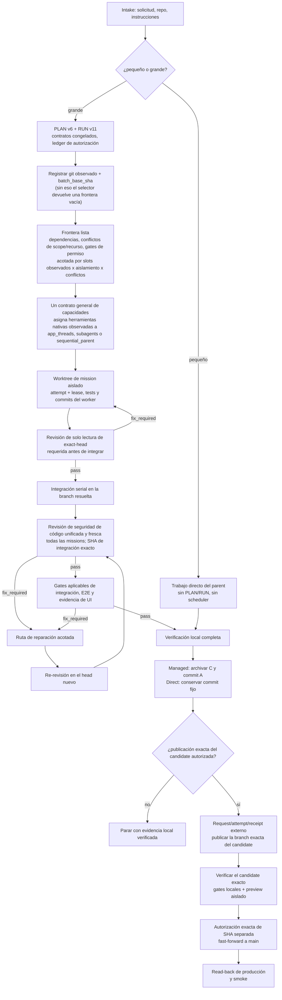

<p align="center">
  
</p>

<p align="center">
  <a href="README.md">English</a> | <a href="README.zh-TW.md">繁體中文</a> | <a href="README.zh-CN.md">简体中文</a> | <strong>Español</strong>
</p>

<p align="center">
  <a href="https://github.com/Phlegonlabs/product-delivery-harness/actions/workflows/harness-ci.yml"></a>
  
</p>

# Product Delivery Harness

Repositorio de skills para convertir una idea de producto o una solicitud de cambio en un flujo de entrega verificado con Codex, Claude Code, Pi o cualquier host que descubra un directorio de skills de usuario.

No es una colección de prompts. La suite de skills separa la definición del producto, el diseño visual, la ejecución de ingeniería, la revisión de seguridad de código, la activación y la revisión post-release de crecimiento orgánico, para que cada etapa tenga una única fuente de verdad, una entrega con límites claros y su propia verificación.

> Define el producto. Compila el diseño. Entrega software verificado.

**Úsalo:** [Instalación](#instalación) | [Empieza aquí](#empieza-aquí) | [Prompts típicos](#prompts-típicos) | [Qué incluye](#qué-incluye) | [Skills independientes](#skills-independientes)<br>
**Entiéndelo:** [Cómo encaja el sistema](#cómo-encaja-el-sistema) | [Referencia operativa](#referencia-operativa)<br>
**Mantenlo:** [Mantén los skills](#mantén-los-skills) | [Releasing](#releasing) | [Historial de versiones](#historial-de-versiones)

## Instalación

El repositorio es público. Necesitas Python 3.10 o posterior, Git y al menos un host que descubra `~/.agents/skills/`.

Para comprobar el acceso al repositorio público antes de clonarlo, ejecuta:

```bash
git ls-remote https://github.com/Phlegonlabs/product-delivery-harness.git HEAD
```

### Configuración más rápida

Clona el repositorio y ejecuta el instalador. Primero toma un bloqueo único para todo el destino, prepara solo los archivos runtime de los siete skills registrados en el índice de Git, dejando los tests y los datos de tiempos de CI en el repositorio fuente, mueve los IDs gestionados actuales y heredados a un backup con timestamp bajo `~/.agents/skill-backups/product-delivery-harness/`, instala los árboles preparados y verifica cada ruta y byte antes de liberar el bloqueo:

```bash
git clone https://github.com/Phlegonlabs/product-delivery-harness.git
cd product-delivery-harness
./install.sh             # macOS / Linux / Git Bash
# Windows PowerShell: powershell -ExecutionPolicy Bypass -File install.ps1
```

Instala antes de validar las dependencias Python fijadas, incluido Pillow:

```bash
python -m pip install -r skills/delivery-harness/requirements-test.txt
```

No existe un equivalente seguro de copia directa para actualizar: omitiría el manifest de archivos registrados, el bloqueo del destino, los marcadores de propiedad, la verificación completa y el rollback. Si ninguno de los instaladores puede ejecutarse, detente y repara el entorno en vez de copiar sobre una instalación existente.

<details>
<summary><b>Salvaguardas del instalador, migración heredada, comprobaciones entre skills y dependencias</b></summary>

El instalador omite caches de Python reproducibles y rechaza cualquier otro artefacto sin seguimiento o ignorado, incluidos `.env` y `.dev.vars`; los examples registrados siguen permitidos. Bash y PowerShell comparten el mismo bloqueo. Ambos rechazan modos tracked symlink/gitlink y componentes junction/reparse en source, destination, backup, staging y targets gestionados antes e inmediatamente alrededor de cada mutación. Cada target nuevo conserva un marcador del intento, por lo que rollback solo elimina rutas del propio intento y restaura el backup; conserva rutas concurrentes. Repetir el instalador requiere autorización y sesiones detenidas. Reinicia el host solo después del éxito. Cada ejecución imprime el SHA de HEAD de origen y si los archivos registrados de `skills/` tienen cambios sin commit; una instalación correcta escribe esa línea en `<backup>.source`, junto a su backup. Los bytes sin commit se siguen instalando, pero el registro los hace rastreables.

Al actualizar desde 0.23 o anterior, ejecuta el instalador: archiva los directorios heredados bajo sus IDs originales en el mismo backup e instala los siete skills actuales: `delivery-harness`, `product-definition-builder`, `ui-design-builder`, `design-system-compiler`, `code-security-review`, `product-activation` y `seo-growth-review`. El mapa es `full-harness` → `delivery-harness`, `prd-builder` → `product-definition-builder` y `product-design-builder` → `design-system-compiler`; el instalador verifica que los IDs heredados ya no sean descubribles.

Los siete skills pueden invocarse por separado; sus modos compartidos validan el Product package aprobado y las identidades exactas. El contrato retenido `ui-design/2` comprueba PRD → HiFi, contenido, CSP y evidencia offline y de navegador, con un par `design-system/3` cuando sea necesario; `ui-design/3` añade el paquete obligatorio `design-system/4`, los RUN de Harness 0.59+ congelan también su HTML derivado y los pins anteriores no pueden consumir `ui-design/3`. Harness envía `design-system/4` al checker del design-system compiler. Con un pin 0.59, solo un frozen maintenance record validado puede retener `ui-design/2`; un enhancement requiere `ui-design/3`. Los `surfaceContracts` híbridos coinciden con cada superficie aprobada, capture mode y conjunto responsive. Los contratos antiguos conservan sus comprobaciones. Deployment, Activation, Outcome Review y los informes SEO guardados comparten la identidad de producción.

Los Skill Bindings quedan unresolved hasta observar candidatos y recibir confirmación del owner. El manifest público fija source locator e install route para ambos requisitos UI: usa el skill installer del host para instalar `frontend-design` desde la ruta Anthropic registrada, e instala Impeccable con `npx impeccable install` (la ruta npx actual requiere Node.js 22.18+). Ejecuta después `check_external_skill_dependencies.py`; un árbol upstream cambiado no puede sustituir silenciosamente los bytes fijados. Harness posee conformance/compilation e Impeccable sigue requiriendo autorización separada.

Los build/test locales gestionados usan las herramientas del proyecto sin Docker/Podman por defecto. Solo los verifiers que seleccionan contenedores requieren un runtime instalado por administrador y su política de confianza (`runtime-trust.md`). La publicación de archivos conserva su política de máquina y firma separadas (`branch-promotion-contract.md`); el instalador no crea estas políticas privilegiadas.

</details>

<details>
<summary><b>Flujo Zero-to-one de la idea de producto al resultado medido</b></summary>

### Flujo Zero-to-one

1. Instala un host soportado y los siete skills. El instalador bloquea el destino, respalda IDs gestionados, copia solo archivos tracked runtime, dejando los tests y los datos de tiempos de CI en el repositorio fuente, y verifica cada byte; reinicia el host.
2. Empieza con `product-definition-builder`: evidencia research-first, drafting/reconciliación del candidate, decisiones explícitas de recommendations, cambios accepted, stack coherente, release targets tipados, tests, Stack Decision Checkpoint y Product Definition Approval humana. Su entrada conserva ownership y approvals; authoring, self-review, preflight y domain routing usan sus lecturas obligatorias de stage.
3. Para UI, ejecutar el preflight de Product Definition con `--ui-contract ui-design/3`, intake, tres estudios renderizados con autorrevisión del autor, selección del owner y HiFi completo. Comprobar HiFi antes de Impeccable/H1–H9 y una Visual Approval humana. Su entrada conserva ownership y approvals; authoring, self-review, preflight y domain routing usan lecturas obligatorias de stage.
4. Compilar el par Markdown/JSON `design-system/4` y su HTML derivado desde fuentes aprobadas y validar la UI final. Un RUN 0.59 retiene `ui-design/2` solo detrás de un frozen maintenance record validado; un enhancement compila el paquete actual. Un par retenido compila schema-3 solo si su gate es `required`; si es `not_required`, registrar la disposición del par existente y vincular el reemplazo HiFi aprobado.
5. Invoca `delivery-harness`. Su size gate mantiene directo un único escritor acotado sin cargar el archivo de etapa gestionada; el trabajo grande sigue las [rutas de etapa obligatorias](skills/delivery-harness/references/stages/managed-delivery.md) y crea PLAN-v6/RUN-v11. Obtén autorización exacta antes de cada acción que cambie estado.
6. Antes del launch gestionado, pasa los joins y ejecuta `python "<delivery-harness-skill-root>/scripts/harness_transition.py" --plan docs/goal/PLAN.md --run docs/goal/RUN.md --repo-root <absolute-root> record-observation`; `--probe-sandboxes` es solo diagnóstico. Usa worktrees aislados y comandos host por defecto; los contenedores seleccionados explícitamente conservan la imagen fijada y sus controles.
7. Completa reviews exact-head, security checks ordenados, un `code-security-review` nuevo, regresión amplia y evidencia UI por plataforma.
8. Solo para managed, cierra RUN. Ejecuta dry-run/apply de `archive_run.py` con evidencia exacta de `main` y un `--anchor-out` externo absoluto; haz commit del move con journal y del receipt como A, y reverifica contra el anchor. Direct conserva su candidate fijo y omite el archivo RUN.
9. Con autorización action-time separada, prepara A mediante anchor y request/attempt/receipt inmutables. El trusted host los recarga, valida, publica la URL exacta sin force y firma evidencia; recovery verifica y lee A. El agente local nunca ejecuta ese argv.
10. Ejecuta gates aislados non-production contra el candidate exacto leído. Si falla tras A, crea un PLAN/RUN de continuación desde A, cierra C2, liga el estado previo y archiva A2 con anchor nuevo.
11. Con otra autorización exact-A, fast-forwardea el candidate sin cambios a `main`, léelo de vuelta y verifica producción.
12. Ejecuta `product-activation` con acciones exactas, read-back independiente, evidencia, readiness y measurement sources.
13. Tras cada ventana por target, ejecuta Outcome Review append-only; para hosted-web público, `seo-growth-review` es opcional.

</details>

<details>
<summary><b>Ejecutar skills instalados y comprobar la publicación</b></summary>

### Ejecutar skills instalados y comprobar la publicación

Resuelve cada `<skill-name-skill-root>` al directorio absoluto instalado (normalmente `~/.agents/skills/<skill-name>`), entrecomilla la ruta del script y conserva el directorio de trabajo y `--repo-root` en el proyecto destino. Las rutas `skills/<name>/scripts/` de las referencias son rutas lógicas de instalación; no requieren copiar skills al proyecto. Los comandos de mantenimiento del repositorio conservan sus rutas relativas.

Skill Bindings comprueba todos los slots por defecto. Product Definition usa `--stage product-definition` y permite filas futuras `pending`/`pending`. UI y compilación usan `ui-design` y `design-compilation`; `backend` solo aplica a un producto headless confirmado o un alcance exclusivamente backend. Cada etapa comprueba los pins del árbol instalado completo; un resultado anterior no aprueba una etapa posterior.

Aprueba los archivos UI en sus rutas lógicas finales dentro de un checkout de publicación autorizado por separado, con el mismo HEAD y todo el historial Git. `check_ui_publication.py` compara los bytes upstream y ejecuta los gates Product y UI finales; después de publicar con autorización, `--published` verifica los bytes transferidos. `.ui-staging` contiene solo borradores sin aprobación. `sourceBindings.uiDesign.sha256` usa `ui_approval_digest.py`, excluyendo los enlaces derivados del par/replacement y, en `ui-design/3`, las líneas Package action y disposición del par, para que un paquete sin cambios pueda pasar a `reuse`; los demás bindings usan el hash del archivo original. Los productos homogéneos usan un conjunto responsive global; los híbridos usan `surfaceContracts` por superficie y el stack aprobado.

Cambios de Design System Compiler en 0.55.0: `stylingMechanism` sigue siendo un enum cerrado, pero solo tiene que nombrar el styling approach literal del Stack guardado en `stackSemantics.stylingMechanism` (por ejemplo `plain CSS` para `modern vanilla CSS`, o `platform theme` para estilos nativos). El preflight sin par no tiene comando propio; se ejecuta dentro de `check_design_system_pair.py --repo-root`. `tokenSources` y `primitiveSources` deben ser rutas exactas relativas al repositorio. `check_color_contrast.py` acepta primeros planos `#RGBA` y `#RRGGBBAA` sobre un fondo opaco, y `check_type_scale.py` acepta tamaños rem y em con `--root-font-size` (16px por defecto). Sus límites de line-height de 1.5 para texto y 1.1 para títulos son mínimos de legibilidad propios, no reglas WCAG AA. El join legacy de Harness ahora comprueba los pares design-system/2 contra la raíz del repositorio.

La publicación HTTPS privada admite la política administrativa de credential-helper y endpoint exacto descrita en `trusted-host-publication.md`. El request fija hashes de política/helper; prepare, push del trusted host y recovery rechazan cambios y no heredan helpers arbitrarios del usuario/repositorio. La evidencia no contiene credenciales. Activation puede preparar requisitos previos al despliegue con SHA fijo y autorización externa separada; readiness y verified measurement handoff aún requieren evidencia del despliegue exacto. Sus comandos incluyen PRD, arquitectura, deployment, stack decisions, activation y repository root.

La publicación por trusted host y el push legacy (anterior a 0.38) de la run branch se ejecutan aislados de hooks, fsmonitor y askpass del repositorio: `core.hooksPath` apunta a un directorio vacío nuevo, `core.fsmonitor` está desactivado y askpass está vacío. El preflight de configuración Git trata la config compartida de un linked worktree y `config.worktree` como config del repositorio, y rechaza un `core.askPass` del repositorio; los ajustes TLS, header y cookie limitados a una URL se rechazan en el acceso remoto y la publicación, mientras que las lecturas locales en un checkout de CI siguen funcionando. La salida de Git y del verifier se lee como UTF-8. Queda una ventana corta entre la recomprobación remota y el push sin force, en la que otro actor podría hacer fast-forward de la run branch a un ancestro de A, así que limita el acceso de push a la run branch al trusted host. La publicación de la run branch usa el trusted host porque su evidencia firmada es estado del archivo; la promoción a `main` es un push normal sin force con autorización separada y no requiere publicar antes A en su run branch.

</details>

Un registro `deployment/2` añade Release Source Provenance. Cada destino vincula por hash un JSON de observación retenido y acotado: repository, refs source y resolved, source SHA, artifact, hora de observación y output real de command o provider. El caller aporta `repo-root` y `expected_repository` de forma independiente; un ref simbólico candidate/1 también necesita un `candidate_ref` concreto. El validator solo lee bytes, nunca ejecuta commands ni consulta providers, y trata el hash como integridad, no autenticidad. La preparación pending y la inspección histórica siguen siendo válidas. Las comprobaciones completas de Deployment, incluidas resource isolation y record validity, gobiernan ready closeout, verified sources, SEO y Outcome. Los subsets explícitos no sustituyen los inventarios completos; blocked y all-n/a conservan compatibilidad.

Prueba estricta de symbolic candidate:

```bash
python "<delivery-harness-skill-root>/scripts/check_deployment.py" --deployment docs/DEPLOYMENT.md --architecture docs/product/architecture.md --require-source-provenance --repo-root <actualFrozenRepo> --expected-repository <owner/repository> --candidate-ref <candidate-ref>
```

## Empieza aquí

| Si tienes... | Empieza con | Lo que obtienes |
| --- | --- | --- |
| Una idea de producto | `product-definition-builder` | Una Product Definition aprobada con arquitectura frontend/backend completa, stack, comportamiento UI, release targets y tests |
| Product Definition aprobada que necesita UI | `ui-design-builder` | Preflight del PRD, intake, selección de dirección, HiFi completo, comprobaciones, Impeccable/H1–H9, Visual Approval y decisión de design-system |
| Un cambio acotado en un repositorio existente | `delivery-harness` | Implementación directa para trabajo pequeño, o un flujo gestionado PLAN/RUN para trabajo grande |
| Un candidato de código integrado y fijado | `code-security-review` | Una revisión de seguridad de solo lectura, sobre el SHA exacto, con hallazgos validados de source-to-sink y brechas de cobertura explícitas |
| Un release entregado que necesita configuración externa | `product-activation` | Acciones de console autorizadas con exactitud, fuentes de medición verificadas y readiness de activación target por target |
| Un sitio público en producción que necesita análisis SEO o de crecimiento orgánico | `seo-growth-review` | Una revisión técnica y de medición de solo lectura, oportunidades de keyword/página ordenadas por evidencia y follow-ups enrutados |

Cada uno de los siete skills incluidos se puede invocar por separado; el pipeline completo es opcional. Cada modo igual valida sus inputs y dependencias declaradas.

<details>
<summary><b>Biblioteca de referencias opcional y catálogos de tecnología, diseño y Cloudflare</b></summary>

Una biblioteca de referencias opcional compara 19 dominios de tecnología y diseño sin elegir un stack por defecto. La [regla de selección](skills/delivery-harness/references/reference-selection.md) parte de la necesidad y lee solo el dominio relevante bajo [option-library](skills/delivery-harness/references/option-library/README.md). Conserva un stack existente y saludable; CSS/Tailwind, icons, Cloudflare, Expo/React Native, GSAP o cualquier proveedor no son obligatorios. Las decisiones adoptadas se registran en los documentos existentes de product, architecture, stack, UI o tareas; no se añaden gates, registros, runtimes ni autoridad de aprobación.

El catálogo frontend compara TanStack Start/Router y su ecosistema como opciones separadas. Los ejemplos de arquitectura cubren stacks completos de React gestionado, React portable, contenido, tiempo real, Python y aplicaciones de negocio. Incluyen HTML dirigido por el servidor, sincronización local-first, workflows durables, aislamiento de datos por tenant, contenido headless/comercio condicional y APIs tipadas independientes, con pruebas de fallos y costes de salida. Las observaciones de madurez tienen fecha; la adopción sigue en el checkpoint de stack de cada proyecto.

Las referencias de diseño incluyen bases de componentes, ocho direcciones visuales y búsqueda manual en Mobbin, Dribbble, Awwwards, Refero y MotionSites. El propietario comparte casos, enlaces al sitio original o capturas; no se añade una conexión MCP de referencias de diseño. React Bits aporta componentes con efectos y Anime.js un motor de animación; reutilización y dependencias conservan las decisiones existentes de stack y licencia.

El informe de visibilidad de docs-weight incluye el Markdown opcional anidado de references y no añade una gate.

El catálogo de Cloudflare separa compute, datos, agentes/búsqueda, navegador/sandbox, medios/email y analítica. Basin, K2, Artifacts, adaptadores, CLI y skills conservan comprobaciones de madurez o migración con fecha; su inclusión no confirma instalación local, disponibilidad en la cuenta ni preparación para desplegar.

Void es una ruta opcional de SDK/CLI full-stack. El routing nativo o por framework sigue siendo una decisión de stack; Cloudflare directo continúa siendo `cloudflare`, y una plataforma Void de equipo es otra decisión de deployment. El Preview de Void requiere una ruta de build/config probada o un despliegue aislado aprobado mediante Void.

</details>

<details>
<summary><b>Traducción de diseño, movimiento, targets de plataforma y vigencia del diseño</b></summary>

### Traducción de diseño y patrones reutilizables

App + Web complementaria usa un PRD con superficies separadas para iOS, Android y el sitio público; una aplicación Web autenticada se incluye solo cuando está en alcance. React Native + Expo es una opción de referencia, no un stack obligatorio ni predeterminado; la elección depende del producto y respeta decisiones ya aprobadas. El [contrato de App y Web](skills/product-definition-builder/references/mobile-stack-selection.md#app-and-companion-web-contract) define tamaños móviles, anchos Web, código compartido y diseño, pruebas y releases por plataforma. Elegir Expo no selecciona el stack del sitio ni autoriza servicios EAS de pago.

Las reglas internas de HiFi exigen medir controles comprimidos, alineación, contenido recortado y capas abiertas, y revisar patrones genéricos según la tarea del producto. Comprueba textos largos, ampliación de texto y anchos intermedios; conserva evidencia por elemento y corrige las causas compartidas. Ocultar overflow o subir una puntuación no resuelve un layout roto. Se usan las revisiones existentes sin exigir Hallmark.

La [guía de fuentes de diseño moderno](skills/ui-design-builder/references/modern-design-sources.md) conecta accesibilidad Web, guías de Apple/Android y prácticas recientes de diseño con IA de Anthropic/Google Labs con el handoff y la revisión existentes. Distingue normas de consejos estéticos y conserva plataforma, anchos y límites de reparación. Los [perfiles por página](skills/ui-design-builder/references/page-design-profiles.md) adaptan Taste: landing/portfolio pueden seleccionar tipografía distintiva, titulares de una o dos líneas en escritorio y movimiento expresivo obligatorio; paneles, datos y formularios priorizan legibilidad y respuesta funcional. Registra decisiones y excepciones móviles, de traducción y movimiento reducido en el brief existente, conservando decisiones aprobadas.

El [enrutador de movimiento y medios](skills/ui-design-builder/references/motion-and-media-routing.md) define ahora una escala clara: CSS/WAAPI, luego Motion, GSAP y Three.js, cada uno solo si el stack aprobado lo incluye. Higgsfield aporta medios generados, incluidos modelos GLB para una región Three.js aprobada. Si el propietario no indica una postura de movimiento, la propuesta sigue lo que la página muestra realmente y se reproduce en el estudio de dirección. El uso de proveedores, sus regiones y el límite de coste se preguntan una sola vez en la intake de diseño. El HiFi incrusta medios como `data:`; una biblioteca que no puede ejecutarse allí usa una aproximación determinista y queda marcada para verificarse en el primer tramo de implementación. H6 también evalúa la calidad del movimiento, y cada referencia inspeccionada conserva captura o grabación y la licencia de cualquier código de plantilla adaptado.

Los estudios y HiFi usan los responsive targets exactos del PRD aprobado. La plantilla Wireframe histórica conserva ejemplos de 390, 768, 1024 y 1440 px: son anchos de revisión, no breakpoints obligatorios ni una etapa nueva.

El prompt de diseño lee directamente el UI Surface Contract del PRD. La fila Page-purpose mapping del Design Brief registra restricciones y libertad creativa; no se duplican requisitos por página. Se comparan casos primarios y de estrés antes de ampliar la dirección seleccionada a HiFi completo. El PRD define comportamiento y contenido; el diseñador decide composición y expresión visual.

Los cambios incrementales preservan el alcance no nombrado. Una **reconstrucción completa del diseño conservando el PRD** empieza composición y dirección nuevas bajo el contrato realmente cargado, manteniendo producto, stack, copy y problemas conocidos. Los archivos y aprobaciones previos son historia; sustituir, archivar e instalar conserva sus permisos. El nuevo alcance iOS parte de iPhone, con casos de teléfono pequeño/grande y Dynamic Type; iPad es opcional sin eliminar requisitos aprobados. HTML no demuestra comportamiento nativo.

Las siete [recetas de composición](skills/ui-design-builder/assets/templates/composition-patterns.json) siguen como referencias opcionales para direcciones/HiFi: cuatro Web y tres iPhone. Se pueden seleccionar, adaptar o descartar. Conservar texto bilingüe, etiquetas de idioma/dirección, textos largos y la matriz del PRD. Ninguna receta impone hero/features/CTA.

Tras actualizar skills y antes de implementar, [design freshness](skills/ui-design-builder/references/design-freshness.md) compara hashes de artefactos y entradas, procedencia del skill y dependencias. Una identidad desconocida sigue desconocida; cambiar el skill exige revisión semántica, no rediseño automático. `check_design_freshness.py` es de solo lectura y no aprueba diseños. Incluye todas las páginas HiFi y ejecuta los validadores completos. Si hay evidencia de que la implementación no empezó, resuelve primero las brechas de diseño.


</details>

## Prompts típicos

Codex acepta la forma `$skill-name` de abajo. En Claude Code o cualquier otro host, pide el skill por nombre, como `product-definition-builder`. En Pi, usa su project skill descubierto o pasa el directorio del skill con `--skill`, y luego pide `delivery-harness` por nombre.

```text
Usa $product-definition-builder para definir este producto, incluyendo arquitectura frontend/backend completa, decisiones de data/auth/deployment, stack coherente, comportamiento UI, release targets, tests y Product Definition Approval. Detente antes del diseño de UI.
```

```text
La Product Definition está aprobada. Usa $ui-design-builder con el contrato `ui-design/3` y $frontend-design obligatorio. Ejecuta el preflight del producto, lee directamente el PRD UI Surface Contract y muestra tres direcciones materialmente distintas sobre los mismos casos representativos para que yo elija.
```

```text
Elegí una dirección. Continúa $ui-design-builder con $frontend-design: crea el HiFi conectado completo, ejecuta el preflight de completitud del HiFi y luego critique y audit de $impeccable solo con su autorización más scoring H1-H9. Pide una sola Visual Approval completa de texto, estructura, menús de producto, pestañas, visuales y tokens, después usa $design-system-compiler para el par obligatorio `design-system/4` y su HTML derivado congelado.
```

```text
Usa $delivery-harness para implementar el plan aprobado, construyendo cada página desde su referencia HTML aprobada en docs/design/ui-references/ dentro de la tolerancia registrada.
```

```text
Usa $delivery-harness para revisar la app existente, planificar el trabajo requerido y detenerte antes de implementar.
```

```text
Usa $delivery-harness para implementar el plan aprobado. Crea una branch y haz commit del cambio verificado, pero no hagas push ni abras un PR.
```

```text
Usa $delivery-harness solo si el size gate elige la ruta direct: implementa este cambio acotado, verifica un candidate fijo y publica esa branch no-default bajo esta autorización exacta. Detente si se requiere PLAN/RUN; managed necesita una petición nueva después de archivar.
```

```text
La entrega está completa. Usa $product-activation para los targets de release de producción, configura solo las acciones externas exactas que apruebo, verifica cada resultado por read-back, y detente después de registrar el readiness de activación y el handoff de la ventana de medición.
```

```text
El RUN está completo en su branch no-default. Usa $delivery-harness para previsualizar y archivar la coordinación en esa misma branch, verificar el candidate de archivo y detenerte antes de push o promoción a main.
```

```text
El candidate archive-only A está verificado. Prepara su request inmutable de publicación para el trusted host desde el anchor externo y detente. No ejecutes localmente el comando emitido; espera evidencia separada del trusted host y recovery.
```

```text
La ventana de medición de producción cerró. Usa $product-definition-builder para validar Outcome Review contra métricas PRD, señales TEST, Deployment, hash de Activation y fuentes MS verificadas.
```

```text
Usa $seo-growth-review para auditar este sitio en producción, reconciliar la visibilidad de Search Console con los resultados on-site de GA4, priorizar oportunidades de keyword y página basadas en evidencia y enrutar cada cambio propuesto sin modificar el sitio ni las cuentas externas.
```

```text
Usa delivery-harness en este host para ejecutar este plan. Observa las capacidades nativas y conserva los roles, modelos y fallbacks instalados.
```

Para una entrega multi-mission, declara el resultado local y remoto previsto. La creación de branches, los commits, la integración, cada push, el despliegue, la eliminación de worktrees y el borrado siguen siendo acciones separadas. La promoción post-RUN solo puede actualizar `main` con autorización exacta al momento de la acción, prueba de fast-forward, read-back y testing completo del candidate.

## Qué incluye

| Skill | Úsalo para | Salida principal |
| --- | --- | --- |
| `product-definition-builder` | Discovery, research, security requirements, comportamiento medible de producto/UI, arquitectura frontend/backend completa, stack coherente, release targets, tests y Product Definition Approval | `PRD.md`, `architecture.md`, `stack-decisions.md` y artifacts de research aprobados |
| `ui-design-builder` | Preflight del PRD, intake, tres direcciones por defecto, HiFi completo, comprobaciones, Impeccable/H1–H9, Visual Approval y Design System Need Gate; lecturas obligatorias de stage poseen el detalle de authoring y routing | `docs/design/ui-design.md`, estudios y paquete HiFi completo aprobado |
| `design-system-compiler` | Compilar el target aprobado de `ui-design.md` en el par design-system congelado tras Visual Approval cuando sea necesario, más su specimen book HTML ligado a la fuente; las lecturas obligatorias de stage poseen el detalle de compilación, validación, publicación y routing | `docs/design/design-system.md`, `docs/design/design-system.json`, `docs/design/design-system-preview.html` |
| `delivery-harness` | Size gate compartido, security task gates, PLAN/RUN, autorización, verificación local e integración, más la referencia de adaptadores de runtime (`references/runtime-adapters.md`) que contiene un contrato general de capacidades que el agente asigna a las herramientas nativas observadas | Trabajo directo o `PLAN.md` + `RUN.md` |
| `code-security-review` | Revisión de seguridad de solo lectura tras la implementación y la integración unificada, preferentemente en un agente sibling fresco; el penetration testing activo y la remediación quedan fuera de este skill; las lecturas obligatorias de stage poseen inputs, workflow y handoff detail | Decisión de SHA exacto, cobertura de trust boundaries, hallazgos validados y tests de remediación |
| `product-activation` | Configuración post-entrega para todos los targets web, API/backend, iOS, Android, macOS, Windows, browser-extension e híbridos compatibles, incluyendo capability routing, autorización exacta de acciones externas, read-back, fuentes de medición y handoff del outcome review; las lecturas obligatorias de stage poseen inputs, execution, status handoff y reporting detail | `docs/ACTIVATION.md` |
| `seo-growth-review` | SEO técnico post-release de solo lectura, integridad de medición, keyword research, diagnóstico de tráfico orgánico y priorización de oportunidades query-to-page; las lecturas obligatorias de stage poseen inputs, review method y reporting detail | Revisión inline por defecto; informe datado opcional con pedido explícito |

<details>
<summary><b>Cómo dimensiona el trabajo el núcleo de entrega: directo o gestionado</b></summary>

El núcleo de entrega toma una decisión de tamaño antes de invocar la orquestación gestionada:

- El trabajo pequeño sigue directo sin PLAN/RUN, pero resuelve los roles obligatorios antes de elegir ejecutor. La autoría UI usa el frontend worker configurado por el host, no el padre. Delegar análisis de solo lectura no exige un RUN gestionado.
- El [contrato de delegación del padre](skills/delivery-harness/references/delegation-contract.md) se aplica a Product Definition, UI Design y entrega. Dos preguntas sustanciales independientes requieren instancias distintas de investigador/explorador cuando hay autorización y capacidad; los límites de capacidad se resuelven por lotes. La API pura `readonly-assignments/1` une resultados por identidad de asignación, intento e inputs congelados, admite distinto orden y rechaza resultados ausentes, duplicados, obsoletos o con workers reutilizados. La observación de lanzamiento del padre se verifica por separado de las declaraciones del hijo. Los roles obligatorios y permisos externos se comprueban antes del lanzamiento; un delegado obligatorio ausente nunca se sustituye silenciosamente por el padre. El fallback sigue la política del host para indisponibilidad explícita, comprobando terminación y trabajo parcial. Cada checkout tiene un solo escritor, incluido el padre; las revisiones independientes requieren sus herramientas reales.
- Las tareas de arquitectura empiezan con un ejemplo de llamada y definen quién controla el estado y cómo recuperar fallos. Las revisiones de código aplican el método a los límites afectados. Las correcciones locales conservan las decisiones aceptadas.
- El trabajo grande entra en planificación gestionada. Puede usar `PLAN.md` y `RUN.md` para una entrega gestionada-secuencial o para múltiples missions y handoff durable; `new_run.py` escribe el `docs/tasks.md` inicial con `--out` y `--repo-root`, y las transiciones gestionadas `accept-wave`, `record-worker-result`, `reject-worker-result`, `record-integration`, `reconcile-candidate-head`, `reconcile-coordination-head`, `reconcile-interrupted`, `reconcile-interrupted-reviews` y `close-wave` con `--repo-root` lo refrescan conservando el Update Log. Un fallo de proyección nunca revierte el RUN; el `render_tasks_view.py` independiente repara o verifica esa vista no canónica. Este repositorio fuente no mantiene un log de flujo `Tasks.md` raíz separado.

Cada checkpoint requerido de integración o cierre de wave puede comprometer sus archivos exactos de coordinación como un hijo directo ordinario y luego observar y ligar ese head con `reconcile-coordination-head`. El guardia acepta solo rutas exactas compatibles de coordinación/generated-view, excluye producto y fuentes de diseño congeladas, verifica identidad live/observed y bytes limpios de producto, conserva evidencia previa y reabre reviews/gates del head exacto actual; los missions aislados pueden continuar mientras los reviewers y comprobaciones del parent están quietos.

- El selector deriva `managed_sequential` para menos de dos missions de escritura segura realmente seleccionadas y `parallel_graph` para dos o más. El fan-out del scheduler arranca solo para el segundo; el runtime driver sigue siendo un hecho de transporte separado. El núcleo usa un contrato general de capacidades; el agente asigna las herramientas actuales sin secciones por proveedor.
- La ejecución del RUN nunca espera al CI remoto. La promoción de branches es una etapa de closeout separada: la verificación del candidato exacto y del preview environment aislado aplicable debe terminar antes de que `main` pueda moverse.

Solo RUN y su vista tasks generada y declarada son excepciones al checkout limpio; los hashes del verifier protegen ambos. Los cambios de producto y las vistas escritas a mano siguen bloqueando. Las operaciones rutinarias de RUN usan transiciones protegidas; una revisión formal conserva el historial y requiere nueva autorización exacta. Si solo hay layers `Selected`/`Required` sin una opción nueva aprobada, conserva `Approved option map: None` y omite el generador opcional. El validador acepta `None` sin distinguir mayúsculas y permite omitir la tabla solo cuando no hay layers ni opciones recién aprobados.

Tamaño significa scope de coordinación y blast radius, no un conteo bruto de archivos o líneas. Si el trabajo pequeño crece, el Harness conserva el trabajo completado y planifica solo el resto.

</details>

## Skills independientes

[README Studio](standalone-skills/readme-studio/SKILL.md) ayuda a otros proyectos a escribir un README de GitHub con identidad de marca, demostraciones reales, un inicio rápido útil y comprobaciones para cada plataforma de presentación. Su [biblioteca de casos fechados](standalone-skills/readme-studio/references/case-library.md) incluye Starship, Bruno, Transformers, tldraw y Vite. El trabajo visual sigue la ruta frontend del proyecto y entrega evidencia antes/después.

Las imágenes de un registry necesitan una URL que funcione en ese destino; incluirlas en el paquete no demuestra que se rendericen allí.

[Release Packager](standalone-skills/release-packager/SKILL.md) prepara los artefactos aplicables para Node/Bun, Python, Go/Rust, contenedores y aplicaciones de escritorio/móviles con las herramientas nativas del proyecto. Comprueba el contenido real y las rutas de instalación/uso, y concilia el README con los datos del release. La compilación, las firmas, las pruebas de instalación y la publicación conservan evidencia separada; los runners o datos de firma ausentes quedan como pendientes. No añade un pipeline CI automático.

Estas fuentes son independientes del bundle de siete skills; `install.sh` e `install.ps1` no las instalan. Abre el `SKILL.md` enlazado y sus referencias en tu host, o registra el directorio completo mediante el mecanismo de descubrimiento que admite ese host. El registro es una acción local separada; este repositorio no lo instala automáticamente. Una vez disponible, usa `$readme-studio` para mejorar un README o `$release-packager` al preparar un release. Conserva el idioma, la licencia y los canales del proyecto; la publicación sigue su autorización existente.

## Cómo encaja el sistema

```mermaid
flowchart LR
  Idea["Idea de producto o solicitud de cambio"] --> PRD["Candidate de Product Definition\nPRD + arquitectura + stack"]
  PRD --> Market["Investigación de mercado posterior al borrador"] --> ProductGate{"Stack Decision + autorrevisión PRD +\nProduct Definition Approval"}
  ProductGate -->|"UI aprobada, solicitud explícita"| UIDesign["ui-design-builder\nintake + direcciones + autorrevisión UI"]
  UIDesign --> UIReview["dirección elegida + HiFi completo\ncobertura + autorrevisión + Impeccable + H1–H9"]
  UIReview --> Design["target HiFi aprobado\ndesign-system-compiler cuando se requiere"]
  ProductGate -->|"producto headless aprobado"| Harness["delivery-harness\nNúcleo de entrega compartido"]
  ProductGate -->|"mejora o mantenimiento acotado aprobado; sin gate de diseño afectado"| Harness
  Design -->|"referencia HTML de todas las páginas aprobada o par design-system"| Harness
  Harness --> Runtime["Capacidades nativas observadas\nUn contrato general"]
  Runtime --> Security["code-security-review\nrevisión unificada fresca de SHA exacto"]
  Security --> Evidence["Tests finales amplios y evidencia de UI"]
  Evidence --> Close["RUN cierra en el integration head exacto"]
  Close --> Archive["Archivar coordinación en la run branch\ncommit + revalidar candidate"]
  Archive --> Push["Request/attempt/receipt externo al checkout\npublicación exacta del candidate"]
  Push --> Candidate["Verificar el candidate SHA exacto\ngates locales + preview aislado"]
  Candidate --> Main["Autorización separada de fast-forward\nSHA exacto a main"]
  Main --> Activate["product-activation\nconfiguración externa + read-back"]
  Activate --> Outcome["Fuentes de medición verificadas\noutcome review posterior"]
  Activate -.-> SEO["seo-growth-review\nrevisión orgánica opcional"]
  SEO -.-> Outcome
```



<details>
<summary><b>Binding del design system, evidencia de tokens y autorrevisión antes de la entrega</b></summary>

Un paquete retenido `ui-design/2` no crea Wireframes grises ni ejecuta una etapa W1–W5. La composición, tipografía, jerarquía y responsive se exploran en estudios visuales y se verifican en HiFi. Las herramientas Wireframe quedan para inspección y validación histórica de solo lectura.

HiFi incluye Design Tokens derivados de estilos reales. Un paquete `ui-design/3` siempre compila `design-system/4`: su `showcase` liga cada variante primitiva, estado de componente y motion a un elemento del HiFi aprobado, y `design-system-preview.html` los presenta como specimen book sin inventar estilos. Para `ui-design/2`, si el Need Gate requiere un par formal, el compilador produce `design-system/3`. Ambos quedan ligados al PRD, arquitectura, stack, contrato UI y paquete HiFi aprobados, sin binding Wireframe.

HiFi conserva la procedencia del texto mediante `ui-hifi-copy/1` incrustado y bindings al DOM del producto. Se validan textos estáticos, contratos dinámicos e idiomas emparejados. Los tokens muestran valores, usos y variantes reales; el texto del visor no satisface la cobertura del producto.

Las observaciones conservan los valores originales y los valores normalizados por el navegador por separado, para comparar correctamente colores hexadecimales, dimensiones rem y pesos definidos por palabras clave.

Retoma una etapa solo cuando sus requisitos previos sigan vigentes. El [contrato de autorrevisión antes de la entrega](skills/delivery-harness/references/pre-delivery-self-review.md) exige revisar el paquete PRD tras la investigación posterior al borrador y los cambios aceptados; revisar estructura y direcciones UI antes de seleccionarlas; y revisar el HiFi conectado antes de la revisión independiente y Visual Approval. Registra versiones, hallazgos, reparaciones y bloqueos en el registro de trabajo existente. La autorrevisión no sustituye la revisión independiente ni las decisiones humanas. Una entrega inicial con UI solo inicia Harness tras completar las comprobaciones aplicables; diferir la UI no permite saltarlas. Los productos headless justifican los controles UI no aplicables, y las mejoras y el mantenimiento revisan su alcance aceptado. Es una comprobación semántica del parent; un validador exitoso no demuestra la autorrevisión.

Harness 0.57.0 elimina el atajo de UI diferida en entregas iniciales con UI, incluso si empiezan por backend. La comprobación de bindings backend no exime este handoff. Si una tarea nueva consume aprobaciones anteriores, realiza ahora las autorrevisiones del alcance aplicable y registra identidades de aprobación y candidato, sin antedatar evidencia ni reabrir decisiones sin cambios. Los RUN fijados a versiones anteriores conservan sus contratos.

</details>

<details>
<summary><b>Diagrama del ciclo de vida completo, gates de aprobación, despliegue, Activation, SEO y reglas comerciales</b></summary>

### Ciclo de vida completo de los skills

El ciclo de vida completo a través de los siete skills, con cada gate y los mecanismos transversales:

```mermaid
flowchart TB
    user([Idea del usuario o solicitud de cambio])

    subgraph PRD["product-definition-builder — definición de producto"]
        direction TB
        interview[Entrevista estructurada<br/>3 segmentos de texto libre + AskUserQuestion]
        pkg["Candidate del paquete core<br/>PRD.md + architecture.md<br/>+ stack-decisions.md"]
        mr["market-research.md<br/>(reconciliar candidate, omitible)"]
        rchoice{{"Recomendaciones de platform optimization<br/>owner accepts / revise / defer / reject"}}
        revision["Aplicar solo cambios accepted"]
        sgate{{"Stack Decision Checkpoint<br/>Required | Selected | Approved"}}
        pgate{{"Product Definition Approval<br/>todos los productos"}}
        ra["Evaluación research-first<br/>research-assessment.md (omitible)"]
        rgate{{"Research Gate<br/>go | clarify | stop"}}
        interview --> ra --> rgate --> pkg --> mr --> rchoice
        rchoice -->|accepted| revision --> sgate --> productself["Autorrevisión PRD del autor"] --> pgate
        rchoice -->|revise proposal| mr
        rchoice -->|none, deferred, or rejected; no blockers| sgate
    end

    subgraph DESIGN["ui-design-builder — diseño UI (petición explícita del owner)"]
        direction TB
        intake{{"UI Design Intake<br/>style + motion + media; esperar al owner"}}
        preflight["Preflight del PRD<br/>operations + states + responsive + copy"]
        studies["frontend-design<br/>tres direcciones por defecto"]
        style["frontend-design<br/>Style Integration + target HiFi"]
        hifi_review["Impeccable critique + audit<br/>scoring H1–H9"]
        vgate{{"Human Visual Approval"}}
        dgate{{"Design System Need Gate"}}
        pending["Marker required/pending aprobado<br/>ligado al digest de Visual Approval"]
        pair["Preflight + compile de design-system-compiler<br/>design-system.md + design-system.json"]
        linked["El owner liga los hashes<br/>validación UI final"]
        intake --> preflight --> studies --> directionself["Autorrevisión de estructura y dirección UI"] --> directionChoice{{"Selección de dirección"}} --> style --> completeness["Preflight de cobertura HiFi"] --> hifiself["Autorrevisión HiFi del autor"] --> hifi_review --> vgate --> dgate
        dgate -->|required| pending --> pair --> linked
        dgate -->|not_required| target[Target aprobado fiel a las páginas]
    end

    subgraph HARNESS["delivery-harness — núcleo de entrega"]
        direction TB
        route["System Review And Route<br/>(solo parent, de solo lectura)"]
        size{{"Project Size Gate"}}

        subgraph DIRECT["Ruta directa (pequeño)"]
            direct_impl["Implementar directamente -> verificación local<br/>-> revisión de seguridad de código -> acciones Git autorizadas"]
        end

        subgraph MANAGED["Ruta gestionada (grande)"]
            direction TB
            plan["PLAN v6<br/>typed graph: missions / reviews / gates<br/>allowed_providers + commits atómicos de task"]
            newrun["new_run.py genera<br/>RUN v11 + el ledger de autorización de 12 claves"]

            subgraph LOOP["Bucle de ejecución (por wave)"]
                direction TB
                lock["--session-id acquire-run-lock<br/>(run lock + heartbeat)"]
                obs["record-observation<br/>snapshot de Git vivo"]
                sel["select_ready_nodes.py<br/>selección determinista de la frontera"]
                accept["accept-wave<br/>(binding de base por lote)"]
                adapters["resolver el agent driver disponible<br/>bajo el contrato compartido"]
                lease["lease-worker<br/>(worktree + lease + graph binding)"]
                workers["workers agentes frescos y acotados"]
                record["record-worker-result<br/>revalida evidencia + actualización atómica del RUN"]
                review["revisión de exact-head<br/>(reserve -> reviewer -> record)"]
                integ["record-integration<br/>(serial; SHA del candidato unificado)"]
                lock --> obs --> sel --> accept --> adapters --> lease --> workers --> record --> review --> integ
            end

            plan --> newrun --> LOOP
            security["code-security-review<br/>sibling fresco; todas las missions; SHA exacto"]
            gates2["Validación final amplia<br/>(E2E / regresión / matriz de evidencia de UI)"]
            LOOP --> security --> gates2
        end

        route --> size
        size -->|pequeño| DIRECT
        size -->|grande| MANAGED
    end

    subgraph DEPLOY["Despliegue (plataforma conectada a Git)"]
        direction TB
        handoff["Managed: actualizar docs/DEPLOYMENT.md<br/>(targets tipados + nombres + tareas de consola)"]
        archive["Cerrar RUN y archivar coordinación<br/>commit + revalidar candidate"]
        push["Request/attempt/receipt externo al checkout<br/>publicación exacta del candidate de run branch"]
        directhandoff["Direct: actualizar Deployment<br/>conservar un candidate fijo verificado"]
        directpush["Publicación direct autorizada<br/>por separado"]
        preview["Los preview builds salen solos<br/>(la plataforma construye por push)"]
        merge([Fast-forward exacto a main<br/>autorizado por separado])
        prod["Despliegue a producción<br/>(la plataforma construye desde main)"]
        check["Verificación post-despliegue (solo lectura)<br/>check_deployment.py"]
        status["Reconciliar el registro de despliegue<br/>(estado + acciones humanas pendientes)"]
        handoff --> archive --> push --> preview --> merge --> prod --> check --> status
        directhandoff --> directpush --> preview
    end

    subgraph ACTIVATE["product-activation — activación post-entrega"]
        direction TB
        profiles["Seleccionar perfiles core + surface<br/>docs/ACTIVATION.md"]
        capability["Probar connector / API / CLI<br/>Browser / Computer Use / manual"]
        actions["Acciones ACT-* exactas<br/>autorización + read-back"]
        ready["Readiness de activación por target<br/>fuentes MS-* verificadas"]
        profiles --> capability --> actions --> ready
    end

    subgraph SEO["seo-growth-review — revisión post-release opcional"]
        direction TB
        seo_sources["Páginas de producción + fuentes verificadas<br/>Search Console / GA4 / estimaciones"]
        seo_review["SEO técnico + integridad de medición<br/>oportunidades query-to-page"]
        seo_route["Follow-ups priorizados y enrutados<br/>sin mutación directa"]
        seo_sources --> seo_review --> seo_route
    end

    subgraph OUTCOME["Revisión de outcome post-release"]
        outcome["docs/product/outcomes/YYYY-MM-DD-release-set.md<br/>(a pedido del owner, tras la ventana de medición)"]
        verdict{{"Veredicto: no_change | enhancement | incident"}}
        outcome --> verdict
    end

    subgraph CROSS["Mecanismos transversales (todas las etapas)"]
        bindings["Skill Bindings<br/>(tabla de slots en AGENTS.md + pins SHA-256)"]
        ledger["Ledger de autorización<br/>12 claves de acción independientes"]
        ver["Version gate + contract digest<br/>(frontera de wave compatible_old)"]
        watch["watchdog + reconcile<br/>(recuperación de interrupciones)"]
    end

    user --> interview
    pgate -->|producto UI aprobado y petición explícita| intake
    pgate -->|producto headless aprobado| HARNESS
    pgate -->|"mejora o mantenimiento acotado aprobado; sin gate de diseño afectado"| route
    linked --> route
    target --> route
    DIRECT --> directhandoff
    gates2 --> handoff
    status --> profiles
    ready --> outcome
    ready -.-> seo_sources
    seo_route -.-> outcome
    verdict -.->|siguiente solicitud de enhancement| interview
```

Product Definition Approval, UI Visual Approval y el merge a `main` son gates humanos separados. La autorización de publicación también es distinta: aceptar el contenido no autoriza sobrescribir ni mover archivos.

Las respuestas de aprobación y entrega de Product Definition y UI enumeran en el chat cada documento actual, con enlace Markdown absoluto verificado, propósito y estado. Incluyen las copias chinas y fuentes inglesas, investigación, estudios de dirección, todas las páginas HiFi, evidencia de revisión, los archivos Markdown/JSON/HTML de design-system requeridos y los documentos de proyecto/operación aplicables. Al completar ambos paquetes, presentan una lista conjunta para revisar el conjunto antes de implementar. Conservan las aprobaciones existentes y señalan archivos ausentes o de etapas posteriores; un panel de vista previa o un enlace al índice no sustituye la lista.

Para cada release desplegable, `docs/DEPLOYMENT.md` es el handoff del operador. Product Definition define `Surface class` y `Public discoverability`; Delivery Harness liga cada target development/production con provider/channel, endpoint o disposición nativa tipada, SHA esperado/desplegado, artifact, evidencia de disponibilidad y hora. Producción usa `<product-slug>-<surface-suffix>` sin `-prod`; desarrollo añade `-dev`. El registro guarda nombres de secretos/variables y tareas externas, nunca valores.

Tras el deployment de producción, `product-activation` deriva perfiles de los release targets tipados y ejecuta solo acciones exactas autorizadas. Capability, read-back, evidencia de comportamiento, measurement sources y readiness se ligan a target, entorno, SHA, artifact, provider/channel y action digest. El Outcome Review posterior repite exactamente la métrica o TEST del PRD, baseline, target, ventana, release y fuentes `MS-*` verificadas.

Activation ejecuta por defecto: inventaría el delta real, continúa las acciones ready autorizadas hasta mutation/read-back/behavior y usa el checker de closeout al final; solo un pedido explícito del owner permite un trabajo documentation-only. `--require-closeout` rechaza una acción requerida dejada en ready, configured, pending, uncertain o stale. Solo el trabajo verificado o un bloqueo concreto explícito cierra la acción; ese estado blocked mantiene el record en blocked. Un no-op real no necesita una acción sintética, pero cada target requiere una disposición n/a concreta; el handoff verificado sigue exigiendo fuentes y readiness verificadas.

Tras Activation, `seo-growth-review` puede revisar en solo lectura un target de producción hosted-web público. El informe fechado coincide con Review date, hostname de Deployment, release exacto, hash de Activation, roles de fuente, data cutoff y checks PASS; no modifica el sitio ni cuentas externas.

Una revisión SEO de lifecycle guardada solo exige que su target de producción revisado esté `ready` en Activation; otros targets, como una app aún en revisión de tienda, pueden seguir pending. `check_seo_review.py` valida una sola vez el paquete de Product Definition y Deployment, imprime esos hallazgos en stdout junto con los demás y reporta un Data cutoff con solo fecha en vez de fallar. En `code-security-review`, el Contract JSON del review packet lista cada ID de PLAN `security_review.required_checks` con la execution key de su PASS en el head revisado, y el resultado copia esa lista en `checks`. El reviewer no devuelve reason codes: un resultado blocked nombra su causa en `coverage.gaps` o `evidence`, y los bloqueos de dispatch los registra el selector del parent.

El bucle se cierra en ambos extremos. La evidencia research-first decide si redactar y aporta baselines aplicables; el candidate completo pasa por reconciliación post-borrador y decisiones explícitas del owner sobre recommendations basadas en evidencia antes de la revisión, Stack Decision Checkpoint y Product Definition Approval. Las métricas ahora incluyen baseline, target/guardrail, ventana, fuente/método y owner para que el outcome review tenga un contrato medible.

Los enhancements clasifican impacto en comportamiento de producto, UI structure/style, data/integraciones, arquitectura/stack, data trust/AI, canales comerciales y release/operaciones. Un cambio de contenido reabre Product Definition Approval; UI conserva `none`/`structure`/`style`/`both` y refresca solo los artifacts afectados.

La versión 0.55.0 cambia las comprobaciones de Product Definition. Los digests de Package y Stack Checkpoint ahora cubren el texto crudo del archivo, incluidos code fences, líneas indentadas y comentarios HTML; solo se elimina el bloque marcador de aprobación o checkpoint y CRLF se lee como LF. Los digests registrados por releases anteriores pueden dejar de coincidir, así que vuelve a ejecutar finalize y registra de nuevo Product Definition Approval y el Stack Decision Checkpoint. Un stack Mobile/Desktop necesita una fila de layer `Styling approach` (por ejemplo `platform theme`). En el Enhancement Impact Record, una fila UI `structure` o `both` nombra Wireframe Validation y Visual Approval, y una fila `style` nombra Visual Approval; Copy Freeze, Wireframe Approval e Impeccable/H1–H9 ya no son nombres obligatorios. `check_product_package.py` imprime `complete and owner-approved` solo cuando se ejecutaron `--require-filled` y `--require-approved`. El agent graph de Product Definition acepta solo las dos release source policies cerradas: development desde el integration head del run y production desde el SHA verificado de `main`; se rechazan tags y otras refs. El digest de `--prior-outcome` es el SHA-256 de los bytes crudos del registro previo, así que coincide con `sha256sum` o `Get-FileHash`.

La higiene de gitignore también aplica al trabajo directo y al gestionado. El scan de scope registra si una task cambia una clase de artifact local, y luego deriva las reglas más estrechas del toolchain observado. Los archivos de entorno y credenciales con valores, el output de build reproducible, los directorios de dependencias, cachés, logs y el estado local de plataformas se ignoran; el código fuente, los tests, los lockfiles, las migraciones, los ejemplos y schemas de configuración registrados y los artifacts canónicos de producto o entrega siguen visibles. Una nueva lectura de variable de entorno actualiza el ejemplo registrado y la regla de ignore en la misma task. El Harness verifica rutas representativas con `git check-ignore`, `git status --ignored` y `git ls-files`; nunca lee un valor de secreto ni esconde un worktree sucio, y un posible secreto ya registrado en Git detiene el run para que actúe el owner.

Los productos comerciales ahora pasan dos decisiones separadas de Product Definition. El Monetization Infrastructure Gate resuelve el modelo, las reglas de pricing/oferta, las surfaces de compra, la fuente de entitlement y el responsable de merchant-of-record/tax antes de comparar opciones actuales como native store billing, RevenueCat, Qonversion, Adapty, Superwall, Stripe Billing, Paddle o Lemon Squeezy; el pricing nunca hace de RevenueCat el default. El Partner Channel Gate resuelve de forma independiente `none`, affiliate, referral, reseller o hybrid. Compara herramientas de link/comisión como Rewardful o FirstPromoter, plataformas de partners más amplias como PartnerStack, una ruta de afiliados integrada de Lemon Squeezy o un servicio de reseller a medida. Billing, entitlement, paywall, tax, atribución, comisión/payout y operaciones de reseller siguen siendo contratos separados de PRD, arquitectura, stack, UI, mission y test.

</details>

Cada assignment tiene scratch privada y un plazo finito. Antes de limpiar o reintentar, el parent confirma que el process tree terminó y revisa el trabajo parcial, la operación previa y los huecos de evidencia. Un 403 o la ausencia de fuentes útiles no es un fallo de lanzamiento; tampoco autoriza a sintetizar evidencia.

## Referencia operativa

Estos grupos contienen las reglas operativas completas. Abre un grupo para leer todos sus requisitos.

<details>
<summary><b>Aceptación, mapa del flujo, revisión bilingüe y checkpoints de handoff</b></summary>

La aceptación ejecuta pruebas específicas por tarea atómica, comprueba la integración afectada por misión y completa la matriz requerida y una revisión de seguridad independiente por candidato fijo. La regresión y la revisión pueden coincidir si sus recursos no entran en conflicto y las dependencias declaradas lo permiten; el selector gestionado y los requisitos previos siguen siendo obligatorios. La reutilización conserva el SHA original de la evidencia; cada reparación exige otra revisión. Las pruebas locales no demuestran el estado externo.

La tabla de plantillas del flujo indica cuándo usar cada plantilla existente, incluidas vistas opcionales y Wireframes históricos; no exige crear artefactos que no correspondan.

Las pruebas de CI analizan el YAML completo del workflow fuente y de la plantilla CI del consumidor, incluidas las expresiones multilínea del candidato y la base del diff. Las comprobaciones de texto no demuestran que GitHub pueda cargar el workflow.

Los proyectos consumidores conservan su política de ramas aprobada. Mantenemos este repositorio de skills para nuestro propio uso. Los cambios usan ramas temporales y PR revisados directamente a main. No requiere una rama development. Los RUN históricos de consumidores conservan sus contratos.

El [flujo paso a paso](docs/WORKFLOW.zh-TW.md) identifica responsables, plantillas existentes y verificaciones de cada etapa aplicable. Una sección admite varios autores frontend/backend aislados después de fijar las interfaces comunes; cada tarea ejecutable conserva su commit atómico. Usa capacidad observada, paquetes acotados, eventos de finalización, revisión al terminar cada misión e integración serial. No elimines verificaciones previas o posteriores como si fueran duplicadas ni declares un planificador continuo de autores que aún no existe.

Product Definition redacta las fuentes canónicas en inglés `PRD.md` y `architecture.md` junto con copias completas en chino tradicional `PRD.zh-TW.md` y `architecture.zh-TW.md`. El propietario revisa en chino; la implementación y los digests de aprobación usan inglés. Los cambios aceptados se reflejan en ambas versiones. El [contrato de revisión bilingüe](skills/product-definition-builder/references/bilingual-review.md) exige hashes de origen, IDs coincidentes y revisión semántica antes de revisar y publicar cada par. Al detectar un PRD o una arquitectura existente solo en inglés, el agente crea la traducción completa al chino en el mismo directorio y conserva el original y sus aprobaciones. Un proyecto con solo PRD puede validar ese par sin crear una arquitectura. Las tareas de solo lectura informan de la copia ausente; los archivos históricos no se traducen automáticamente.

`AGENTS.md` exige revisar el repositorio local al iniciar la tarea, tras cambios importantes y al terminar, incluso sin Harness ni PLAN/RUN. Los cambios relevantes, confirmados o sin commit, se registran en el Epic correspondiente y en `docs/DOCUMENTS.md`; los externos quedan observados y sin verificar. Una base desconocida se declara; una revisión sin cambios no duplica entradas. Las tareas de solo lectura proponen el registro sin escribir. Esto no crea un monitor ni concede nuevas autorizaciones.

Antes de cada handoff, repite el checkpoint del repositorio y reconcilia los documentos vivos afectados, el Epic y el índice, y el registro de la tarea. En runs gestionados, compara PLAN/RUN con la vista generada `docs/tasks.md` usando `--check` del renderer; RUN sigue siendo la autoridad y no se edita a mano el contenido generado. Compara por significado las reglas compartidas de `AGENTS.md` con la plantilla del proyecto y versión instaladas y observadas; con la autoridad de escritura documental existente, actualiza en el sitio solo las reglas compartidas obsoletas y conserva las reglas locales. Un bootstrap autorizado propone secciones compartidas ausentes y diferencias de encabezados iguales; aplica solo después de que un reviewed merge plan fije los hashes observados y la selección de encabezados. Antes de añadir, vuelve a comprobar los bytes revisados en el archivo abierto y exige el resultado exacto original más bloque. Un cambio concurrente falla conservando todos los bytes. Las adiciones propuestas no prueban que no haya contradicciones. Reconcilie por significado sin sobrescribir reglas locales intencionalmente más estrictas; el gate posterior `--check --require-resolved` comprueba placeholders, no igualdad de bytes con la plantilla. Si la plantilla o la combinación semántica es incierta, informa la brecha. Es un checkpoint de handoff, no un escaneo programado ni una autorización nueva.

Las correcciones de auditoría unifican las rutas de skills instalados, los argumentos CLI obligatorios, la revisión de responsabilidades a las 500 líneas, Wireframe Validation de schema 5 y reviewer shell v3. Activation usa el perfil de cada destino; security PASS exige cobertura completa. Product Definition revisa la integridad de las operaciones; las puertas de aprobación UI de schema 5 verifican las correspondencias declaradas entre PRD, Wireframe y HiFi. Los RUN actuales terminan localmente; la publicación y la promoción a main conservan autorizaciones separadas.

</details>

<details>
<summary><b>Garantías centrales de recuperación, aprobaciones, paquetes de diseño, aislamiento, evidencia y política de release</b></summary>

## Garantías centrales

- **La recuperación conserva identidad y evidencia.** Launch recording separa el lock del parent `--session-id` de `--worker-session-id`. La admisión histórica adicional exige el intento retenido; un PASS anterior no cubre otro head. Un review hermano bloqueado sin receipt de reconciliación de interrupción impide mover el candidate. Las missions interrumpidas con role binding actual necesitan un failure receipt que confirme la terminación antes de reconciliar y reintentar. Los archives dual-branch prueban ancestry desde el base congelado y conservan la observación de main; los pins históricos mantienen sus reglas. El packet puede conservar el diff completo externo con SHA-256 e inventario name-status. Un preview truncado exige inspección completa y security siempre revisa todo el scope. La entrada UI nueva usa `/3`; `/2` retenido conserva sus aprobaciones.

- **Recomendaciones antes de implementar.** Cuando no hay preferencias técnicas, se propone una opción adecuada al producto y alternativas para frontend, alojamiento, backend/runtime y agentes, con compatibilidad, supuestos de coste y motivos para reconsiderar. Las mejoras comparan los casos afectados antes y después. Las referencias de plantillas y CSS requieren revisar licencia y stack, conservando las convenciones nativas. Los pedidos de hero y animación se rastrean hasta la entrega. Visual Approval exige observaciones tipadas con hashes en modo normal y reducido para cada animación; HTML solo acredita la proyección de revisión.
- **El trabajo pequeño se queda pequeño.** Un cambio acotado usa un ciclo directo de inspección, implementación, verificación y revisión.
- **El trabajo grande es explícito.** PLAN v6 define el typed graph; RUN v11 registra autorización, intentos y evidencia.
- **La Product Definition se aprueba antes del diseño UI.** La evidencia research-first, los baselines aplicables, un candidate completo, las decisiones explícitas sobre recommendations y cualquier delta accepted preceden las aprobaciones finales. Una matriz cerrada de aplicabilidad deriva arquitectura y stack de cada release surface: hosted UI exige frontend, native UI exige mobile/desktop, servicios y agentes exigen backend/data/interfaces, y CLI exige toolchain explícito. Las aprobaciones de Product y Stack ligan digests canónicos, una revisión estructurada, fecha no futura y referencias exactas para cada open item aceptado. En cada gate de revisión humana, el agente envía proactivamente enlaces Markdown absolutos verificados al candidato completo actual y espera la aprobación explícita. Un producto con UI entra en `ui-design-builder` solo tras petición explícita. CLI y `other_nonpublic` comparten el área canónica `Toolchain` (`CLI/toolchain` es un alias), con layers de lenguaje, toolchain, distribución y pruebas.
- **La seguridad empieza en la Product Definition.** Todo software ejecutable —incluidos static sites, clients, CLI y agents— registra un Security Requirements Gate con responsables humanos. Cada fila required traza un requisito PRD existente y un TEST de seguridad; los task gates de Harness implementan controles y pruebas negativas de denegación y ausencia de efectos no autorizados antes del commit, y la revisión final es un code-security review nuevo sobre el SHA exacto.

La exención de seguridad requiere una descripción y un Product Archetype de documentación, con superficies ejecutables explícitamente ausentes. Las señales de TEST de seguridad y los criterios de Harness usan `denial: rejected (<signal>); no unauthorized side effects: unchanged (<state evidence>)`, con observaciones concretas para ambas afirmaciones.
- **Una recomendación no autoriza implementación.** Cada área aplicable recibe dos o tres stacks coherentes. Una elección nueva aceptada queda `Approved`, una existente `Selected` y una restricción dura `Required`; `Recommended` y `Provisional` bloquean delivery. El conjunto cerrado del checkpoint debe igualar las áreas aplicables resueltas, y el mapa de layers de la opción aprobada debe igualar las filas ejecutables. `render_stack_option_map.py` imprime un mapa candidato desde las filas existentes para revisión del owner; no puede aprobar ni reescribir el paquete. Los option maps explícitos se delimitan como `||...||`; los mapas legacy de solo comas siguen siendo legibles, y las comas en un layer o una selección exigen esa forma. La component foundation de frontend puede ser una capa headless de primitivas React, Base UI o Radix Primitives, más componentes propios; elige una por producto. Radix Themes cuenta como suite empaquetada. HiFi dibuja los estados y el comportamiento de foco de esa capa sin cambiar el stack.
- **Los paquetes UI completos incluyen un design system completo.** Los diseños iniciales y los rediseños completos usan `UI contract: ui-design/3`: tres estudios de dirección renderizados por defecto en `docs/design/directions/<round>/`, cada uno autorrevisado por el mismo autor; el owner elige, mezcla o modifica; el HiFi completo se comprueba en todos los tamaños aprobados y en anchos web intermedios; y se exige el paquete Markdown/JSON/HTML `design-system/4` (`Package action: compile|update|reuse`). El specimen book HTML muestra en plates aislados todos los tokens, rangos, variantes de componentes registrados, estados, tamaños responsive y motion copiados del HiFi aprobado, con repetir, detener y reduced motion. Cada estado requerido, incluido default, tiene una fila explícita de tratamiento. La evidencia de animación sigue la declaración CSS ganadora del espécimen y sus keyframes nombrados, con importancia, especificidad y propiedades personalizadas resueltas. El CSS de animación no compatible, las declaraciones escapadas y los shorthands inválidos generan un hallazgo. El `ui-design/2` retenido compila `design-system/3` solo cuando se requiere; sus aprobaciones `not_required` conservan su significado. Una sola recomendación exige una elección explícita del owner en el intake, con Decision owner humano y Decided on; el número de estudios debe coincidir. El mantenimiento validado `none`/`style` conserva el diseño histórico; no concede una nueva aprobación del pair o preview. Sin anchos web aprobados adyacentes, registra exactamente `Intermediate width check: not_applicable — no adjacent approved web viewport widths`; siguen siendo obligatorias las pruebas de size classes nativas y el resto de HiFi.
- **Los paquetes retenidos pasan del PRD a HiFi.** `UI contract: ui-design/2` selecciona el flujo retenido explícitamente; los diseños iniciales y los rediseños completos nuevos usan `ui-design/3`. El preflight valida operaciones, estados, responsive y copy status; HiFi comprueba procedencia del texto y controles antes de Impeccable. Tres direcciones por defecto, selección y una Visual Approval completa. HTML nativo sigue siendo evidencia de diseño. Schemas y RUNs históricos conservan su significado; la ausencia de Wireframe no reduce las comprobaciones.
- **Las páginas HiFi se conectan mediante controles del producto.** Las referencias nuevas o revisadas usan `ui-hifi/2`: un manifiesto en `index.html` fija los hashes de las páginas HTML hermanas y los destinos de los controles. Las observaciones actuales `ui-output/3` verifican clic y teclado en cada tamaño; páginas ausentes, hashes obsoletos, controles inactivos, destinos incorrectos o navegación no declarada bloquean la aprobación. Cada página muestra solo sus surfaces asignadas. Se publica y conserva el paquete completo. Schema 1 solo admite inspección; toda Visual Approval actual exige schema 2 de HiFi. Output/2 y evidence/2 históricos conservan su significado. La revisión Git congelada debe contener todas las páginas hijas con los mismos bytes.
- **La calidad visual tiene su propio mínimo.** H5 (apariencia genérica), H7 (distinción creativa) y H9 (consistencia) exigen 80 cada uno; una media de 90 no compensa una dimensión visual débil. El review cita capturas inspeccionadas y principios confirmados de la dirección. Validar números no demuestra belleza ni inspección humana.
- **Elegir direcciones con casos renderizados.** Cada dirección usa los mismos casos primarios/de estrés y contenido en las plataformas aplicables; conservar capturas y hashes. Los estudios de movimiento reproducibles muestran normal/reduced motion, pero no prueban el efecto final ni autorizan proveedores. Solo la dirección elegida se amplía al HiFi conectado completo.
- **Las plataformas comparten marca, no controles por defecto.** Platform rules separa cada plataforma aprobada. iOS evalúa system text styles, Dynamic Type, SF Symbols e interacción/layout nativos sin imponer bibliotecas Web. HTML solo sirve de proyección de revisión. La implementación nativa verifica los casos representativos con herramientas de plataforma antes de ampliar, y completa después la matriz final.
- **Los workers están aislados.** Las missions de escritura usan worktrees dedicados y scopes acotados. El parent valida cada commit y diff devueltos.
- **Cada intento conserva evidencia; la verificación local usa el host por defecto.** Los PLAN nuevos declaran `execution.isolation: "host"` para build, lint y test con las herramientas del proyecto. Los resultados ligan SHA, identidad del comando, cwd, salida, logs y controles de fuentes/Git. La verificación host termina sus procesos hijo antes del control final de fuentes/Git, también al agotar el tiempo. Los comandos host se ejecutan de nuevo y en serie con los permisos del usuario; un worktree no es un sandbox del SO. La opción `container` conserva Docker/Podman aprobado, imagen fijada y sus controles, sin fallback automático al host. Cada intento se reserva antes de ejecutar y el inspector no deduce actividad de procesos de una fase. Los workers independientes arrancan en worktrees distintos antes de esperar resultados; la verificación host no limita su concurrencia. Observa la capacidad real en vez de conservar el valor inicial de un slot.
- **Los runtime bindings son explícitos.** `lease-worker` deriva provider, driver, model, effort y ejes de runtime portables del directive seleccionado, acepta `--task-thread-id` solo para app tasks, acepta un target exacto existente y materializa un target exacto nuevo solo desde un wildcard grant activo, sin ampliar la autoridad.
- **Tener capacidad no es tener permiso.** Un runtime puede poder hacer push o limpieza, pero cada acción sigue necesitando autorización exacta.
- **La activación se lee de vuelta.** Activation, Outcome y SEO revalidan primero Product/Stack aprobados y el Deployment completo. Outcome Coverage conserva method, owner y un mapa target→source exacto; cada ventana empieza después de que su target esté disponible. Multi-target usa un solo modo, liga campos primary al primer target ordenado, mantiene las filas anteriores append-only y deriva el veredicto y follow-up exigido.
- **El crecimiento SEO se apoya en evidencia.** Un lifecycle SEO guardado solo acepta un target hosted-web público y descubrible; cada modo fija mercado, idioma, outcome, timezone, ventanas y segmentación. El `verified at` de cada source se separa del límite común de cobertura de datos, y Search Console permanece separado de GA4.
- **La evidencia sigue al SHA.** Un commit nuevo invalida la evidencia previa de gates y UI del head anterior.
- **La evidencia UI demuestra layout, no píxeles.** Los runs fijados a harness 0.34.0 o posterior registran un `layout_check` por route-breakpoint-state desde un navegador real; cada tarea UI clasifica su impacto (`none`/`style`/`structure`/`both`), las desviaciones aceptadas van a un ledger con cita, y el motion entregado traza a Motion and Media Intent de `ui-design.md`. Los runs fijados a 0.35.0 o posterior también verifican por máquina el `deviation_ledger` y un `ui_impact_summary` por misión.
- **Los runs gestionados se archivan antes de la promoción.** `archive_run.py` reverifica C, `main`, todo el inventario y los moves bajo handles no-follow, y ejecuta C→A con un journal durable que preserva cambios concurrentes durante recovery. A se revalida contra un anchor externo; el agente local solo prepara el handoff ligado a machine policy, verifier y evidencia firmada del trusted host, y nunca ejecuta el argv de publicación. El trabajo directo conserva su candidate fijo y no inventa un archivo PLAN/RUN.
- **La paridad se captura, no se recuerda.** Hosted-browser captura cada route×viewport×state; extension, native y desktop usan tooling de plataforma o captura manual explícita. Un grupo requerido no soportado vuelve el resultado parcial y no válido como gate. Cada fila liga Git blob, authority hash, baseline, método, identidad trusted del launcher y layout. Los nombres de capturas incluyen el SHA-256 completo de la tupla surface/route/breakpoint/state para evitar colisiones por normalización o diferencias de mayúsculas.
- **Leer las reglas es obligatorio.** El `AGENTS.md` del proyecto sembrado exige leer el SKILL.md de `delivery-harness` instalado antes del trabajo gestionado y las secciones afectadas del PRD antes del trabajo directo que afecta al producto; saltárselo es un hallazgo bloqueante.
- **La seguridad de código es una revisión final nueva.** Todo PLAN con código requiere `code-security-review`; `not_applicable` solo sirve para trabajo de documentación estrecho. Los paths reales del candidate deben quedar dentro del scope de mission/security y nunca incluir coordinación del parent. Los security commands requeridos son verifiers host o container ordenados por graph y se comprueba su execution key del head actual antes del review. Un PASS liga SHA exacto, coverage completa y cero exclusions.
- **Las release sources usan Preview antes de main.** El trabajo nuevo 0.63+ usa `main-preview/1`. Tanto ordinary como hotfix congelan main remoto y usan una rama temporal. Primero pasan revisión y aceptación del Preview con SHA exacto. Después reciben autorización separada para main y verifican producción. No se requiere development permanente. Los RUN siguen local-only en C. Archivo A, publicación trusted-host y autorización de main siguen separados. Los RUN históricos y sus correcciones conservan sus versiones. Este cambio no elimina ramas existentes.

Cloudflare prefiere Workers Previews nativos con Wrangler 4.135.0+ del proyecto y `wrangler preview`. Registra URL/ID fijo del deployment y SHA exacto. Aísla D1/KV/R2, secretos, autenticación y pagos. Los recorridos incompatibles con service bindings, Workflow, Queue, Cron o rutas requieren una alternativa aislada o quedan bloqueados. Pages Preview requiere decisión del propietario.

Las fuentes frontend usan el marcador explícito `main-preview/1` para Preview del candidate y main verificado para producción. Los contratos históricos dual-branch/1 y candidate/1 conservan su semántica.

Antes de crear RUN, la validación de PLAN comprueba juntos la política de rama explícita y el marcador de arquitectura. La ausencia de RUN no implica una versión antigua ni autoriza ejecución.

</details>

<details>
<summary><b>Revisión de diseño unificada: visor HiFi, intake de diseño y refinamiento del PRD</b></summary>

Los estudios nuevos usan `assemble_ui_review.py --mode direction` y el perfil cerrado `ui-direction-review/1`. `--mode hifi` sigue siendo el valor predeterminado y los contratos HiFi no cambian. El perfil asigna a cada caso su surface, platform, target family aprobada y anchos exactos en píxeles. El ensamblador reutiliza el CSS compartido del reviewer y el runtime HiFi, muestra solo los targets aprobados de ese caso y lleva el caso y el target a los demás estudios.

## Revisión de diseño unificada

HiFi usa un visor neutro aislado del CSS del producto: grupos App, Web y administración, un lienzo, tamaños y estados por plataforma y una vista de Design Tokens derivada de estilos reales. Los Wireframes históricos conservan su visor y sus validaciones.

Los controles y paneles del revisor usan Shadow DOM; el lienzo del producto permanece en el DOM normal. Los controles de estado cambian el contenido por estado y tamaño, y las selecciones se guardan por paquete y plataforma.

`frontend-design` lee el PRD directamente y propone tres direcciones comparables por defecto. Tras la selección del owner crea HiFi completo. Una dirección explícita permite un solo estudio; los enhancements sin cambios de dirección conservan la aprobada. El preflight del PRD precede al diseño y la comprobación de HiFi precede a Impeccable/H1–H9. Una Visual Approval cubre texto, estructura, menús, tabs, interacciones, estilo y tokens; Home, volver, cancelar, teclado, Escape y foco siguen las operaciones del PRD.

Antes de crear direcciones o HiFi, verificar los bindings de UI y cargar `frontend-design` completo en el contexto del autor. La lectura del parent y el montaje del visor no sustituyen la autoría. El dispatch gestionado requiere `ui-design-builder` y `frontend-design`.

El diseño inicial usa el flujo completo. Las mejoras cambian las páginas afectadas y conexiones necesarias, comparando las conservadas. El mantenimiento cotidiano modifica y verifica el producto actual sin regenerar HiFi históricos. Se distinguen versiones fuente, instalada y realmente cargada. `ui-output/3` y `ui-evidence/3` conservan observaciones, tiempo, herramienta, entorno y hashes reales; no crean aprobaciones humanas. Los formatos antiguos conservan su significado. Véanse [flujo](skills/ui-design-builder/references/review-workflow.md) y [evidencia](skills/ui-design-builder/references/review-evidence.md).

La versión 0.55.0 endurece las reglas de UI Design Builder. Impeccable critique y audit son obligatorios antes de Visual Approval; sus efectos secundarios siguen requiriendo autorización separada, y si el owner la rechaza la revisión HiFi queda `blocked`. El antiguo encabezado Wireframe Approval no conserva las reglas antiguas de evidencia HiFi. Una Visual Approval legacy decidida el 2026-09-27 o después, o con cualquier receipt de HiFi Review o de efecto de movimiento ejecutado desde esa fecha, siempre necesita `ui-evidence/3`, reviewer shell v3 y filas Frontend Design Usage de direction/hifi; hacer commit o ponerle una fecha anterior no la vuelve histórica, y su fecha Decided on no puede ser anterior a esa evidencia. Una aprobación anterior conserva sus receipts HiFi `ui-evidence/2` solo mientras su Approved target coincida con el confirmado en HEAD. La publicación, el preflight del compilador de design system y los joins de UI y del par de Harness para runs que requieren 0.55.1 o posterior aplican la regla por fecha; solo `check_ui_publication.py` compara además el target con HEAD. Los receipts de wireframe schema 5 usan un único nombre de check derivado de los Release Targets de la arquitectura (`wireframe-browser`, `-extension`, `-desktop`, `-native`, o `-mixed` para híbridos) y el orden de casos del propio wireframe, así que los mismos receipts pasan el gate de estructura y Visual Approval. Se rechaza una Visual Approval con fecha anterior al receipt más reciente de HiFi, Impeccable, grading o motion.

El intake de diseño pregunta expresamente si el propietario tiene imágenes, capturas, sitios web, vistas de Figma o productos de referencia, qué aprender y qué evitar. Las preguntas de texto recogen enlaces y preferencias; las imágenes se adjuntan en la conversación. Se reutilizan las respuestas previas; no tener referencias es válido y permite investigar y proponer direcciones pertinentes. Un Design Brief breve dentro de `ui-design.md` mapea los UI ID aprobados por propósito/perfil de página y enlaza restricciones de tipografía/densidad/titular, intención de movimiento, referencias inspeccionadas, restricciones visuales concretas y patrones que evitar con los registros REF/RP, Style Integration y movimiento existentes. Los roles de referencia y ejemplos que evitar son opcionales; si se usan, su motivo debe ser concreto. Las decisiones aceptadas del brief pasan a dirección, HiFi, H1–H9 y a la autoría posterior de compiler/implementación. No añade archivos ni aprobaciones, ni exige completar briefs históricos. Véase [intake](skills/ui-design-builder/references/ui-design-intake.md).

El PRD se completa durante toda la entrega. Antes de aprobar la primera entrega, las perspectivas de UI y técnica revisan el mismo borrador: recorridos completos, dependencias entre funciones, datos, permisos, recuperación y preparación operativa. Los hallazgos separan lo necesario, lo aplazado explícitamente y las decisiones del responsable. Después, diseño, implementación, pruebas y observaciones del lanzamiento aportan evidencia e IDs estables mediante el flujo de producto existente. Se mantiene un PRD vigente y su copia de revisión en chino, sin ampliar el alcance, reducir los criterios ni reescribir aprobaciones congeladas. Se usan los roles y controles existentes, sin otra fase de diseño ni una nueva aprobación. Véase [refinamiento del PRD](skills/product-definition-builder/references/prd-refinement.md).

</details>

<details>
<summary><b>Modelo de entrega: Epics, contratos de aceptación y eval, waves gestionadas y rutas de reparación</b></summary>

Source authority es independiente de la evidencia de disponibilidad. El provenance ref de cada destino procede de su política de origen en la arquitectura. La verificación estricta une el ref, el source SHA observado, el Expected SHA, el Deployed SHA y el hash del artifact. Los subsets de revisión deben declararse; Activation sigue inventariando cada destino activo, y un n/a concreto solo sustituye a un destino no disponible según la regla del owner.

La strict Outcome Review requiere stack-decisions.md y valida una sola vez el paquete de Product Definition. Reenvía ese contexto validado a Activation, exige provenance en Deployment y revisa solo el subset de production targets de esa revisión. Un informe SEO guardado reenvía el mismo contexto de origen y revisa solo su destino auditado.

## Modelo de entrega

La aceptación rechaza marcadores de identidad sin resolver y exige rutas de evidencia relativas al checkout para conservar la portabilidad de los resultados.

La revisión documental enumera fuentes modificadas, artefactos afectados y comprobaciones necesarias. El agente principal posee el inventario global; una instancia hija declara su alcance completo y no reemplaza su snapshot. El agente principal revisa el cambio semántico; los hashes no conceden aprobación. Los snapshots `document-sync/1` siguen siendo legibles. La identidad cargada desconocida sigue desconocida.
La instancia hija verifica source hashes y informa su evidencia loaded/read.

La gobernanza del repositorio usa una entrada corta con rutas obligatorias por condición. Las reglas completas de tareas, desarrollo, contratos de producto, mantenimiento del código fuente y entrega gestionada están en `skills/delivery-harness/references/governance/`; las rutas del consumidor se resuelven desde la raíz observada del Harness instalado.

Las mejoras completas usan un Epic indexado en `docs/epics/` que referencia el PRD actual. Una corrección pequeña se añade al Epic correspondiente y puede enlazar evidencia directa detallada. El objetivo, alcance, diseño, dependencias y pruebas se derivan en ese registro o en PLAN/RUN, sin otra especificación intermedia.

Elige el registro antes de implementar: un resultado nuevo aceptado necesita un Epic; las correcciones del mismo objetivo se añaden a su Change Log; una corrección aislada recibe una entrada breve en un Epic con evidencia directa enlazada. Anota motivo, alcance, commit, pruebas y pendientes sin reescribir el historial cerrado. Las mejoras UI son incrementales: añade o modifica solo las páginas HiFi nombradas y sus controles de entrada y retorno. Conserva diseño, contenido, estilo e IDs ajenos al cambio y reutiliza la dirección aprobada. Enumera los consumidores antes de modificar un componente compartido. La cobertura completa y la regresión no autorizan redibujar todas las pantallas.

AGENTS conserva entrada, lectura, responsabilidades, sincronización, autorización y cierre. Comercio, activación y ejecución gestionada pasan a una referencia obligatoria según el caso. La plantilla AGENTS para proyectos consumidores exige KISS, primeros principios, módulos separados por responsabilidad y ninguna compatibilidad especulativa. Sus módulos nuevos, incluidos tests, tienen un límite estricto de 500 líneas físicas; esto no impone un límite ni una refactorización al código de Harness.

La documentación nueva o modificada usa reglas centrales de [ASD-STE100 Issue 9](https://www.asd-ste100.org/about_STE.html): voz activa, una idea por frase y términos consistentes. Cada paso incluye una instrucción, con las condiciones necesarias primero. En inglés, las frases de procedimiento tienen como máximo 20 palabras; las descriptivas, 25. El código y las cadenas literales quedan fuera del recuento. Otros idiomas usan expresiones naturales y términos consistentes, sin límites de palabras ingleses. Conserva el significado técnico, la fuerza de los requisitos, las aprobaciones y el historial. Esta guía inspirada en STE usa la revisión documental existente; no añade gates ni declara conformidad completa.

La revisión HiFi abre la página principal; la barra lateral ofrece Overview, páginas y especificaciones. Interacciones, navegación del visor y tokens necesitan evidencias separadas. Los paquetes históricos siguen legibles.

HiFi muestra un lienzo, aplica anchos reales y conserva los valores y estados aplicables. El navegador verifica controles y variantes; las muestras de tokens se vinculan a sus páginas fuente.

El validador HiFi comprueba `aria-current="page"` en el enlace de la página actual dentro de la barra lateral, incluso si está anidado. Una marca en el elemento padre u otro enlace no lo sustituye.

La evidencia también cubre enlaces desconocidos, el botón Atrás desde cada vista de revisión y la restauración final de la página principal en cada tamaño objetivo.

La entrega full-stack sigue flujos completos: UI, API, permisos, persistencia y respuesta. agent-browser explora Web; los recorridos importantes quedan como pruebas locales y de CI. Login, denegación, reintentos y efectos requieren evidencia real. La publicación verifica migraciones, salud, monitoreo, costes y recuperación; entrega, disponibilidad, activación y resultados se informan por separado. SEO se aplica solo a superficies públicas pertinentes.

Actualiza a 0.50.0 con el instalador canónico después de detener las sesiones en un punto seguro. Conserva la copia y abre una sesión nueva; no actualices workers en caliente. Aplica solo los cambios documentales afectados y conserva reglas locales e historia. document-sync/1 y ui-hifi/2 siguen siendo legibles. Una nueva aprobación HiFi necesita la interfaz lateral y observaciones reviewer de ui-output/2 por página; renueva evidencia afectada sin reescribir aprobaciones antiguas. Las correcciones pequeñas reutilizan un Epic sin PLAN/RUN; solo crean un Epic breve cuando ninguno corresponde. Repite las puertas afectadas y la verificación final obligatoria. En 0.49.0, revisa la vigencia del diseño antes de implementar y añade motionSpec por región en la validación estricta de schema-5; conserva las aprobaciones históricas. En 0.50.0, conserva los diseños del producto y los artefactos aprobados. Los nuevos wireframes abren con anotaciones. Añade una propiedad data-token-preview admitida y su uso en la fuente para cada token HiFi; regenera solo las observaciones afectadas y conserva las aprobaciones históricas.

Cada invocación aplica el [contrato de sincronización documental](skills/delivery-harness/references/document-sync-contract.md): revisa cambios en las instrucciones vigentes, la identidad del skill/runtime y los documentos del producto, sin reescribir aprobaciones ni RUN históricos. El PRD actual sigue siendo la base de la próxima mejora; las versiones reemplazadas conservan enlaces de referencia. La [mejora acotada](skills/delivery-harness/references/bounded-enhancement.md) reutiliza un alcance aceptado para reparar, reemplazar módulos dentro de ese alcance y repetir pruebas, sin pedir la misma aprobación. Al agotar el presupuesto, entrega los pendientes a la próxima ronda; terminar una ronda no equivale a PASS ni autoriza publicar.

La [guía Generate, Verify, Correct](skills/delivery-harness/references/gen-verify-correct.md) asigna cada etapa a su autor, verificador y corrector. Empieza con la prueba enfocada más corta útil, amplía por mission, feature, platform e integration, y se detiene con PASS. Un hallazgo read-only vuelve al flujo owner con evidencia expected/actual; la prueba del candidate exacto y los budgets existentes siguen vigentes.

El [contrato de aceptación](skills/delivery-harness/references/delivery-acceptance-contract.md) vincula los TEST obligatorios del PRD con la matriz congelada de escenarios/plataformas y evidencia de la versión exacta. Prepara cuentas sintéticas y datos propios solo en un entorno aislado autorizado. Un login mock no prueba autenticación real; Web, iOS nativo y herramientas de agentes necesitan evidencia propia. Un bypass de login en producción, secretos en fixtures, pruebas obligatorias omitidas, builds obsoletos o bloqueos aplazados nunca cuentan como PASS. Los verificadores comprueban cobertura y evidencia retenida, no la veracidad de una declaración humana u observación externa.

La [política eval](skills/product-definition-builder/references/eval-policy-contract.md) congela rúbrica, población, repeticiones, tasa mínima, slices, reglas críticas y entradas del juez en el PRD aprobado. El bloque obligatorio `json` mantiene todos los campos visibles durante la revisión. Los saltos y las líneas en blanco del prefijo deben seguir las reglas de Markdown. Las rutas de entradas aprobadas se conservan durante staging y publicación; las versiones anteriores se retienen. La aprobación y publicación de paquetes nuevos usan `--repo-root <root> --eval-policy eval-policy/1` para verificar los bytes aprobados; los ordinarios justifican la exención. Todos los TEST funcionales obligatorios siguen pasando. Los paquetes antiguos sin marcador conservan sus controles; cualquier marcador presente se valida.

La nueva autoría con un orden whole-platform elegido por el owner añade `--platform-delivery platform-delivery/1`. El checker lee la secuencia active de architecture, el inventario exacto de release, las filas ARCH compartidas de API/interface, la decisión humana y los TEST Required-Yes del PRD; solo el estado approved es ejecutable. Los casos draft, duplicate, hidden, malformed, omitted o shared-label bypass fallan. Las secciones legacy ausentes siguen siendo legibles.

Harness une ese contrato a PLAN v6. El orden de architecture define la secuencia de stages; cada owner UI explícito se mapea una vez por release surface, el ARCH compartido empieza primero, y las dependencies pass-only llegan al completion mission y a la siguiente platform. Una review runtime pre-integration de una sola mission no puede llevar esa ruta. La integration y los final gates fresh cubren los TEST de platform; un integration PASS retained es solo handoff histórico. Los PLAN sin marcador siguen siendo legacy.

En un flujo marcado, cada trace `PRD-*` planned y must nombra acceptance gates fresh. Sus TEST provienen de obligations Required-Yes canónicas del PRD y pueden añadir regressions required adicionales; los PLAN legacy sin marcador siguen siendo opcionales.

El [contrato de aceptación eval](skills/delivery-harness/references/eval-acceptance-contract.md) deriva la ejecución de esa política y recalcula cada trial previsto. Los fallos de calidad siguen en el denominador; los resultados prohibidos o críticos bloquean la aceptación. Dos informes completos retienen salidas, observaciones del juez/herramientas, identidad, tiempos y uso; el de entrega repite la ejecución desde un checkout limpio.

`check_eval_acceptance.py` une ambos informes al registro de entrega en H2 limpio, verifica hashes congelados y equivalencia con H1, y precede la aceptación de entrega. Los contratos congelados, las entradas aprobadas y los archivos entregados deben existir y coincidir con el contenido, tipo y modo Git de H1, aunque se registren como evidencia. El [runbook eval](skills/delivery-harness/assets/templates/EVAL_RUNBOOK.template.md) documenta instalación, comandos completos/rápidos, límites, reproducción de fallos y limpieza autorizada. El checker no ejecuta runners; la revisión verifica la procedencia.

Para pins >=0.60.0, readiness exige aplicabilidad eval explícita y, si es requerida, fuentes eval/entrega congeladas y gates siempre ejecutados: controles finales → eval → aceptación de entrega → closeout. Hashes, comandos o conexiones incorrectos fallan. Los pins anteriores sin marcador conservan su contrato; un marcador presente adopta los controles.
Ambos checkers usan rutas absolutas de la instalación y del Python observado,
con ejecución explícita en
el host; una imagen no puede sustituir el archivo en la misma ruta.
Una autoridad PRD insegura o ilegible es un vacío de validación, incluso en
pins antiguos; no demuestra que la política esté ausente.
Antes de interpretar presencia o ausencia, los bytes deben coincidir con el
hash congelado y cualquier revisión Git declarada.

El Harness se construye sobre límites explícitos:

1. Inspecciona el proyecto actual e identifica el trabajo requerido.
2. Congela los contratos, fuentes, scopes y pasos de verificación relevantes.
3. Planifica las dependencias antes de empezar la implementación cuando la tarea es lo bastante grande para necesitarlo.
4. Usa workers en paralelo solo cuando al menos dos missions de escritura segura están realmente seleccionadas, el trabajo es independiente y aislado, y cada acción está explícitamente autorizada; el modo gestionado-secuencial igual prueba su escritor aislado, su scope/head y sus gates de revisión.
5. Verifica los resultados de las tasks y las integraciones, ejecuta una revisión de seguridad de código unificada y fresca, luego verifica los recorridos de UI donde aplique y el diff final. Una sola mission no tiene un gate de lote cross-mission inventado.
6. El RUN 0.38+ termina en C como local-only y no hace push. Tras crear y reverificar el archive-only A, cualquier publicación de la run branch requiere una instrucción nueva de action-time y un request/attempt/receipt externo al checkout; verifica A y solo después autoriza el fast-forward a `main`, el read-back y producción.

Para el trabajo respaldado por un plan, registra el scope de la task, las dependencias, la propiedad de los workers, los comandos de verificación y la autorización específica por acción. Un test que pasa no autoriza un push, la eliminación de un worktree ni el borrado de una branch. En Harness 0.38+ el push de RUN queda false; el protocolo de archivo deriva C y la branch desde el archive, verifica la reubicación exacta C→A y el pre-state remoto, liga una URL canónica y la política/verificador observados, prepara un handoff URL-only no-force y deja la publication a un trusted host; recovery verifica la evidencia firmada y lee de vuelta A. Los runs legacy fijados conservan su ruta solo para recovery.

Antes de aceptar una wave, el Harness reverifica el árbol de producto limpio observado en la integration branch no default, liga el lote a ese head exacto, vuelve a ejecutar el selector y acepta solo su frontera actual completa. El gate de árbol limpio excluye solo el archivo RUN tracked exacto que las transiciones necesariamente actualizan; cualquier otro cambio sigue bloqueando. Un checkout de integración vinculado se registra como el parent, mientras el checkout primario limpio de Git sigue siendo un sibling reconocido. El run lock durable es dueño del dispatch; un lock corto del sistema operativo serializa cada transacción de lectura/validación/escritura del RUN. Las fuentes congeladas de PRD, HiFi completo aprobado y design-system van ligadas por byte-hash tanto en la validación standalone como en la ruta de escritura de transiciones. Cada PRD congelado se parsea incluso cuando PLAN declara cero surfaces de UI. Cada surface de PRD estructurado posee una ruta literal; un PRD localizado con UI mantiene exactamente un par de fronteras language-neutral y un ancla de `route` y `states` por entrada; los IDs, rutas y states coinciden exactamente entre artifacts. El par design-system mantiene filas fuente separadas de Markdown y JSON, su contrato generado y los namespaces del compiler deben coincidir, y cada trace `DS-*` de PLAN se resuelve por el mismo registro JSON globalmente único. product-definition-builder agrupa cada decisión cerrada aplicable a la capacidad real por llamada de la herramienta de preguntas; no tiene un target de llamada específico de Codex y no descarta ninguna decisión para caber en un conteo del host.

Las reglas añadidas en 0.55.0 solo aplican a runs que requieren Harness 0.55.0 o posterior; los runs anteriores conservan las reglas con que se registraron. Los nodos lifecycle de limpieza (`archive_worker_tasks`, `remove_worktrees`, `delete_branches`) necesitan un target exacto en PLAN incluso con un grant `*` de todo el run: la validación de PLAN rechaza un nodo sin él, el selector lo difiere como `action_not_authorized`, y `delete_branches` nunca cubre `main`, `development` ni la rama por defecto observada. Un reviewer subagent recibe un receipt exacto `worker:<id>` de `spawn_subagents`, igual que un mission worker. En cualquier versión de RUN-v11, los lanzamientos de misión y los reviewers `app_threads` necesitan `mission_ids` exactos en sus grants de lanzamiento: el selector difiere un alcance de misión `*` como `action_not_authorized` y `lease-worker` lo rechaza. `integration.coordination_paths` de RUN-v11 solo puede listar archivos de coordinación del run (`docs/tasks.md`, `docs/DOCUMENTS.md`, PLAN/RUN/DECISIONS/REFINEMENT_BACKLOG/tasks bajo `docs/goal/` y `docs/epics/*.md`); se rechazan fuentes de producto y de diseño congeladas. Esta comprobación y la del grant protegido de `delete_branches` también aplican cuando `required_harness_version` es null o está mal formado; solo un pin por debajo de 0.55.0 las omite. El closeout acepta edges dormant y nodos de repair sin usar en rutas que el run nunca tomó; todo lo que está en la ruta tomada debe terminar. `record-integration` rechaza un head nuevo cuando un gate o integration review que rearmaría no tiene presupuesto de intentos. Las routes entrantes son OR y las dependencies son AND, así que el fan-in de varios reviewers usa un gate por review unido con dependency edges. Las plantillas PLAN y RUNBOOK incluyen las entradas de delivery-acceptance que añade un PLAN de entrega: la fuente `SRC-004`, el final gate `delivery-acceptance` entre `final-check` y `final-closeout`, el nodo `N-ACCEPTANCE-GATE` y los edges `E-FINAL-ACCEPTANCE` y `E-ACCEPTANCE-CLOSEOUT`; los pins anteriores sin marcador eval no las exigen; la adopción eval aplicable exige esas uniones. Cuando un PLAN declara ese gate, la validación de resultados de worker rechaza en todo modo de workspace, incluido el checkout compartido, un cambio de worker en las rutas del registro o de la evidencia. Los scripts nunca despachan runtimes de otro provider; `invoke_external_runtime` se mantiene por compatibilidad de schema y para procesos que el parent inicia él mismo. Las transiciones de RUN, `archive_run.py --apply` y `check_design_system_pair.py --write` conservan su commit por intercambio atómico y ahora también funcionan en macOS (`renameat2` `RENAME_EXCHANGE` en Linux, `renameatx_np` `RENAME_SWAP` en macOS).



</details>

<details>
<summary><b>Adaptador general de runtime: capacidades del host, adopción del contrato y handoff entre hosts</b></summary>

La capacidad del navegador del reviewer debe coincidir con su binding. Un reviewer nativo prueba el provider y driver del host. Un external bridge prueba además el model provider y la probe session reservada. Los modelos específicos del host pertenecen a la política del host; los skills compartidos conservan los roles configurados y los fallback autorizados.

## Adaptador general de runtime

Al avanzar el candidato por una reparación autorizada, la recuperación conserva el mismo RUN y las missions completadas. Los recibos históricos mantienen su SHA e intento; los PASS actuales siguen exigiendo el SHA exacto actual. La reconciliación del candidato reactiva los gates obsoletos dentro del presupuesto restante y exige nuevas revisiones de integración y seguridad. No autoriza reparaciones, reinicia presupuestos ni reabre un RUN completado. Se comprueban el padre y los espacios actualmente vinculados; otros worktrees no bloquean la recuperación. Las rutas modificadas como `[slug]` se tratan como nombres literales, separados de los patrones de alcance de escritura.

Todos los hosts usan el contrato de capacidades de `delivery-harness/references/runtime-adapters.md`. El agente inspecciona las herramientas nativas actuales y asigna sus llamadas a `app_threads`, `subagents` o `sequential_parent`. No hay secciones por proveedor, modelos predeterminados fijos ni scripts de ejecución nativos incluidos.

Un host que expone skills como referencias lazy de sistema de archivos puede desconocer qué bundle de siete skills se cargó al iniciar la sesión. En un límite quiet autorizado por el owner, RUN-v11 puede registrar un receipt `adopted`: el parent aporta el digest revisado, la fuente del owner y la evidencia de lectura; la transición verifica la versión de Harness en ejecución y se niega a escribir si un digest instalado recién calculado difiere. El digest cargado históricamente sigue null. La selección de runtime workers verifica una vez el digest vivo, la deriva bloquea el despacho, y cada worker/reviewer nuevo debe recalcular, leer y reportar el contrato fijo. La evidencia del owner y de lectura es una atestación, no prueba criptográfica de lo que ingestó el modelo. Desde 0.55.1, bajo un contrato adoptado, cada worker y reviewer devuelve `contract_adoption_check` (`digest`, `matched`, `reading_evidence`). Las transiciones que registran resultados de worker y reviews rechazan un resultado de worker aprobado o una review no `blocked` cuyo check falte, nombre otro digest o tenga `matched` distinto de `true`. `record-review-attempt` lo recibe con `--contract-adoption-check`, como objeto simple o como la respuesta envuelta; un reviewer de seguridad lo devuelve junto al resultado de seguridad, nunca dentro. Una review bloqueada puede reportar la discrepancia, que el log de intentos guarda como `contract_adoption_mismatch:<digest>`. El check es una atestación del propio hijo; la comparación con el bundle vivo ocurre en el despacho.

El proveedor solo determina la elegibilidad explícita del PLAN. El orden de drivers depende de capacidades observadas; el nombre del host no demuestra ninguna. La delegación exige evidencia de creación, resultados y espacio de trabajo. Una capacidad desconocida bloquea el lanzamiento. Modelo y esfuerzo nulos preservan los roles y valores instalados; una opción explícita no soportada bloquea el nodo sin sustitución.

El padre conserva autorizaciones, PLAN/RUN, leases, escritura aislada, validación del SHA exacto e integración secuencial. Cada revisor empieza con contexto nuevo y demuestra sus herramientas en su propia sesión. La finalización nativa, los reintentos y la caché no reemplazan estas comprobaciones. Las tareas independientes solicitadas no se sustituyen silenciosamente por subagentes.

Product Definition ejecuta su grafo de análisis de solo lectura únicamente con autorización. `product_agent_graph.cjs` valida entradas congeladas y genera paquetes; no lanza agentes. El padre despacha los roles y conserva las puertas de decisión y publicación. Si no puede imponerse el límite de solo lectura, se bloquea la asignación afectada. Una capacidad de uno ejecuta delegados distintos en serie, sin sustituirlos por el padre.

Los resultados de roles gestionados usan [recibos retenidos por el padre](skills/delivery-harness/references/agent-execution-receipts.md): deben coincidir la sesión real, los bytes retenidos y el payload aceptado. Un recibo de fallo al iniciar permite la recuperación de disponibilidad configurada sin inventar un lanzamiento exitoso. Los hashes vinculan evidencia; no autentican un adaptador padre no confiable.

Se eliminan el driver nativo de workflow, sus plantillas y la compatibilidad con `workflow_runs`. Los archivos históricos del usuario quedan intactos. El trabajo pendiente con esos bindings necesita replanificación explícita y nuevas pruebas de capacidad y autorización; no se migra silenciosamente.

La ruta de rendimiento runtime elimina trabajo repetido sin mover un gate. `docs_weight.py` lee los blobs de un baseline resuelto con un `cat-file --batch`; los resultados verifier exponen tiempos de solo lectura para setup, guard, snapshot, command y postcheck; los review packets quitan solo material duplicado del diff, y un nuevo launch comprueba el mensaje UTF-8 completo visible al parent con un byte budget explícito antes de escrituras; bytes de archive immutables del mismo batch se reutilizan mientras cada verifier recibe su propia extracción verificada; los slots de verifier se llenan con trabajo sin conflicto en lugar de esperar una wave; y solo un PASS determinista opt-in del mismo runner puede reutilizar un resultado container después de verificar de nuevo el guard y la confianza runtime/image. Ningún resultado container entra en un cache durable. Cada reutilización nueva debe incluir su ejecución de origen en el lote actual observado por el parent; el historial de RUN por sí solo no la autoriza.

Workers y reviewers nunca delegan. El parent mantiene un writer por worktree aislado, integra en serie y despacha fresh reviewers para exact-head review. Los alcances de lectura y escritura quedan separados; una etiqueta de perfil no demuestra permission-level tool removal. Si el host no coincide con PLAN, el nodo se difiere con `runtime_unavailable` sin lanzar otro runtime.

Un run tiene un solo active host a la vez. Un handoff en el mismo repositorio (same-repository) solo se permite después de que el Host A cierre su wave y `RUN.active_wave.status` no sea ni `active` ni `proposed`; el objeto `active_wave` permanece en RUN, así que su ausencia no es una señal de handoff. El Host B preserva PLAN/RUN y el estado del graph, vuelve a probar su runtime y revisa el SHA exacto actual (exact SHA) antes de seleccionar la siguiente wave. Una reparación regresa al Host A e invalida la revisión vieja; el handoff cross-machine no está soportado hasta que un schema futuro agregue identidad portable de repositorio/estado.

</details>

<details>
<summary><b>Ejecución nativa en el host actual</b></summary>

## Ejecución nativa

Elige llamadas según la sesión actual, no el nombre del runtime. Las tareas independientes requieren contratos observados y autorizados de identidad, worktree y resultados. Los agentes hermanos necesitan contexto nuevo y resultados terminales. El padre ejecuta secuencialmente el trabajo que pueda asumir; una revisión independiente sigue requiriendo un revisor nuevo.

Preserva la topología solicitada, los roles instalados, los modelos y las instrucciones efectivas. Resuelve herramientas diferidas, registra identidades reales y lanza todos los hermanos seleccionados antes de esperar. Prefiere eventos o cursores. Ante una creación ambigua, reconcilia las tareas existentes antes de reintentar; no crees duplicados automáticamente.

</details>

## Estructura del repositorio

```text
skills/                                      Fuentes canónicas de los skills
skills/delivery-harness/references/option-library/   Catálogo de referencias opcional
assets/                                              Portadas de los READMEs
.github/workflows/harness-ci.yml                     Checks de contrato, unit y E2E
install.sh / install.ps1                             Instaladores de un comando en ~/.agents/skills/
```

## Mantén los skills

Edita solo las fuentes canónicas en `skills/` y luego ejecuta la suite de verificación central:

```bash
python -m pip install -r skills/delivery-harness/requirements-test.txt
python skills/delivery-harness/scripts/check_skill_spec.py
python -m pyflakes skills/delivery-harness/scripts skills/product-definition-builder/scripts skills/ui-design-builder/scripts skills/design-system-compiler/scripts skills/product-activation/scripts skills/seo-growth-review/scripts
python skills/delivery-harness/scripts/docs_weight.py
python -m unittest discover -s skills/delivery-harness/scripts/tests -v
python -m unittest discover -s skills/product-definition-builder/scripts/tests -v
python -m unittest discover -s skills/ui-design-builder/scripts/tests -v
python -m unittest discover -s skills/design-system-compiler/scripts/tests -v
python -m unittest discover -s skills/product-activation/scripts/tests -v
python -m unittest discover -s skills/seo-growth-review/scripts/tests -v
git diff --check
```

El CI también ejecuta el spine end-to-end. En POSIX usa `HARNESS_GOLDEN_PATH=1 python -m unittest discover -s skills/delivery-harness/scripts/tests -p "test_golden_path.py" -v`. En PowerShell usa `$env:HARNESS_GOLDEN_PATH='1'; python -m unittest discover -s skills/delivery-harness/scripts/tests -p "test_golden_path.py" -v; Remove-Item Env:HARNESS_GOLDEN_PATH`. Recorre el CLI real sobre un paquete sintético. En macOS, ejecuta primero `export TMPDIR="$(cd "$TMPDIR" && pwd -P)/"` para que los repositorios de prueba eviten el enlace `/var`, y deja `/usr/bin` antes de Homebrew en `PATH` para que Harness encuentre un Git propiedad de root.

<details>
<summary><b>Verificación y medición: CI, suite de navegador, tiempos y evidencia de aceptación</b></summary>

`check_ui_diagnostic_wave.py` une las identidades de browser, critique, audit, grading, PRD, manifest y subject. Las filas FAIL completamente observadas siguen siendo complete y elegibles para reparación bajo la autoridad existente, mientras la strict final approval sigue fallando. La evidencia ausente, bloqueada, parcial, obsoleta o fuera de alcance bloquea el handoff; un informe parcial no recibe aprobación de reparación. Direction `--overwrite` compara destinations con author sources y manifest por identidad de archivo y rechaza hardlinks, conservando las entradas. Los checkers de Outcome y SEO llevan el contexto Product/Stack requerido a las comprobaciones estrictas de Activation.

## Verificación y medición de ejecución

CI instala las versiones fijadas de Node/Playwright y Chromium antes de las pruebas obligatorias del navegador. La falta de dependencias hace fallar esa suite. Para la misma comprobación local, ejecuta `npm ci` y `npx playwright install chromium`, define `PDH_REQUIRE_BROWSER_TESTS=1` y `PLAYWRIGHT_MODULE` con la ruta `node_modules/playwright` de este checkout, y ejecuta la suite UI. Las comprobaciones locales ordinarias aún pueden omitir el navegador si no está disponible.

La CI del repositorio verifica una feature branch una sola vez mediante su pull request. Los pushes a `main`, los candidatos del merge queue y un release manual se ejecutan por separado. Cada job de suite revisa y verifica un SHA completo común de candidato; un release manual nombra ese SHA más un `base_sha` completo ancestro y usa el candidate como identidad de concurrencia, así que un push posterior de otra rama no puede cancelarlo. El resolver hace fallar una base sin resolver o no relacionada y usa el merge base verificado para PR y merge queue, así que los cambios creados solo en base después del fork quedan excluidos. Si la base de push falta o es todo ceros, compara el árbol candidate con el empty tree derivado por Git en lugar de un self-diff vacío. La template consumer incluida usa comprobaciones Git inline equivalentes y no necesita un checkout de skills. El job final `validate` exige que cada dependencia sea `success`, incluidos los shards de la matriz.

La suite Harness corre en cuatro shards deterministas por plataforma POSIX; los archivos nativos explícitos de Windows también corren en cuatro shards. `ci-test-timings.json` registra una muestra de planificación en Windows, no evidencia de una suite aprobada ni de un release. Reutilizar esos pesos para dividir macOS y Linux es una decisión de planificación. Un archivo nuevo sin medición se planifica con el mayor peso medido solo con `--allow-unmeasured`, y se informa como fallback. Estas observaciones no prueban una mejora de velocidad alojada.

El modo obligatorio inicia directamente el Chromium incluido con Playwright. Si un escenario HiFi supera el plazo total, informa de su última fase completada. Cada operación conserva su límite de tiempo y todas las comprobaciones del producto siguen activas.

`design_workflow.py` incluye las rutas canónicas de PLAN/RUN y distingue la presencia de archivos de una ejecución activa. Maintenance requiere UI impact `none` o `style`; los impactos estructurales o desconocidos necesitan las comprobaciones de diseño aplicables. La prueba común schema-5 usa los validadores reales de compiler, Harness, Activation y SEO. El checker UI carga sus dependencias antes de que Harness retire su ruta temporal; SEO transmite el stack y el contexto del repositorio a Activation.

La versión 0.55.0 cambia estas comprobaciones de gates. Una fila de Environment Status de Deployment con status o valor Checked necesita URL, una hora Checked RFC3339 con zona horaria (una fecha sola falla), SHAs completos y Expected igual a Deployed para PASS. `check_ui_contract.py` solo deja valores crudos en una regla `:root` simple (se permiten selectores de atributo) y en un bloque exacto `@media (prefers-reduced-motion: reduce)`; `--token-source` o `--primitive-source` imprime `NOT CONTRACT-CLEAN` y sale con 1. El PASS de un verifier depende solo del exit code 0; `pass_signal` es una etiqueta escrita `exit 0`. No hay caché de verifier en disco y se ignora `cache_root` en un request. `check_delivery_acceptance.py` lee el registro y la evidencia del working tree. Desde 0.55.1 necesita `--candidate-sha <sha>` o `--candidate-from-head`; en un checkout Git, el `candidate_sha` del registro debe ser HEAD o un ancestro, y los commits posteriores solo pueden cambiar el registro, los archivos de evidencia que lista y los archivos de coordinación del run. Ejecuta los escenarios en el candidato H1, haz commit solo del registro y su evidencia para obtener H2, y luego ejecuta las reviews y todos los final gates en H2 desde un checkout limpio. En un run gestionado, H1 es el head fusionado de la última misión, y `record-integration --integrated-sha H2` se ejecuta antes de las reviews unificadas; las rutas del registro van en el `write_scope` de esa misión y en el alcance de la review de seguridad, no en las rutas de coordinación. Repetir la aceptación después de H2 requiere una revisión del PLAN.

Las transiciones de escritura de Harness registran el tiempo medido de preparación. `inspect_harness_run.py` lo presenta separado de los tiempos de verificación. La validación final, la escritura y las salidas posteriores quedan fuera de ese intervalo. Los tiempos globales, ruta crítica, esperas y uso del modelo desconocidos siguen sin valor; un benchmark sintético del CLI no demuestra la velocidad del modelo ni de toda la entrega.

Document sync omite nombres antiguos solo dentro de catálogos explícitos de retiro. Las referencias operativas y la identidad cargada desconocida siguen visibles. Una lectura solo se reutiliza en la misma sesión, con bytes actuales iguales, el contenido anterior completo disponible y la misma regla aplicable; las comprobaciones de cada invocación siguen ejecutándose. No se añade una caché persistente ni una base de aprobaciones.

Las copias chinas se comprueban también por cobertura de niveles de encabezados, formas/filas de tablas y literales numéricos, además del hash y los trace IDs. Los títulos traducidos pueden diferir. El checker no prueba el significado ni el orden de secciones: la comparación semántica completa sigue siendo necesaria.

### Evidencia de aceptación en checkouts Git

Cuando `--repo-root` es la raíz del checkout Git, el gate de aceptación compara el registro, toda la evidencia y el árbol candidato con un único SHA fijo de `HEAD`; falla si HEAD ya no señala ese SHA al terminar. La configuración de Git diff no puede ocultar cambios de submódulos. La comprobación H1/H2 anterior también requiere esa raíz. La evidencia ignorada, sin seguimiento o modificada falla aunque su hash coincida con la copia de trabajo. Añade y confirma los atributos `-text -filter` para el registro y la evidencia antes del candidato H1, para que los saltos de línea de Windows o los filtros Git no cambien los bytes. Después de ejecutar las pruebas en H1, confirma solo el registro y la evidencia como H2 y ejecuta el gate final.

</details>

## Mantener los READMEs al día

Los READMEs son la documentación de registro: cada cambio que agregue o altere un skill, regla, tabla, diagrama o flujo documentado actualiza las secciones descriptivas del README en el mismo cambio, en los cuatro idiomas. El badge de versión y las entradas del historial de versiones son la parte del release y siguen Releasing abajo.

## Releasing

El mantenimiento de skills ejecuta checks enfocados por tarea atómica y la matriz completa sobre un candidato de release fijo. Reutiliza dependencias compatibles y cita resultados deterministas del mismo SHA e inputs con su origen; no almacenes PASS ni reutilices evidencia caducada de seguridad, navegador, estado externo o migraciones. Las entrevistas, aprobaciones UI y ejecución de Activation de productos consumidores no son pasos del release de este repositorio. Tras verificar el release formal, actualiza los skills locales una sola vez si cambió el digest del bundle, con el instalador oficial, sesiones pertinentes en reposo, backup y verificación. Los pushes de feature/development no sustituyen la versión instalada; reinicia el host pertinente solo después de una instalación correcta cuando necesite cargar los cambios.

La CI ejecuta jobs de Linux, macOS y Windows contra un SHA exacto común de candidato. Las regresiones del aggregate ejecutan la CLI pública con resultados correctos, fallidos, omitidos, cancelados y ausentes. Un shard fallido o que ejecuta cero pruebas falla, y el aggregate estable `validate` también falla cualquier job skipped o cancelled. Las feature branches se verifican una vez por pull request; `main`, el merge queue y los releases por SHA exacto permanecen separados. Las pruebas de navegador corren en Linux, mientras que macOS conserva su suite UI sin navegador. Windows mantiene las comprobaciones nativas de Harness, installer y Design System. Los fixtures resuelven las rutas temporales antes de vincular identidades del ejecutable o repositorio, incluidos alias 8.3. En macOS, los verificadores de contenedor en sandbox y la captura de paridad del navegador fallan de forma cerrada, porque macOS no puede ejecutar un descriptor de archivo vinculado. La verificación de firmas del host de confianza solo funciona allí con `/usr/bin/ssh-keygen` protegido por SIP.

Los ejemplos HiFi conservan finales de línea LF para mantener sus hashes entre plataformas. Las pruebas Node del wireframe leen scripts multilínea por stdin para evitar que los lanzadores de Windows omitan aserciones.

Cada flujo que aterriza en `main` es un release, y el bump de versión va en el mismo cambio — patch por defecto, minor para un cambio breaking del skill-bundle. Actualiza todo esto junto:

1. El campo `version` de `package.json` y la versión del copied-skill en `skills/delivery-harness/VERSION`.
2. El badge de versión en los cuatro READMEs (`README.md`, `README.zh-TW.md`, `README.zh-CN.md`, `README.es.md`) y la entrada del historial de versiones en `CHANGELOG.md`.
3. El default de `required_harness_version` del RUNBOOK en `skills/delivery-harness/assets/templates/MISSION_RUNBOOK.template.md`.
4. Sin literales de test: `skills/delivery-harness/scripts/tests/test_skill_contract.py` lee `VERSION` y falla si cualquier superficie anterior no coincide.

Luego ejecuta la verificación completa de arriba, revisa el diff entero y lleva este candidato de fuentes directamente a `main` mediante un PR revisado. Los consumidores mantienen `branch-promotion-contract.md`. Usa un PR cuando la protección del repositorio lo exija. Si el proveedor crea un SHA nuevo en main, exige igualdad de tree con el candidate verificado y repite inmediatamente la suite completa y la revisión de seguridad sobre ese exact main SHA antes de etiquetar o declarar completo el release. Después de aterrizar, etiqueta el commit de release en `main` con el tag `v<version>` correspondiente (por ejemplo `v0.30.0`); el tag es parte del release, no un extra opcional. Cada versión publicada tiene su tag — `git tag` y `package.json` deben contar la misma historia.

## Seguridad y protección de datos

- Mantén los tokens de GitHub y otras credenciales fuera de este repositorio.
- No borres las copias viejas de los skills instalados hasta confirmar que las nuevas cargan correctamente.
- El skill de orquestación exige autorización explícita para cada acción de Git o ciclo de vida que cambie estado.
- `code-security-review` es de solo lectura por defecto. No instala scanners, no habilita acceso a red, no remedia código ni sondea un target vivo sin autorización explícita separada.

## Licencia

Este repositorio está bajo la Licencia MIT — ver [LICENSE](LICENSE).

## Historial de versiones

Las notas de cada versión están en [CHANGELOG.md](CHANGELOG.md).
