<p align="center">
  
</p>

<p align="center">
  <a href="README.md">English</a> | <a href="README.zh-TW.md">繁體中文</a> | <a href="README.zh-CN.md">简体中文</a> | <strong>Español</strong>
</p>

<p align="center">
  <a href="https://github.com/Phlegonlabs/product-delivery-harness/actions/workflows/harness-ci.yml"></a>
  
</p>

# Product Delivery Harness

Skills para convertir ideas de producto y solicitudes de cambio en software verificado con Codex, Claude Code, Pi u otro host compatible. Definición, diseño, implementación, seguridad y configuración externa conservan sus propias fuentes, pruebas y decisiones del owner.

## Instalación

Necesitas Python 3.10+, Git y un host que descubra `~/.agents/skills/`. En Windows, ejecuta `./install.sh` desde Git Bash.

```bash
git clone https://github.com/Phlegonlabs/product-delivery-harness.git
cd product-delivery-harness
./install.sh
```

El instalador bloquea el destino y prepara solo archivos del bundle registrados en el índice de Git. Guarda los IDs gestionados actuales y heredados bajo `~/.agents/skill-backups/product-delivery-harness/`; después verifica cada ruta y byte instalado.

Rechaza enlaces inseguros y archivos de origen inesperados. Los marcadores de propiedad limitan el rollback a ese intento y preservan rutas ajenas y backups anteriores. El recibo de origen registra el SHA y los cambios sin commit.

El instalador copia scripts, referencias, assets y plantillas. Los tests quedan en el checkout de origen; ejecútalos allí. Instala las dependencias Python fijadas antes de validar:

```bash
python -m pip install -r skills/delivery-harness/requirements-test.txt
```

Actualiza con el mismo instalador, nunca mediante copia directa. Obtén autorización, detén las sesiones relevantes y conserva los backups; abre una sesión nueva tras verificar el éxito. Una instalación fallida se revierte. Si falla la verificación posterior, ejecuta el instalador desde el tag de la versión anterior.

Al actualizar desde 0.23 o anterior, el instalador archiva los directorios heredados bajo sus IDs originales en el mismo backup: `full-harness` → `delivery-harness`, `prd-builder` → `product-definition-builder`, `product-design-builder` → `design-system-compiler`. Desde 0.73.0 el instalador también retira `code-security-review` (ahora `delivery-harness/references/security-review.md`), `product-activation` (ahora el registro de despliegue y `references/external-setup.md`) y `seo-growth-review` (ahora `growth-review`).

El trabajo UI también necesita los árboles externos exactos de `frontend-design` e `impeccable` fijados en el [manifest de dependencias](skills/delivery-harness/assets/external-skill-dependencies.json). Sigue las rutas de instalación registradas y ejecuta `check_external_skill_dependencies.py`. Revisa los cambios antes de actualizar los hashes del árbol completo. Los Skill Bindings conservan las elecciones del owner; nunca sustituyas un skill silenciosamente.

## Empieza aquí

| Punto de partida | Skill | Resultado |
| --- | --- | --- |
| Idea de producto | `product-definition-builder` | PRD, arquitectura, stack, obligaciones TEST y archivos feature de BDD, todos aprobados |
| Product Definition aprobada con UI (el diseño puede empezar tras el Product Thesis con una ronda de exploración opcional) | `ui-design-builder` | Direcciones, journey maps, HiFi completo, evidencia de navegador y Visual Approval |
| HiFi aprobado que requiere design system | `design-system-compiler` | Par congelado y HTML derivado vinculado al origen |
| Implementación o mantenimiento acotado | `delivery-harness` | Trabajo Direct o PLAN/RUN gestionado; escenarios de aceptación generados a partir de los archivos feature del PRD; las missions de UI siguen los journeys aprobados |
| Producto publicado con alguna superficie descubrible | `growth-review` | Revisión de crecimiento por superficie, de solo lectura, con seguimientos asignados |

Los cinco skills centrales y los cuatro independientes requieren una petición explícita que nombre el skill, como `$delivery-harness`. Se permite continuar un flujo ya solicitado. Las tareas ordinarias no inician rutas Harness, sincronización documental, registros Epic ni PLAN/RUN. La instalación y los documentos existentes no activan el flujo. El skill solicitado conserva sus controles y dependencias; una nueva etapa principal requiere una petición explícita. Codex usa `allow_implicit_invocation: false`; los demás hosts respetan el mismo límite.

Usa la [selección de referencias](skills/delivery-harness/references/reference-selection.md) y el [catálogo opcional](skills/delivery-harness/references/option-library/README.md) para decisiones pertinentes sin resolver o contexto de decisiones adoptadas. No son requisitos previos ni conceden autoridad para ejecutar; las decisiones y aprobaciones existentes siguen vigentes.

## Prompts típicos

Usa `$skill-name` en Codex o pide el skill por nombre en tu host. Indica el alcance exacto de escritura y el resultado local o remoto.

```text
Usa $product-definition-builder para definir este producto, incluyendo arquitectura frontend/backend completa, decisiones de data/auth/deployment, stack coherente, comportamiento UI, release targets, tests con sus archivos feature y Product Definition Approval. Detente antes del diseño de UI.
```

```text
La Product Definition está aprobada. Usa $ui-design-builder con el contrato `ui-design/3` y $frontend-design obligatorio. Ejecuta el preflight del producto, lee directamente el PRD UI Surface Contract y muestra tres direcciones materialmente distintas sobre los mismos casos representativos para que yo elija.
```

```text
Elegí una dirección. Continúa $ui-design-builder con $frontend-design: crea el HiFi conectado completo, ejecuta el preflight de completitud del HiFi y luego critique y audit de $impeccable solo con su autorización más scoring H1-H9. Pide una sola Visual Approval completa de texto, estructura, menús de producto, pestañas, visuales y tokens, después usa $design-system-compiler para el par obligatorio `design-system/4` y su HTML derivado congelado.
```

```text
Usa $delivery-harness para implementar el plan aprobado. Crea una branch y haz commit del cambio verificado, pero no hagas push ni abras un PR.
```

```text
La entrega está completa. Usa $delivery-harness para ejecutar las filas de configuración externa de docs/DEPLOYMENT.md para los targets de producción, configura solo las acciones exactas que apruebo, verifica cada resultado por read-back y registra el estado de Measurement Sources.
```

```text
Usa $growth-review para leer cada superficie de este producto publicado con su propia lente, reconciliar las fuentes de medición verificadas con el Growth Contract, priorizar oportunidades basadas en evidencia por superficie y enrutar cada cambio propuesto sin modificar el producto ni las cuentas externas.
```

## Qué incluye

| Skill | Responsabilidad |
| --- | --- |
| `product-definition-builder` | `PRD.md` con `## Ambition`, la fila `Shape` del At a Glance y `## Growth Contract`, `architecture.md`, `stack-decisions.md`, archivos feature en `docs/product/features/`, investigación, deltas de PRD por ronda y Product Definition Approval; el perfil de entrega `program` para productos de muchos módulos (PRD de programa más un [paquete por módulo](skills/product-definition-builder/assets/templates/PROGRAM_PRD.template.md), validado por módulo), el [contrato de funciones de IA](skills/product-definition-builder/references/ai-feature-contract.md) y el patrón de monolito modular para productos de muchos módulos |
| `ui-design-builder` | `docs/design/ui-design.md`, estudios de dirección y paquete HiFi completo aprobado |
| `design-system-compiler` | `design-system.md` / `design-system.json` congelados y `design-system-preview.html` |
| `delivery-harness` | Selección de ruta, autorización, tareas, integración, verificación, el registro de aceptación de entrega generado a partir de los archivos feature del PRD y un perfil de ejecución, la regla del delta del PRD que exige un escenario nuevo o cambiado para cada Required TEST de un requisito nuevo o revisado, la lente de seguridad, configuración externa y fuentes de medición en `docs/DEPLOYMENT.md` (incluidas la [configuración de administración de GA4](skills/delivery-harness/references/ga4-admin-setup.md) y la del proveedor de IA), [presupuestos de rendimiento y coste](skills/delivery-harness/references/performance-and-cost-budget.md), verificación nativa que limpia lo que construyó, PLAN/RUN cuando hace falta, las stage cards del modo gestionado y el launch brief para ejecución autónoma |
| `growth-review` | Una lente por superficie según el Surface Catalog: motores de búsqueda y de respuestas, listados de tiendas, registries y directorios, plataformas de bots y las cuentas que gestiona el equipo; modos `pre_launch`, `baseline`, `growth_review` de Day 7 y Day 30 y `traffic_drop`, salida inline |

## Skills independientes

[Go To Market](standalone-skills/go-to-market/SKILL.md) selecciona canales y experimentos, mantiene un messaging record por proyecto, amplía la Launch Window del PRD en un launch runbook, redacta lifecycle messaging para los mecanismos de re-engagement del Growth Contract y prepara borradores, assets, calendarios y variantes por canal con dos hooks, incluidos canales de desarrolladores y listings de tiendas.

[Customer Discovery](standalone-skills/customer-discovery/SKILL.md) planifica entrevistas con usuarios, sintetiza notas anonimizadas y entrega hallazgos candidatos `RA-*` a la Product Definition. [README Studio](standalone-skills/readme-studio/SKILL.md) redacta READMEs con demostraciones reales. [Release Packager](standalone-skills/release-packager/SKILL.md) verifica artifacts de release y rutas de instalación del consumidor.

Estos cuatro directorios completos requieren registro separado en el host; `install.sh` instala solo los cinco skills centrales. Registro, builds, descargas, firmas, publicación, programación y cambios de cuenta conservan su autorización. Reutiliza los registros de producto y medición; no añadas una ronda de revisión.

## Cómo encaja el sistema

```mermaid
flowchart LR
  Product["Product Definition, Ambition, Growth Contract y archivos feature con aprobación del owner"] --> UI["Direcciones UI, journey maps y HiFi completo"] --> Design["Visual Approval y par de diseño obligatorio"]
  Product -.->|"ronda de exploración R0 opcional tras el Product Thesis"| UI
  Product -->|"sin UI o mejora o mantenimiento acotado"| Harness["Entrega Direct o gestionada"]
  Design -->|"las missions siguen los journeys aprobados"| Harness
  Harness --> Review["Una revisión conjunta sobre el SHA final"] --> Tests["Una validación final amplia y el registro de aceptación"] --> C["Candidato fijo C"]
  C -->|managed| A["Solo Managed: archivo A"] --> Publish["Publicación autorizada y Preview aplicable"]
  C -->|direct| Publish
  Publish --> Main["Landing main exact-SHA autorizado por separado"] --> Setup["Readback de configuración externa por target"] --> Outcome["Resultados medidos y growth review opcional"]
```



La entrega inicial con UI requiere diseño y todas las autorrevisiones aplicables antes de ejecutar Harness. Sigue la [autorrevisión del autor](skills/delivery-harness/references/pre-delivery-self-review.md) en las salidas existentes de Product, dirección y HiFi indicadas abajo.

## Reglas operativas

Las reglas siguientes se aplican dentro de flujos de skills solicitados explícitamente.

El núcleo toma una decisión de tamaño: un escritor y una secuencia coherente de verificación permanecen en Direct. Misiones escribibles independientes, handoff duradero o un grafo acotado de corrección usan PLAN/RUN. Las missions son lotes de funcionalidad; las tasks finas conservan commits atómicos. Con `Delivery profile: mvp` elegido por el owner, un proyecto pequeño o un MVP de una semana usa la ruta comprimida: aprobación de stack y producto en una sola llamada, HiFi solo para las superficies requeridas, una revisión de entrega combinada con Final UI Acceptance integrada y como máximo cuatro gates del owner; la evidencia, la seguridad y la protección de datos no cambian.

- [Entrada y handoff](skills/delivery-harness/references/governance/task-and-handoff.md): inspecciona instrucciones y fuentes actuales; la identidad cargada desconocida sigue siendo desconocida. Una run gestionada se reanuda desde el bloque `Next` del inspector; un RUN `running` estancado necesita antes una decisión del owner, y una run autónoma parte de un launch brief firmado.
- [Delegación](skills/delivery-harness/references/delegation-contract.md): la configuración de agentes y AGENTS eligen executor, modelo, esfuerzo y fallback. Un escritor posee cada checkout; los workers asignados nunca delegan. Los briefs y los paquetes de revisión se dimensionan antes del lanzamiento a los límites de tiempo, turnos y bytes de la ruta. Un plazo vencido sin veredicto queda bloqueado por entorno y se vuelve a despachar como llamadas acotadas más pequeñas.
- [Verificación](skills/delivery-harness/references/verification-gates.md): vincula la evidencia requerida al candidato exacto; capacidad o evidencia ausente sigue bloqueada. La revisión independiente de una matriz de navegador es verificar y luego muestrear: verifica los recibos, inspecciona las filas FAIL y las marcadas por diff, y muestrea las filas PASS. La sonda de capacidad del navegador se reutiliza durante el resto de la sesión. Un reviewer en sandbox que no puede ejecutar git prueba identidad y checkout limpio con el paquete de `review_input.py`.
- [Aceptación de entrega](skills/delivery-harness/references/delivery-acceptance-contract.md): los archivos feature son contenido del PRD que aprueba el owner; las step definitions son código. El registro se genera a partir de los archivos feature y nunca se edita a mano. Cambiar el texto de un escenario es una decisión de producto y pasa por un delta del PRD; cambiar solo las step definitions es un arreglo menor en el Epic existente. El BDD runner es una decisión de stack.
- [Publicación y promoción](skills/delivery-harness/references/branch-promotion-contract.md): conserva targets, autorizaciones y readback remoto exactos; nunca uses force-push.
- [Mantenimiento del origen](skills/delivery-harness/references/governance/source-maintenance.md): verificaciones atómicas enfocadas y una matriz completa por candidato fijo.

Antes de cada handoff, comprueba hashes de origen (source hashes), el Epic y la coherencia documental, y reescribe el bloque `## Handoff` del Epic (etapa, aprobaciones vigentes, trabajo restante, siguiente acción); cada entrada de skill lee ese bloque primero. `docs/tasks.md` deriva de RUN, y `render_delivery_acceptance.py` genera el registro de aceptación de entrega a partir de los archivos feature; no se edita a mano el contenido generado. [Sincronización documental](skills/delivery-harness/references/document-sync-contract.md), [reparaciones acotadas](skills/delivery-harness/references/bounded-enhancement.md) y [aceptación de entrega](skills/delivery-harness/references/delivery-acceptance-contract.md) poseen estas reglas.

| Etapa | Revisión predeterminada y condición de parada |
| --- | --- |
| Product Definition | Una autorrevisión del paquete completo después de redactar y reconciliar la investigación; recheck de cambios afectados antes de la aprobación del owner; después una revisión independiente de solo lectura del PRD y un recheck acotado, y el owner decide con una guía de diez preguntas. Los defectos posteriores se vuelven reparaciones aisladas con revisión acotada. |
| Direcciones | El mismo autor comprueba y repara los estudios renderizados antes de la selección del owner. Tres estudios; el owner elige. |
| HiFi | Tras el preflight de completitud, el mismo autor revisa y repara antes de la revisión independiente. Visual Approval llega tras Impeccable `critique` **y** `audit` y una media H1–H9 redondeada **mínima de 85** con cada dimensión **mínima de 80**. |
| Entrega | `review_policy: final_candidate`: una revisión conjunta de código, visual si hay UI y seguridad en el SHA final fijo (navegador real para UI), más un recheck acotado. Después, cada defecto restante se vuelve una reparación acotada con una revisión acotada solo de su diff. |
| Release | Una instrucción del owner puede nombrar varias acciones exactas. El archivo A y el SHA main S con árbol idéntico heredan evidencia verificada según las reglas siguientes. Un árbol distinto es otro candidato. |
| Configuración externa | `docs/DEPLOYMENT.md` guarda una fila External Console Setup por acción y la tabla Measurement Sources. Verifica autorización, readback independiente y comportamiento aplicable por target; preparación y readiness de producción siguen separados. |

## Adaptador general de runtime

Los drivers actuales son `subagents` y `sequential_parent`; el [adaptador runtime](skills/delivery-harness/references/runtime-adapters.md) los relaciona con herramientas nativas observadas. La ejecución del parent no sustituye la revisión independiente. Los verifiers host usan permisos del usuario actual, sin confinamiento del sistema de archivos ni de red. La capacidad no concede acciones.

Conserva los doce [permisos de acción](skills/delivery-harness/references/execution-state-model.md#authorization-action-ledger):

```text
invoke_external_runtime, spawn_subagents, create_user_owned_tasks,
create_local_worktrees, create_app_managed_worktrees, create_local_branches,
create_local_commits, integrate_locally, push, archive_worker_tasks,
remove_worktrees, delete_branches
```

Los RUN actuales cierran en `local_only`, con `push` false y `pushed_head_sha` null. Publicación, landing protegido, despliegue, instalación, archivo y limpieza conservan sus autorizaciones separadas. Una misión que pasa devuelve `WORKER_RESULT`; una misión bloqueada o fallida devuelve el resultado del nodo del grafo con `worker_result: null`, y el parent conserva la autoridad de validación, revisión e integración.

## Estructura del repositorio

| Ruta | Propósito |
| --- | --- |
| `skills/` | Cinco skills canónicos, referencias, assets, plantillas y tests de origen |
| `standalone-skills/` | Skills opcionales registrados por separado |
| `assets/` | Portadas del README |
| `docs/` | Índice vigente y registros de tareas |
| `.github/workflows/harness-ci.yml` | CI del candidato exacto |
| `install.sh` | Instalación y actualización verificadas del bundle |

## Mantén los skills

Edita las fuentes canónicas y actualiza las descripciones de los cuatro READMEs en el mismo cambio. Selecciona pruebas enfocadas y casos negativos según los archivos cambiados. Ejecuta desde el checkout de origen:

```bash
python skills/delivery-harness/scripts/check_skill_spec.py
python -m unittest discover -s skills/delivery-harness/scripts/tests -p "test_skill_contract.py"
python skills/delivery-harness/scripts/docs_weight.py
git diff --check
```

La [matriz requerida](skills/delivery-harness/references/governance/source-maintenance.md#required-verification) corre una vez en CI sobre el candidato fijo. Ejecútala localmente solo si CI no está disponible. Conserva cobertura de navegador y nativa; fallos o entradas cambiadas requieren rechecks afectados. La evidencia reutilizada conserva su origen.

## Releasing

Sigue el [Git flow del origen](skills/delivery-harness/references/governance/source-maintenance.md#git-flow) y la [verificación requerida](skills/delivery-harness/references/governance/source-maintenance.md#required-verification). Lleva el candidato revisado mediante el PR requerido a `main` protegido y etiqueta ese commit con `v<version>`. Para fijar la versión, escribe las cuatro entradas del historial en un directorio como `en.md`, `zh-TW.md`, `zh-CN.md` y `es.md`, una línea cada una, y ejecuta `python skills/delivery-harness/scripts/prepare_release.py --version <X.Y.Z> --entries <dir>`. Se niega si alguna superficie de versión no coincide; si coinciden, fija la nueva versión en `VERSION`, `package.json`, `package-lock.json` y los cuatro READMEs, y mueve la entrada más antigua del README a `CHANGELOG.md`. Los tests leen la versión de `VERSION`, sin nuevos literales fijos.

A debe ser hijo directo de C. Hereda la evidencia solo tras verificar el archivo exacto vinculado al recibo. Solo pueden cambiar los movimientos de coordinación/evidencia registrados, el `docs/tasks.md` generado opcional, `docs/DOCUMENTS.md` y `ARCHIVE_RECEIPT.json`. Las demás rutas quedan intactas. Retén el SHA revisado de C y los orígenes de los resultados. La evidencia heredada no es una ejecución nueva en A. Un SHA main S creado por el servidor con árbol idéntico hereda la evidencia y su origen original. La igualdad sola no exige repetir suites ni seguridad. Un árbol distinto requiere verificar otro candidato.

Publicar exige el SHA y la rama exactos autorizados por el owner, push sin force y readback remoto. Una instrucción puede vincular esas autorizaciones; detente ante drift o gates fallidos. Tras verificar el release formal, actualiza un bundle instalado distinto con el instalador oficial, en reposo y con backup y verificación. Un badge no demuestra instalación ni despliegue.

## Seguridad y protección de datos

Mantén credenciales y datos de usuario fuera del repositorio. Preserva archivos ajenos, worktrees y backups; borrar o sustituir requiere autorización exacta del owner. La revisión de solo lectura no instala scanners, cambia código ni sondea targets vivos sin otro alcance. Consulta [seguridad](skills/delivery-harness/references/security-review.md) y [protección de datos](skills/delivery-harness/references/governance/development-rules.md#protect-local-data).

## Licencia

[MIT](LICENSE). Conserva licencias y atribución de código y assets de terceros.

## Historial de versiones

- **0.77.0** — Escenarios ejecutables. Los archivos feature en `docs/product/features/` entran en el paquete del PRD y se aprueban con él. Cada escenario lleva exactamente una etiqueta `@TEST-*`, y cada Test Obligation `Required: Yes` necesita al menos un escenario. `check_feature_coverage.py` comprueba la cobertura en ambos sentidos, y los paquetes nuevos se validan además con `check_product_package.py --features <dir>`. `render_delivery_acceptance.py` genera el registro de aceptación de entrega a partir de los archivos feature y un perfil de ejecución; las etiquetas `@platform:`, `@auth:` y `@env:` sobrescriben el perfil para un solo escenario, y el registro nunca se edita a mano. Con `--features` y `--features-base`, `check_prd_delta_scope.py` rechaza un requisito nuevo o revisado del delta cuyo Required TEST no tenga un escenario nuevo o cambiado. La plantilla AGENTS del proyecto añade una sección Behavior Specs, y el scaffold Greenfield configura el BDD runner aprobado (una nueva capa del stack) con su directorio de step definitions. Cambiar el texto de un escenario es una decisión de producto y pasa por un delta del PRD; cambiar solo las step definitions es un arreglo menor en el Epic existente.

- **0.76.1** — Ciclos de revisión más rápidos. Un recibo de motion se valida como recibo offline de una sola intención en su target representativo, con el sandbox allowlisted-local-pages y sin la evidencia de interacciones, navegación y reviewer del bundle HiFi, de modo que un colector de motion puede pasar el contrato instalado. Un reviewer en sandbox que no puede ejecutar git prueba la identidad del candidato y el checkout limpio con el paquete de `review_input.py` del padre (clon detached, diffs por alcance, status del padre y un manifiesto SHA-256 de todos los archivos); un fallo de git con ese paquete ya no es un bloqueo de entorno. Cuando quedan varias familias de hallazgos tras la re-verificación dirigida, se reparan en una sola reparación consolidada con un único punto de revisión, dividido por grupo de rutas solo cuando el paquete supera los límites de la ruta; la puerta previa a la revisión exige un control de comparación con la base que registra la transición esperada de cada caso frente a los bytes base vinculados (entrada inválida old=accept new=reject, comportamiento válido restaurado old=reject new=accept, positivos retenidos aceptados por ambos).

- **0.76.0** — Revisión de UI más rápida. Una superficie UI del PRD puede declarar `derivedStates`, capturados una vez en su target más pequeño; los ejes de estrés de la primera ola se muestrean en casos representativos; las reparaciones aisladas se limitan a dos re-revisiones acotadas. El arrastre usa el render fingerprint (geometría, estilos calculados e identidad de medios) en lugar de los bytes de la página; la re-revisión y la paridad juzgan primero el diff con una regla de región; una captura sirve a toda observación de un caso; la evidencia de movimiento son tres observaciones en un target representativo. El nuevo `ui-design-builder/scripts/hifi_matrix_capture.py` recorre toda la matriz HiFi en un solo contexto de navegador, y `parity_capture.py` carga cada lado una vez por ruta, clasifica los pares y arrastra los que no cambiaron. La revisión independiente de una matriz de navegador verifica y muestrea, los paquetes se dimensionan a la ruta antes de lanzarse, las pruebas de capacidad del navegador se reutilizan por sesión, la aceptación del owner cierra la ronda de diseño cuando toda comprobación requerida pasa, y una ronda termina con el pin de bundle de su entrada.

- **0.75.4** — Revisión del contenido de seguridad. `security-review.md` ya no permite una revisión de seguridad inline en la ruta directa, toma los trust boundaries de las filas de Security Requirements del PRD y sus trazas `TEST-*`, confirma la prueba de denegación de cada boundary planificado en el head revisado, copia `scope` del packet tal cual y explica cómo se registra un intento bloqueado por el entorno. El índice de la option library dirige la revisión de alcance exacto al security lens de delivery-harness en lugar del retirado `code-security-review`, y `security.md` coloca sus controles antes de la lista de fuentes.

- **0.75.3** — Correcciones de plantillas detectadas en la adopción de 0.75.2. `PROJECT_AGENTS.template.md` apunta ahora las reglas de runs gestionadas a `project-operating-rules.md` en lugar de una sección que la plantilla nunca tuvo; el ejemplo de presence de `DEPLOYMENT.template.md` ya no lo marca `check_deployment.py` como placeholder sin rellenar; la guía de GA4 indica que una fila `MS-*` queda en `available` hasta que Realtime o DebugView muestran el evento.

Versiones anteriores: [CHANGELOG.md en inglés](CHANGELOG.md).
