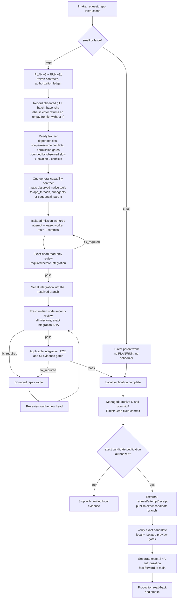

<p align="center">
  
</p>

<p align="center">
  <strong>English</strong> | <a href="README.zh-TW.md">繁體中文</a> | <a href="README.zh-CN.md">简体中文</a> | <a href="README.es.md">Español</a>
</p>

<p align="center">
  <a href="https://github.com/Phlegonlabs/product-delivery-harness/actions/workflows/harness-ci.yml"></a>
  
</p>

# Product Delivery Harness

Skills repository for turning a product idea or change request into a verified delivery flow with Codex, Claude Code, Pi, or any host that discovers a user skills directory.

It is not a prompt collection. The skill suite separates product definition, visual design, engineering execution, code-security review, activation, and post-release organic-growth review so each stage has one source of truth, a bounded handoff, and its own verification.

> Define the product. Compile the design. Deliver verified software.

**Use it:** [Install](#install) | [Start here](#start-here) | [Typical prompts](#typical-prompts) | [What is included](#what-is-included) | [Standalone skills](#standalone-skills)<br>
**Understand it:** [How the system fits together](#how-the-system-fits-together) | [Operating reference](#operating-reference)<br>
**Maintain it:** [Maintain the skills](#maintain-the-skills) | [Releasing](#releasing) | [Version history](#version-history)

## Install

The repository is public, so no access permission is needed. You need Python 3.10 or newer, Git, and at least one host that discovers a user skills directory such as `~/.agents/skills/` — Codex, Claude Code, Pi, or any other.

To confirm public repository access before cloning, run:

```bash
git ls-remote https://github.com/Phlegonlabs/product-delivery-harness.git HEAD
```

### Fastest setup

Clone the repository and run the installer. It takes one destination-wide lock, stages only Git-index-tracked runtime files from the seven skills, leaving tests and CI timing data in the source repository, moves current and legacy managed IDs to one timestamped backup under `~/.agents/skill-backups/product-delivery-harness/`, installs the staged trees, and verifies every path and byte before releasing the lock:

```bash
git clone https://github.com/Phlegonlabs/product-delivery-harness.git
cd product-delivery-harness
./install.sh             # macOS / Linux / Git Bash
# Windows PowerShell: powershell -ExecutionPolicy Bypass -File install.ps1
```

Install the pinned Python test/runtime dependencies, including Pillow, before validation:

```bash
python -m pip install -r skills/delivery-harness/requirements-test.txt
```

There is no safe raw-copy equivalent for updates: it would bypass the tracked-file manifest, destination lock, ownership markers, complete verification, and rollback. If neither installer can run, stop and repair that environment instead of copying over an existing install.

<details>
<summary><b>Installer safeguards, legacy migration, cross-skill checks and dependencies</b></summary>

The installer ignores reproducible Python caches and refuses every other untracked or ignored source artifact, including local `.env` and `.dev.vars` values; tracked example files remain allowed. Its lock serializes Bash and PowerShell updaters. Both installers reject tracked symlink/gitlink modes and junction/reparse components in source, destination, backup, staging, and managed targets before and immediately around mutation. Each created target carries an attempt owner marker until full-tree verification finishes, so rollback removes only paths created by that attempt and restores the prior backup. A foreign or concurrently created path is preserved. Re-running the installer is the update path and still requires explicit authorization plus quiesced skill-using sessions. Start a fresh host session only after success. Each run prints the source HEAD SHA and whether tracked `skills/` files have uncommitted changes; a successful install writes that line to `<backup>.source` next to its backup. Uncommitted bytes still install, but the record makes them traceable.

When upgrading from 0.23 or earlier, let the installer archive the legacy directories under their original IDs in the same backup and install all seven current skills: `delivery-harness`, `product-definition-builder`, `ui-design-builder`, `design-system-compiler`, `code-security-review`, `product-activation`, and `seo-growth-review`. The migration is `full-harness` → `delivery-harness`, `prd-builder` → `product-definition-builder`, and `product-design-builder` → `design-system-compiler`; the installer verifies that every legacy ID is no longer discoverable.

The seven bundled skills can be invoked independently; their cross-skill modes validate the approved Product package and exact source identities. A retained `ui-design/2` package checks direct PRD-to-HiFi coverage, copy, CSP and offline/browser evidence, plus a conditional `design-system/3` pair; `ui-design/3` adds the required `design-system/4` package, and Harness 0.59+ RUNs freeze its derived HTML too, while older pins cannot consume `ui-design/3`. The Harness dispatches `design-system/4` to the design-system compiler's checker. Under a 0.59 pin, only a validated frozen maintenance record retains `ui-design/2`; an enhancement requires `ui-design/3`. Hybrid `surfaceContracts` match every approved UI surface, capture mode and responsive set. Legacy contracts keep their original joins. Deployment, Activation, Outcome Review and saved SEO reports share the production identity.

New project Skill Bindings are deliberately unresolved until the session observes installed candidates and the owner confirms one skill per slot. Pins cover each complete skill tree, not only `SKILL.md`. The public dependency manifest pins the source locator and install route for both required UI dependencies: use the host's skill installer to install `frontend-design` from the recorded Anthropic path, and install Impeccable with `npx impeccable install` (its current npx route requires Node.js 22.18+). Then run `check_external_skill_dependencies.py`; a changed upstream tree must not silently replace the pinned bytes. The Harness owns conformance and compilation contracts. Impeccable is never a default read-only Harness reviewer: using its pinned workflow needs separate authorization for subagents, browser/server work, snapshot writes, and any optional binary download.

Managed local build/test uses the project toolchain without Docker or Podman by default. Only explicitly selected container verifiers require an administrator-installed runtime and machine trust policy (`runtime-trust.md`). Archive publication still requires its separate machine trust policy and signing setup (`branch-promotion-contract.md`); the installer creates neither privileged policy.

</details>

<details>
<summary><b>Zero-to-one flow from product idea to measured outcome</b></summary>

### Zero-to-one flow

1. Install one supported host and all seven skills. The installer locks the destination, backs up managed IDs, copies only Git-tracked runtime files, leaving tests and CI timing data in the source repository, and verifies every byte. Restart the host.
2. Start with `product-definition-builder`: research-first evidence, candidate drafting and reconciliation, explicit recommendation choices, accepted changes, coherent stack choices, typed release targets, tests, Stack Decision Checkpoint, and human Product Definition Approval. Its entry retains ownership and approvals; authoring, review, preflight and domain routing use its mandatory stage reads.
3. For UI, run Product Definition preflight with `--ui-contract ui-design/3`, then intake, three rendered direction studies with author self-checks, owner selection and complete HiFi. Run HiFi completeness checks before Impeccable/H1–H9 and one human Visual Approval. Its entry retains ownership and approvals; authoring, self-review, preflight and domain routing use mandatory stage reads.
4. Compile the `design-system/4` Markdown/JSON pair and its derived HTML from approved sources and pass final UI validation. A 0.59 RUN retains `ui-design/2` only behind a validated frozen maintenance record; an enhancement compiles the current package. A retained pair compiles schema 3 only when its gate is `required`; if `not_required`, record existing-pair disposition and bind the approved HiFi replacement.
5. Invoke `delivery-harness`. Its size gate keeps one bounded writer direct without loading the managed stage file; large work follows the [mandatory stage routes](skills/delivery-harness/references/stages/managed-delivery.md) and creates PLAN-v6/RUN-v11. Obtain exact authorization before every state-changing action.
6. Before a managed launch, pass exact source joins and run `python "<delivery-harness-skill-root>/scripts/harness_transition.py" --plan docs/goal/PLAN.md --run docs/goal/RUN.md --repo-root <absolute-root> record-observation`; `--probe-sandboxes` is diagnostic only. Execute missions in isolated worktrees and candidate commands on the host by default; explicitly selected containers retain pinned sandbox execution.
7. Run exact-head mission reviews, graph-ordered security checks, a fresh unified `code-security-review`, broad regression gates, and platform-correct UI evidence.
8. For managed work only, close the RUN. Dry-run/apply `archive_run.py` with exact `main` evidence and an absolute external `--anchor-out`; commit the journaled move plus `ARCHIVE_RECEIPT.json` as A and reverify it against the anchor. Direct work keeps its already verified fixed candidate and skips RUN archival.
9. Under separate action-time authorization, prepare A through its external anchor and immutable request/attempt/receipt. The trusted host reloads and validates them, performs the exact URL-only no-force publication, signs evidence, and recovery verifies that evidence and reads back A. Local agents never execute the emitted publication argv.
10. Run the isolated non-production candidate gates against the exact read-back candidate. If they fail after A, create a fresh continuation PLAN/RUN from exact A, close C2, bind the prior publication state, and archive A2 under a new anchor.
11. Under a separate exact-A authorization, fast-forward the unchanged candidate to `main`, read it back, and verify production.
12. Run `product-activation` for exact approved external actions, independent read-back, behavior evidence, readiness, and verified measurement sources.
13. After every target-specific measurement window, run the strict append-only Outcome Review. Optionally run `seo-growth-review` for an exact public hosted-web production target.

</details>

<details>
<summary><b>Running installed skills and publication checks</b></summary>

### Running installed skills and publication checks

Resolve each `<skill-name-skill-root>` to its installed absolute directory (normally `~/.agents/skills/<skill-name>`), quote the script path, and keep the working directory and `--repo-root` at the target project. Reference paths such as `skills/<name>/scripts/` are logical installed paths, not a requirement to copy skills into that project. Source-repository maintenance commands below retain their repository-relative paths.

Skill Bindings checks default to all slots. Product Definition uses `--stage product-definition` and may retain `pending`/`pending` future rows. UI authoring and compilation use `ui-design` and `design-compilation`; `backend` is limited to a proven headless or backend-only scope. Each stage rechecks required installed full-tree pins; no earlier result grants a later stage.

Approve UI artifacts at final logical paths in a separately authorized publication checkout at the source HEAD with complete Git history. `check_ui_publication.py` compares upstream bytes and runs the approved Product and final UI gates; after authorized publication, `--published` checks exact transferred bytes. `.ui-staging` is for unapproved drafts. Compiler `sourceBindings.uiDesign.sha256` uses `ui_approval_digest.py`, excluding derived pair/replacement linkage and, for `ui-design/3`, the Package action and pair disposition lines, so an unchanged package can switch to `reuse`; other bindings use raw-file hashes. Homogeneous responsive sets stay global, while hybrids use exact per-surface `surfaceContracts` and approved stack semantics.

Design System Compiler changes in 0.55.0: `stylingMechanism` stays a closed enum but only has to name the verbatim Stack styling approach kept in `stackSemantics.stylingMechanism` (for example `plain CSS` for `modern vanilla CSS`, or `platform theme` for native styles). The pair-less preflight has no separate command; it runs inside `check_design_system_pair.py --repo-root`. `tokenSources` and `primitiveSources` must be exact repo-relative paths. `check_color_contrast.py` accepts `#RGBA` and `#RRGGBBAA` foregrounds over an opaque background, and `check_type_scale.py` accepts rem and em sizes with `--root-font-size` (default 16px). Its 1.5 text and 1.1 heading line-height limits are house readability floors, not WCAG AA rules. The legacy Harness join now checks design-system/2 pairs against the repository root.

Private HTTPS publication may use the administrator's exact-endpoint credential-helper policy from `trusted-host-publication.md`. Requests bind policy/helper hashes; prepare, trusted-host push, and recovery reject drift and never inherit arbitrary repository/user helpers. No credentials enter evidence. Activation may prepare separately authorized deployment prerequisites at a fixed implementation SHA; readiness and verified measurement handoff still require exact deployment evidence. Activation checker commands include PRD, architecture, deployment, stack decisions, activation path, and repository root.

Trusted-host publication and the legacy pre-0.38 run-branch push both run isolated from repository hooks, fsmonitor and askpass: `core.hooksPath` points at a fresh empty directory, `core.fsmonitor` is off and askpass is empty. The Git config preflight treats a linked worktree's shared config and `config.worktree` as repository config, and rejects a repository `core.askPass`; URL-scoped TLS, header and cookie settings are rejected for remote access and publication, while local reads in a CI checkout still work. Git and verifier output is read as UTF-8. A short window remains between the remote recheck and the no-force push, in which another actor could fast-forward the run branch to an ancestor of A, so keep run-branch push access limited to the trusted host. Run-branch publication uses the trusted host because its signed evidence is archive state; `main` promotion is a separately authorized plain no-force push and does not require A to be published to its run branch first.

</details>

A `deployment/2` record adds Release Source Provenance. Each target binds a bounded retained observation JSON by hash: repository, source and resolved refs, source SHA, artifact, observation time, and actual command or provider output. The caller supplies `repo-root` and `expected_repository` independently; a symbolic candidate/1 ref also needs a concrete `candidate_ref`. The validator reads bytes only, never executes commands or fetches providers, and treats a hash as integrity rather than authenticity. Pending preparation and historical inspection stay valid. Full Deployment checks, including resource isolation and record validity, gate ready closeout, verified sources, SEO, and Outcome. Explicit target subsets do not replace complete inventories; blocked and all-n/a records retain compatibility.

For strict symbolic-candidate proof:

```bash
python "<delivery-harness-skill-root>/scripts/check_deployment.py" --deployment docs/DEPLOYMENT.md --architecture docs/product/architecture.md --require-source-provenance --repo-root <actualFrozenRepo> --expected-repository <owner/repository> --candidate-ref <candidate-ref>
```

## Start here

| If you have... | Start with | What you get |
| --- | --- | --- |
| A product idea | `product-definition-builder` | An owner-approved Product Definition with complete frontend/backend architecture, stack choices, UI behavior, release targets, and tests |
| An approved Product Definition that needs UI design | `ui-design-builder` | PRD preflight, intake, direction selection, connected HiFi, completeness checks, Impeccable/H1–H9, Visual Approval and the design-system decision |
| A scoped change in an existing repository | `delivery-harness` | Direct implementation for small work, or a managed PLAN/RUN flow for large work |
| A fixed integrated code candidate | `code-security-review` | A read-only, exact-SHA security review with validated source-to-sink findings and explicit coverage gaps |
| A delivered release that needs external setup | `product-activation` | Exact authorized console actions, verified measurement sources, and target-by-target activation readiness |
| A public production site that needs SEO or organic-growth analysis | `seo-growth-review` | A read-only technical and measurement review, evidence-ranked keyword/page opportunities, and routed follow-ups |

Each bundled skill can be invoked on its own; the full pipeline is optional. Each mode still enforces its declared inputs and dependencies.

<details>
<summary><b>Optional reference library and technology, design and Cloudflare catalogs</b></summary>

A shared optional reference library compares 19 technology and design domains without choosing a default stack. The [selection rule](skills/delivery-harness/references/reference-selection.md) starts from the need and reads only the relevant domain under [option-library](skills/delivery-harness/references/option-library/README.md). It preserves an existing stack and never makes CSS/Tailwind, icons, Cloudflare, Expo/React Native, GSAP, or any provider mandatory. Adopted choices go into existing product, architecture, stack, UI, or task records; no new gate, registry, runtime, or approval authority is added.

The frontend catalog includes TanStack Start/Router and the supporting ecosystem as separate choices. Architecture examples compare complete managed React, portable React, content, realtime, Python and business-app stacks. They also cover server-driven HTML, local-first sync, durable workflows, tenant data isolation, headless content/conditional commerce and independent typed APIs, with failure checks and exit costs. Maturity observations carry dates; each project's existing stack checkpoint still decides adoption.

Design references include component foundations, eight visual directions and manual discovery with Mobbin, Dribbble, Awwwards, Refero and MotionSites. Owners share selected case/original-site links or screenshots; no design-reference MCP connection is added. React Bits supplies effect components and Anime.js supplies an animation engine; source reuse and dependencies still follow the existing stack and license decisions.

The docs-weight visibility report includes nested optional reference Markdown and adds no gate.

The Cloudflare catalog separates compute, data, agents/search, browser/sandbox, media/email and analytics roles. Basin, K2, Artifacts, framework adapters, CLI and skill candidates include dated maturity or migration checks; catalog coverage does not establish local installation, account availability or deployment readiness.

Void appears as an optional full-stack SDK/CLI path. Native or framework routing is a stack decision, direct Cloudflare stays `cloudflare`, and a team Void platform remains a separate deployment decision. Void Preview needs a proven build/config path or an approved isolated deployment through Void.

</details>

<details>
<summary><b>Design translation, motion, platform targets and design freshness</b></summary>

### Design translation and reusable patterns

App + companion Web products use one PRD with separate iOS, Android and public-showcase surfaces; authenticated Web apps are included only when scoped. React Native + Expo is a reference option, not a required or default stack; choose technology from product needs and preserve existing approved decisions. Native phone targets, Web widths, shared-code boundaries and platform-specific design, tests and release paths follow the [App and companion Web contract](skills/product-definition-builder/references/mobile-stack-selection.md#app-and-companion-web-contract). Choosing Expo for mobile does not select the website stack or approve paid EAS services.

Internal HiFi rules require measured checks for compressed controls, alignment, clipped content and open layers, plus product-specific anti-slop review. Inspect long copy, text scaling and widths between Web targets; retain element-level evidence and repair shared causes. Hiding overflow or increasing a score cannot clear a broken layout. These rules use the existing review gates and do not require Hallmark.

The [modern design source guide](skills/ui-design-builder/references/modern-design-sources.md) maps Web accessibility, Apple/Android platform guidance and recent Anthropic/Google Labs AI-design practices into the existing handoff and review. It separates standards from aesthetic advice and preserves platform choices, review widths and bounded repair limits. [Page design profiles](skills/ui-design-builder/references/page-design-profiles.md) adapt Taste ideas by purpose: landing/portfolio pages can select distinctive font roles, one- or two-line desktop heroes and required expressive motion; dashboards, data pages and forms prioritize readable density and functional feedback. Record choices and mobile/localization/reduced-motion exceptions in the existing brief; retain approved decisions.

Motion now has a clear ladder in the [motion and media router](skills/ui-design-builder/references/motion-and-media-routing.md): CSS/WAAPI, then Motion, GSAP and Three.js, each only when the approved stack includes it. Higgsfield supplies generated media, including GLB models for an approved Three.js region. When the owner states no motion posture, the proposal follows what the page actually shows and plays live in the direction study. Provider use, regions and cost limit are asked once in the design intake. HiFi embeds media as `data:`; a library that cannot run there gets a deterministic approximation and is marked for verification in the first implementation slice. H6 also judges motion craft, and inspected references keep a screenshot or recording plus the license of any adapted template code.

Direction studies and HiFi use the exact approved PRD responsive targets. The retained legacy Wireframe template offers 390, 768, 1024 and 1440 px examples; these are review widths, not mandatory breakpoints or a new authoring stage.

Design prompts read the PRD UI Surface Contract directly. Record constraints and creative freedom in the existing Design Brief Page-purpose mapping; do not duplicate per-page requirements. Compare primary and stress cases, then expand the selected direction into complete HiFi. The PRD owns required behavior and content; the designer chooses composition and visual expression.

Incremental changes preserve unnamed scope. An explicit **full design rebuild with retained PRD** instead starts fresh composition and direction under the observed skill contract, preserving product/stack/copy constraints and known usability failures. Old design files and approvals remain history; replacement, archival and installation keep their own authorization. New iOS scope defaults to iPhone with smaller/larger phone review targets and Dynamic Type checks; iPad remains opt-in and existing PRD requirements stay binding. Native HTML never proves native behavior.

The seven [composition recipes](skills/ui-design-builder/assets/templates/composition-patterns.json) remain optional references for direction/HiFi work: four Web and three iPhone patterns. Select, adapt or reject them to suit the product. Preserve bilingual copy, language/direction tags, long-content checks and the PRD language matrix. No recipe imposes a hero/features/CTA layout.

After applicable skill updates and before implementation, [design freshness](skills/ui-design-builder/references/design-freshness.md) checks inventoried artifact and input hashes, skill provenance and downstream dependencies. Unknown identity remains unknown; a changed skill requires semantic review, not automatic redesign. `check_design_freshness.py` is read-only and never approves a design. Include every HiFi sibling and still run the full package validators. Resolve affected gaps before coding when implementation is demonstrably not started.


</details>

## Typical prompts

Codex accepts the `$skill-name` form below. In Claude Code or any other host, ask for the skill by name, such as `product-definition-builder`. In Pi, use its discovered project skill or pass the skill directory with `--skill`, then ask for `delivery-harness` by name.

```text
Use $product-definition-builder to define this product, including complete frontend/backend architecture, data/auth/deployment choices, coherent stack options, UI behavior, release targets, tests, and Product Definition Approval. Stop before UI design.
```

```text
The Product Definition is approved. Use $ui-design-builder with the `ui-design/3` contract and mandatory $frontend-design. Run the product preflight, read the PRD UI Surface Contract directly, and show three materially different directions over the same representative cases for my selection.
```

```text
I selected a direction. Continue $ui-design-builder with $frontend-design: build the complete connected HiFi, run the HiFi completeness preflight, then run separately authorized $impeccable critique and audit plus H1-H9 grading. Ask for one full Visual Approval covering copy, structure, product menus, tabs, visuals and tokens, then use $design-system-compiler for the required `design-system/4` pair and frozen derived HTML.
```

```text
Use $delivery-harness to implement the approved plan, building each page from its approved HTML reference in docs/design/ui-references/ within the recorded tolerance.
```

```text
Use $delivery-harness to review the existing app, plan the required work, and stop before implementation.
```

```text
Use $delivery-harness to implement the approved plan. Create a branch and commit the verified change, but do not push or open a PR.
```

```text
Use $delivery-harness only if the size gate selects the direct route: implement this bounded change, verify one fixed candidate, and push that non-default branch under this exact authorization. Stop if PLAN/RUN managed delivery is required; managed publication needs a new post-archive request.
```

```text
The delivery is complete. Use $product-activation for the production release targets, configure only the exact external actions I approve, verify each result by read-back, and stop after recording activation readiness and the measurement-window handoff.
```

```text
The RUN is complete on its non-default branch. Use $delivery-harness to dry-run and archive the completed coordination set on that same branch, verify the archive-only candidate, and stop before any push or main promotion.
```

```text
The archive-only candidate A is verified. Prepare its immutable trusted-host publication request from the external anchor and stop. Do not execute the emitted publication command locally; wait for separate trusted-host evidence and recovery.
```

```text
The production measurement window has closed. Use $product-definition-builder to validate the Outcome Review against the exact PRD metrics, TEST signals, deployment, Activation hash, and verified MS sources.
```

```text
Use $seo-growth-review to audit this production website, reconcile Search Console visibility with GA4 on-site outcomes, prioritize evidence-backed keyword and page opportunities, and route every proposed change without modifying the site or external accounts.
```

```text
Use delivery-harness on this host to execute this plan. Observe native capabilities and preserve installed roles, models and fallbacks.
```

For a multi-mission delivery, state the intended local and remote outcome. Branch creation, commits, integration, each push, deployment, worktree removal, and deletion remain separate actions. Post-RUN promotion may update only `main`, with exact action-time authorization, fast-forward proof, read-back, and complete candidate testing.

## What is included

| Skill | Use it for | Main output |
| --- | --- | --- |
| `product-definition-builder` | Discovery, research, security requirements, measurable product/UI behavior, complete frontend/backend architecture, coherent stack choices, release targets, tests, and Product Definition Approval | Approved `PRD.md`, `architecture.md`, `stack-decisions.md`, and research artifacts |
| `ui-design-builder` | PRD preflight, intake, three-direction default, connected HiFi, completeness checks, Impeccable/H1–H9, Visual Approval and Design System Need Gate; mandatory stage reads own authoring and routing detail | `docs/design/ui-design.md`, direction studies and the approved complete HiFi package |
| `design-system-compiler` | Compiling an approved `ui-design.md` target into the frozen design-system pair after Visual Approval when required, plus its derived source-bound HTML specimen book; mandatory stage reads own compile, validation, publication and routing detail | `docs/design/design-system.md`, `docs/design/design-system.json`, `docs/design/design-system-preview.html` |
| `delivery-harness` | Shared size gate, security-aware task gates, PLAN/RUN, authorization, local verification, and integration, plus the runtime adapter reference (`references/runtime-adapters.md`) holding one general capability contract mapped to observed native tools | Direct work or `PLAN.md` + `RUN.md` |
| `code-security-review` | Read-only security review after implementation and unified integration, preferably in a fresh sibling agent; active penetration testing and remediation stay outside this skill; mandatory stage reads own inputs, workflow and handoff detail | Exact-SHA decision, trust-boundary coverage, validated findings, and remediation tests |
| `product-activation` | Post-delivery setup for every supported web, API/backend, iOS, Android, macOS, Windows, browser-extension, and hybrid release target, including capability routing, exact external-action authorization, read-back, measurement sources, and outcome-review handoff; mandatory stage reads own inputs, execution, status handoff and reporting detail | `docs/ACTIVATION.md` |
| `seo-growth-review` | Read-only post-release technical SEO, measurement integrity, keyword research, organic-traffic diagnosis, and query-to-page opportunity prioritization; mandatory stage reads own inputs, review method and reporting detail | Inline review by default; optional dated report on explicit request |

<details>
<summary><b>How the delivery core sizes work: direct or managed</b></summary>

The delivery core makes one size decision before it invokes managed orchestration:

- Small work stays direct without PLAN/RUN, but resolves required roles before choosing its executor. UI authoring uses the host-bound frontend worker, not the parent. Read-only delegation alone does not require a managed run.
- The [parent-owned delegation contract](skills/delivery-harness/references/delegation-contract.md) applies across Product Definition, UI Design and delivery. Two independent substantive research/exploration questions require distinct researcher/explorer instances when authorized and capable. Capacity limits use bounded waves. The pure `readonly-assignments/1` API joins by assignment, attempt and frozen input identity, accepts reordered results, and rejects missing, duplicate, stale or reused-worker results. Parent launch evidence remains separate from child claims. Required role bindings and external-runtime grants must be checked before launch; a missing mandatory delegate never silently becomes parent work. Availability-only fallback preserves host policy, termination checks and partial work. One writer owns each checkout, including the parent; independent review still requires its actual tools.
- Architecture assignments start with a caller example, then define state ownership and failure recovery. Code reviews apply this method to affected boundaries. Local repairs reuse accepted decisions.
- Large work enters managed planning. It may use `PLAN.md` and `RUN.md` for a managed-sequential delivery or for multiple missions and durable handoff; `new_run.py` writes the initial `docs/tasks.md` with `--out` and `--repo-root`, and guarded `accept-wave`, `record-worker-result`, `reject-worker-result`, `record-integration`, `reconcile-candidate-head`, `reconcile-coordination-head`, `reconcile-interrupted`, `reconcile-interrupted-reviews`, and `close-wave` transitions with `--repo-root` refresh it while preserving the Update Log. Projection failure never rolls back RUN; the standalone `render_tasks_view.py` repairs or checks that non-canonical view. This source repository does not keep a separate root `Tasks.md` flow log.

Each required integration or wave-close checkpoint can commit its exact coordination files as one ordinary direct child, then freshly observe and bind that head with `reconcile-coordination-head`. The guard accepts only supported exact coordination/generated-view paths, keeps product and frozen design sources out, checks live/observed identity and clean product bytes, preserves old evidence, and re-arms current exact-head reviews and gates; isolated mission workers may continue while parent-side reviewers and checks are quiescent.

- The selector derives `managed_sequential` for fewer than two actually selected safe write missions and `parallel_graph` for two or more. Scheduler fan-out starts only for the latter; the runtime driver remains a separate transport fact. The core applies one general capability contract; the agent maps current native tools without a provider-specific section.
- RUN execution never waits for remote CI. Branch promotion is a separate closeout stage: exact candidate and applicable isolated preview-environment verification must finish before `main` can move.

Only RUN and its declared generated tasks view are clean-checkout exceptions; verifier hashes still protect both. Product dirt and hand-authored views still block. Routine RUN operations use guarded transitions, while formal revisions preserve history and need exact new authorization. For a package containing only `Selected`/`Required` layers with no approved new option, keep `Approved option map: None` and skip the optional generator. The checker accepts case-insensitive `None` without an options table only when no layer or option is newly approved.

Size means coordination scope and blast radius, not a raw file or line count. If small work grows, the Harness preserves completed work and plans only the remainder.

</details>

## Standalone skills

[README Studio](standalone-skills/readme-studio/SKILL.md) helps other projects write a distinctive, brand-first GitHub README with real demonstrations, a useful quickstart and renderer-specific checks. Its [dated case library](standalone-skills/readme-studio/references/case-library.md) draws on Starship, Bruno, Transformers, tldraw and Vite. Visual work follows the target project's frontend route and includes before/after evidence.

Registry images need a working destination URL; including an image in a package alone does not prove that it renders there.

[Release Packager](standalone-skills/release-packager/SKILL.md) prepares applicable artifacts for Node/Bun, Python, Go/Rust, containers and desktop/mobile apps using the project's native tooling. It tests actual package contents and consumer paths, then reconciles README/release facts. Builds, signatures, installation tests and publication retain separate evidence; missing runners or signing material remain explicit gaps. It adds no automatic CI pipeline.

These sources are independent of the seven-skill bundle and are not installed by `install.sh` or `install.ps1`. Open the linked `SKILL.md` with its references in your host, or register the complete skill directory using that host's supported discovery mechanism. Registration is a separate local action; this repository does not automatically install it. Once available, invoke `$readme-studio` to improve a README or `$release-packager` when preparing a release. Keep the project's language, license and supported channels; publishing follows its existing authorization.

## How the system fits together

```mermaid
flowchart LR
  Idea["Product idea or change request"] --> PRD["Product Definition candidate\nPRD + architecture + stack"]
  PRD --> Market["Post-draft market reconciliation"] --> ProductGate{"Stack Decision + PRD self-review +\nProduct Definition Approval"}
  ProductGate -->|"approved UI product, explicit request"| UIDesign["ui-design-builder\nintake + directions + UI self-review"]
  UIDesign --> UIReview["selected direction + complete HiFi\ncompleteness + self-review + Impeccable + H1–H9"]
  UIReview --> Design["approved HiFi target\ndesign-system-compiler when required"]
  ProductGate -->|"approved headless product"| Harness["delivery-harness\nShared delivery core"]
  ProductGate -->|"approved scoped enhancement or maintenance; no affected design gate"| Harness
  Design -->|"approved all-pages HTML reference or design-system pair"| Harness
  Harness --> Runtime["Observed native capabilities\nOne general contract"]
  Runtime --> Security["code-security-review\nfresh unified exact-SHA review"]
  Security --> Evidence["Broad final tests and UI evidence"]
  Evidence --> Close["RUN closes on exact integration head"]
  Close --> Archive["Archive coordination on run branch\ncommit + reverify archive-only candidate"]
  Archive --> Push["External request/attempt/receipt\nfor exact candidate push"]
  Push --> Candidate["Verify exact candidate SHA\nlocal + isolated preview gates"]
  Candidate --> Main["Separately authorize fast-forward\nexact SHA to main"]
  Main --> Activate["product-activation\nExternal setup + read-back"]
  Activate --> Outcome["Verified measurement sources\nLater outcome review"]
  Activate -.-> SEO["seo-growth-review\nOptional organic-growth review"]
  SEO -.-> Outcome
```



<details>
<summary><b>Design-system binding, token evidence and pre-delivery self-review</b></summary>

A retained `ui-design/2` package has no grayscale Wireframe or W1–W5 stage. Layout, typography, hierarchy and responsive behavior are explored directly in representative visual studies and verified in HiFi. Historical Wireframe tools remain available for read-only inspection and validation.

HiFi supplies the complete source-derived Design Tokens view. A `ui-design/3` package always compiles `design-system/4`: its `showcase` binds every primitive variant, component state and motion variant to an approved HiFi element, and `design-system-preview.html` renders them as a specimen book without inventing styles. For `ui-design/2`, when the Need Gate requires a formal pair, the compiler creates `design-system/3`. Both bind the approved PRD, architecture, stack, UI contract and HiFi package, without a Wireframe binding.

HiFi copy provenance uses embedded `ui-hifi-copy/1` metadata and product DOM bindings. Static text, dynamic display contracts and paired languages remain checkable. Tokens show actual values, purposes and control variants; reviewer text cannot satisfy product coverage.

Token observations retain raw source/display values separately from browser-normalized source/applied values, so hex colors, rem dimensions and keyword weights compare correctly.

Resume at a stage only when its prerequisites remain current. Follow the [pre-delivery self-review contract](skills/delivery-harness/references/pre-delivery-self-review.md): after post-draft market reconciliation and accepted revisions, review the PRD package; review UI structure/directions before direction selection; review the connected HiFi before independent review and Visual Approval. Keep candidate identities, findings, repairs and unresolved blockers in the existing task record. Self-review does not replace required independent review or owner approval. UI-bearing initial delivery enters Harness execution only after the applicable checks pass; a deferred UI phase cannot bypass them. Headless products record UI checks as not applicable, and enhancements/maintenance review their accepted scope. These are parent semantic checks; validator success alone does not prove self-review.

Harness 0.57.0 removes the UI-deferred shortcut for UI-bearing initial delivery, including backend-first slices. A backend binding check does not waive this handoff. When a new task consumes earlier approvals, perform present-day catch-up self-reviews of the applicable scope; record the approval and candidate identities without backdating or reopening unchanged owner decisions. Earlier pinned RUNs keep their contracts.

</details>

<details>
<summary><b>Full skill lifecycle diagram, approval gates, deployment, Activation, SEO and commerce rules</b></summary>

### Full skill lifecycle

The complete lifecycle across all seven skills, with every gate and the cross-cutting mechanisms:

```mermaid
flowchart TB
    user([User idea or change request])

    subgraph PRD["product-definition-builder — product definition"]
        direction TB
        interview[Structured interview<br/>3 free-text segments + AskUserQuestion]
        pkg["Core package candidate<br/>PRD.md + architecture.md<br/>+ stack-decisions.md"]
        mr["market-research.md<br/>(reconcile candidate, skippable)"]
        rchoice{{"Platform optimization recommendations<br/>owner accepts / revise / defer / reject"}}
        revision["Apply accepted changes only"]
        sgate{{"Stack Decision Checkpoint<br/>Required | Selected | Approved"}}
        pgate{{"Product Definition Approval<br/>all products"}}
        ra["research-first assessment<br/>research-assessment.md (skippable)"]
        rgate{{"Research Gate<br/>go | clarify | stop"}}
        interview --> ra --> rgate --> pkg --> mr --> rchoice
        rchoice -->|accepted| revision --> sgate --> productself["PRD author self-review"] --> pgate
        rchoice -->|revise proposal| mr
        rchoice -->|none, deferred, or rejected; no blockers| sgate
    end

    subgraph DESIGN["ui-design-builder — UI design (explicit owner request)"]
        direction TB
        intake{{"UI Design Intake<br/>style + motion + media; wait for owner"}}
        preflight["PRD preflight<br/>operations + states + responsive + copy"]
        studies["frontend-design<br/>three directions by default"]
        style["frontend-design<br/>Style Integration + HiFi target"]
        hifi_review["Impeccable critique + audit<br/>H1–H9 grading"]
        vgate{{"Human Visual Approval"}}
        dgate{{"Design System Need Gate"}}
        pending["Approved required/pending marker<br/>bound to Visual Approval digest"]
        pair["design-system-compiler preflight + compile<br/>design-system.md + design-system.json"]
        linked["Owner links pair hashes<br/>final UI validation"]
        intake --> preflight --> studies --> directionself["UI structure/direction self-review"] --> directionChoice{{"Direction selection"}} --> style --> completeness["HiFi completeness preflight"] --> hifiself["HiFi author self-review"] --> hifi_review --> vgate --> dgate
        dgate -->|required| pending --> pair --> linked
        dgate -->|not_required| target[Approved page-faithful target]
    end

    subgraph HARNESS["delivery-harness — delivery core"]
        direction TB
        route["System Review And Route<br/>(parent-only, read-only)"]
        size{{"Project Size Gate"}}

        subgraph DIRECT["Direct route (small)"]
            direct_impl["Implement directly -> local verify<br/>-> code-security review -> authorized Git actions"]
        end

        subgraph MANAGED["Managed route (large)"]
            direction TB
            plan["PLAN v6<br/>typed graph: missions / reviews / gates<br/>allowed_providers + atomic task commits"]
            newrun["new_run.py generates<br/>RUN v11 + the 12-key authorization ledger"]

            subgraph LOOP["Execution loop (per wave)"]
                direction TB
                lock["--session-id acquire-run-lock<br/>(run lock + heartbeat)"]
                obs["record-observation<br/>live-Git snapshot"]
                sel["select_ready_nodes.py<br/>deterministic frontier selection"]
                accept["accept-wave<br/>(batch base binding)"]
                adapters["resolve the available agent driver<br/>under the shared contract"]
                lease["lease-worker<br/>(worktree + lease + graph binding)"]
                workers["fresh bounded agent workers"]
                record["record-worker-result<br/>revalidate evidence + atomic RUN update"]
                review["exact-head review<br/>(reserve -> reviewer -> record)"]
                integ["record-integration<br/>(serial; unified candidate SHA)"]
                lock --> obs --> sel --> accept --> adapters --> lease --> workers --> record --> review --> integ
            end

            plan --> newrun --> LOOP
            security["code-security-review<br/>fresh sibling; all missions; exact SHA"]
            gates2["Broad final validation<br/>(E2E / regression / UI evidence matrix)"]
            LOOP --> security --> gates2
        end

        route --> size
        size -->|small| DIRECT
        size -->|large| MANAGED
    end

    subgraph DEPLOY["Deployment (git-connected platform)"]
        direction TB
        handoff["Managed: refresh docs/DEPLOYMENT.md<br/>(typed targets + secret names + console tasks)"]
        archive["Close RUN, archive coordination<br/>commit + reverify candidate"]
        push["Checkout-external request/attempt/receipt<br/>for the exact run-branch candidate"]
        directhandoff["Direct: refresh deployment record<br/>retain one fixed verified candidate"]
        directpush["Separately authorized direct<br/>candidate publication"]
        preview["Preview builds automatically<br/>(platform builds per push)"]
        merge([Separately authorized exact-SHA<br/>fast-forward to main])
        prod["Production deployment<br/>(platform builds from main)"]
        check["Post-deploy verification (read-only)<br/>check_deployment.py"]
        status["Reconcile deployment record<br/>(status + pending human actions)"]
        handoff --> archive --> push --> preview --> merge --> prod --> check --> status
        directhandoff --> directpush --> preview
    end

    subgraph ACTIVATE["product-activation — post-delivery activation"]
        direction TB
        profiles["Select core + surface profiles<br/>docs/ACTIVATION.md"]
        capability["Probe connector / API / CLI<br/>Browser / Computer Use / manual"]
        actions["Exact ACT-* actions<br/>authorization + read-back"]
        ready["Per-target activation readiness<br/>verified MS-* sources"]
        profiles --> capability --> actions --> ready
    end

    subgraph SEO["seo-growth-review — optional post-release review"]
        direction TB
        seo_sources["Production pages + verified sources<br/>Search Console / GA4 / estimates"]
        seo_review["Technical SEO + measurement integrity<br/>query-to-page opportunities"]
        seo_route["Prioritized routed follow-ups<br/>no direct mutation"]
        seo_sources --> seo_review --> seo_route
    end

    subgraph OUTCOME["Post-release outcome review"]
        outcome["docs/product/outcomes/YYYY-MM-DD-release-set.md<br/>(owner-requested, post measurement window)"]
        verdict{{"Verdict: no_change | enhancement | incident"}}
        outcome --> verdict
    end

    subgraph CROSS["Cross-cutting mechanisms (all stages)"]
        bindings["Skill Bindings<br/>(AGENTS.md slot table + SHA-256 pins)"]
        ledger["Authorization ledger<br/>12 independent action keys"]
        ver["Version gate + contract digest<br/>(compatible_old wave boundary)"]
        watch["watchdog + reconcile<br/>(interruption recovery)"]
    end

    user --> interview
    pgate -->|approved UI product and explicit UI request| intake
    pgate -->|approved headless product| HARNESS
    pgate -->|"approved scoped enhancement or maintenance; no affected design gate"| route
    linked --> route
    target --> route
    DIRECT --> directhandoff
    gates2 --> handoff
    status --> profiles
    ready --> outcome
    ready -.-> seo_sources
    seo_route -.-> outcome
    verdict -.->|next enhancement request| interview
```

Product Definition Approval, UI Visual Approval, and the merge to `main` are separate human gates. Publication authorization is also separate: accepting product content never authorizes overwriting or moving files.

Product Definition and UI approval/handoff responses list every current document individually in chat, with a verified absolute Markdown link, purpose and status. Include Chinese review copies and English sources, research, direction studies, all HiFi pages, review evidence, required design-system Markdown/JSON/HTML and applicable project/operational documents. Once both packages are complete, present one combined list for whole-package review before implementation. Keep existing approvals and mark missing or later-stage outputs explicitly; a preview panel or document-index link does not replace this list.

For every deployable release, `docs/DEPLOYMENT.md` is the operator handoff. Product Definition seeds typed `Surface class` and `Public discoverability` fields; Delivery Harness joins every development/production target to those fields, its exact provider/channel, endpoint or typed native disposition, expected/deployed SHA, artifact identity, availability evidence, and checked time. Production uses canonical `<product-slug>-<surface-suffix>` with no `-prod`; development adds `-dev`. The record lists secret and variable names plus external-console tasks, never secret values.

After production deployment, `product-activation` creates or reconciles `docs/ACTIVATION.md`, derives profiles from typed release targets, and performs only exact authorized actions through the safest available route. Capabilities, read-back, behavior evidence, measurement sources, and readiness bind to the exact target, environment, SHA, artifact, provider/channel, and action digest. The later strict Outcome Review repeats the PRD metric or TEST definition, baseline, target, window, exact production release, and matching verified `MS-*` evidence.

Activation is execution by default: inventory the real delta, continue ready authorized actions through mutation/read-back/behavior, and use the closeout checker at the end; documentation-only work requires an explicit owner request. `--require-closeout` rejects a required action left ready, configured, pending, uncertain, or stale. Only verified work or an explicit concrete blocker closes the action; either blocked state keeps the record blocked. A true no-op needs no synthetic action, but every target must have a concrete n/a disposition, while verified handoff still requires verified sources and target readiness.

After activation, `seo-growth-review` can run as an independent read-only pass for a typed public hosted-web production target. Its dated report must match the Review date, deployment hostname, exact release and Activation hash, verified source roles, data cutoff, and PASS integrity checks. It audits crawl/index behavior, separates Search Console visibility from GA4 behavior, ranks evidence-labeled opportunities, and routes follow-up without changing the site or external accounts.

A saved lifecycle SEO review needs only its reviewed production target to be `ready` in Activation; other targets, such as an app still in store review, may stay pending. `check_seo_review.py` validates the Product Definition package and Deployment once, prints those findings on stdout with the other review findings, and reports a date-only Data cutoff instead of crashing. For `code-security-review`, the review packet's Contract JSON lists each PLAN `security_review.required_checks` ID with the execution key of its PASS at the reviewed head, and the result copies that list into `checks`. The reviewer returns no reason codes: a blocked result names its cause in `coverage.gaps` or `evidence`, and dispatch blockers are recorded by the parent's selector.

The loop closes at both ends. Research-first evidence gates drafting and supplies applicable baselines; the complete candidate receives post-draft reconciliation and owner decisions on evidence-based recommendations before any revision, Stack Decision Checkpoint, or Product Definition Approval. Metrics now carry baseline, target/guardrail, measurement window, source/method, and owner so the later outcome review has a real contract.

Enhancements record impact across product behavior, UI structure/style, data/integrations, architecture/stack, data trust/AI, commercial channels, and release/operations. Changed product content reopens Product Definition Approval; UI keeps its `none`/`structure`/`style`/`both` gate and refreshes only affected artifacts.

Product Definition checks changed in 0.55.0. Package and Stack Checkpoint digests now cover the raw file text, including fenced code, indented lines and HTML comments; only the approval or checkpoint marker block is removed, and CRLF reads as LF. Digests recorded by earlier releases may no longer match, so re-run finalize and re-record Product Definition Approval and the Stack Decision Checkpoint. A Mobile/Desktop stack needs a `Styling approach` layer row (for example `platform theme`). In the Enhancement Impact Record, a UI `structure` or `both` row names Wireframe Validation and Visual Approval, and a `style` row names Visual Approval; Copy Freeze, Wireframe Approval and Impeccable/H1–H9 are no longer required names. `check_product_package.py` prints `complete and owner-approved` only when both `--require-filled` and `--require-approved` ran. The Product Definition agent graph accepts only the two closed release source policies: development from the run's integration head and production from the verified `main` SHA; tags and other refs are rejected. The `--prior-outcome` digest is the SHA-256 of the prior record's raw bytes, so it matches `sha256sum` or `Get-FileHash`.

Gitignore hygiene also applies to both direct and managed work. The scope scan records whether a task changes a local-only artifact class, then derives the narrowest rules from the observed toolchain. Value-bearing environment and credential files, reproducible build output, dependency directories, caches, logs, and local platform state are ignored; source, tests, lockfiles, migrations, tracked configuration examples and schemas, and canonical product or delivery artifacts stay visible. A new environment-variable read updates the tracked example and ignore rule in the same task. Harness verifies representative paths with `git check-ignore`, `git status --ignored`, and `git ls-files`; it never reads a secret value or hides a dirty worktree, and a likely secret already tracked by Git stops the run for owner action.

Commercial products now pass two separate Product Definition decisions. The Monetization Infrastructure Gate resolves the model, pricing/offer rules, purchase surfaces, entitlement source, and merchant-of-record/tax ownership before comparing current options such as native store billing, RevenueCat, Qonversion, Adapty, Superwall, Stripe Billing, Paddle, or Lemon Squeezy; pricing never makes RevenueCat the default. The Partner Channel Gate independently resolves `none`, affiliate, referral, reseller, or hybrid. It compares link/commission tools such as Rewardful or FirstPromoter, broader partner platforms such as PartnerStack, an integrated Lemon Squeezy affiliate route, or a custom reseller service. Billing, entitlement, paywall, tax, attribution, commission/payout, and reseller operations remain separate PRD, architecture, stack, UI, mission, and test contracts.

</details>

Each assignment gets private scratch and a finite deadline. Before cleanup or retry, the parent confirms the process tree exits and inspects partial work, prior operations, and evidence gaps. A 403 or a finding that research produced no useful sources is not a launch failure; it is never permission to synthesize evidence.

## Operating reference

These groups hold the complete operating rules. Open a group to read its requirements in full.

<details>
<summary><b>Acceptance, workflow map, bilingual review and handoff checkpoints</b></summary>

Acceptance runs focused checks per atomic task, affected integration checks per mission, then the complete required matrix and one independent security review per fixed candidate. Resource-safe regression and review may overlap only when declared dependencies permit it; managed selection and required-check prerequisites remain binding. Reuse retains the original exact-SHA evidence; repairs require fresh review, and local tests never prove external state.

The workflow's template map names where every existing template is used, including optional views and historical Wireframe templates; it does not create unnecessary artifacts to use them all.

CI regression parses the complete source workflow and consumer CI template as YAML, including multiline candidate and diff-base expressions. Text assertions alone do not prove GitHub can load a workflow.

Consumer workflows keep their approved branch policy. This skills source repository is maintained for our own use: temporary work branches target main through reviewed PRs. It needs no development branch. Historical consumer runs keep their pinned contracts.

The [step-by-step workflow](docs/WORKFLOW.zh-TW.md) maps every applicable stage to its owner, existing templates and verification boundary. A section may have several isolated frontend/backend writers after shared interfaces are frozen; each executable task retains its atomic commit. Use observed host capacity, bounded packets and completion events, streaming review and serial integration. Do not remove precondition or postcondition validation as duplicate work, or claim rolling writer scheduling before it is implemented.

Product Definition drafts canonical English `PRD.md` and `architecture.md` together with complete Traditional Chinese `PRD.zh-TW.md` and `architecture.zh-TW.md` review copies. The owner reviews Chinese; implementation and approval digests use English. Accepted feedback updates both views. The [bilingual review contract](skills/product-definition-builder/references/bilingual-review.md) requires source hashes, matching IDs and semantic comparison before review and paired publication. When an existing English-only PRD or architecture is found at a task checkpoint, the agent adds a complete Chinese review copy in the same directory, preserving the English source and approvals. A PRD-only project can validate its pair without creating an architecture. Read-only tasks report the missing copy; archives are not translated automatically.

`AGENTS.md` requires local repository checks at task start, significant changes and completion, even without Harness or PLAN/RUN. Record meaningful committed and uncommitted changes in the matching Epic, including external changes labeled observed/unverified, and update `docs/DOCUMENTS.md`. Missing baselines stay explicit; unchanged checks create no duplicate entry. Read-only tasks report proposed records. No background watcher or new action authority is implied.

Before every handoff, repeat the repository checkpoint and reconcile affected live documents, the matching Epic and index, and the task record. For managed runs, compare PLAN/RUN with the generated `docs/tasks.md` view using the renderer's `--check`; RUN remains authoritative, and generated content is not hand-edited. Compare shared `AGENTS.md` rules by meaning with the observed installed project template and version, then update only stale shared instructions within existing document-write authority while preserving local rules. Authorized bootstrap proposes missing shared sections and same-heading differences; apply only after a reviewed merge plan binds the observed hashes and heading selection. Before append, recheck the opened file against reviewed bytes; require the exact original-plus-block result. Concurrent drift fails while preserving every byte. Proposed additions are not proof that contradictions are absent. Reconcile by meaning without overwriting intentional stricter local rules; the later `--check --require-resolved` gate checks placeholders, not template byte equality. If the template or semantic merge is unknown, report the gap. This is a handoff checkpoint, not a timed scan or new action grant.

Audit corrections align installed command paths, required CLI flags, the 500-line responsibility checkpoint, schema-5 Wireframe Validation and reviewer shell v3. Activation uses the exact release-surface profile; security PASS requires complete coverage. Product Definition review checks operation completeness; the schema-5 UI approval gates enforce the declared PRD-to-Wireframe/HiFi joins. Current RUNs are local-only; publication and main promotion keep separate authorization.

</details>

<details>
<summary><b>Core guarantees for recovery, approvals, design packages, isolation, evidence and release policy</b></summary>

## Core guarantees

- **Recovery preserves identity and evidence.** Launch recording separates the parent `--session-id` lock from `--worker-session-id`. Additional historical-review admission matches the retained attempt; old PASS never covers a new head. A blocked sibling without an interrupted-review reconciliation receipt prevents candidate movement. Current role-bound interrupted missions need a stopped failure receipt before reconciliation and retry. Dual-branch archives prove frozen-base ancestry while retaining their main observation; legacy pins keep their original rules. Review packets can retain a complete external diff with SHA-256 and name-status inventory. Truncated previews require full inspection, and security integration reviews always cover the full scope. New UI entry uses `/3`; retained `/2` packages keep their approval semantics.

- **Recommendations before implementation.** When owners have no stack preference, propose a product-fit default and alternatives covering frontend, hosting, backend/runtime and agent orchestration, with compatibility, cost assumptions and revisit triggers. Enhancements inspect the current UI and show affected before/after cases. Research templates and CSS references with license and stack checks; preserve native platform conventions. Explicit hero and motion requests remain traceable through delivery. Visual Approval requires typed, hash-bound normal and reduced-motion observations for every motion intent; HTML evidence proves only the review projection.
- **Small work stays small.** One bounded change uses a direct inspect, implement, verify, and review loop.
- **Large work is explicit.** PLAN v6 defines the typed graph; RUN v11 records authorization, attempts, and evidence.
- **Product definition is approved before UI design.** Research-first evidence, applicable baselines, a complete candidate, explicit recommendation choices, and any accepted delta precede the final approvals. Every release surface selects its required architecture and stack areas from one closed applicability matrix: hosted UI needs frontend, native UI needs mobile/desktop, services and agents need backend/data/interface decisions, and CLI delivery needs an explicit toolchain. Product and Stack approvals carry canonical content digests, a structured revision, a non-future decision time, and exact acceptance references for every retained open item. At a human review gate, the agent proactively links the complete actual candidate and waits for explicit approval. UI-bearing products enter `ui-design-builder` only on an explicit request. CLI and `other_nonpublic` share the canonical `Toolchain` approval area (`CLI/toolchain` is an alias), with language, toolchain, distribution mechanism, and testing layers.
- **Security starts in Product Definition.** Executable software — including static sites, clients, CLI tools, and agents — records a human-owned Security Requirements Gate. Each required row traces an existing PRD requirement and security TEST, then Harness task gates implement controls plus denial/no-side-effect negative tests before commit; the fresh exact-SHA code-security review remains final.

Security exemptions also require a documentation-only product description and Product Archetype, plus explicitly absent executable architecture surfaces. Required security TEST signals and Harness criteria use `denial: rejected (<signal>); no unauthorized side effects: unchanged (<state evidence>)`, with concrete observations for both assertions.
- **Recommendations are not implementation authority.** Product Definition presents two or three coherent technology bundles per applicable area. New accepted choices are `Approved`, existing choices remain `Selected`, and hard constraints are `Required`; `Recommended` and `Provisional` block delivery. The checkpoint's closed area set must equal the applicable resolved areas, and the approved option's layer map must equal the executable stack rows. `render_stack_option_map.py` prints a candidate map from existing rows for owner review; it cannot approve or rewrite the package. Explicit option maps are wrapped as `||...||`; legacy comma-only maps remain readable, and commas in layer names or selections require the explicit form. A frontend component foundation may be one headless React primitive layer, Base UI or Radix Primitives, plus custom components; pick one per product. Radix Themes counts as a packaged suite. HiFi draws that layer's states and focus behavior without changing the stack.
- **Full UI packages ship a complete design system.** New initial and full-redesign packages select `UI contract: ui-design/3`: three rendered direction studies by default in `docs/design/directions/<round>/`, each self-checked by the same author, owner select/mix/modify, full HiFi checked at every approved target and each intermediate web width, and a required `design-system/4` Markdown/JSON/HTML package (`Package action: compile|update|reuse`). The HTML specimen book shows every token, range, registered component variant, state, responsive size and motion copied from the approved HiFi in sandboxed plates, with replay/stop and reduced motion. Every required state, including default, has an explicit treatment row. Animation evidence follows the specimen’s winning CSS declaration and named keyframes, including importance, specificity and resolved custom properties. Unsupported animation CSS, including escaped declarations and invalid shorthands, is a finding. Retained `ui-design/2` compiles `design-system/3` only when required; its `not_required` approvals keep their meaning. A single recommendation requires the owner's explicit intake choice, human Decision owner and Decided on; its studies must match that choice. Validated `none`/`style` maintenance retains historical design artifacts; it grants no fresh pair or preview approval. Without adjacent approved web widths, record the exact `Intermediate width check: not_applicable — no adjacent approved web viewport widths`; native size-class and ordinary HiFi evidence remain required.
- **Retained design packages go directly from PRD to HiFi.** `UI contract: ui-design/2` explicitly selects the retained flow; new initial and full-redesign packages use `ui-design/3`. Product preflight validates operations, states, responsive targets and copy status; HiFi checks actual copy provenance and product-control coverage before Impeccable. Three directions are the default, followed by selection and one complete Visual Approval. Native HTML remains design evidence. Legacy schemas and pinned RUNs keep their original meanings; a missing Wireframe never selects a weaker check.
- **HiFi pages must connect through product controls.** New or revised `ui-hifi/2` references use an `index.html` manifest with hash-bound sibling HTML pages and explicit control destinations. Current `ui-output/3` observations check click and keyboard outcomes at every responsive target; missing pages, stale hashes, dead controls, wrong destinations, and undeclared navigation block approval. Each page renders exactly its assigned surfaces. Publish and retain the complete package. Schema-1 references remain inspection-only; every current Visual Approval requires HiFi schema 2. Historical output/2 and evidence/2 retain their original meaning. A frozen Git revision must contain every listed child page with the same bytes.
- **Visual quality has its own floor.** HiFi H5 (visual slop), H7 (creative distinction), and H9 (design consistency) each require 80; an overall 90 cannot average away a weak visual dimension. Reviews cite inspected screenshots and confirmed direction principles. Numeric validation does not prove beauty or human inspection.
- **Select directions from rendered representative cases.** Each direction uses the same primary/stress cases and content across the applicable platforms. Keep captures and hashes. Bounded playable motion studies show normal/reduced motion; they are selection evidence, not final motion proof or provider authorization. Only the selected direction expands into the full connected HiFi.
- **Platforms share a brand, not control defaults.** Platform rules cover each approved platform separately. iOS addresses system text styles, Dynamic Type, SF Symbols and native input/layout; Web libraries are not forced onto it. HTML remains a review projection. Native implementation proves the representative cases with platform tooling before expanding, then completes the final full matrix.
- **Workers are isolated.** Write missions use dedicated worktrees and bounded scopes. The parent validates every returned commit and diff.
- **Every graph attempt is durable; local verification defaults to the host.** New PLANs explicitly use `execution.isolation: "host"` for build, lint, and test with the project toolchain. Results retain exact SHA, command identity, cwd, exit status, logs, and source/Git guards. Host verification ends its owned child processes before the final source/Git check, including after a timeout. Host commands run fresh and serially with current user permissions; worktrees are not OS sandboxes. Optional `container` declarations retain machine-approved Docker/Podman, pinned images and all isolation checks, with no automatic host fallback. Attempts still reserve before execution and the inspector never infers process liveness from a phase. Independent workers launch in separate worktrees before the parent waits for results; host verification does not cap mission concurrency. Re-observe actual capacity instead of keeping seeded one-slot defaults.
- **Runtime bindings are explicit.** `lease-worker` derives the provider, driver, model, effort, and portable runtime axes from the selected directive, accepts `--task-thread-id` only for app tasks, accepts an existing exact target, and materializes a new exact target only from an active wildcard grant without widening authority.
- **Capability is not permission.** A runtime may be able to push or clean up, but each action still needs exact authorization.
- **Activation is read back.** Activation, Outcome, and SEO first revalidate the approved Product/Stack bytes and the full Deployment contract. External setup stays outside PLAN/RUN, binds approval to an exact action digest and typed release target, and becomes verified only after independent read-back and behavior evidence. Outcome coverage preserves the PRD method and owner plus an exact target-to-source map; measurement windows begin after each target is available. Multi-target reviews use one closed mode, bind their primary fields to the first ordered target, preserve earlier rows append-only, and derive the aggregate verdict and required follow-up.
- **SEO growth is evidence-led.** Saved lifecycle SEO reviews are limited to an exact public, discoverable hosted-web production target. Their mode-specific record fixes market, language, outcome, timezone, comparison windows, and segmentation. Per-source verification time remains separate from the review's common data-coverage boundary. Search Console visibility stays separate from GA4 on-site behavior, and every change routes to its owning workflow.
- **Evidence follows the SHA.** A new commit invalidates earlier gate and UI evidence for the old head.
- **UI evidence proves layout, not pixels.** Runs pinned to harness 0.34.0 or later record a `layout_check` on every route-breakpoint-state evidence row from a real-browser geometry scan, every UI task classifies its impact (`none`/`style`/`structure`/`both`) before acceptance, accepted parity deviations land in a cited deviation ledger, and shipped motion traces to `ui-design.md`'s Motion and Media Intent. Runs pinned to 0.35.0 or later also machine-check the `deviation_ledger` and a per-mission `ui_impact_summary`.
- **Completed managed runs fold away before promotion.** `archive_run.py` verifies C, current `main`, every coordination path, evidence, and the move list under no-follow handles, then journals a durable C→A transaction, writes the closed receipt plus immutable checkout-external anchor, and preserves concurrent user data during recovery. Archive-only A is revalidated against that anchor before any separately authorized publication. `push_archived_candidate.py` binds the exact canonical push URL, machine policy, verifier, immutable request/attempt/receipt, and detached trusted-host evidence; the local agent prepares the handoff but never executes its publication argv. Direct work keeps its fixed verified candidate and does not invent a PLAN/RUN archive.
- **Parity is captured, not remembered.** Hosted-browser surfaces use `parity_capture.py` at every route×viewport×state. Extensions, native apps, and desktop apps use platform tooling or labeled manual captures and never substitute a hosted URL. Any unsupported required group makes the result partial and non-gating. Every row binds accepted Git blobs, authority paths/hashes, baseline image/hash, capture method, trusted launcher identity, and layout result. Screenshot filenames include the full SHA-256 of the surface/route/breakpoint/state tuple, so token normalization and case-insensitive paths cannot merge distinct evidence pairs.
- **Reading the rules is mandatory.** The seeded project `AGENTS.md` requires every session to read the installed `delivery-harness` SKILL.md before managed work and the affected PRD sections before product-affecting direct work; skipping it is a blocking review finding.
- **Code security is a fresh final review.** Every code PLAN requires `code-security-review`; `not_applicable` is accepted only for narrowly scoped documentation-only work. Actual candidate paths must stay inside mission/security scope and may never include parent coordination files. Project-required security commands are graph-ordered host or container verifiers whose exact current-head execution keys are checked before review. A PASS is exact-SHA, complete, exclusion-free, and cannot reuse earlier tree-identical evidence.
- **Release sources use branch Preview before main.** New 0.63+ work uses `main-preview/1`. Ordinary work and hotfixes freeze remote main, use a temporary branch, pass exact-candidate review and isolated PR/branch Preview acceptance, then separately land on protected main and verify production. No permanent development branch is required. Managed RUNs remain local-only at C; archive A, trusted-host publication and protected-main authorization stay separate. Historical RUNs and correction lineages retain their original pins. Existing branches are never deleted by this change.

Cloudflare uses native Workers Previews with project Wrangler 4.135.0+ and `wrangler preview` when supported. Record a fixed deployment URL/ID and exact SHA. D1/KV/R2, secrets, auth and payments need explicit non-production isolation. Unsupported service-binding, Workflow, Queue, Cron or route journeys need an isolated alternative or remain blocked. Pages Preview remains an owner-selected route.

Frontend release sources use the explicit `main-preview/1` marker for candidate Preview and verified main for production. Historical dual-branch/1 and markerless candidate/1 keep their recorded semantics.

Before RUN creation, plan-only validation checks an explicit branch policy and architecture marker together. An absent RUN does not imply a legacy pin or grant execution.

</details>

<details>
<summary><b>Unified design review: HiFi reviewer, design intake and PRD refinement</b></summary>

New assembled studies use `assemble_ui_review.py --mode direction` and the closed `ui-direction-review/1` profile. `--mode hifi` remains the default and HiFi contracts do not change. The profile gives every case its own surface, platform, approved target family, and exact pixel widths. The assembler reuses the shared reviewer CSS and HiFi runtime, shows only one case's approved targets, and carries that case and target across studies.

## Unified design review

HiFi uses a neutral reviewer shell isolated from product CSS, with App, Web front and administration groups, one product canvas, platform-specific sizes/states, and a source-derived Design Tokens view. Historical Wireframe packages retain their reviewer and original checks.

Reviewer controls and panels use Shadow DOM while the product canvas stays in normal DOM. Real state controls switch state/target content; reviewer selections persist by package and platform without crossing packages.

`frontend-design` reads the PRD directly, proposes three comparable directions by default, then builds connected HiFi after owner selection. An explicit owner direction may use one study; unchanged enhancements retain their direction. Product preflight precedes authoring, and cheap HiFi completeness checks precede Impeccable and H1–H9. One Visual Approval covers copy, structure, working menus/tabs, interactions, visuals and tokens. Required Home/back/cancel, keyboard, Escape and focus return follow PRD operations.

Before direction or HiFi authoring, verify UI-stage bindings and load the complete pinned `frontend-design` in the actual writer context. Parent reads and shell assembly are not design authorship. Managed authoring requires both `ui-design-builder` and `frontend-design`.

Initial design uses the full flow. Enhancements author only affected pages and connecting flows, with preserved-page comparisons. Routine maintenance edits and verifies the current product and effective requirements without rebuilding historical HiFi. Source, installed and actually loaded skill identities stay separate. New `ui-output/3` / `ui-evidence/3` preserve real observations, time, tool, environment and candidate hashes; machine results never invent human approval. Legacy formats retain their historical meaning. See [review workflow](skills/ui-design-builder/references/review-workflow.md) and [evidence](skills/ui-design-builder/references/review-evidence.md).

UI Design Builder rules tightened in 0.55.0. Impeccable critique and audit are required before Visual Approval; their side effects still need separate authorization, and if the owner declines it the HiFi review is `blocked`. The old Wireframe Approval heading does not keep old HiFi evidence rules. A legacy Visual Approval decided on or after 2026-09-27, or with any HiFi Review or motion-effect receipt run from that date, always needs `ui-evidence/3`, reviewer shell v3 and direction/hifi Frontend Design Usage rows; committing or backdating it does not make it historical, and its Decided on date must not predate that evidence. An earlier approval keeps its `ui-evidence/2` HiFi receipts only while its Approved target equals the one committed at HEAD. Publication, the design-system compiler preflight and Harness UI and pair joins for runs that require 0.55.1 or later enforce the dated rule; only `check_ui_publication.py` also compares the target with HEAD. Schema-5 wireframe receipts use one check name derived from the architecture Release Targets (`wireframe-browser`, `-extension`, `-desktop`, `-native`, or `-mixed` for hybrids) and the wireframe's own case order, so the same receipts pass both the structure gate and Visual Approval. A Visual Approval dated before the newest HiFi, Impeccable, grading or motion receipt is rejected.

The existing design intake explicitly asks whether the owner has reference images, screenshots, websites, Figma views or products, what to learn from them and what to avoid. Text questions collect links and preferences; image attachments use the conversation's attachment support. Supplied answers are reused, and no references is a valid answer that leads to relevant research and proposals. A concise Design Brief inside `ui-design.md` maps approved UI IDs to page purposes/profiles, then links typography/density/headline constraints, motion intent, inspected references, visual constraints and avoid rules to existing REF/RP, Style Integration and motion records. Reference roles and avoid examples are optional; their reasons must be concrete. Selected brief decisions carry through direction, HiFi, H1–H9 and later compiler/implementation authority. It adds no separate file or approval gate and does not require historical briefs to be backfilled. See [intake](skills/ui-design-builder/references/ui-design-intake.md).

The PRD is refined throughout delivery. Before first-delivery approval, UI and technical perspectives review the same candidate for complete user journeys, cross-feature dependencies, data, permissions, failure recovery and operational readiness. Findings identify required coverage, explicitly deferred scope and owner decisions. Later design, implementation, tests and release observations feed evidence and stable IDs back through the existing product flow. Keep one current PRD and its Chinese review copy; do not silently expand scope, weaken acceptance or rewrite frozen approvals. These checks use existing roles and checkpoints, not an extra design phase or approval gate. See [PRD refinement](skills/product-definition-builder/references/prd-refinement.md).

</details>

<details>
<summary><b>Delivery model: Epics, acceptance and eval contracts, managed waves and repair routes</b></summary>

Source authority is separate from availability evidence. Every target's provenance ref comes from its architecture source policy. Strict checks keep that ref, the observed source SHA, expected SHA, deployed SHA, and artifact hash joined. Target-review subsets remain explicit; Activation still inventories every active target, while a concrete n/a can replace an unavailable target only by owner rule.

Strict Outcome Review requires stack-decisions.md and validates the Product Definition package once. It forwards that validated context to Activation, requires provenance on Deployment, and checks only the review's production-target subset. A saved SEO review forwards the same source context and checks only its reviewed target.

## Delivery model

Acceptance rejects embedded identity placeholders and requires checkout-relative evidence paths, so retained results remain portable between checkouts.

Document checks now report each changed source, affected artifacts and required rechecks. The parent owns the global inventory; a child names its complete scope and never replaces the parent snapshot. A parent reviews the semantic delta; hashes and routing hints never grant approval. Existing `document-sync/1` snapshots remain readable. Unknown loaded identity stays unknown.
The child checks source hashes and reports its own loaded/read evidence.

Repository governance uses a short entry with mandatory trigger routes. Complete task, development, product-contract, source-maintenance, and managed-delivery rules live in `skills/delivery-harness/references/governance/`; consumer paths resolve from the observed installed Harness root.

Complete enhancements use one indexed Epic in `docs/epics/`, referencing the current PRD instead of duplicating it. Small fixes append to the relevant Epic and may link detailed direct-task evidence. The goal, write scope, design source, dependencies and checks are derived into that record or existing PLAN/RUN; no extra coordination specification is required.

Choose the record before implementation: a new accepted outcome gets an Epic; same-outcome fixes append to its Change Log; an isolated small fix gets a bounded Epic entry with linked direct-task evidence. Log the reason, affected scope, commit, tests and remaining work without rewriting closed history. UI enhancements are incremental: add or patch only named HiFi pages and necessary entry/return controls. Preserve unrelated product layout, content, style and IDs, and reuse the approved direction. List shared-component consumers before changing them. Complete package coverage and full regression are not instructions to redraw every screen.

Project AGENTS keeps entry, reading, ownership, routing, synchronization, authorization and completion rules. Conditional commerce, activation and managed-run details live in a required reference. The consumer AGENTS template requires KISS, first-principles reasoning, responsibility-based module splitting and no speculative compatibility code. New consumer code/test modules have a 500-physical-line hard cap; this does not impose a cap or a refactor on Harness source.

New or changed documentation uses core [ASD-STE100 Issue 9](https://www.asd-ste100.org/about_STE.html) writing rules: active voice, one idea per sentence and consistent terms. Procedures use one instruction per step, with necessary conditions first. English procedural sentences have at most 20 words; descriptive sentences have at most 25. Code and literal strings are outside prose counts. Other languages use natural phrasing and consistent terms without English word limits. Preserve technical meaning, requirement strength, approvals and history. This STE-informed guideline uses existing document review; it adds no delivery gate or full-conformity claim.

HiFi review starts on the primary product page. The sidebar opens Overview, every page and design specifications. Product interactions, reviewer navigation and source-derived tokens need separate evidence. Historical bundles remain readable.

HiFi keeps one product canvas visible, sets actual review widths and retains applicable inputs and state. Product controls and state variants are verified in the browser; token specimens stay bound to their source pages.

The HiFi validator checks `aria-current="page"` on each page's own sidebar link, including nested links. A marker on a parent or another link cannot substitute for it.

Reviewer evidence also covers unknown links, browser Back from each review view, and final restoration of the primary product page at every target.

Full-stack delivery follows complete user flows through UI, API, permissions, persistence and feedback. Use agent-browser for Web exploration and retain important journeys as local/CI tests. Actual login, denied access, retry and side effects need evidence. Deployment checks include migrations, health, monitoring, cost alerts and recovery; delivery, release, activation and product results are reported separately. SEO applies only to relevant public surfaces.

Upgrade to 0.50.0 with the canonical installer after active skill-using sessions reach a safe boundary. Keep its backup and start a fresh session; installed bytes do not update a loaded worker. Review the document-sync impact report, preserve local AGENTS rules and historical evidence, and patch only affected live sources. Existing document-sync/1 and ui-hifi/2 files remain inspectable. A fresh HiFi approval adds the reviewer shell and page-bound ui-output/2 reviewer observations; regenerate only affected evidence, not old approvals. Small fixes reuse a matching Epic without PLAN/RUN; create a bounded Epic only when none fits. Re-run the affected owner gates plus mandatory final verification. For 0.49.0, inspect design freshness before implementation and supply region-bound motionSpec in strict schema-5 authoring checks; preserve historical approvals. For 0.50.0, retain existing product layouts and approved artifacts. New wireframes open with annotations. Add a supported data-token-preview property and a matching source consumer for each HiFi token, then regenerate affected reviewer observations; preserve historical approvals.

Every skill invocation starts with the shared [document-sync contract](skills/delivery-harness/references/document-sync-contract.md): review changed live instructions, skill/runtime identity and product documents, without rewriting historical approvals or runs. The current PRD stays the next enhancement's baseline; superseded PRDs remain linked references. [Bounded enhancement](skills/delivery-harness/references/bounded-enhancement.md) reuses one accepted scope for repairs, same-scope module replacement and retesting instead of repeated approval prompts. Stop at the repair budget and hand unresolved requirements to the next round; ending a round is not a delivery PASS or permission to publish.

The [Generate, Verify, Correct guide](skills/delivery-harness/references/gen-verify-correct.md) maps each stage to its author, verifier, and corrector. It starts with the shortest meaningful focused check, broadens at mission, feature, platform, and integration scope, and stops on PASS. Read-only findings return to the owning flow with expected and actual evidence; exact-candidate proof and existing budgets stay binding.

The [delivery-acceptance contract](skills/delivery-harness/references/delivery-acceptance-contract.md) joins required PRD TEST IDs to a frozen scenario/platform matrix and exact-version evidence. Prepare isolated synthetic accounts and owned test data only under the declared test-environment authority. Mock login proves mocked behavior, not real authentication; Web, native iOS and agent-tool outcomes need their own evidence. No production login bypass, secret-bearing fixture, skipped required test, stale build or deferred blocker can count as PASS. The checkers validate retained evidence and coverage, not whether a human attestation or external observation is truthful.

The [eval policy](skills/product-definition-builder/references/eval-policy-contract.md) freezes rubric, population, repeats, pass rate, slices, critical rules and judge inputs in the approved PRD. Its required `json` fence keeps every field visible during review. Prefix line endings and blank lines must follow Markdown rules. Approved input paths stay fixed through staging/publication; retain superseded versions. New-package approval and publication use `--repo-root <root> --eval-policy eval-policy/1` to verify approved input bytes; ordinary products give a reasoned exemption. Required functional TESTs still all pass. Legacy packages without the marker keep their checks; a present marker always validates.

New authoring with an owner-selected whole-platform order adds `--platform-delivery platform-delivery/1`. The checker reads the active architecture sequence, exact release inventory, shared API/interface ARCH rows, human decision, and Required-Yes PRD tests; only approved status is executable. Draft, duplicate, hidden, malformed, omitted, or shared-label bypass cases fail. Absent legacy sections stay readable.

Harness joins that contract to PLAN v6. Architecture order defines stage sequence. Explicit UI owners map once by release surface, shared ARCH work starts first, and pass-only dependencies reach each completion mission and next platform. A single-mission pre-integration runtime review cannot carry that path. Fresh completion integration and final gates cover platform TESTs; retained integration PASS is historical handoff only. Unmarked plans stay legacy.

In a marked flow, every planned `PRD-*` must trace names fresh acceptance gates. Their TEST IDs come from canonical Required-Yes PRD obligations and may include extra required regressions; unmarked legacy plans stay optional.

The [eval acceptance contract](skills/delivery-harness/references/eval-acceptance-contract.md) derives its execution contract from that policy and recomputes every planned trial. Quality failures remain in the denominator; prohibited or critical failures override the rate. Two full reports retain output, judge/tool observations, identity, timing and usage; the handoff report repeats the run from a clean checkout.

`check_eval_acceptance.py` joins those two reports to the existing delivery register at clean H2, verifies frozen hashes and H1 equivalence, then precedes delivery acceptance. Frozen contracts, approved inputs and delivered artifacts must already match H1 content, type and Git mode, even when registered as evidence. The delivered [eval runbook](skills/delivery-harness/assets/templates/EVAL_RUNBOOK.template.md) covers setup, full/quick commands, limits, failed-case replay and owned-fixture cleanup. Checkers execute no runner commands; review still verifies provenance.

For RUN pins >=0.60.0, readiness requires explicit eval applicability and, when required, frozen eval/delivery sources plus always-run checker gates in dependency order: broad final checks → eval acceptance → delivery acceptance → closeout. Wrong hashes, substituted commands or disconnected gates fail. Older pins without the marker retain their contract; a present marker opts in.
Both acceptance checkers use absolute installed paths, the observed absolute
Python executable and explicit host execution,
so an image cannot replace the checker at the same path.
An unsafe or unreadable PRD authority is a validation gap, including on older
pins; it cannot establish that a policy is absent.
Policy presence and absence both require the read bytes to match the frozen
hash and any declared Git revision before parsing.

The Harness is built around explicit boundaries:

1. Inspect the current project and identify the required work.
2. Freeze the relevant contracts, sources, scope, and verification steps.
3. Plan dependencies before starting implementation when the task is large enough to need it.
4. Use parallel workers only when at least two safe write missions are actually selected, the work is independent and isolated, and every action is explicitly authorized; managed-sequential still proves its isolated writer, scope/head, and review gates.
5. Verify task results and integrations, run a fresh unified code-security review, then verify UI journeys where relevant and the final diff. A single mission has no invented cross-mission batch gate.
6. Close the Harness 0.38+ RUN local-only at C. Archive and commit exact A, then use a new action-time instruction plus checkout-external request/attempt/receipt for any run-branch publication. Verify A before separately promoting it to `main` and verifying production.

For plan-backed work, it records task scope, dependencies, worker ownership, verification commands, and action-specific authorization. Harness 0.38+ keeps RUN push false. The post-archive protocol derives C and the branch from the archive, verifies exact C→A relocation and remote pre-state, binds an exact canonical URL plus observed trust policy/verifier, prepares a URL-only no-force handoff, and leaves publication to a trusted host; recovery verifies detached execution evidence and reads back A. Legacy pinned runs keep their older path only for recovery.

Before a wave is accepted, the Harness rechecks the observed clean product tree on the non-default integration branch, binds the batch to that exact head, reruns the selector, and accepts only its complete current frontier. The clean-tree gate excludes only the exact tracked RUN file that transitions necessarily update; every other change still blocks. A linked integration checkout is recorded as the parent while Git's clean primary checkout remains a recognized sibling. The durable run lock owns dispatch; a short operating-system lock serializes each RUN read/validate/write transaction. Frozen PRD, complete approved HiFi, and design-system sources are byte-hash-bound in both standalone validation and the transition write path. Every frozen PRD is parsed even when PLAN claims zero UI surfaces. Every structured PRD surface owns one literal route; a UI-bearing localized PRD keeps exactly one language-neutral boundary pair and one `route` and `states` anchor per entry; IDs, routes, and states agree exactly across artifacts. The design-system pair keeps separate Markdown and JSON source rows, its generated contract and compiler namespaces must agree, and every PLAN `DS-*` trace resolves through the same globally unique JSON registry. product-definition-builder batches every applicable closed decision to the question tool's actual per-call capacity; it has no Codex-specific call target and drops no decision to fit a host count.

Rules added in 0.55.0 apply only to runs that require Harness 0.55.0 or later; older runs keep the rules they were recorded under. Cleanup lifecycle nodes (`archive_worker_tasks`, `remove_worktrees`, `delete_branches`) need an exact PLAN target even under a run-wide `*` grant: PLAN validation rejects a node without one, the selector defers it as `action_not_authorized`, and `delete_branches` never covers `main`, `development` or the observed default branch. A subagent reviewer gets an exact `worker:<id>` `spawn_subagents` receipt, like a mission worker. At every RUN-v11 version, mission launches and `app_threads` reviewers need exact `mission_ids` in their launch grants: the selector defers a `*` mission scope as `action_not_authorized`, and `lease-worker` refuses it. RUN-v11 `integration.coordination_paths` may list only run coordination files (`docs/tasks.md`, `docs/DOCUMENTS.md`, PLAN/RUN/DECISIONS/REFINEMENT_BACKLOG/tasks under `docs/goal/`, and `docs/epics/*.md`); product and frozen design sources are rejected. This check and the protected `delete_branches` grant check also apply when `required_harness_version` is null or malformed; only a pin below 0.55.0 skips them. Closeout accepts dormant edges and unused repair nodes on routes the run never took; everything on the taken path must still finish. `record-integration` refuses a new head when a gate or integration review it would re-arm has no attempt budget left. Incoming routes are OR and dependencies are AND, so fan-in from several reviewers uses one gate per review joined by dependency edges. The PLAN and RUNBOOK templates include the delivery-acceptance entries a delivery PLAN adds: source `SRC-004`, the `delivery-acceptance` final gate between `final-check` and `final-closeout`, node `N-ACCEPTANCE-GATE` and edges `E-FINAL-ACCEPTANCE` and `E-ACCEPTANCE-CLOSEOUT`; legacy pins without an eval marker do not mandate them; applicable eval adoption enforces these joins. When a PLAN declares that gate, worker-result validation refuses a worker change to the register or evidence paths in every workspace mode, shared checkout included. The scripts never dispatch cross-provider runtimes; `invoke_external_runtime` stays for schema compatibility and for processes the parent starts itself. RUN transitions, `archive_run.py --apply` and `check_design_system_pair.py --write` keep their atomic exchange commit and now also run on macOS (`renameat2` `RENAME_EXCHANGE` on Linux, `renameatx_np` `RENAME_SWAP` on macOS).



</details>

<details>
<summary><b>General runtime adapter: host capabilities, contract adoption and host handoff</b></summary>

Required reviewer browser capability must match the reviewer's binding. A native reviewer proves the host provider and driver. An external bridge additionally proves the model provider and reserved probe session. Host-specific models stay in host policy; shared skills retain configured roles and authorized fallbacks.

## General runtime adapter

Resume keeps the same RUN and completed missions when an authorized repair advances the candidate. Historical verifier receipts retain their original SHA and attempt; current PASS results still require the current exact SHA. Candidate reconciliation re-arms stale gates within their remaining attempt budgets and requires fresh integration and security reviews. It does not authorize repairs, reset budgets or reopen a completed RUN. Resume checks the parent and currently bound workspaces; unrelated linked worktrees do not block it. Changed-file paths such as `[slug]` are literal paths, separate from write-scope patterns.

One capability contract in `delivery-harness/references/runtime-adapters.md` serves every host. The agent reads the current native tool descriptions, observes capabilities and maps actual calls to `app_threads`, `subagents` or `sequential_parent`. There are no provider-specific adapter sections, fixed model defaults or bundled native workflow scripts.

Hosts that expose skills as lazy filesystem references may not know which seven-skill bundle was loaded at session start. At an owner-authorized quiet boundary, RUN-v11 can instead record an `adopted` receipt after the parent supplies the reviewed digest, owner source and reading evidence; the transition checks the executing Harness version and refuses to record when a fresh installed digest differs. The historical loaded digest stays null. Runtime-worker selection rechecks the live digest once, drift blocks dispatch, and each fresh worker or reviewer must independently recompute, read and report the fixed contract. Owner and reading evidence are attestations, not cryptographic proof of model ingestion. From 0.55.1, under an adopted contract, each worker and reviewer returns `contract_adoption_check` (`digest`, `matched`, `reading_evidence`). The worker-result and review recording transitions reject a passing worker result or non-blocked review whose check is missing, names a different digest or has `matched` other than `true`. `record-review-attempt` takes it with `--contract-adoption-check`, as the bare object or the wrapped reply; a security reviewer returns it beside the security result, never inside it. A blocked review may report a mismatch, which the attempt log keeps as `contract_adoption_mismatch:<digest>`. The check is a child attestation; the live-bundle comparison happens at dispatch.

Provider identity controls only explicit PLAN eligibility. Available drivers are ordered from observed suitability; a host name proves no capability. Delegated drivers require evidence for task creation/result delivery and any managed workspace. Unknown capability cannot dispatch. Null model and effort preserve installed defaults and role/fallback routing; unsupported explicit choices block without substitution.

The parent keeps all authorization, PLAN/RUN, leases, isolated writes, exact-SHA result checks and serial integration. Reviewers start fresh and prove required tools inside their own session. Native completion, retries and caches never replace those gates. Explicitly requested independent app tasks cannot silently become direct subagents.

Product Definition uses a bounded read-only analysis graph only when authorized. `product_agent_graph.cjs` validates frozen inputs and produces packets; it launches no agents. The parent dispatches the assigned roles and retains the existing decision and publication gates. If the required read-only boundary cannot be enforced, block the affected assignment. Capacity of one serializes distinct delegates; it does not substitute parent work.

Managed role-bound results use [parent-retained execution receipts](skills/delivery-harness/references/agent-execution-receipts.md): exact host session, retained source bytes and accepted payload must agree. Explicit failed-start receipts allow configured availability recovery without inventing a successful launch. These hashes bind evidence; they do not authenticate an untrusted parent adapter.

The former native workflow driver, launch templates and `workflow_runs` compatibility path are removed. Historical user files remain unchanged. Unfinished work with those bindings needs explicit replanning and fresh capability/authorization evidence; do not silently migrate it.

The runtime performance path removes repeated work without moving a gate. `docs_weight.py` reads a resolved baseline's blobs in one `cat-file --batch`; verifier results expose read-only setup, guard, snapshot, command, and postcheck timings; review packets remove only duplicated diff material, and a new launch checks the complete parent-visible UTF-8 message against an explicit byte budget before writes; same-batch immutable archive bytes are reused while each verifier gets its own checked extraction; verifier slots refill with conflict-free work instead of waiting for a wave; and only a deterministic opted-in PASS from the same runner may reuse a container result after fresh guard and runtime/image trust checks. No container result enters a durable cache. New reuse must include its origin in the current parent-observed batch; RUN history alone cannot authorize it.

Workers and reviewers never delegate. The parent keeps one writer per isolated worktree, integrates serially, and dispatches fresh reviewers for exact-head review. Read-only and write scopes stay separate; profile labels never prove permission-level tool removal. A PLAN host mismatch defers with `runtime_unavailable` and never launches another runtime.

One run has one active host. A same-repository handoff is allowed only after Host A closes its wave and `RUN.active_wave.status` is neither `active` nor `proposed`; the `active_wave` object remains in RUN, so its absence is not a handoff signal. Host B preserves PLAN/RUN and graph state, re-probes its runtime, and reviews the current exact SHA before selecting the next wave. A repair routes back to Host A and invalidates the old review; cross-machine handoff is unsupported until a future schema adds portable repository/state identity.

</details>

<details>
<summary><b>Native execution on the current host</b></summary>

## Native execution

Choose native calls from the current session, not a runtime name. Use independent app tasks only when their task/worktree/result contract is observed and authorized; use fresh sibling agents when their launch and terminal-result contract is observed; otherwise perform eligible work sequentially in the parent. An independent review still needs a fresh reviewer and blocks when none is available.

Preserve requested topology, installed roles, model choices and effective repository instructions. Resolve deferred tools, bind actual identities, launch selected siblings before waiting and prefer terminal events or cursor waits. Reconcile ambiguous creation before retrying; never create duplicate tasks automatically.

</details>

## Repository layout

```text
skills/                                              Canonical skill sources
skills/delivery-harness/references/option-library/   Optional cross-domain reference catalog
assets/                                              README covers
.github/workflows/harness-ci.yml                     Contract, unit, and E2E checks
install.sh / install.ps1                             One-command installers into ~/.agents/skills/
```

## Maintain the skills

Edit only the canonical sources in `skills/`, then run the core verification suite:

```bash
python -m pip install -r skills/delivery-harness/requirements-test.txt
python skills/delivery-harness/scripts/check_skill_spec.py
python -m pyflakes skills/delivery-harness/scripts skills/product-definition-builder/scripts skills/ui-design-builder/scripts skills/design-system-compiler/scripts skills/product-activation/scripts skills/seo-growth-review/scripts
python skills/delivery-harness/scripts/docs_weight.py
python -m unittest discover -s skills/delivery-harness/scripts/tests -v
python -m unittest discover -s skills/product-definition-builder/scripts/tests -v
python -m unittest discover -s skills/ui-design-builder/scripts/tests -v
python -m unittest discover -s skills/design-system-compiler/scripts/tests -v
python -m unittest discover -s skills/product-activation/scripts/tests -v
python -m unittest discover -s skills/seo-growth-review/scripts/tests -v
git diff --check
```

CI also runs the end-to-end spine check. In a POSIX shell use `HARNESS_GOLDEN_PATH=1 python -m unittest discover -s skills/delivery-harness/scripts/tests -p "test_golden_path.py" -v`. In PowerShell use `$env:HARNESS_GOLDEN_PATH='1'; python -m unittest discover -s skills/delivery-harness/scripts/tests -p "test_golden_path.py" -v; Remove-Item Env:HARNESS_GOLDEN_PATH`. It walks the real CLI spine (`new_run.py` → frozen joins including the sibling skill's full wireframe checker → `validate_result.py --repo-root`) over one synthetic product package. On macOS, first run `export TMPDIR="$(cd "$TMPDIR" && pwd -P)/"` so test repositories avoid the `/var` link, and keep `/usr/bin` ahead of Homebrew on `PATH` so Harness finds a root-owned Git.

<details>
<summary><b>Verification and measured execution: CI, browser suite, timing and acceptance evidence</b></summary>

`check_ui_diagnostic_wave.py` joins browser, critique, audit, grading, PRD, manifest, and subject identities. Fully observed FAIL rows remain complete and repair-eligible under existing authority, while strict final approval still fails. Missing, blocked, partial, stale, or out-of-scope evidence blocks handoff; a partial report never gains repair approval. Direction `--overwrite` rejects hardlinks after comparing destinations with author sources and the manifest, preserving inputs. Outcome and SEO checkers carry the required Product/Stack context into strict Activation checks.

## Verification and measured execution

CI installs the pinned Node/Playwright packages and Chromium before the required reviewer browser suite. Missing browser prerequisites fail that suite. For the same local check, run `npm ci` and `npx playwright install chromium`, set `PDH_REQUIRE_BROWSER_TESTS=1` and `PLAYWRIGHT_MODULE` to this checkout's `node_modules/playwright`, then run the UI suite. Ordinary local checks may still skip unavailable browsers.

Source CI verifies a feature branch once through its pull request. Pushes to `main`, merge-queue candidates, and manual releases run separately. Every suite job checks out and verifies one full candidate SHA; a manual release names that SHA plus a full ancestor `base_sha` and is grouped by the candidate, so a later branch push cannot cancel it. The resolver fails an unresolved or unrelated base and uses the verified merge base for PR and merge-group checks, so base-only changes made after the fork are excluded. For a missing or all-zero push base, it compares the candidate tree with Git's derived empty tree instead of an empty self-diff. The seeded consumer template uses equivalent inline Git checks and does not require a skills checkout. The final `validate` job requires every dependency to be `success`, including matrix shards.

The Harness suite runs in four deterministic shards per POSIX platform; Windows runs its explicit native files in four shards. `ci-test-timings.json` records a Windows scheduling sample, not passing-suite or release evidence. Reusing those weights to split macOS and Linux is a scheduling choice. An unmeasured discovered file is scheduled at the largest measured weight only with `--allow-unmeasured`, and is reported as a fallback. These observations do not establish a hosted speedup.

Required browser mode launches Playwright's bundled Chromium directly. A timed-out HiFi scenario reports its last completed phase. Browser operations keep their own time limits, and every product assertion remains active.

`design_workflow.py` includes canonical goal PLAN/RUN paths and reports file presence separately from live execution. Maintenance needs UI impact `none` or `style`; structural or unknown impacts require the affected design checks. The shared schema-5 lifecycle test uses real compiler, Harness, Activation and SEO checks. The UI checker loads its own dependencies before Harness removes its temporary import path, and SEO forwards the stack and repository context to Activation.

Gate checks changed in 0.55.0. A Deployment Environment Status row with a status or Checked value needs a URL, an RFC3339 Checked time with a timezone (a bare date fails), full SHAs, and Expected equal to Deployed for PASS. `check_ui_contract.py` lets only a bare `:root` rule (attribute selectors allowed) and an exact `@media (prefers-reduced-motion: reduce)` block hold raw values; `--token-source` or `--primitive-source` prints `NOT CONTRACT-CLEAN` and exits 1. Verifier PASS is exit code 0 alone; `pass_signal` is a label written `exit 0`. There is no disk verifier cache, and a request's `cache_root` is ignored. `check_delivery_acceptance.py` reads the register and evidence from the working tree. From 0.55.1 it needs `--candidate-sha <sha>` or `--candidate-from-head`; in a Git checkout the register's `candidate_sha` must be HEAD or an ancestor of it, and later commits may change only the register, the evidence files it lists and run coordination files. Run the scenarios at candidate H1, commit only the register and its evidence to get H2, then run the reviews and every final gate at H2 from a clean checkout. In a managed run, H1 is the last mission's merged head, and `record-integration --integrated-sha H2` runs before the unified reviews; the register paths go in that mission's `write_scope` and the security review scope, not in coordination paths. Rerunning acceptance after H2 needs a PLAN revision.

Successful mutating Harness transitions record their measured preparation phase. `inspect_harness_run.py` summarizes those observations separately from verifier timings. Final validation, persistence and later output work are outside the preparation interval. Unknown run time, critical path, waits and model usage remain unknown; a synthetic CLI benchmark is not a model or full-delivery speed claim.

Document sync ignores bare old names only in explicit retirement catalogs. Actionable references remain visible, as does an unknown loaded skill identity. Reuse a reading only in the same session, with matching current file bytes, the full prior content still available and the same applicable rule; rerun invocation checks. No persistent reading cache or approval database is introduced.

Chinese review checks now detect missing heading-level counts, table shapes/rows and numeric literals as well as stale source hashes and trace IDs. Translated labels may differ. The checker does not prove meaning or section order; the required complete semantic comparison remains a human responsibility.

### Acceptance evidence in Git checkouts

When `--repo-root` is the Git checkout root, the delivery-acceptance gate compares the register, every listed evidence file and candidate tree against one fixed `HEAD` SHA; it fails unless HEAD still names that SHA when the check finishes. Submodule changes cannot be hidden by Git diff settings. This root requirement also applies to the H1/H2 check above. Ignored, untracked and edited evidence fails even when its recorded hash matches the working copy. Add and commit `-text -filter` attributes for the register and evidence paths before candidate H1, so Windows line endings or Git filters cannot change their committed bytes. After running at H1, commit only the register and evidence as H2, then run the final gate.

</details>

## Keeping the READMEs current

The READMEs are documentation-of-record: every change that adds or alters a skill, rule, table, diagram, or documented flow updates the README's descriptive sections in the same change, in all four languages. The version badge and version-history entries are the release-time part and follow Releasing below.

## Releasing

Source maintenance uses focused checks per atomic task, followed by the full required matrix on a fixed release candidate. Reuse compatible installed test dependencies and cite unchanged exact-SHA deterministic results with their origin; never cache PASS or reuse stale security, browser, live-state or migration evidence. Consumer product interviews, UI approvals and Activation execution are not source-repository release steps. After a verified formal release, update local skills once only when the bundle digest changed, using the official installer at a quiescent boundary with backup and verification. Feature/development pushes do not replace the installed release; restart the relevant host only after successful installation when needed.

CI runs Linux, macOS and Windows jobs against one exact candidate SHA. Aggregate regressions execute the public CLI with successful, failed, skipped, cancelled and missing job results. A failed or zero-coverage shard fails, and the stable `validate` aggregate also fails any skipped or cancelled job. Feature branches verify once by pull request; `main`, merge queue and exact-SHA release runs stay separate. Browser tests run on Linux, while macOS retains its non-browser UI suite. Windows keeps native Harness, installer and Design System checks. Test fixtures resolve temporary paths before binding executable or repository identities, including Windows 8.3 aliases. On macOS, sandboxed container verifiers and browser parity capture fail closed, because macOS cannot execute a bound file descriptor. Trusted-host signature verification runs there only with the SIP-protected `/usr/bin/ssh-keygen`.

Byte-bound HiFi examples retain LF line endings across checkouts. Wireframe Node tests read multiline scripts from stdin so Windows launchers cannot silently truncate assertions.

Every flow that lands on `main` is one release, and the version bump rides in the same change — patch by default, minor for a breaking skill-bundle change. Update all of these together:

1. The `version` field in `package.json` and the copied-skill version in `skills/delivery-harness/VERSION`.
2. The version badge in all four READMEs (`README.md`, `README.zh-TW.md`, `README.zh-CN.md`, `README.es.md`) and the version-history entry in `CHANGELOG.md`.
3. The RUNBOOK `required_harness_version` default in `skills/delivery-harness/assets/templates/MISSION_RUNBOOK.template.md`.
4. No test literals: `skills/delivery-harness/scripts/tests/test_skill_contract.py` reads `VERSION` and fails when any surface above differs from it.

Then run the full verification above, review the entire diff, and land this source candidate through a reviewed PR directly to `main`. Consumer promotions still follow `branch-promotion-contract.md`. Use a PR when repository protection requires it. If the provider creates a new main SHA, require tree equality with the verified candidate and immediately rerun the full suite plus security review on that exact main SHA before tagging or claiming release completion. After landing, tag the release commit on `main` with the matching `v<version>` tag (for example `v0.30.0`); the tag is part of the release, not an optional extra. Every released version has its tag — `git tag` and `package.json` must tell the same story.

## Security and data safety

- Keep GitHub tokens and other credentials out of this repository.
- Do not delete old installed skill copies until the new ones are confirmed to load correctly.
- The orchestration skill requires explicit authorization for every state-changing Git or lifecycle action.
- `code-security-review` is read-only by default. It does not install scanners, enable network access, remediate code, or probe a live target without separate explicit authorization.

## License

This repository is licensed under the MIT License — see [LICENSE](LICENSE).

## Version history

Release notes for every version are in [CHANGELOG.md](CHANGELOG.md).
