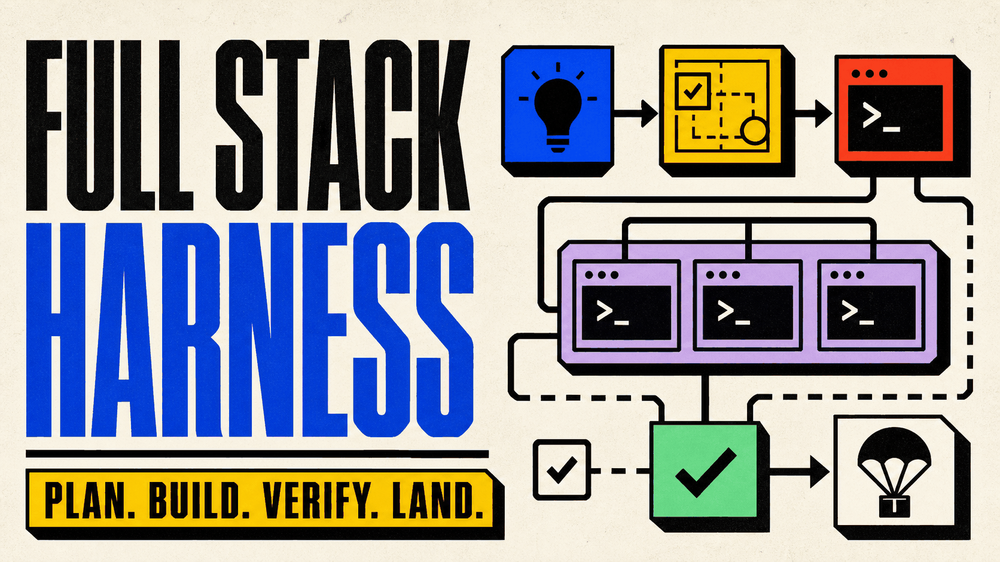

<p align="center">
  
</p>

<p align="center">
  <strong>English</strong> | <a href="README.zh-TW.md">繁體中文</a> | <a href="README.zh-CN.md">简体中文</a> | <a href="README.es.md">Español</a>
</p>

<p align="center">
  <a href="https://github.com/Phlegonlabs/product-delivery-harness/actions/workflows/harness-ci.yml"></a>
  
</p>

# Product Delivery Harness

Skills for turning product ideas and change requests into verified software with Codex, Claude Code, Pi or another skills-capable host. Product definition, design, implementation, security and external setup retain their own sources, evidence and owner decisions.

## Install

You need Python 3.10+, Git and a host that discovers `~/.agents/skills/`. On Windows, run `./install.sh` in Git Bash.

```bash
git clone https://github.com/Phlegonlabs/product-delivery-harness.git
cd product-delivery-harness
./install.sh
```

The installer locks the destination and stages only Git-index-tracked bundle files. It backs up current and legacy managed IDs under `~/.agents/skill-backups/product-delivery-harness/`, then verifies every installed path and byte.

It rejects unsafe links and unexpected source artifacts. Attempt ownership markers limit rollback to that attempt; foreign paths and prior backups remain intact. Its source receipt records the source SHA and dirty state. It prints the installed five-skill contract digest next to the one it replaced and saves both with the receipt; `harness_contract.py --skills-root <dir>` prints the digest of any skills tree.

The installer copies scripts, references, assets and templates. Tests stay in the source checkout; run them there. Install the pinned Python dependencies before validation:

```bash
python -m pip install -r skills/delivery-harness/requirements-test.txt
```

Updates use the same installer, never raw-copy replacement. Obtain authorization, quiesce relevant skill sessions and retain backups; start a fresh host session after verified success. A failed install rolls back. If later verification fails, rerun the installer from the previous release tag. A consumer repository then follows [bundle adoption](skills/delivery-harness/references/bundle-adoption.md): it updates the `## Harness Version` bullets in its `AGENTS.md`, runs `check_skill_bindings.py --previous-skill-dir <installer backup>` to label each changed pin `previous_release` or `owner_pin`, and records one Epic Change Log row.

For upgrades from 0.23 or earlier, archive the legacy directories under their original IDs in the same backup: `full-harness` → `delivery-harness`, `prd-builder` → `product-definition-builder`, `product-design-builder` → `design-system-compiler`. From 0.73.0 the installer also retires `code-security-review` (now `delivery-harness/references/security-review.md`), `product-activation` (now the deployment record and `references/external-setup.md`) and `seo-growth-review` (now `growth-review`).

UI work also needs the exact external `frontend-design` and `impeccable` trees in the [dependency manifest](skills/delivery-harness/assets/external-skill-dependencies.json). Follow their recorded installation routes, then run `check_external_skill_dependencies.py`. Review changed trees before updating full-tree pins. Project Skill Bindings keep owner-confirmed choices; never substitute a skill silently.

## Start here

| Your starting point | Skill | Result |
| --- | --- | --- |
| Product idea | `product-definition-builder` | Approved PRD, architecture, stack, TEST obligations and BDD feature files |
| Approved Product Definition with UI (design can start after the Product Thesis with an optional exploration round) | `ui-design-builder` | Directions, journey maps, complete HiFi, browser evidence and Visual Approval |
| Approved HiFi requiring a design system | `design-system-compiler` | Frozen pair and source-bound derived HTML |
| Scoped implementation or maintenance | `delivery-harness` | Direct work or managed PLAN/RUN; acceptance scenarios rendered from the PRD feature files; UI missions follow the approved journeys |
| Product with a public search surface (before its PRD), or a released product with any discoverable surface | `growth-review` | Keyword map before the PRD (`demand_research`); per-surface growth review with routed follow-ups, read-only except the map |

Source-runtime plates also support uniquely annotated shared subjects whose surface, state and target constraints agree with the row. The selected state is bound before product scripts run. Only the exact recognized design-token filler in its reviewer-panel placement is excluded; identical product script occurrences remain bound and ambiguous specimens still fail. An initial hidden flag may follow its own declared state controller; uncontrolled hidden paths still fail.

All five core skills and five standalone skills require an explicit request naming the skill, such as `$delivery-harness`. Continuing an already requested workflow is allowed. Ordinary tasks do not start Harness routing, document sync, Epic records or PLAN/RUN. Installation and existing project artifacts do not opt a task in. A requested skill retains its required checks and dependencies; a new top-level stage needs an explicit request. Codex metadata sets `allow_implicit_invocation: false`; other hosts follow the same instruction boundary.

For relevant choices or adopted decisions needing context, use [reference selection](skills/delivery-harness/references/reference-selection.md) and the [optional catalog](skills/delivery-harness/references/option-library/README.md). Neither is a prerequisite or grants execution authority; existing decisions and approvals remain binding.

## Typical prompts

Use `$skill-name` in Codex, or ask your host for the named skill. State the exact write scope and local or remote outcome.

```text
Use $growth-review in `demand_research` mode before the PRD: research search demand for this product's public pages, group the keywords into clusters with stable `KW-*` IDs and write `docs/product/keyword-map.md`, labeling every figure observed, estimated or hypothesis. Change no other file.
```

```text
Use $product-definition-builder to define this product, including complete frontend/backend architecture, data/auth/deployment choices, coherent stack options, UI behavior, release targets, tests with their feature files, and Product Definition Approval. Stop before UI design.
```

```text
The Product Definition is approved. Use $ui-design-builder with the `ui-design/3` contract and mandatory $frontend-design. Run the product preflight, read the PRD UI Surface Contract directly, and show three materially different directions over the same representative cases for my selection.
```

```text
I selected a direction. Continue $ui-design-builder with $frontend-design: build the kit and pilot pages first, then the complete connected HiFi, run the HiFi completeness preflight, then run $impeccable critique and audit plus H1-H9 grading. Ask for one full Visual Approval covering copy, structure, product menus, tabs, visuals and tokens, then use $design-system-compiler for the required `design-system/4` pair and frozen derived HTML.
```

```text
Use $delivery-harness to implement the approved plan. Create a branch and commit the verified change, but do not push or open a PR.
```

```text
The delivery is complete. Use $delivery-harness to perform the external setup rows in docs/DEPLOYMENT.md for the production release targets, configure only the exact actions I approve, verify each result by read-back, and record the Measurement Sources status.
```

```text
Use $growth-review to read back every surface of this released product with its own lens, reconcile the verified measurement sources against the Growth Contract, prioritize evidence-backed opportunities per surface, and route every proposed change without modifying the product or external accounts.
```

## What is included

| Skill | Owns |
| --- | --- |
| `product-definition-builder` | `PRD.md` with `## Ambition`, the At a Glance `Shape` row and `## Growth Contract`, `architecture.md`, `stack-decisions.md`, feature files in `docs/product/features/`, research, per-round PRD deltas and Product Definition Approval; the `program` delivery profile for many-module products (program PRD plus one [module package](skills/product-definition-builder/assets/templates/PROGRAM_PRD.template.md) each, validated per module), the [AI feature contract](skills/product-definition-builder/references/ai-feature-contract.md) and the modular monolith pattern for many-module products; every stack table has a `BDD runner` row, the approval block carries a `Feature files` digest, and the package checker turns on feature coverage, including eval-policy scenario ids, whenever the Test Obligations name their feature file; the PRD cites the `KW-*` clusters of `docs/product/keyword-map.md` when one applies |
| `ui-design-builder` | `docs/design/ui-design.md` from `UI_DESIGN.template.md`, direction studies and the approved complete HiFi package, with templates for the consolidated defect ledger (`UI_DEFECT_LEDGER.template.json`) and the grader, Impeccable-operator, pilot-diagnosis and re-review packets (`UI_REVIEW_PACKET.template.md`); a new visual scope also keeps its reference board captures under `docs/design/directions/<round>/references/` |
| `design-system-compiler` | Frozen `design-system.md` / `design-system.json` and `design-system-preview.html`; `check_design_system_pair.py --write-bindings` fills `sourceBindings` from `ui-design.md`, `--write` renders the `contrastPairs` and `typeSteps` ratios into a generated evidence block, and a `design-system/4` JSON token must match the HiFi CSS declaration of the same name |
| `delivery-harness` | Scope routing, authorization, tasks, integration, verification, the delivery-acceptance register rendered from the PRD feature files plus one run profile, the PRD delta rule that each Required TEST of a new or revised requirement needs a new or changed scenario, the security lens, external setup and measurement sources in `docs/DEPLOYMENT.md` (including the [GA4 admin setup](skills/delivery-harness/references/ga4-admin-setup.md) and AI provider setup), [performance and cost budgets](skills/delivery-harness/references/performance-and-cost-budget.md), native verification that cleans up what it built, PLAN/RUN when needed, the managed stage cards and the autonomous launch brief; the seeded project `AGENTS.md` with `Harness Version` and `Behavior Specs` sections, direct-route [assignment](skills/delivery-harness/assets/templates/ASSIGNMENT.template.md) and [review brief](skills/delivery-harness/assets/templates/DIRECT_REVIEW_BRIEF.template.md) templates, [delivery evidence](skills/delivery-harness/assets/templates/DELIVERY_EVIDENCE.template.md) files that `build_delivery_results.py` turns into `delivery-results.json`, and evidence-first [open-ended refinement](skills/delivery-harness/references/open-ended-refinement.md) of an existing app |
| `growth-review` | One lens per surface from the Surface Catalog: search and answer engines, store listings, registries and directories, bot platforms, desktop apps and the accounts the team runs; `pre_launch`, `demand_research`, `baseline`, Day 7 and Day 30 `growth_review` and `traffic_drop` modes, inline output except `demand_research`, which runs before the PRD and writes its one output, `docs/product/keyword-map.md`; live copy that contradicts `docs/gtm/MESSAGING.md` is a finding |

## Standalone skills

[Go To Market](standalone-skills/go-to-market/SKILL.md) selects channels and experiments, keeps one messaging record per project, extends the PRD Launch Window into a launch runbook, drafts lifecycle messaging for the Growth Contract re-engagement mechanisms, and prepares channel-specific drafts, assets, calendars and per-channel variants with two hooks, including developer channels and store listings.

[Customer Discovery](standalone-skills/customer-discovery/SKILL.md) plans user interviews, synthesizes redacted notes and hands `RA-*` candidate findings to the Product Definition. [README Studio](standalone-skills/readme-studio/SKILL.md) prepares project READMEs with real demonstrations and takes the first line from the messaging record when one exists. [Release Packager](standalone-skills/release-packager/SKILL.md) verifies release artifacts and consumer installation paths. [Logo Studio](standalone-skills/logo-studio/SKILL.md) designs a logo from a brand brief, a wide black-and-white sketch sheet, a written cull and stress-tested concepts, and leaves the choice to the owner.

These five complete skill directories require separate host registration; `install.sh` installs only the five core skills. Registration, builds, downloads, signing, publication, scheduling and account changes retain their own authorization. Reuse existing product and measurement records; add no review wave.

## How the system fits together


Initial UI requires design and all applicable self-reviews before Harness execution. Follow [author self-review](skills/delivery-harness/references/pre-delivery-self-review.md) at the Product, direction and HiFi exits below.

## Operating rules

The rules below apply within explicitly requested skill workflows.

The delivery core makes one size decision: one writer and one coherent verification sequence stay direct, and a few independent parts in separate files run as a [Direct Fan-Out](skills/delivery-harness/references/direct-fan-out.md): one writer per worktree, each merged back as soon as its merge check passes. Missions that depend on each other, durable handoff or a bounded correction graph use PLAN/RUN. Missions are feature batches; fine tasks keep their own atomic commits. An owner-selected `Delivery profile: mvp` compresses a small project or one-week MVP: stack and product approval in one owner call, HiFi for required surfaces, one combined delivery review with Final UI Acceptance folded in, and at most four owner gates; evidence, security and data-safety rules stay unchanged.

- [Entry and handoff](skills/delivery-harness/references/governance/task-and-handoff.md): inspect current instructions and sources; unknown loaded identity stays unknown. The current Epic is the one the `Current Epic:` line in `docs/DOCUMENTS.md` names; the index keeps one `docs/epics/` row, and each Epic keeps its own status. The bootstrap seeds a missing `.gitattributes` from `PROJECT_GITATTRIBUTES.template` so hash-bound files stay byte-exact ([gitattributes contract](skills/delivery-harness/references/gitattributes-contract.md)), and `configure_project_context.py --check` reports without writing: attribute gaps, a diff per stale `AGENTS.md` section and, with `--documents`, `docs/DOCUMENTS.md` drift. Resume a managed run from the inspector's `Next` block; a stale `running` RUN needs an owner decision first, and an autonomous run starts from a signed launch brief.
- [Delegation](skills/delivery-harness/references/delegation-contract.md): agent configuration and AGENTS choose executors, models, effort and fallback. One writer owns each checkout; assigned workers never delegate. Briefs and review packets are sized to the route's time, turn and byte caps before launch. A deadline with no verdict is environment-blocked and re-dispatched as smaller scoped calls. Design and review of changed boundaries follow the [architecture method](skills/delivery-harness/references/architecture-method.md).
- [Verification](skills/delivery-harness/references/verification-gates.md): bind required evidence to the exact candidate; missing capability or evidence stays blocked. An independent review of a browser matrix is verify-then-sample: verify the receipts, inspect FAIL and diff-flagged rows, and sample PASS rows. A browser capability probe is reused for the rest of the session. A sandboxed reviewer that cannot run git proves identity and a clean checkout through the `review_input.py` packet. `build_verifier_request.py` builds worker and task verifier requests from the live lease, and `security_review_result.py --result <file> --reviewed-sha <sha>` checks a direct-route security result without writing.
- [Delivery acceptance](skills/delivery-harness/references/delivery-acceptance-contract.md): feature files are PRD content the owner approves; step definitions are code. The register is rendered from the feature files and never hand-edited. Changing scenario text is a product decision and goes through a PRD delta; changing only step definitions is a small fix on the existing Epic. The BDD runner is a stack decision. A run profile's `variants` and `assign` map render a mixed-platform register, and `render_delivery_acceptance.py --check` reports drift without writing.
- [Candidate publication and promotion](skills/delivery-harness/references/branch-promotion-contract.md): preserve exact targets, action grants and remote readback; never force-push. An eligible repository may land one Epic under an owner grant recorded in advance, which `landing_gate.py` checks against the exact candidate before each action. [Card 8](skills/delivery-harness/references/stages/stage-cards.md#card-8-archive-publish-and-promote) lists the archive, publish and promote commands in order.
- [Source maintenance](skills/delivery-harness/references/governance/source-maintenance.md): use focused atomic checks and one complete candidate matrix.

Before every handoff, check source hashes, the Epic record and document consistency, and rewrite the Epic's `## Handoff` block (stage, approvals in force, remaining work, next action); every skill entry reads that block first. Document sync hashes each Epic without that block, so a rewrite is not drift. `docs/tasks.md` is a RUN-derived view, and `render_delivery_acceptance.py` renders the delivery-acceptance register from the feature files; generated content is not hand-edited. [Document sync](skills/delivery-harness/references/document-sync-contract.md), [bounded repairs](skills/delivery-harness/references/bounded-enhancement.md) and [delivery acceptance](skills/delivery-harness/references/delivery-acceptance-contract.md) own these checks.

| Stage | Default review and stop condition |
| --- | --- |
| Product Definition | One author self-review of the whole package after drafting and research reconciliation; recheck affected changes before owner approval; then one independent read-only PRD review and one targeted recheck, and the owner decides with a ten-question review guide. Later defects become isolated repairs with a scoped review. The keyword map comes before the page list; a route's `<title>` and meta description are content fields that can be rewritten without a PRD delta. |
| Directions | A new visual scope starts from a reference board of 9–12 captures, taken first from the owner's reference library when one exists. Each study's author checks and repairs its rendered study before owner selection, with a `slop_scan.py` run and a comparison sheet against the board. Three studies, written at the same time by separate authors when the host has the capacity. The owner sees the board, its proposed principles and the studies side by side in `_compare.html`, confirms the principles and chooses in one reply, and may ask once for three variants of one study. |
| HiFi | Three layers, the kit (tokens and every control with all states, one product stylesheet) and the pilot pages built first, then composition and art; authored static first, then motion. The author runs the checks after each journey, including measured accessibility. After completeness preflight, the same author self-reviews and repairs before independent review, with a `slop_scan.py` run and a `capture_sheet.py` sheet that puts the selected direction beside the candidate. One matrix capture per candidate; one review wave and one closure re-review by the same reviewers, no scoped re-reviews; a block needs a reproduced failure, the rule it breaks and closure criteria. Visual Approval follows Impeccable `critique` **and** `audit` and a rounded H1–H9 overall **at least 85** with every dimension **at least 80**. |
| Delivery | `review_policy: final_candidate`: one combined code, visual-if-UI and security review on the fixed final SHA (real browser for UI), plus one targeted re-check. After it, each remaining defect becomes one bounded repair with a scoped review of its diff only. |
| Release | One owner instruction may name several exact release actions. Archive-only A and tree-equal server main S inherit verified evidence under the rules below. A changed tree is a new candidate. |
| External setup | `docs/DEPLOYMENT.md` holds one External Console Setup row per action, the Measurement Sources table and one Release Log row per release. Verify authorization, independent readback and applicable behavior per release target; preparation and production readiness remain separate. A store or installer target needs install or download proof; an upload alone stays `pending`. |

## General runtime adapter

Current drivers are `subagents` and `sequential_parent`; map observed native tools through the [runtime adapter](skills/delivery-harness/references/runtime-adapters.md). Parent execution cannot satisfy an independent review. Host verifiers use current user permissions and provide no filesystem or network confinement. Capability never grants an action.

Preserve all twelve [action permissions](skills/delivery-harness/references/execution-state-model.md#authorization-action-ledger):

```text
invoke_external_runtime, spawn_subagents, create_user_owned_tasks,
create_local_worktrees, create_app_managed_worktrees, create_local_branches,
create_local_commits, integrate_locally, push, archive_worker_tasks,
remove_worktrees, delete_branches
```

Current RUNs close `local_only`, with `push` false and `pushed_head_sha` null. Publication, protected-branch landing, deployment, installation, archival and cleanup retain their separate grants. A passing mission returns `WORKER_RESULT`; a blocked or failed mission returns the graph node result with `worker_result: null`, and the parent retains validation, review and integration authority.

## Repository layout

| Path | Purpose |
| --- | --- |
| `skills/` | Five canonical skills, references, assets, templates and source tests |
| `standalone-skills/` | Separately registered optional skills |
| `assets/` | README cover assets |
| `docs/` | Live index and task records |
| `.github/workflows/harness-ci.yml` | Exact-candidate CI |
| `install.sh` | Verified bundle installation and updates |

## Maintain the skills

Edit canonical sources and update all four README descriptions in the same change. Select focused tests and negative cases from the changed files. Run tests from the source checkout:

```bash
python skills/delivery-harness/scripts/check_skill_spec.py
python -m unittest discover -s skills/delivery-harness/scripts/tests -p "test_skill_contract.py"
python skills/delivery-harness/scripts/docs_weight.py
python skills/delivery-harness/scripts/prepare_release.py --check
git diff --check
```

The [required matrix](skills/delivery-harness/references/governance/source-maintenance.md#required-verification) runs once on the fixed candidate through CI. Run it locally only when CI is unavailable, with `python skills/delivery-harness/scripts/ci_test_shards.py matrix --base <released main SHA> --log-dir <new directory>`; it writes one log per step and `summary.txt`. Preserve browser and native coverage; failures and changed inputs require affected rechecks. Retain the origin of reused evidence.

## Releasing

Follow the [source Git flow](skills/delivery-harness/references/governance/source-maintenance.md#git-flow) and [required verification](skills/delivery-harness/references/governance/source-maintenance.md#required-verification). Land the reviewed source candidate through its required PR to protected `main`; tag that commit `v<version>`. To set the version, write the four version-history entries into one directory as `en.md`, `zh-TW.md`, `zh-CN.md` and `es.md`, one line each, then run `python skills/delivery-harness/scripts/prepare_release.py --version <X.Y.Z> --entries <dir>`. It refuses unless every version surface agrees, sets the new version in `VERSION`, `package.json`, `package-lock.json` and the four READMEs, and moves the oldest README entry into `CHANGELOG.md`. Tests read the version from `VERSION`; add no hard-coded version literals.

Archive-only A must be C's direct child and pass exact receipt-bound archive verification before inheriting C's evidence. Only receipt-listed coordination/evidence moves, optional generated `docs/tasks.md`, the `docs/DOCUMENTS.md` update and `ARCHIVE_RECEIPT.json` may differ. All other paths stay unchanged. Retain C's reviewed SHA and original result origins; inherited evidence is never a fresh execution at A. A tree-equal server-created main SHA S inherits the candidate evidence with its original origin, proved by the `promotion_readback.py post` JSON; equality alone requires no repeated suite or security review. A different tree needs new candidate verification.

Publication requires the exact owner-authorized SHA and branch, a no-force push and remote readback. A single release instruction may bind these grants together; stop on drift or failed gates. After a verified formal release, update a changed installed bundle through the official installer at a quiescent boundary, with backup and verification. A badge proves neither installation nor deployment.

## Security and data safety

Keep credentials and user data out of the repository. Preserve unrelated files, worktrees and backups; deletion or replacement needs its exact owner authorization. Read-only security review never installs scanners, edits code or probes live targets without separate scope. See [security review](skills/delivery-harness/references/security-review.md) and [data protection](skills/delivery-harness/references/governance/development-rules.md#protect-local-data).

## License

[MIT](LICENSE). Retain third-party licenses and attribution for reused source and assets.

## Version history

- **0.91.0** — A direct task now reads the entry file and one short card instead of every contract. The direct steps moved into three cards: one for every direct task, one added for an initial delivery, one added for a UI change. Reading that serves only managed runs or only UI work now states its trigger. The new `check_commit_message.py` checks a commit message and states the fix, so the commit convention is read only when that check fails.

- **0.90.1** — The installed dependency checker now finds frontend-design and Impeccable beside delivery-harness. It verifies both skills against their pinned hashes.

- **0.90.0** — The HiFi stage of `ui-design-builder` now builds the shared parts first and ends its review after one re-review. Three layers: the kit (tokens and every control with all states, one product stylesheet), composition and art. The kit and the pilot pages come first, the author checks the pilot, a pilot diagnosis lists findings only, and the remaining journeys are built from the locked kit with a check after each journey. A small product skips the pilot and an enhancement has none. `assemble_ui_review.py --product-css <file>` embeds one product stylesheet identically in every page, and the bundle check rejects drift once any page carries the markers. `hifi_matrix_capture.py --measure-a11y` measures contrast, target size, text clip, focus visible and text growth and writes them to the sidecar's `a11y` object; it never changes a result or the exit code. The author makes one matrix capture per candidate, on the frozen bytes, and reviewers never run the driver. A missing obligation or a rejected receipt goes back to the same reviewer session; there is no evidence-only round. The review budget is the pilot diagnosis, one wave, one consolidated repair and one closure re-review by the wave's own reviewers with one fix exchange; the two scoped re-reviews are gone, and an open block leaves the candidate `blocked` for the owner. A block needs a reproduced failure, the rule it breaks and closure criteria. Authors read the Impeccable craft floor before authoring (`impeccable` gains the allowed use `author_quality_reference`), and the Impeccable authorization is asked at UI Design Intake. Receipt binding, the 85/80 thresholds and the contract versions are unchanged.

- **0.89.0** — Search demand can now be researched before the PRD. `growth-review` has a new mode, `demand_research`, for a product with a public search surface (public web pages or a store listing). It writes one file, `docs/product/keyword-map.md`, from `KEYWORD_MAP.template.md`: Scope, Clusters with stable `KW-*` IDs, Not pursued, Content fields and a Change log. Before a site exists every figure carries a label, `observed`, `estimated` or `hypothesis`, and no volume, rank or competitor fact is invented; an account-bound provider is used only with recorded access. The Product Definition runs the mode before it drafts the page list: Discovery Surface rows and `SEO metadata` lines cite `KW-*`, and a product with no map records `Keyword map: n/a` or `not run` with its reason. There is no new approval gate. A route's `<title>` and meta description are now content fields: the PRD keeps the launch values and limits, the map holds the current values, and a rewrite inside the limits that keeps the cluster needs no PRD delta and no UI review. The Day 7 and Day 30 `growth_review` readback compares every `KW-*` with the data and returns two lists: content-field rewrites, and structural PRD delta candidates.

- **0.88.0** — The HiFi matrix driver and the reviewer runtime close four gaps that failed correct product behaviour. A `navigate` interaction may now name its destination state: the control links to `<page>#hifi-state=<surface>/<state>`, also on the same page, and must use that form when the destination state is not the page's default; on arrival the fragment decides the surface and state, the arrival is saved, and a selection that another page stored no longer decides what a page shows after product navigation. When several reachable instances share one control ID, the driver activates the first that is not already selected and records its index, so a segmented control changes something. When an operation's control is a text field, a textarea or a select, the driver enters data as a user would and still requires an observed change; a disabled or read-only field fails. A page that keeps timing out now fails or blocks only its own remaining work, in base and intermediate runs alike, so a whole-package run with `--workers 4` completes: a 52-page package with a 6.9 MB entry page went from 345 blocked cases to none. The driver's focus rule now accepts focus that enters a newly opened layer and focus that returns to the opener of the layer an activation closed; any other focus movement still fails. The reviewer runtime in `HIFI_REVIEWER.template.html` changed, so a package adopts this release by rebuilding its pages from the new template; the compiler accepts the new runtime and the two earlier ones.

Earlier releases: [CHANGELOG.md](CHANGELOG.md).
