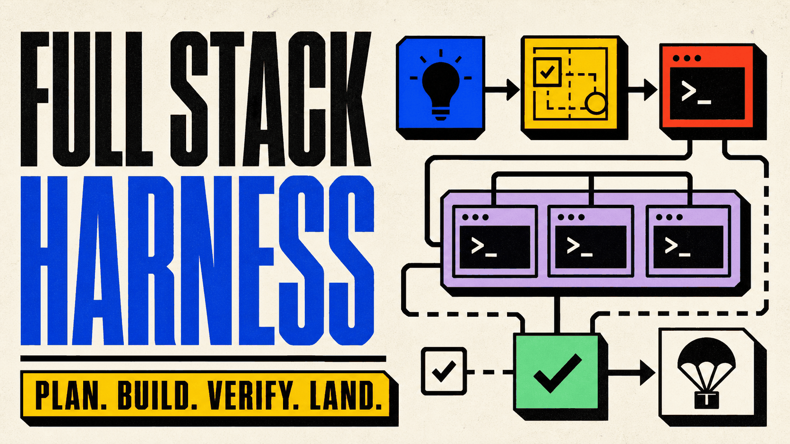

<p align="center">
  
</p>

<p align="center">
  <strong>English</strong> | <a href="README.zh-TW.md">繁體中文</a> | <a href="README.zh-CN.md">简体中文</a> | <a href="README.es.md">Español</a>
</p>

<p align="center">
  <a href="https://github.com/Phlegonlabs/product-delivery-harness/actions/workflows/harness-ci.yml"></a>
  
</p>

# Product Delivery Harness

Skills for turning product ideas and change requests into verified software with Codex, Claude Code, Pi or another skills-capable host. Product definition, design, implementation, security and external setup retain their own sources, evidence and owner decisions.

## Install

You need Python 3.10+, Git and a host that discovers `~/.agents/skills/`. On Windows, run `./install.sh` in Git Bash.

```bash
git clone https://github.com/Phlegonlabs/product-delivery-harness.git
cd product-delivery-harness
./install.sh
```

The installer locks the destination and stages only Git-index-tracked bundle files. It backs up current and legacy managed IDs under `~/.agents/skill-backups/product-delivery-harness/`, then verifies every installed path and byte.

It rejects unsafe links and unexpected source artifacts. Attempt ownership markers limit rollback to that attempt; foreign paths and prior backups remain intact. Its source receipt records the source SHA and dirty state.

The installer copies scripts, references, assets and templates. Tests stay in the source checkout; run them there. Install the pinned Python dependencies before validation:

```bash
python -m pip install -r skills/delivery-harness/requirements-test.txt
```

Updates use the same installer, never raw-copy replacement. Obtain authorization, quiesce relevant skill sessions and retain backups; start a fresh host session after verified success. A failed install rolls back. If later verification fails, rerun the installer from the previous release tag.

For upgrades from 0.23 or earlier, archive the legacy directories under their original IDs in the same backup: `full-harness` → `delivery-harness`, `prd-builder` → `product-definition-builder`, `product-design-builder` → `design-system-compiler`. From 0.73.0 the installer also retires `code-security-review` (now `delivery-harness/references/security-review.md`), `product-activation` (now the deployment record and `references/external-setup.md`) and `seo-growth-review` (now `growth-review`).

UI work also needs the exact external `frontend-design` and `impeccable` trees in the [dependency manifest](skills/delivery-harness/assets/external-skill-dependencies.json). Follow their recorded installation routes, then run `check_external_skill_dependencies.py`. Review changed trees before updating full-tree pins. Project Skill Bindings keep owner-confirmed choices; never substitute a skill silently.

## Start here

| Your starting point | Skill | Result |
| --- | --- | --- |
| Product idea | `product-definition-builder` | Approved PRD, architecture, stack and TEST obligations |
| Approved Product Definition with UI | `ui-design-builder` | Directions, complete HiFi, browser evidence and Visual Approval |
| Approved HiFi requiring a design system | `design-system-compiler` | Frozen pair and source-bound derived HTML |
| Scoped implementation or maintenance | `delivery-harness` | Direct work or managed PLAN/RUN |
| Released product with any discoverable surface | `growth-review` | Read-only per-surface growth review with routed follow-ups |

All five core skills and three standalone skills require an explicit request naming the skill, such as `$delivery-harness`. Continuing an already requested workflow is allowed. Ordinary tasks do not start Harness routing, document sync, Epic records or PLAN/RUN. Installation and existing project artifacts do not opt a task in. A requested skill retains its required checks and dependencies; a new top-level stage needs an explicit request. Codex metadata sets `allow_implicit_invocation: false`; other hosts follow the same instruction boundary.

For relevant choices or adopted decisions needing context, use [reference selection](skills/delivery-harness/references/reference-selection.md) and the [optional catalog](skills/delivery-harness/references/option-library/README.md). Neither is a prerequisite or grants execution authority; existing decisions and approvals remain binding.

## Typical prompts

Use `$skill-name` in Codex, or ask your host for the named skill. State the exact write scope and local or remote outcome.

```text
Use $product-definition-builder to define this product, including complete frontend/backend architecture, data/auth/deployment choices, coherent stack options, UI behavior, release targets, tests, and Product Definition Approval. Stop before UI design.
```

```text
The Product Definition is approved. Use $ui-design-builder with the `ui-design/3` contract and mandatory $frontend-design. Run the product preflight, read the PRD UI Surface Contract directly, and show three materially different directions over the same representative cases for my selection.
```

```text
I selected a direction. Continue $ui-design-builder with $frontend-design: build the complete connected HiFi, run the HiFi completeness preflight, then run separately authorized $impeccable critique and audit plus H1-H9 grading. Ask for one full Visual Approval covering copy, structure, product menus, tabs, visuals and tokens, then use $design-system-compiler for the required `design-system/4` pair and frozen derived HTML.
```

```text
Use $delivery-harness to implement the approved plan. Create a branch and commit the verified change, but do not push or open a PR.
```

```text
The delivery is complete. Use $delivery-harness to perform the external setup rows in docs/DEPLOYMENT.md for the production release targets, configure only the exact actions I approve, verify each result by read-back, and record the Measurement Sources status.
```

```text
Use $growth-review to read back every surface of this released product with its own lens, reconcile the verified measurement sources against the Growth Contract, prioritize evidence-backed opportunities per surface, and route every proposed change without modifying the product or external accounts.
```

## What is included

| Skill | Owns |
| --- | --- |
| `product-definition-builder` | `PRD.md` with `## Ambition`, the At a Glance `Shape` row and `## Growth Contract`, `architecture.md`, `stack-decisions.md`, research, per-round PRD deltas and Product Definition Approval |
| `ui-design-builder` | `docs/design/ui-design.md`, direction studies and the approved complete HiFi package |
| `design-system-compiler` | Frozen `design-system.md` / `design-system.json` and `design-system-preview.html` |
| `delivery-harness` | Scope routing, authorization, tasks, integration, verification, the security lens, external setup and measurement sources in `docs/DEPLOYMENT.md`, PLAN/RUN when needed, the managed stage cards and the autonomous launch brief |
| `growth-review` | One lens per surface from the Surface Catalog: search and answer engines, store listings, registries and directories, bot platforms and the accounts the team runs; `pre_launch`, `baseline`, Day 7 and Day 30 `growth_review` and `traffic_drop` modes, inline output |

## Standalone skills

[Go To Market](standalone-skills/go-to-market/SKILL.md) selects channels and experiments, keeps one messaging record per project, extends the PRD Launch Window into a launch runbook, drafts lifecycle messaging for the Growth Contract re-engagement mechanisms, and prepares channel-specific drafts, assets, calendars and per-channel variants with two hooks, including developer channels and store listings.

[Customer Discovery](standalone-skills/customer-discovery/SKILL.md) plans user interviews, synthesizes redacted notes and hands `RA-*` candidate findings to the Product Definition. [README Studio](standalone-skills/readme-studio/SKILL.md) prepares project READMEs with real demonstrations. [Release Packager](standalone-skills/release-packager/SKILL.md) verifies release artifacts and consumer installation paths.

These four complete skill directories require separate host registration; `install.sh` installs only the five core skills. Registration, builds, downloads, signing, publication, scheduling and account changes retain their own authorization. Reuse existing product and measurement records; add no review wave.

## How the system fits together

```mermaid
flowchart LR
  Product["Product Definition + Ambition + Growth Contract + owner approval"] --> UI["UI directions + complete HiFi"] --> Design["Visual Approval + required design-system pair"]
  Product -->|"headless or scoped enhancement or maintenance"| Harness["Direct or managed delivery"]
  Design --> Harness
  Harness --> Review["One combined review on final SHA"] --> Tests["One broad final validation"] --> C["Fixed candidate C"]
  C -->|managed| A["Managed only: archive-only A"] --> Publish["Authorized candidate publication + Preview when needed"]
  C -->|direct| Publish
  Publish --> Main["Separately authorized exact-SHA main landing"] --> Setup["External setup readback per target"] --> Outcome["Measured outcome + optional growth review"]
```



Initial UI requires design and all applicable self-reviews before Harness execution. Follow [author self-review](skills/delivery-harness/references/pre-delivery-self-review.md) at the Product, direction and HiFi exits below.

## Operating rules

The rules below apply within explicitly requested skill workflows.

The delivery core makes one size decision: one writer and one coherent verification sequence stay direct. Independent writable missions, durable handoff or a bounded correction graph use PLAN/RUN. Missions are feature batches; fine tasks keep their own atomic commits. An owner-selected `Delivery profile: mvp` compresses a small project or one-week MVP: stack and product approval in one owner call, HiFi for required surfaces, one combined delivery review with Final UI Acceptance folded in, and at most four owner gates; evidence, security and data-safety rules stay unchanged.

- [Entry and handoff](skills/delivery-harness/references/governance/task-and-handoff.md): inspect current instructions and sources; unknown loaded identity stays unknown. Resume a managed run from the inspector's `Next` block; a stale `running` RUN needs an owner decision first, and an autonomous run starts from a signed launch brief.
- [Delegation](skills/delivery-harness/references/delegation-contract.md): agent configuration and AGENTS choose executors, models, effort and fallback. One writer owns each checkout; assigned workers never delegate. Briefs and review packets are sized to the route's time, turn and byte caps before launch.
- [Verification](skills/delivery-harness/references/verification-gates.md): bind required evidence to the exact candidate; missing capability or evidence stays blocked.
- [Candidate publication and promotion](skills/delivery-harness/references/branch-promotion-contract.md): preserve exact targets, action grants and remote readback; never force-push.
- [Source maintenance](skills/delivery-harness/references/governance/source-maintenance.md): use focused atomic checks and one complete candidate matrix.

Before every handoff, check source hashes, the Epic record and document consistency, and rewrite the Epic's `## Handoff` block (stage, approvals in force, remaining work, next action); every skill entry reads that block first. `docs/tasks.md` is a RUN-derived view; generated content is not hand-edited. [Document sync](skills/delivery-harness/references/document-sync-contract.md), [bounded repairs](skills/delivery-harness/references/bounded-enhancement.md) and [delivery acceptance](skills/delivery-harness/references/delivery-acceptance-contract.md) own these checks.

| Stage | Default review and stop condition |
| --- | --- |
| Product Definition | A Product Thesis readback before closed-set decisions. One author self-review of the whole package after drafting and research reconciliation; recheck affected changes before owner approval; then one independent read-only PRD review and one targeted recheck, and the owner decides with a ten-question review guide. Discovery asks an Ambition segment, `PRD.md` holds `## Ambition`, and each PRD round publishes a delta aligned with its Epic. The At a Glance `Shape` row declares the track, companion surface and console; the checker validates it. `## Growth Contract` records the north star, re-engagement, discovery surfaces and launch window. The package budget is the author self-review, one independent review and one targeted recheck; later defects become isolated repairs with a scoped review. |
| Directions | The same author checks and repairs rendered studies before owner selection. Three studies; the owner chooses. A modification adds one revised selected study and decision; rejection starts a new set. |
| HiFi | After completeness preflight, the same author self-reviews and repairs before independent review. One diagnostic wave, one consolidated repair and one affected-scope re-review. Required browser coverage, Impeccable `critique` **and** `audit`, rounded H1–H9 overall **at least 85** and every dimension **at least 80**, then Visual Approval. Carry unchanged evidence forward with its identity. The stage holds the same two-review budget; later defects become isolated repairs with a scoped review of the repair diff. |
| Delivery | `review_policy: final_candidate`: one combined code, visual-if-UI and security review on the fixed final SHA (real browser for UI), triaged into blocking findings and notes, plus one targeted re-check. After the re-check, each remaining or new defect becomes one bounded repair with its own focused verifier and a scoped review of the repair diff only (finding, repair diff, direct consumers); the security lens joins when the diff touches a trust boundary, a scoped PASS re-binds the repaired paths, and scoped reviews do not consume review attempts. No Final UI Acceptance rerun unless the repair touches a UI surface, then only that surface; the broad final validation runs once per candidate at the end. Environment-blocked attempts do not spend the budget. |
| Release | One owner instruction may name several exact release actions. Archive-only A and tree-equal server main S inherit verified evidence under the rules below. A changed tree is a new candidate. |
| External setup | `docs/DEPLOYMENT.md` holds one External Console Setup row per action and the Measurement Sources table. Verify authorization, independent readback and applicable behavior per release target; preparation and production readiness remain separate. |

A missing `review_policy` retains legacy `per_mission` behavior. Preserve frozen PLAN/RUN pins and historical approvals; never reset consumed attempts by renaming a node. Past the two-review budget, remaining defects get isolated repairs with a scoped review of each repair diff; there is no extra review round. Security is mandatory for executable diffs; without it report `UNVALIDATED`, never PASS. A docs, copy, Epic, evidence or bookkeeping-only diff records `security: not_applicable (<reason>)` with the path list. A scope-disjoint carried PASS keeps its origin SHA and is never relabeled fresh. The first HiFi pass covers every audit axis. Its re-review repeats critique and audit on affected pages and states while retaining the full evidence matrix.

Impeccable remains mandatory for HiFi, but is not the default read-only implementation reviewer. Its workflow needs separate authorization for subagents, browser/server activity, snapshot writes and optional downloads. Product, stack, direction and Visual Approval decisions stay with their owners.

## General runtime adapter

Current drivers are `subagents` and `sequential_parent`; map observed native tools through the [runtime adapter](skills/delivery-harness/references/runtime-adapters.md). Parent execution cannot satisfy an independent review. Host verifiers use current user permissions and provide no filesystem or network confinement. Capability never grants an action.

Preserve all twelve [action permissions](skills/delivery-harness/references/execution-state-model.md#authorization-action-ledger):

```text
invoke_external_runtime, spawn_subagents, create_user_owned_tasks,
create_local_worktrees, create_app_managed_worktrees, create_local_branches,
create_local_commits, integrate_locally, push, archive_worker_tasks,
remove_worktrees, delete_branches
```

Current RUNs close `local_only`, with `push` false and `pushed_head_sha` null. Publication, protected-branch landing, deployment, installation, archival and cleanup retain their separate grants. A passing mission returns `WORKER_RESULT`; a blocked or failed mission returns the graph node result with `worker_result: null`, and the parent retains validation, review and integration authority.

## Repository layout

| Path | Purpose |
| --- | --- |
| `skills/` | Five canonical skills, references, assets, templates and source tests |
| `standalone-skills/` | Separately registered optional skills |
| `assets/` | README cover assets |
| `docs/` | Live index and task records |
| `.github/workflows/harness-ci.yml` | Exact-candidate CI |
| `install.sh` | Verified bundle installation and updates |

## Maintain the skills

Edit canonical sources and update all four README descriptions in the same change. Select focused tests and negative cases from the changed files. Run tests from the source checkout:

```bash
python skills/delivery-harness/scripts/check_skill_spec.py
python -m unittest discover -s skills/delivery-harness/scripts/tests -p "test_skill_contract.py"
python skills/delivery-harness/scripts/docs_weight.py
git diff --check
```

The [required matrix](skills/delivery-harness/references/governance/source-maintenance.md#required-verification) runs once on the fixed candidate through CI. Run it locally only when CI is unavailable. Preserve browser and native coverage; failures and changed inputs require affected rechecks. Retain the origin of reused evidence.

## Releasing

Follow the [source Git flow](skills/delivery-harness/references/governance/source-maintenance.md#git-flow) and [required verification](skills/delivery-harness/references/governance/source-maintenance.md#required-verification). Land the reviewed source candidate through its required PR to protected `main`; tag that commit `v<version>`. Update these release surfaces together:

1. `package.json` version and `skills/delivery-harness/VERSION`.
2. Version badges and current version-history entries in all four READMEs.
3. `required_harness_version` in `assets/templates/MISSION_RUNBOOK.template.md` under the delivery skill.
4. Keep tests deriving versions from `VERSION`, not new hard-coded literals.

Archive-only A must be C's direct child and pass exact receipt-bound archive verification before inheriting C's evidence. Only receipt-listed coordination/evidence moves, optional generated `docs/tasks.md`, the `docs/DOCUMENTS.md` update and `ARCHIVE_RECEIPT.json` may differ. All other paths stay unchanged. Retain C's reviewed SHA and original result origins; inherited evidence is never a fresh execution at A. A tree-equal server-created main SHA S inherits the candidate evidence with its original origin; equality alone requires no repeated suite or security review. A different tree needs new candidate verification.

Publication requires the exact owner-authorized SHA and branch, a no-force push and remote readback. A single release instruction may bind these grants together; stop on drift or failed gates. After a verified formal release, update a changed installed bundle through the official installer at a quiescent boundary, with backup and verification. A badge proves neither installation nor deployment.

## Security and data safety

Keep credentials and user data out of the repository. Preserve unrelated files, worktrees and backups; deletion or replacement needs its exact owner authorization. Read-only security review never installs scanners, edits code or probes live targets without separate scope. See [security review](skills/delivery-harness/references/security-review.md) and [data protection](skills/delivery-harness/references/governance/development-rules.md#protect-local-data).

## License

[MIT](LICENSE). Retain third-party licenses and attribution for reused source and assets.

## Version history

- **0.74.0** — Runs no longer stall in the middle. `inspect_harness_run.py` prints a `Next` block with one recommended command, and a `running` RUN without a lock needs an owner decision before selection. Seven short stage cards replace the long contracts as the routine reading, a signed launch brief carries authorizations and pre-recorded owner decisions into an autonomous loop, briefs and review packets are sized to each route's time, turn and byte caps, readiness probes the environment once, and every Epic ends with one `## Handoff` block that each skill entry reads first. The Product Definition reads back a Product Thesis, adds one independent read-only PRD review before approval and gives the owner a ten-question guide. Go To Market gains a messaging record, lifecycle messaging, developer, store and Hong Kong and Taiwan channel playbooks and a launch runbook, and the new standalone Customer Discovery skill turns user interviews into `RA-*` candidates.

- **0.73.0** — One project is a set of surfaces. The new [Surface Catalog](skills/delivery-harness/references/surface-catalog.md) lists 22 build surface classes (adding MCP servers, skills and plugins, libraries, messaging bots, marketplace apps, assistant listings, containers and internal services) and five presence kinds (social, video channel, newsletter, community, docs site) that live in the PRD Growth Contract as `platform:handle`; the Shape row gains `tool` and `content` tracks and the Launch Window a Destination column. The bundle shrinks from seven skills to five: `code-security-review` becomes the harness security lens (`references/security-review.md`), `product-activation` collapses into the deployment record (External Console Setup rows plus a Measurement Sources table, with the setup catalog in `references/external-setup.md`), and `seo-growth-review` becomes `growth-review`, which reads every surface with its own lens and resolves providers from the project's own stack decisions. `gtm-content` folds into `go-to-market`, and unused templates, dead helpers and the duplicate validator CLIs are gone.

- **0.72.1** — Mission workers return `WORKER_RESULT` only for a passing mission; blocked or failed missions return the graph node result with `worker_result: null`, and the parent keeps validation, review and integration authority.

- **0.72.0** — `ci_test_shards.py run --suite <name> --workers N` runs a suite's test modules in parallel processes with per-module logs, so the local Required Verification matrix finishes in minutes instead of 27 on one core.

- **0.71.0** — Every project declares its shape on purpose: the PRD At a Glance gains a `Shape` row naming the track, companion public surface and console type, and `## Growth Contract` records the north star with Day 7 and Day 30 targets, re-engagement mechanisms, discovery surfaces and a launch window. Track-specific required UI surfaces and delivery foundations, the `agentic-operations-console` architecture profile and activation profiles for store launch, agent directories and GEO read-back extend the flow from web to app and agent products. `seo-growth-review` gains a `pre_launch` mode and Day 7 and Day 30 `growth_review` readbacks that feed the next PRD delta, go-to-market drafts the Launch Reach Plan, and GTM Content packages one source piece into per-channel variants with two hooks.

Earlier releases: [CHANGELOG.md](CHANGELOG.md).
