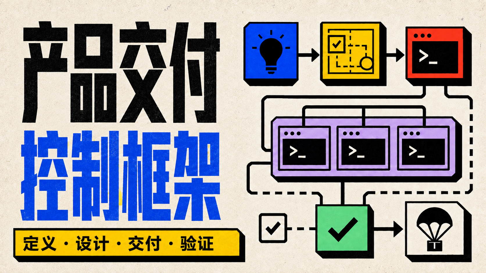

<p align="center">
  
</p>

<p align="center">
  <a href="README.md">English</a> | <a href="README.zh-TW.md">繁體中文</a> | <strong>简体中文</strong> | <a href="README.es.md">Español</a>
</p>

<p align="center">
  <a href="https://github.com/Phlegonlabs/product-delivery-harness/actions/workflows/harness-ci.yml"></a>
  
</p>

# Product Delivery Harness

这套技能让 Codex、Claude Code、Pi 或其他支持 skills 的宿主，把产品想法与变更需求转成经过验证的软件。产品定义、设计、实现、安全与外部设置各自保留来源、证据及 owner 决定。

## 安装

需要 Python 3.10 以上、Git，以及能发现 `~/.agents/skills/` 的宿主。Windows 请在 Git Bash 运行 `./install.sh`。

```bash
git clone https://github.com/Phlegonlabs/product-delivery-harness.git
cd product-delivery-harness
./install.sh
```

安装器会锁定目标目录，只暂存 Git index 已跟踪的 bundle 文件。它把当前与旧版 managed ID 备份到 `~/.agents/skill-backups/product-delivery-harness/`，再逐路径、逐字节验证安装结果。

安装器拒绝不安全的链接与非预期源文件。Attempt ownership marker 让 rollback 只处理本次建立的路径，保留外来路径与旧备份。来源收据记录 source SHA 与未提交状态。安装器会打印新安装的 five-skill contract digest 与被替换的那一个，并与收据一起保存；`harness_contract.py --skills-root <dir>` 可打印任一 skills tree 的 digest。

安装器复制 scripts、references、assets 与 templates。测试保留在源 checkout，请在该处运行。验证前先安装固定的 Python 依赖：

```bash
python -m pip install -r skills/delivery-harness/requirements-test.txt
```

更新沿用同一安装器，不能用 raw-copy 覆盖。先取得授权、暂停相关 skill session 并保留备份；验证成功后才开启新的宿主会话。安装失败会 rollback；后续验证失败时，从前一个 release tag 重跑安装器。consumer 仓库接着按 [bundle adoption](skills/delivery-harness/references/bundle-adoption.md) 采用新 bundle：更新 `AGENTS.md` 的 `## Harness Version` 条目，运行 `check_skill_bindings.py --previous-skill-dir <installer backup>` 把每个变动的 pin 标为 `previous_release` 或 `owner_pin`，并在 Epic 的 Change Log 记一行。

从 0.23 或更早版本升级时，在同一份备份中用原 ID 保存各旧目录：`full-harness` → `delivery-harness`、`prd-builder` → `product-definition-builder`、`product-design-builder` → `design-system-compiler`。自 0.73.0 起安装器也会退役 `code-security-review`（改为 `delivery-harness/references/security-review.md`）、`product-activation`（改为 deployment record 与 `references/external-setup.md`）与 `seo-growth-review`（改为 `growth-review`）。

UI 工作另需 [dependency manifest](skills/delivery-harness/assets/external-skill-dependencies.json) 固定的完整 `frontend-design` 与 `impeccable` tree。按记录的路径安装，再运行 `check_external_skill_dependencies.py`。更新 full-tree pin 前须审查变更；项目 Skill Bindings 保留 owner 已确认的选择，不可静默替换 skill。

## 从这里开始

| 当前起点 | Skill | 结果 |
| --- | --- | --- |
| 产品想法 | `product-definition-builder` | 已批准的 PRD、architecture、stack、TEST 义务与 BDD feature 文件 |
| 已批准且包含 UI 的 Product Definition（Product Thesis 之后即可开始设计，可先做可选的探索轮） | `ui-design-builder` | 方向、journey map、完整 HiFi、浏览器证据与 Visual Approval |
| 已批准且需要设计系统的 HiFi | `design-system-compiler` | 冻结的 pair 与来源绑定派生 HTML |
| 有界实现或维护 | `delivery-harness` | Direct 工作或 managed PLAN/RUN；验收 scenario 由 PRD 的 feature 文件生成；UI mission 按已批准的 journey 进行 |
| 已发布且有任何可被发现 surface 的产品 | `growth-review` | 逐 surface 的只读增长 review，以及已路由后续工作 |

五个核心 skills 与四个独立 skills 都只在你明确点名调用时启动，例如 `$delivery-harness`；也可继续已调用的工作。普通任务不会自动跑 Harness 分流、文档同步、Epic 记录或 PLAN/RUN。安装、项目指令与已有文档都不代表调用。被调用的 skill 保留必要检查与依赖；新的顶层阶段需要明确要求。Codex 设为 `allow_implicit_invocation: false`，其他 host 遵守同一指令边界。

相关选择尚未解决，或现有决定需要参考背景时，使用[参考选择规则](skills/delivery-harness/references/reference-selection.md)与[可选目录](skills/delivery-harness/references/option-library/README.md)。两者都不是前置条件，也不授予执行权限；现有决定与批准仍有效。

## 常见提示词

Codex 使用 `$skill-name`；其他宿主可直接指定 skill 名称。说明准确写入范围，以及本地或远端的预期结果。

```text
Use $product-definition-builder to define this product, including complete frontend/backend architecture, data/auth/deployment choices, coherent stack options, UI behavior, release targets, tests with their feature files, and Product Definition Approval. Stop before UI design.
```

```text
The Product Definition is approved. Use $ui-design-builder with the `ui-design/3` contract and mandatory $frontend-design. Run the product preflight, read the PRD UI Surface Contract directly, and show three materially different directions over the same representative cases for my selection.
```

```text
I selected a direction. Continue $ui-design-builder with $frontend-design: build the complete connected HiFi, run the HiFi completeness preflight, then run separately authorized $impeccable critique and audit plus H1-H9 grading. Ask for one full Visual Approval covering copy, structure, product menus, tabs, visuals and tokens, then use $design-system-compiler for the required `design-system/4` pair and frozen derived HTML.
```

```text
Use $delivery-harness to implement the approved plan. Create a branch and commit the verified change, but do not push or open a PR.
```

```text
The delivery is complete. Use $delivery-harness to perform the external setup rows in docs/DEPLOYMENT.md for the production release targets, configure only the exact actions I approve, verify each result by read-back, and record the Measurement Sources status.
```

```text
Use $growth-review to read back every surface of this released product with its own lens, reconcile the verified measurement sources against the Growth Contract, prioritize evidence-backed opportunities per surface, and route every proposed change without modifying the product or external accounts.
```

## 包含的内容

| Skill | 负责范围 |
| --- | --- |
| `product-definition-builder` | 含 `## Ambition`、At a Glance `Shape` 行与 `## Growth Contract` 的 `PRD.md`、`architecture.md`、`stack-decisions.md`、`docs/product/features/` 下的 feature 文件、研究、各轮 PRD delta 与 Product Definition Approval；多模块产品的 `program` 交付档（程序级 PRD 加每模块一个[模块包](skills/product-definition-builder/assets/templates/PROGRAM_PRD.template.md)，逐模块校验）、[AI 功能契约](skills/product-definition-builder/references/ai-feature-contract.md) 与多模块产品的 modular monolith 模式；每张 stack 表都有 `BDD runner` 行，批准区块带 `Feature files` digest，Test Obligations 一旦指明其 feature 文件，包 checker 就检查 feature 覆盖（含 eval-policy 的 scenario id） |
| `ui-design-builder` | 由 `UI_DESIGN.template.md` 创建的 `docs/design/ui-design.md`、方向研究与完整已批准 HiFi 包，另有集中缺陷 ledger（`UI_DEFECT_LEDGER.template.json`）以及 grader、Impeccable operator 与 scoped 复查 packet（`UI_REVIEW_PACKET.template.md`）的模板 |
| `design-system-compiler` | 冻结的 `design-system.md`／`design-system.json` 与 `design-system-preview.html`；`check_design_system_pair.py --write-bindings` 从 `ui-design.md` 填入 `sourceBindings`，`--write` 把 `contrastPairs` 与 `typeSteps` 的比值写入生成的证据区块，`design-system/4` 的 JSON token 须与 HiFi CSS 中的同名声明一致 |
| `delivery-harness` | 范围路由、授权、任务、集成、验证、由 PRD feature 文件加一份 run profile 生成的交付验收 register、PRD delta 规则（新增或修订需求的每个 Required TEST 都须有新增或改动的 scenario）、安全 lens、`docs/DEPLOYMENT.md` 内的外部设置与测量来源（含 [GA4 后台设置](skills/delivery-harness/references/ga4-admin-setup.md) 与 AI 供应商设置）、[性能与成本预算](skills/delivery-harness/references/performance-and-cost-budget.md)、跑完会清掉自己产物的原生验证，需要时的 PLAN/RUN，以及 managed stage cards 与自主执行用的 launch brief；初始化的项目 `AGENTS.md` 含 `Harness Version` 与 `Behavior Specs` 段落，另有 direct 路线的 [assignment](skills/delivery-harness/assets/templates/ASSIGNMENT.template.md) 与 [review brief](skills/delivery-harness/assets/templates/DIRECT_REVIEW_BRIEF.template.md) 模板、由 `build_delivery_results.py` 转成 `delivery-results.json` 的 [delivery evidence](skills/delivery-harness/assets/templates/DELIVERY_EVIDENCE.template.md) 文件，以及对现有 app 先取证再改的 [open-ended refinement](skills/delivery-harness/references/open-ended-refinement.md) |
| `growth-review` | 依 Surface Catalog 逐 surface 各用一个 lens：搜索与答案引擎、商店列表、registry 与目录、bot 平台、桌面 app，以及团队经营的账号；含 `pre_launch`、`baseline`、Day 7 与 Day 30 `growth_review` 与 `traffic_drop` 模式，直接回复；与 `docs/gtm/MESSAGING.md` 矛盾的线上文案算 finding |

## 独立 skills

[Go To Market](standalone-skills/go-to-market/SKILL.md) 选择渠道与实验、每个项目保留一份 messaging record、把 PRD 的 Launch Window 延伸成 launch runbook、为 Growth Contract 的再触达机制撰写 lifecycle messaging，并准备各渠道草稿、素材、日历与附两个 hook 的各渠道变体，涵盖开发者渠道与商店 listing。

[Customer Discovery](standalone-skills/customer-discovery/SKILL.md) 规划用户访谈、整理去标识化笔记，并把 `RA-*` 候选发现交回 Product Definition。[README Studio](standalone-skills/readme-studio/SKILL.md) 用实际展示编写项目 README，有 messaging record 时从中取第一行。[Release Packager](standalone-skills/release-packager/SKILL.md) 验证 release artifact 与用户安装路径。

这四个完整 skill 目录须另行向宿主注册；`install.sh` 只安装五个核心 skills。注册、build、下载、签名、发布、排程与账户变更保留各自授权。沿用现有产品与测量记录，不新增 review wave。

## 系统如何协同


初次 UI 交付须先完成设计与所有适用自查，才能进入 Harness 执行。按[作者自查](skills/delivery-harness/references/pre-delivery-self-review.md)，在下表的 Product、方向与 HiFi 既有出口完成检查。

## 运行规则

以下流程规则只适用于你明确调用的 skill 工作。

Delivery core 只做一次规模判断：一位 writer 配一段连贯验证即可完成的工作走 direct。可独立写入的 missions、持久交接或有界 correction graph 使用 PLAN/RUN。Mission 是功能批次，细 task 各自保留 atomic commit。owner 选择 `Delivery profile: mvp` 时，小型项目或一周 MVP 走压缩路线：stack 与产品批准一次合并调用、必要页面才做 HiFi、一次合并交付 review 并入 Final UI Acceptance，owner gate 最多四个；证据、安全与数据保护规则不变。

- [进场与交接](skills/delivery-harness/references/governance/task-and-handoff.md)：检查当前指令与来源；未知的 loaded identity 维持未知。当前 Epic 就是 `docs/DOCUMENTS.md` 的 `Current Epic:` 行所指的那份；索引只保留一行 `docs/epics/`，各 Epic 的状态写在自己的文件里。初始化会从 `PROJECT_GITATTRIBUTES.template` 创建缺少的 `.gitattributes`，让哈希绑定的文件逐字节保存（[gitattributes 契约](skills/delivery-harness/references/gitattributes-contract.md)）；`configure_project_context.py --check` 不写入任何文件，报告 attribute 缺口、每个过时 `AGENTS.md` 段落的 diff，加上 `--documents` 时也报告 `docs/DOCUMENTS.md` 的偏差。managed run 从 inspector 的 `Next` 区块恢复；停滞的 `running` RUN 先要 owner 决定，自主执行从已签署的 launch brief 开始。
- [分工](skills/delivery-harness/references/delegation-contract.md)：agent 设置与 AGENTS 决定 executor、model、effort 与 fallback。每个 checkout 只有一位 writer；被分派的 worker 不能再次分派。brief 与 review packet 在启动前先按路线的时间、turn 与 byte 上限切好大小。期限已到却没有 verdict，视为环境受阻，改以较小的 scoped 调用重新分派。变动边界的设计与 review 按 [architecture method](skills/delivery-harness/references/architecture-method.md) 进行。
- [验证](skills/delivery-harness/references/verification-gates.md)：必要证据绑定准确候选；缺能力或证据维持 blocked。浏览器矩阵的独立 review 采用先验证再抽样：验证 receipt，检查 FAIL 与经 diff 标记的行，再抽样 PASS 行。浏览器能力探测在同一 session 内重复使用。沙箱内跑不了 git 的 reviewer 以 `review_input.py` packet 证明身份与 checkout 干净。`build_verifier_request.py` 按 live lease 生成 worker 与 task 的 verifier request；`security_review_result.py --result <file> --reviewed-sha <sha>` 不写入任何文件，检查 direct 路线的安全审查结果。
- [交付验收](skills/delivery-harness/references/delivery-acceptance-contract.md)：feature 文件是 owner 批准的 PRD 内容，step definition 是代码。交付验收 register 由 feature 文件生成，不能手动编辑。改 scenario 文字是产品决定，须走 PRD delta；只改 step definition 是现有 Epic 上的小修正。BDD runner 是 stack 决策的一部分。run profile 的 `variants` 与 `assign` 映射可生成混合平台的 register；`render_delivery_acceptance.py --check` 只报告偏差，不写入。
- [候选发布与晋升](skills/delivery-harness/references/branch-promotion-contract.md)：保留准确 target、授权与远端回读，不得 force-push。[Card 8](skills/delivery-harness/references/stages/stage-cards.md#card-8-archive-publish-and-promote) 按顺序列出归档、发布与晋升命令。
- [源码维护](skills/delivery-harness/references/governance/source-maintenance.md)：每个 atomic task 跑聚焦检查，固定候选跑一次完整 matrix。

每次交接前，核对来源哈希（source hashes）、Epic 记录与文件一致性，并原地重写 Epic 的 `## Handoff` 区块（阶段、有效核准、剩余工作、下一步）；每个 skill 进场先读这个区块。文档同步计算每份 Epic 的哈希时不含该区块，所以重写它不算 drift。`docs/tasks.md` 由 RUN 派生，交付验收 register 由 `render_delivery_acceptance.py` 从 feature 文件生成；不能手动编辑生成区段。[文档同步](skills/delivery-harness/references/document-sync-contract.md)、[有界修复](skills/delivery-harness/references/bounded-enhancement.md) 与[交付验收](skills/delivery-harness/references/delivery-acceptance-contract.md) 拥有这些检查规则。

| 阶段 | 默认 review 与停止条件 |
| --- | --- |
| Product Definition | 草稿与研究对账完成后，作者自查整套文件一次；owner 批准前重查受影响变更；之后再做一次独立只读 PRD review 与一次定向复查，owner 按十题 review 指南决定。其后的缺陷走隔离修复加 scoped review。 |
| 方向 | 原作者先检查并修复已渲染的研究，再交 owner 选择。三个研究，由 owner 选定。 |
| HiFi | 完整性 preflight 后，原作者先自查及修复，再交独立 review。Impeccable `critique` **与** `audit` 完成，且四舍五入的 H1–H9 总平均 **至少 85**、每项 **至少 80** 后，才取得 Visual Approval。 |
| 交付 | `review_policy: final_candidate`：固定最终 SHA 上一次合并 code、适用 UI visual 与 security review（UI 使用真实浏览器），另加一次定向复查。之后每个剩余缺陷各成一笔有界修复，只对其修复差异做 scoped review。 |
| Release | 一个 owner 指令可指定多个准确 release 动作。Archive-only A 与 tree 相同的 server main S 按下列规则继承已验证证据；tree 不同就是新候选。 |
| 外部设置 | `docs/DEPLOYMENT.md` 每个动作一行 External Console Setup，另有 Measurement Sources 表，每次 release 在 Release Log 记一行。逐 release target 验证授权、独立回读与适用行为；前置准备与 production readiness 分开。商店或安装程序 target 须有安装或下载证明；只有上传时保持 `pending`。 |

## 通用 runtime adapter

当前 driver 为 `subagents` 与 `sequential_parent`，由 [runtime adapter](skills/delivery-harness/references/runtime-adapters.md) 对应实际观察到的 native 工具。Parent 执行不能替代独立 review。Host verifier 使用当前用户权限，不提供文件系统或网络隔离；有能力不等于有授权。

保留十二个[动作权限](skills/delivery-harness/references/execution-state-model.md#authorization-action-ledger)：

```text
invoke_external_runtime, spawn_subagents, create_user_owned_tasks,
create_local_worktrees, create_app_managed_worktrees, create_local_branches,
create_local_commits, integrate_locally, push, archive_worker_tasks,
remove_worktrees, delete_branches
```

当前 RUN 在本地以 `local_only` 结束，`push` 为 false，`pushed_head_sha` 为 null。发布、受保护分支 landing、部署、安装、归档与清理保留各自授权。任务通过时 worker 返回 `WORKER_RESULT`，阻塞或失败时返回 `worker_result: null` 的 graph node result，验证、review 与整合权保留在 parent。

## 仓库结构

| 路径 | 用途 |
| --- | --- |
| `skills/` | 五个 canonical skills、references、assets、templates 与源码测试 |
| `standalone-skills/` | 另行注册的可选 skills |
| `assets/` | README 封面素材 |
| `docs/` | 当前索引与任务记录 |
| `.github/workflows/harness-ci.yml` | Exact-candidate CI |
| `install.sh` | 经过验证的 bundle 安装与更新 |

## 维护技能

修改 canonical 源文件时，同步更新四种语言 README 的说明。按变动文件选择聚焦测试与反例；在源码 checkout 运行：

```bash
python skills/delivery-harness/scripts/check_skill_spec.py
python -m unittest discover -s skills/delivery-harness/scripts/tests -p "test_skill_contract.py"
python skills/delivery-harness/scripts/docs_weight.py
python skills/delivery-harness/scripts/prepare_release.py --check
git diff --check
```

[必要 matrix](skills/delivery-harness/references/governance/source-maintenance.md#required-verification) 在固定候选上通过 CI 跑一次，只有 CI 不可用时才在本地用 `python skills/delivery-harness/scripts/ci_test_shards.py matrix --base <released main SHA> --log-dir <new directory>` 运行完整 matrix，它为每一步写一份 log 与 `summary.txt`。保留浏览器与 native 覆盖，失败或输入变更时重验受影响部分；沿用证据须保留原始来源。

## 发布

遵循[源码 Git flow](skills/delivery-harness/references/governance/source-maintenance.md#git-flow) 与[必要验证](skills/delivery-harness/references/governance/source-maintenance.md#required-verification)。已审查的源码候选经必要 PR 进入受保护 `main`，并在该 commit 加上 `v<version>` tag。设定版本时，把四段版本历史写进同一目录的 `en.md`、`zh-TW.md`、`zh-CN.md` 与 `es.md`（各一行），再运行 `python skills/delivery-harness/scripts/prepare_release.py --version <X.Y.Z> --entries <dir>`。任何版本字段不一致时它会拒绝；一致时把新版本写进 `VERSION`、`package.json`、`package-lock.json` 与四份 README，并把 README 最旧的一条记录移到 `CHANGELOG.md`。测试从 `VERSION` 读取版本，不新增 hard-coded literal。

Archive-only A 须为 C 的直接子 commit，通过准确、receipt-bound 归档验证后才继承 C 的证据。差异只可包含收据列出的 coordination／evidence 移动、可选的派生 `docs/tasks.md`、`docs/DOCUMENTS.md` 更新与 `ARCHIVE_RECEIPT.json`，其他路径保持不变。保留 C 已审 SHA 与各结果的原始来源，不把继承证据当作 A 的新执行。Server 生成的 main SHA S 若 tree 相同，连同原始来源继承候选证据，由 `promotion_readback.py post` 的 JSON 证明；不因 tree 相同而重跑完整 suite 或安全审查。Tree 不同则重新验证新候选。

发布须绑定 owner 授权的准确 SHA 与 branch，使用 no-force push 并回读远端。一个 release 指令可同时绑定这些授权；遇到 drift 或 gate 失败就停止。正式 release 验证完成后，若已安装 bundle 不同，在相关 session 静止时以官方安装器更新，保留备份及验证。Badge 不能证明已安装或已部署。

## 安全与数据保护

凭证与用户数据不得进入仓库。保留无关文件、worktree 与备份，删除或替换须有准确 owner 授权。只读安全审查不会擅自安装 scanner、改代码或探测线上 target。详见[安全审查](skills/delivery-harness/references/security-review.md)与[数据保护](skills/delivery-harness/references/governance/development-rules.md#protect-local-data)。

## 许可

[MIT](LICENSE)。重用第三方代码与素材时保留许可与署名。

## 版本历史

- **0.79.1** — 0.79.0 PR 经 Codex review 后的补丁。`hifi_matrix_capture.py` 对产品控件不可见或焦点没有单独落在控件上的交互改记 FAIL，不再出现 `focusCorrect: false` 却 PASS 的行；reviewer pass 改点击带 surface 条件的状态控件，同一页两个 surface 共用 `ready` 等状态时不再误报“reviewer control missing”。frozen package 的 join 会把 PRD 声明的 `docs/product/features` 目录传给 Product Definition checker，批准后改动 scenario 会以 feature 文件 digest 不符拦下 readiness，与 CLI 行为一致。bundle 字节改变，consumer 需重 pin 五技能契约。

- **0.79.0** — 整套 review 第二轮。0.78.0 那次审查留下的十项在此版落地。RUN 里权限最高的几个改动现在都有守卫的 transition：`harness_transition.py record-grant`、`open-run`、`close-run`、`record-runtime` 会取锁、带着 owner 的原话、从 RUN 填入 run_id 与 plan revision 和 digest、写入前验证整个 pair，并拒绝 `push`；`lease-worker --packet-out` 直接从已租用的 RUN 渲染并检查 worker goal 包大小，Card 4 因此去掉独立的渲染与检查步骤。`build_verifier_request.py --layer mission_integration` 生成 integration verifier 的 request，builder 与两个 validator 现在共用同一个 `verifier_context`。`promotion_readback.py pre` 与 `post` 以只读方式证明 main 的前状态、祖先关系与 tree 相等；README 以 `post` 的 JSON 作为 tree 相等的证明。`hifi_matrix_capture.py` 会点击并以键盘触发 manifest 的每个交互、测量 reviewer 行、用 `--color-scheme dark` 跑完整基础矩阵、用 `--intermediate` 写出中间宽度的输出，并新增 `reflow-320` 轴。`parity_capture.py --hifi-package` 通过 reviewer 控件比对 ui-hifi/2 包，route map 用 `PARITY_ROUTE_MAP.template.json`。consumer 会察觉的变化，在 0.79.0 pin 之后：eval policy 为 `not_required` 的 managed PLAN 仍须冻结 delivery-acceptance source、声明 acceptance 与 closeout gate 及 pass-only 链；system-conformance 的 `target_comparison` 必须引用冻结的已批准 HiFi。pin 在 0.79.0 之前的 run 保持现行行为。bundle 新增契约，因此升 minor 版本。

- **0.78.0** — 整套 review。一次只读的整套审查问了三件事：哪里能简化、哪些该做成模板、还缺什么；91 项已验证的发现中，78 项分两波在此版落地，另外十项较大的留待第二轮。各入口行动前必读的字数下降：delivery-harness 由 43,863 降到约 31,100（managed 路线由 41,245 降到 28,389），product-definition-builder 由 41,185 降到约 37,700，ui-design-builder 由 32,758 降到约 30,800。新模板：`UI_DESIGN`、`UI_DEFECT_LEDGER`、`UI_REVIEW_PACKET`、`PROJECT_GITATTRIBUTES`、`DIRECT_REVIEW_BRIEF`、`ASSIGNMENT` 与 `DELIVERY_EVIDENCE`，初始化的记录另有 Release Log、`Current Epic:` 行与 `Harness Version` 段落。新 reference：architecture method、gitattributes 契约、bundle adoption、open-ended refinement 与 Card 8。新命令：`build_delivery_results.py`、`build_verifier_request.py`、`prepare_release.py`、`ci_test_shards.py matrix`、`security_review_result.py` 的 CLI、`render_delivery_acceptance.py --check` 与 profile variants，以及 `check_design_system_pair.py --write-bindings` 和自动计算的对比与字级证据。consumer 会察觉的变化：JSON 与 HiFi CSS 不一致的现有 `design-system/4` pair 可能在 token 值检查失败；商店与安装程序 target 须有安装或下载证明；`MISSION_RUNBOOK.template.md` 已移除，它的默认值不再是版本字段；带 pre-0.66 anchor key 的 archive receipt 会失败；Epic 哈希不含 Handoff 区块。bundle 新增契约，因此升 minor 版本。

- **0.77.0** — 可执行的 scenario。`docs/product/features/` 下的 feature 文件纳入 PRD 包，与 PRD 一起批准。每个 scenario 恰好带一个 `@TEST-*` tag，每个 `Required: Yes` 的 Test Obligation 至少要有一个 scenario。`check_feature_coverage.py` 双向检查，新包运行 `check_product_package.py` 时另加 `--features <dir>`。`render_delivery_acceptance.py` 由 feature 文件加一份 run profile 生成交付验收 register；`@platform:`、`@auth:` 与 `@env:` tag 只针对单个 scenario 覆盖 profile，register 不能手动编辑。加上 `--features` 与 `--features-base` 时，`check_prd_delta_scope.py` 要求 delta 中每个新增或修订需求的 Required TEST 都有新增或改动的 scenario，否则拒绝。项目 AGENTS 模板新增 Behavior Specs 段落，Greenfield scaffold 会配置已批准的 BDD runner（新增的 stack 层）及其 step definition 目录。改 scenario 文字是产品决定，须走 PRD delta；只改 step definition 是现有 Epic 上的小修正。

- **0.76.1** — 更快的 review 循环。motion receipt 按单一 intent 在代表性 target 上的离线 receipt 校验，沙箱为 allowlisted-local-pages，不再要求 HiFi bundle 的 interaction、navigation 与 reviewer 证据，motion collector 因此能通过安装的契约。沙箱内跑不了 git 的 reviewer 改用父进程以 `review_input.py` 生成的 packet（detached clone、按范围切分的 diff、父进程 status 与全文件 SHA-256 清单）证明候选身份与 checkout 干净；有该 packet 时 git 失败不再算 environment block。targeted re-check 后若仍有多个 finding family，合并成一次 consolidated repair，用一个 review point 审查，只有 packet 超过路线上限时才按路径组拆分；pre-review gate 要求基线对比控件，对绑定的 base 字节记录每个案例的预期转变（无效输入 old=accept new=reject，恢复的合法行为 old=reject new=accept，保留的正向样本两边都 accept）。

较早版本：[英文 CHANGELOG.md](CHANGELOG.md)。
