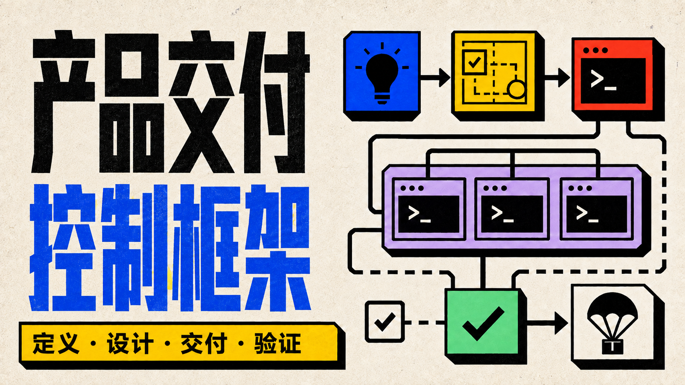

<p align="center">
  
</p>

<p align="center">
  <a href="README.md">English</a> | <a href="README.zh-TW.md">繁體中文</a> | <strong>简体中文</strong> | <a href="README.es.md">Español</a>
</p>

<p align="center">
  <a href="https://github.com/Phlegonlabs/product-delivery-harness/actions/workflows/harness-ci.yml"></a>
  
</p>

# Product Delivery Harness

这套技能让 Codex、Claude Code、Pi 或其他支持 skills 的宿主，把产品想法与变更需求转成经过验证的软件。产品定义、设计、实现、安全与启用各自保留来源、证据及 owner 决定。

## 安装

需要 Python 3.10 以上、Git，以及能发现 `~/.agents/skills/` 的宿主。Windows 请在 Git Bash 运行 `./install.sh`。

```bash
git clone https://github.com/Phlegonlabs/product-delivery-harness.git
cd product-delivery-harness
./install.sh
```

安装器会锁定目标目录，只暂存 Git index 已跟踪的 bundle 文件。它把当前与旧版 managed ID 备份到 `~/.agents/skill-backups/product-delivery-harness/`，再逐路径、逐字节验证安装结果。

安装器拒绝不安全的链接与非预期源文件。Attempt ownership marker 让 rollback 只处理本次建立的路径，保留外来路径与旧备份。来源收据记录 source SHA 与未提交状态。

安装器复制 scripts、references、assets 与 templates。测试保留在源 checkout，请在该处运行。验证前先安装固定的 Python 依赖：

```bash
python -m pip install -r skills/delivery-harness/requirements-test.txt
```

更新沿用同一安装器，不能用 raw-copy 覆盖。先取得授权、暂停相关 skill session 并保留备份；验证成功后才开启新的宿主会话。安装失败会 rollback；后续验证失败时，从前一个 release tag 重跑安装器。

从 0.23 或更早版本升级时，在同一份备份中用原 ID 保存各旧目录：`full-harness` → `delivery-harness`、`prd-builder` → `product-definition-builder`、`product-design-builder` → `design-system-compiler`。

UI 工作另需 [dependency manifest](skills/delivery-harness/assets/external-skill-dependencies.json) 固定的完整 `frontend-design` 与 `impeccable` tree。按记录的路径安装，再运行 `check_external_skill_dependencies.py`。更新 full-tree pin 前须审查变更；项目 Skill Bindings 保留 owner 已确认的选择，不可静默替换 skill。

## 从这里开始

| 当前起点 | Skill | 结果 |
| --- | --- | --- |
| 产品想法 | `product-definition-builder` | 已批准的 PRD、architecture、stack 与 TEST 义务 |
| 已批准且包含 UI 的 Product Definition | `ui-design-builder` | 方向、完整 HiFi、浏览器证据与 Visual Approval |
| 已批准且需要设计系统的 HiFi | `design-system-compiler` | 冻结的 pair 与来源绑定派生 HTML |
| 有界实现或维护 | `delivery-harness` | Direct 工作或 managed PLAN/RUN |
| 固定且已集成的代码候选 | `code-security-review` | 只读 exact-SHA 安全结果与覆盖缺口 |
| 外部设置或 release readiness | `product-activation` | 逐 target 的授权动作、回读与 readiness |
| Production 公开网站 | `seo-growth-review` | 只读搜索与测量 review，以及已路由后续工作 |

七个核心 skills 与四个独立 skills 都只在你明确点名调用时启动，例如 `$delivery-harness`；也可继续已调用的工作。普通任务不会自动跑 Harness 分流、文档同步、Epic 记录或 PLAN/RUN。安装、项目指令与已有文档都不代表调用。被调用的 skill 保留必要检查与依赖；新的顶层阶段需要明确要求。Codex 设为 `allow_implicit_invocation: false`，其他 host 遵守同一指令边界。

相关选择尚未解决，或现有决定需要参考背景时，使用[参考选择规则](skills/delivery-harness/references/reference-selection.md)与[可选目录](skills/delivery-harness/references/option-library/README.md)。两者都不是前置条件，也不授予执行权限；现有决定与批准仍有效。

## 常见提示词

Codex 使用 `$skill-name`；其他宿主可直接指定 skill 名称。说明准确写入范围，以及本地或远端的预期结果。

```text
Use $product-definition-builder to define this product, including complete frontend/backend architecture, data/auth/deployment choices, coherent stack options, UI behavior, release targets, tests, and Product Definition Approval. Stop before UI design.
```

```text
The Product Definition is approved. Use $ui-design-builder with the `ui-design/3` contract and mandatory $frontend-design. Run the product preflight, read the PRD UI Surface Contract directly, and show three materially different directions over the same representative cases for my selection.
```

```text
I selected a direction. Continue $ui-design-builder with $frontend-design: build the complete connected HiFi, run the HiFi completeness preflight, then run separately authorized $impeccable critique and audit plus H1-H9 grading. Ask for one full Visual Approval covering copy, structure, product menus, tabs, visuals and tokens, then use $design-system-compiler for the required `design-system/4` pair and frozen derived HTML.
```

```text
Use $delivery-harness to implement the approved plan. Create a branch and commit the verified change, but do not push or open a PR.
```

```text
The delivery is complete. Use $product-activation for the production release targets, configure only the exact external actions I approve, verify each result by read-back, and stop after recording activation readiness and the measurement-window handoff.
```

```text
Use $seo-growth-review to audit this production website, reconcile Search Console visibility with GA4 on-site outcomes, prioritize evidence-backed keyword and page opportunities, and route every proposed change without modifying the site or external accounts.
```

## 包含的内容

| Skill | 负责范围 |
| --- | --- |
| `product-definition-builder` | 含 `## Ambition`、At a Glance `Shape` 行与 `## Growth Contract` 的 `PRD.md`、`architecture.md`、`stack-decisions.md`、研究、各轮 PRD delta 与 Product Definition Approval |
| `ui-design-builder` | `docs/design/ui-design.md`、方向研究与完整已批准 HiFi 包 |
| `design-system-compiler` | 冻结的 `design-system.md`／`design-system.json` 与 `design-system-preview.html` |
| `delivery-harness` | 范围路由、授权、任务、集成、验证，以及需要时的 PLAN/RUN |
| `code-security-review` | 准确候选的安全维度：findings、工具、覆盖与 exclusions |
| `product-activation` | `docs/ACTIVATION.md`、外部设置、行为证明、测量交接与 `aso-and-store-launch`、`agent-directory`、`geo-readback` profile |
| `seo-growth-review` | Production SEO 与自然流量证据；默认直接回复，明确要求时才另存报告，另含 `pre_launch` 模式与 Day 7、Day 30 的 `growth_review` 回读 |

## 独立 skills

[Go To Market](standalone-skills/go-to-market/SKILL.md) 选择渠道与实验，并起草 Launch Reach Plan。[GTM Content](standalone-skills/gtm-content/SKILL.md) 准备各渠道草稿、素材、日历与附两个 hook 的各渠道变体。

[README Studio](standalone-skills/readme-studio/SKILL.md) 用实际展示编写项目 README。[Release Packager](standalone-skills/release-packager/SKILL.md) 验证 release artifact 与用户安装路径。

这四个完整 skill 目录须另行向宿主注册；`install.sh` 只安装七个核心 skills。注册、build、下载、签名、发布、排程与账户变更保留各自授权。沿用现有产品与测量记录，不新增 review wave。

## 系统如何协同


初次 UI 交付须先完成设计与所有适用自查，才能进入 Harness 执行。按[作者自查](skills/delivery-harness/references/pre-delivery-self-review.md)，在下表的 Product、方向与 HiFi 既有出口完成检查。

## 运行规则

以下流程规则只适用于你明确调用的 skill 工作。

Delivery core 只做一次规模判断：一位 writer 配一段连贯验证即可完成的工作走 direct。可独立写入的 missions、持久交接或有界 correction graph 使用 PLAN/RUN。Mission 是功能批次，细 task 各自保留 atomic commit。owner 选择 `Delivery profile: mvp` 时，小型项目或一周 MVP 走压缩路线：stack 与产品批准一次合并调用、必要页面才做 HiFi、一次合并交付 review 并入 Final UI Acceptance，owner gate 最多四个；证据、安全与数据保护规则不变。

- [进场与交接](skills/delivery-harness/references/governance/task-and-handoff.md)：检查当前指令与来源；未知的 loaded identity 维持未知。
- [分工](skills/delivery-harness/references/delegation-contract.md)：agent 设置与 AGENTS 决定 executor、model、effort 与 fallback。每个 checkout 只有一位 writer；被分派的 worker 不能再次分派。
- [验证](skills/delivery-harness/references/verification-gates.md)：必要证据绑定准确候选；缺能力或证据维持 blocked。
- [候选发布与晋升](skills/delivery-harness/references/branch-promotion-contract.md)：保留准确 target、授权与远端回读，不得 force-push。
- [源码维护](skills/delivery-harness/references/governance/source-maintenance.md)：每个 atomic task 跑聚焦检查，固定候选跑一次完整 matrix。

每次交接前，核对来源哈希（source hashes）、Epic 记录与文件一致性。`docs/tasks.md` 由 RUN 派生，不能手动编辑生成区段。[文档同步](skills/delivery-harness/references/document-sync-contract.md)、[有界修复](skills/delivery-harness/references/bounded-enhancement.md) 与[交付验收](skills/delivery-harness/references/delivery-acceptance-contract.md) 拥有这些检查规则。

| 阶段 | 默认 review 与停止条件 |
| --- | --- |
| Product Definition | 草稿与研究对账完成后，作者自查整套文件一次；owner 批准前重查受影响变更。Discovery 追加 Ambition 段落，`PRD.md` 放 `## Ambition`，且每轮 PRD 发布与其 Epic 对齐的 delta。At a Glance 的 `Shape` 行声明 track、companion 界面与 console，由 checker 验证；`## Growth Contract` 记录 north star、再触达、discovery surfaces 与 launch window。套件保有两次 review 预算——一次初审与一次定向复查——之后的缺陷走隔离修复加 scoped review。 |
| 方向 | 原作者先检查并修复已渲染的研究，再交 owner 选择。三个研究；修改只新增一个所选方向的修订研究与一次决定，拒绝才重做整组。 |
| HiFi | 完整性 preflight 后，原作者先自查及修复，再交独立 review。一次诊断 wave、一批集中修复与一次受影响范围复查。保留必要浏览器覆盖、Impeccable `critique` **与** `audit`、四舍五入的 H1–H9 总平均 **至少 85** 及每项 **至少 80**，再取得 Visual Approval。未变证据连同身份沿用。此阶段保有同样的两次 review 预算；之后的缺陷走隔离修复，并对修复差异做 scoped review。 |
| 交付 | `review_policy: final_candidate`：固定最终 SHA 上一次合并 code、适用 UI visual 与 security review（UI 使用真实浏览器），findings 分为 blocking 与 notes，另加一次定向复查。复查后每个剩余或新缺陷各成一笔有界修复，附自己的聚焦 verifier，并只对修复差异做 scoped review（finding、修复差异、直接消费者）；差异碰到信任边界时安全维度才加入，scoped PASS 重新绑定被修复路径，scoped review 不占用 attempt 预算。除非修复碰到 UI 页面，否则不重跑 Final UI Acceptance，碰到时只重跑该页面；broad final validation 每个候选于最后跑一次。环境受阻的 attempt 不占用预算。 |
| Release | 一个 owner 指令可指定多个准确 release 动作。Archive-only A 与 tree 相同的 server main S 按下列规则继承已验证证据；tree 不同就是新候选。 |
| Activation | 逐 release target 验证授权、独立回读与适用行为；前置准备与 production readiness 分开。 |

缺少 `review_policy` 时保留旧版 `per_mission` 行为。保留冻结 PLAN/RUN pin 与历史批准，不可改 node 名称重置已用 attempts。预算用完后，剩余缺陷走隔离修复，并对每个修复差异做 scoped review；没有额外 review 轮次。可执行差异必须有安全审查，缺少时报 `UNVALIDATED`，不能报 PASS。仅含 docs、copy、Epic、证据或簿记的差异改记 `security: not_applicable (<reason>)` 并列出路径。范围不相交而沿用的 PASS 保留原始 SHA，不得改称全新。 HiFi 初审涵盖每个 audit 轴；复查只在受影响页面与状态重跑 critique 和 audit，仍保留完整证据矩阵。

HiFi 仍须使用 Impeccable，但它不是默认的只读实现 reviewer。其 workflow 的 subagent、浏览器／server、snapshot 写入与可选下载须另有授权。产品、stack、方向与 Visual Approval 决定仍属原 owner。

## 通用 runtime adapter

当前 driver 为 `subagents` 与 `sequential_parent`，由 [runtime adapter](skills/delivery-harness/references/runtime-adapters.md) 对应实际观察到的 native 工具。Parent 执行不能替代独立 review。Host verifier 使用当前用户权限，不提供文件系统或网络隔离；有能力不等于有授权。

保留十二个[动作权限](skills/delivery-harness/references/execution-state-model.md#authorization-action-ledger)：

```text
invoke_external_runtime, spawn_subagents, create_user_owned_tasks,
create_local_worktrees, create_app_managed_worktrees, create_local_branches,
create_local_commits, integrate_locally, push, archive_worker_tasks,
remove_worktrees, delete_branches
```

当前 RUN 在本地以 `local_only` 结束，`push` 为 false，`pushed_head_sha` 为 null。发布、受保护分支 landing、部署、安装、归档与清理保留各自授权。

## 仓库结构

| 路径 | 用途 |
| --- | --- |
| `skills/` | 七个 canonical skills、references、assets、templates 与源码测试 |
| `standalone-skills/` | 另行注册的可选 skills |
| `assets/` | README 封面素材 |
| `docs/` | 当前索引与任务记录 |
| `.github/workflows/harness-ci.yml` | Exact-candidate CI |
| `install.sh` | 经过验证的 bundle 安装与更新 |

## 维护技能

修改 canonical 源文件时，同步更新四种语言 README 的说明。按变动文件选择聚焦测试与反例；在源码 checkout 运行：

```bash
python skills/delivery-harness/scripts/check_skill_spec.py
python -m unittest discover -s skills/delivery-harness/scripts/tests -p "test_skill_contract.py"
python skills/delivery-harness/scripts/docs_weight.py
git diff --check
```

[必要 matrix](skills/delivery-harness/references/governance/source-maintenance.md#required-verification) 在固定候选上通过 CI 跑一次，只有 CI 不可用时才在本地运行完整 matrix。保留浏览器与 native 覆盖，失败或输入变更时重验受影响部分；沿用证据须保留原始来源。

## 发布

遵循[源码 Git flow](skills/delivery-harness/references/governance/source-maintenance.md#git-flow) 与[必要验证](skills/delivery-harness/references/governance/source-maintenance.md#required-verification)。已审查的源码候选经必要 PR 进入受保护 `main`，并在该 commit 加上 `v<version>` tag。以下 release 字段一并更新：

1. `package.json` version 与 `skills/delivery-harness/VERSION`。
2. 四种语言 README 的版本 badge 与当前版本历史。
3. Delivery skill 的 `assets/templates/MISSION_RUNBOOK.template.md` 内 `required_harness_version`。
4. 测试继续从 `VERSION` 读取版本，不新增 hard-coded literal。

Archive-only A 须为 C 的直接子 commit，通过准确、receipt-bound 归档验证后才继承 C 的证据。差异只可包含收据列出的 coordination／evidence 移动、可选的派生 `docs/tasks.md`、`docs/DOCUMENTS.md` 更新与 `ARCHIVE_RECEIPT.json`，其他路径保持不变。保留 C 已审 SHA 与各结果的原始来源，不把继承证据当作 A 的新执行。Server 生成的 main SHA S 若 tree 相同，连同原始来源继承候选证据；不因 tree 相同而重跑完整 suite 或安全审查。Tree 不同则重新验证新候选。

发布须绑定 owner 授权的准确 SHA 与 branch，使用 no-force push 并回读远端。一个 release 指令可同时绑定这些授权；遇到 drift 或 gate 失败就停止。正式 release 验证完成后，若已安装 bundle 不同，在相关 session 静止时以官方安装器更新，保留备份及验证。Badge 不能证明已安装或已部署。

## 安全与数据保护

凭证与用户数据不得进入仓库。保留无关文件、worktree 与备份，删除或替换须有准确 owner 授权。只读安全审查不会擅自安装 scanner、改代码或探测线上 target。详见[安全审查](skills/code-security-review/SKILL.md)与[数据保护](skills/delivery-harness/references/governance/development-rules.md#protect-local-data)。

## 许可

[MIT](LICENSE)。重用第三方代码与素材时保留许可与署名。

## 版本历史

- **0.71.0** — 每个项目都明确声明自己的形状：PRD At a Glance 新增 `Shape` 行，写明 track、companion 公开界面与 console 类型，`## Growth Contract` 记录 north star 与 Day 7、Day 30 目标、再触达机制、discovery surfaces 与 launch window。各 track 的必要 UI 界面与交付基础、`agentic-operations-console` 架构 profile，以及 store launch、agent directory 与 GEO 回读的 activation profile，把流程从 web 延伸到 app 与 agent 产品。`seo-growth-review` 新增 `pre_launch` 模式与 Day 7、Day 30 的 `growth_review` 回读并喂给下一轮 PRD delta，go-to-market 起草 Launch Reach Plan，GTM Content 把一份源内容打包成各渠道变体并附两个 hook。

- **0.70.0** — 每个候选阶段保有两次 review 预算：一次初审与一次定向复查；需要 owner 授权的额外轮次与后继 review node 移除。复查后每个剩余或新缺陷各成一笔隔离修复，附自己的聚焦 verifier，并只对修复差异做 scoped review——差异碰到信任边界时安全维度才加入，scoped PASS 重新绑定被修复路径、既有 PASS 沿用，broad final validation 每个候选于最后跑一次。managed 路线记录修复范围与 scoped PASS，owner 选择的 `mvp` delivery profile 把小型项目或一周 MVP 压缩到最多四个 owner gate。

- **0.69.0** — Discovery 追加第四个 Ambition 段落，`PRD.md` 新增 `## Ambition` 与 Metrics 的 `Stretch` 列，PRD 各轮不再累加到同一份文件：每轮发布与其 Epic 对齐的 delta。Epic 记录其 delta 与 ambition rung，PLAN 冻结 `prd-delta` 来源，范围检查把 mission trace 绑到所属 delta 的需求 ID。

- **0.68.0** — review findings 分为 blocking 缺陷与非 blocking notes：只有 blocking findings 触发修复，复查只在修复范围内验证原 findings，安全维度保持完整范围。环境受阻的 review attempt 不再占用 attempt 预算，修复须附作者的 verifier PASS 才会进复查，非可执行差异改记 `security: not_applicable` 而非 `UNVALIDATED`。范围不相交而沿用的 PASS 保留原始 SHA，超出一次合并 review 加一次复查的 review 点须记录理由。

- **0.67.0** — 七个核心与四个独立 skills 都改为明确调用才启动。Harness 分流、文档同步与 Epic 记录只适用于已调用的工作。保留必要检查与依赖，不自动启动下一个顶层阶段。

- **0.66.0** — 从 PRD、UI 到交付减少重复 review 轮次，保留 85／80、Impeccable、Visual Approval 与精确 SHA 安全审查。Mission 以功能批次规划，每个只派一位合并维度的 reviewer；只有证明干净的 merge chain 才跳过代码整合审查。候选的所有 review 回来后一次修复，复查只看修复范围。HiFi 复查限于修复清单并沿用未变记录，修改方向只新增一份研究，PRD 检查提前拦下无法到达的页面和没有出口的状态。每个 RUN 与设计轮固定一个 Harness 合约，未观察身份每个 session 只记一次，改加载简短入口清单。修正 retention 假缺陷与整合记录的 commit 边界竞态，并发布 AgentKiosk 的 compiler、状态覆盖、role-policy 与 ingestion 改动。

较早版本：[英文 CHANGELOG.md](CHANGELOG.md)。
