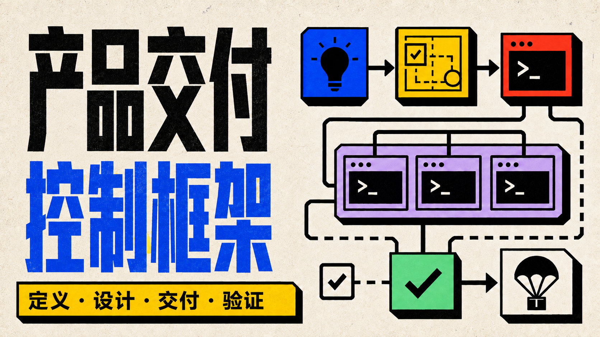

<p align="center">
  
</p>

<p align="center">
  <a href="README.md">English</a> | <a href="README.zh-TW.md">繁體中文</a> | <strong>简体中文</strong> | <a href="README.es.md">Español</a>
</p>

<p align="center">
  <a href="https://github.com/Phlegonlabs/product-delivery-harness/actions/workflows/harness-ci.yml"></a>
  
</p>

# Product Delivery Harness

这套技能让 Codex、Claude Code、Pi 或其他支持 skills 的宿主，把产品想法与变更需求转成经过验证的软件。产品定义、设计、实现、安全与外部设置各自保留来源、证据及 owner 决定。

## 安装

需要 Python 3.10 以上、Git，以及能发现 `~/.agents/skills/` 的宿主。Windows 请在 Git Bash 运行 `./install.sh`。

```bash
git clone https://github.com/Phlegonlabs/product-delivery-harness.git
cd product-delivery-harness
./install.sh
```

安装器会锁定目标目录，只暂存 Git index 已跟踪的 bundle 文件。它把当前与旧版 managed ID 备份到 `~/.agents/skill-backups/product-delivery-harness/`，再逐路径、逐字节验证安装结果。

安装器拒绝不安全的链接与非预期源文件。Attempt ownership marker 让 rollback 只处理本次建立的路径，保留外来路径与旧备份。来源收据记录 source SHA 与未提交状态。安装器会打印新安装的 five-skill contract digest 与被替换的那一个，并与收据一起保存；`harness_contract.py --skills-root <dir>` 可打印任一 skills tree 的 digest。

安装器复制 scripts、references、assets 与 templates。测试保留在源 checkout，请在该处运行。验证前先安装固定的 Python 依赖：

```bash
python -m pip install -r skills/delivery-harness/requirements-test.txt
```

更新沿用同一安装器，不能用 raw-copy 覆盖。先取得授权、暂停相关 skill session 并保留备份；验证成功后才开启新的宿主会话。安装失败会 rollback；后续验证失败时，从前一个 release tag 重跑安装器。consumer 仓库接着按 [bundle adoption](skills/delivery-harness/references/bundle-adoption.md) 采用新 bundle：更新 `AGENTS.md` 的 `## Harness Version` 条目，运行 `check_skill_bindings.py --previous-skill-dir <installer backup>` 把每个变动的 pin 标为 `previous_release` 或 `owner_pin`，并在 Epic 的 Change Log 记一行。

从 0.23 或更早版本升级时，在同一份备份中用原 ID 保存各旧目录：`full-harness` → `delivery-harness`、`prd-builder` → `product-definition-builder`、`product-design-builder` → `design-system-compiler`。自 0.73.0 起安装器也会退役 `code-security-review`（改为 `delivery-harness/references/security-review.md`）、`product-activation`（改为 deployment record 与 `references/external-setup.md`）与 `seo-growth-review`（改为 `growth-review`）。

UI 工作另需 [dependency manifest](skills/delivery-harness/assets/external-skill-dependencies.json) 固定的完整 `frontend-design` 与 `impeccable` tree。按记录的路径安装，再运行 `check_external_skill_dependencies.py`。更新 full-tree pin 前须审查变更；项目 Skill Bindings 保留 owner 已确认的选择，不可静默替换 skill。

## 从这里开始

| 当前起点 | Skill | 结果 |
| --- | --- | --- |
| 产品想法 | `product-definition-builder` | 已批准的 PRD、architecture、stack、TEST 义务与 BDD feature 文件 |
| 已批准且包含 UI 的 Product Definition（Product Thesis 之后即可开始设计，可先做可选的探索轮） | `ui-design-builder` | 方向、journey map、完整 HiFi、浏览器证据与 Visual Approval |
| 已批准且需要设计系统的 HiFi | `design-system-compiler` | 冻结的 pair 与来源绑定派生 HTML |
| 有界实现或维护 | `delivery-harness` | Direct 工作或 managed PLAN/RUN；验收 scenario 由 PRD 的 feature 文件生成；UI mission 按已批准的 journey 进行 |
| 已发布且有任何可被发现 surface 的产品 | `growth-review` | 逐 surface 的只读增长 review，以及已路由后续工作 |

Source-runtime plate 也支持具唯一标记、且 surface、state 与 target 条件符合该行的共用主体。产品脚本执行前会先绑定选定状态。只有内容与检视器面板位置完全符合的已知 design-token 填值脚本会被排除；内容相同的产品脚本仍保留绑定，样本有歧义仍会失败。 初始 hidden 可由元素自身声明的状态规则控制；没有状态控制器的隐藏路径仍会失败。

五个核心 skills 与四个独立 skills 都只在你明确点名调用时启动，例如 `$delivery-harness`；也可继续已调用的工作。普通任务不会自动跑 Harness 分流、文档同步、Epic 记录或 PLAN/RUN。安装、项目指令与已有文档都不代表调用。被调用的 skill 保留必要检查与依赖；新的顶层阶段需要明确要求。Codex 设为 `allow_implicit_invocation: false`，其他 host 遵守同一指令边界。

相关选择尚未解决，或现有决定需要参考背景时，使用[参考选择规则](skills/delivery-harness/references/reference-selection.md)与[可选目录](skills/delivery-harness/references/option-library/README.md)。两者都不是前置条件，也不授予执行权限；现有决定与批准仍有效。

## 常见提示词

Codex 使用 `$skill-name`；其他宿主可直接指定 skill 名称。说明准确写入范围，以及本地或远端的预期结果。

```text
Use $product-definition-builder to define this product, including complete frontend/backend architecture, data/auth/deployment choices, coherent stack options, UI behavior, release targets, tests with their feature files, and Product Definition Approval. Stop before UI design.
```

```text
The Product Definition is approved. Use $ui-design-builder with the `ui-design/3` contract and mandatory $frontend-design. Run the product preflight, read the PRD UI Surface Contract directly, and show three materially different directions over the same representative cases for my selection.
```

```text
I selected a direction. Continue $ui-design-builder with $frontend-design: build the complete connected HiFi, run the HiFi completeness preflight, then run separately authorized $impeccable critique and audit plus H1-H9 grading. Ask for one full Visual Approval covering copy, structure, product menus, tabs, visuals and tokens, then use $design-system-compiler for the required `design-system/4` pair and frozen derived HTML.
```

```text
Use $delivery-harness to implement the approved plan. Create a branch and commit the verified change, but do not push or open a PR.
```

```text
The delivery is complete. Use $delivery-harness to perform the external setup rows in docs/DEPLOYMENT.md for the production release targets, configure only the exact actions I approve, verify each result by read-back, and record the Measurement Sources status.
```

```text
Use $growth-review to read back every surface of this released product with its own lens, reconcile the verified measurement sources against the Growth Contract, prioritize evidence-backed opportunities per surface, and route every proposed change without modifying the product or external accounts.
```

## 包含的内容

| Skill | 负责范围 |
| --- | --- |
| `product-definition-builder` | 含 `## Ambition`、At a Glance `Shape` 行与 `## Growth Contract` 的 `PRD.md`、`architecture.md`、`stack-decisions.md`、`docs/product/features/` 下的 feature 文件、研究、各轮 PRD delta 与 Product Definition Approval；多模块产品的 `program` 交付档（程序级 PRD 加每模块一个[模块包](skills/product-definition-builder/assets/templates/PROGRAM_PRD.template.md)，逐模块校验）、[AI 功能契约](skills/product-definition-builder/references/ai-feature-contract.md) 与多模块产品的 modular monolith 模式；每张 stack 表都有 `BDD runner` 行，批准区块带 `Feature files` digest，Test Obligations 一旦指明其 feature 文件，包 checker 就检查 feature 覆盖（含 eval-policy 的 scenario id） |
| `ui-design-builder` | 由 `UI_DESIGN.template.md` 创建的 `docs/design/ui-design.md`、方向研究与完整已批准 HiFi 包，另有集中缺陷 ledger（`UI_DEFECT_LEDGER.template.json`）以及 grader、Impeccable operator 与 scoped 复查 packet（`UI_REVIEW_PACKET.template.md`）的模板；新视觉范围另保留 `docs/design/directions/<round>/references/` 下的参考板截图 |
| `design-system-compiler` | 冻结的 `design-system.md`／`design-system.json` 与 `design-system-preview.html`；`check_design_system_pair.py --write-bindings` 从 `ui-design.md` 填入 `sourceBindings`，`--write` 把 `contrastPairs` 与 `typeSteps` 的比值写入生成的证据区块，`design-system/4` 的 JSON token 须与 HiFi CSS 中的同名声明一致 |
| `delivery-harness` | 范围路由、授权、任务、集成、验证、由 PRD feature 文件加一份 run profile 生成的交付验收 register、PRD delta 规则（新增或修订需求的每个 Required TEST 都须有新增或改动的 scenario）、安全 lens、`docs/DEPLOYMENT.md` 内的外部设置与测量来源（含 [GA4 后台设置](skills/delivery-harness/references/ga4-admin-setup.md) 与 AI 供应商设置）、[性能与成本预算](skills/delivery-harness/references/performance-and-cost-budget.md)、跑完会清掉自己产物的原生验证，需要时的 PLAN/RUN，以及 managed stage cards 与自主执行用的 launch brief；初始化的项目 `AGENTS.md` 含 `Harness Version` 与 `Behavior Specs` 段落，另有 direct 路线的 [assignment](skills/delivery-harness/assets/templates/ASSIGNMENT.template.md) 与 [review brief](skills/delivery-harness/assets/templates/DIRECT_REVIEW_BRIEF.template.md) 模板、由 `build_delivery_results.py` 转成 `delivery-results.json` 的 [delivery evidence](skills/delivery-harness/assets/templates/DELIVERY_EVIDENCE.template.md) 文件，以及对现有 app 先取证再改的 [open-ended refinement](skills/delivery-harness/references/open-ended-refinement.md) |
| `growth-review` | 依 Surface Catalog 逐 surface 各用一个 lens：搜索与答案引擎、商店列表、registry 与目录、bot 平台、桌面 app，以及团队经营的账号；含 `pre_launch`、`baseline`、Day 7 与 Day 30 `growth_review` 与 `traffic_drop` 模式，直接回复；与 `docs/gtm/MESSAGING.md` 矛盾的线上文案算 finding |

## 独立 skills

[Go To Market](standalone-skills/go-to-market/SKILL.md) 选择渠道与实验、每个项目保留一份 messaging record、把 PRD 的 Launch Window 延伸成 launch runbook、为 Growth Contract 的再触达机制撰写 lifecycle messaging，并准备各渠道草稿、素材、日历与附两个 hook 的各渠道变体，涵盖开发者渠道与商店 listing。

[Customer Discovery](standalone-skills/customer-discovery/SKILL.md) 规划用户访谈、整理去标识化笔记，并把 `RA-*` 候选发现交回 Product Definition。[README Studio](standalone-skills/readme-studio/SKILL.md) 用实际展示编写项目 README，有 messaging record 时从中取第一行。[Release Packager](standalone-skills/release-packager/SKILL.md) 验证 release artifact 与用户安装路径。

这四个完整 skill 目录须另行向宿主注册；`install.sh` 只安装五个核心 skills。注册、build、下载、签名、发布、排程与账户变更保留各自授权。沿用现有产品与测量记录，不新增 review wave。

## 系统如何协同

```mermaid
flowchart LR
  Product["Product Definition 与 Ambition、Growth Contract、feature 文件、owner 批准"] --> UI["UI 方向、journey map 与完整 HiFi"] --> Design["Visual Approval 与必要设计系统 pair"]
  Product -.->|"Product Thesis 之后的可选探索轮 R0"| UI
  Product -->|"无 UI，或限域增强或维护"| Harness["Direct 或 managed 交付"]
  Design -->|"mission 按已批准的 journey 进行"| Harness
  Harness --> Review["最终 SHA 的一次合并 review"] --> Tests["一次 broad final validation 与交付验收 register"] --> C["固定候选 C"]
  C -->|managed| A["仅 managed：archive-only A"] --> Publish["已授权候选发布与适用 Preview"]
  C -->|direct| Publish
  Publish --> Main["另行授权 exact-SHA main landing"] --> Setup["逐 target 外部设置回读"] --> Outcome["测量成效与可选 growth review"]
```



初次 UI 交付须先完成设计与所有适用自查，才能进入 Harness 执行。按[作者自查](skills/delivery-harness/references/pre-delivery-self-review.md)，在下表的 Product、方向与 HiFi 既有出口完成检查。

## 运行规则

以下流程规则只适用于你明确调用的 skill 工作。

Delivery core 只做一次规模判断：一位 writer 配一段连贯验证即可完成的工作走 direct；几个互不依赖、文件不重叠的部分走 [Direct Fan-Out](skills/delivery-harness/references/direct-fan-out.md)：每位 writer 一个 worktree，merge check 一通过就合回工作分支。互相依赖的 missions、持久交接或有界 correction graph 使用 PLAN/RUN。Mission 是功能批次，细 task 各自保留 atomic commit。owner 选择 `Delivery profile: mvp` 时，小型项目或一周 MVP 走压缩路线：stack 与产品批准一次合并调用、必要页面才做 HiFi、一次合并交付 review 并入 Final UI Acceptance，owner gate 最多四个；证据、安全与数据保护规则不变。

- [进场与交接](skills/delivery-harness/references/governance/task-and-handoff.md)：检查当前指令与来源；未知的 loaded identity 维持未知。当前 Epic 就是 `docs/DOCUMENTS.md` 的 `Current Epic:` 行所指的那份；索引只保留一行 `docs/epics/`，各 Epic 的状态写在自己的文件里。初始化会从 `PROJECT_GITATTRIBUTES.template` 创建缺少的 `.gitattributes`，让哈希绑定的文件逐字节保存（[gitattributes 契约](skills/delivery-harness/references/gitattributes-contract.md)）；`configure_project_context.py --check` 不写入任何文件，报告 attribute 缺口、每个过时 `AGENTS.md` 段落的 diff，加上 `--documents` 时也报告 `docs/DOCUMENTS.md` 的偏差。managed run 从 inspector 的 `Next` 区块恢复；停滞的 `running` RUN 先要 owner 决定，自主执行从已签署的 launch brief 开始。
- [分工](skills/delivery-harness/references/delegation-contract.md)：agent 设置与 AGENTS 决定 executor、model、effort 与 fallback。每个 checkout 只有一位 writer；被分派的 worker 不能再次分派。brief 与 review packet 在启动前先按路线的时间、turn 与 byte 上限切好大小。期限已到却没有 verdict，视为环境受阻，改以较小的 scoped 调用重新分派。变动边界的设计与 review 按 [architecture method](skills/delivery-harness/references/architecture-method.md) 进行。
- [验证](skills/delivery-harness/references/verification-gates.md)：必要证据绑定准确候选；缺能力或证据维持 blocked。浏览器矩阵的独立 review 采用先验证再抽样：验证 receipt，检查 FAIL 与经 diff 标记的行，再抽样 PASS 行。浏览器能力探测在同一 session 内重复使用。沙箱内跑不了 git 的 reviewer 以 `review_input.py` packet 证明身份与 checkout 干净。`build_verifier_request.py` 按 live lease 生成 worker 与 task 的 verifier request；`security_review_result.py --result <file> --reviewed-sha <sha>` 不写入任何文件，检查 direct 路线的安全审查结果。
- [交付验收](skills/delivery-harness/references/delivery-acceptance-contract.md)：feature 文件是 owner 批准的 PRD 内容，step definition 是代码。交付验收 register 由 feature 文件生成，不能手动编辑。改 scenario 文字是产品决定，须走 PRD delta；只改 step definition 是现有 Epic 上的小修正。BDD runner 是 stack 决策的一部分。run profile 的 `variants` 与 `assign` 映射可生成混合平台的 register；`render_delivery_acceptance.py --check` 只报告偏差，不写入。
- [候选发布与晋升](skills/delivery-harness/references/branch-promotion-contract.md)：保留准确 target、授权与远端回读，不得 force-push。[Card 8](skills/delivery-harness/references/stages/stage-cards.md#card-8-archive-publish-and-promote) 按顺序列出归档、发布与晋升命令。
- [源码维护](skills/delivery-harness/references/governance/source-maintenance.md)：每个 atomic task 跑聚焦检查，固定候选跑一次完整 matrix。

每次交接前，核对来源哈希（source hashes）、Epic 记录与文件一致性，并原地重写 Epic 的 `## Handoff` 区块（阶段、有效核准、剩余工作、下一步）；每个 skill 进场先读这个区块。文档同步计算每份 Epic 的哈希时不含该区块，所以重写它不算 drift。`docs/tasks.md` 由 RUN 派生，交付验收 register 由 `render_delivery_acceptance.py` 从 feature 文件生成；不能手动编辑生成区段。[文档同步](skills/delivery-harness/references/document-sync-contract.md)、[有界修复](skills/delivery-harness/references/bounded-enhancement.md) 与[交付验收](skills/delivery-harness/references/delivery-acceptance-contract.md) 拥有这些检查规则。

| 阶段 | 默认 review 与停止条件 |
| --- | --- |
| Product Definition | 草稿与研究对账完成后，作者自查整套文件一次；owner 批准前重查受影响变更；之后再做一次独立只读 PRD review 与一次定向复查，owner 按十题 review 指南决定。其后的缺陷走隔离修复加 scoped review。 |
| 方向 | 新视觉范围先建立 9–12 张截图的参考板，由 owner 确认。各研究的作者先检查并修复自己已渲染的研究，再交 owner 选择；检查包含 `slop_scan.py` 与对照参考板的比对页。三个研究，主机有容量时由不同作者同时撰写，由 owner 选定。 |
| HiFi | 先做静态，再加动效。完整性 preflight 后，原作者先自查及修复，再交独立 review；自查包含 `slop_scan.py`，以及用 `capture_sheet.py` 把选定方向和候选稿并排的比对页。Impeccable `critique` **与** `audit` 完成，且四舍五入的 H1–H9 总平均 **至少 85**、每项 **至少 80** 后，才取得 Visual Approval。 |
| 交付 | `review_policy: final_candidate`：固定最终 SHA 上一次合并 code、适用 UI visual 与 security review（UI 使用真实浏览器），另加一次定向复查。之后每个剩余缺陷各成一笔有界修复，只对其修复差异做 scoped review。 |
| Release | 一个 owner 指令可指定多个准确 release 动作。Archive-only A 与 tree 相同的 server main S 按下列规则继承已验证证据；tree 不同就是新候选。 |
| 外部设置 | `docs/DEPLOYMENT.md` 每个动作一行 External Console Setup，另有 Measurement Sources 表，每次 release 在 Release Log 记一行。逐 release target 验证授权、独立回读与适用行为；前置准备与 production readiness 分开。商店或安装程序 target 须有安装或下载证明；只有上传时保持 `pending`。 |

## 通用 runtime adapter

当前 driver 为 `subagents` 与 `sequential_parent`，由 [runtime adapter](skills/delivery-harness/references/runtime-adapters.md) 对应实际观察到的 native 工具。Parent 执行不能替代独立 review。Host verifier 使用当前用户权限，不提供文件系统或网络隔离；有能力不等于有授权。

保留十二个[动作权限](skills/delivery-harness/references/execution-state-model.md#authorization-action-ledger)：

```text
invoke_external_runtime, spawn_subagents, create_user_owned_tasks,
create_local_worktrees, create_app_managed_worktrees, create_local_branches,
create_local_commits, integrate_locally, push, archive_worker_tasks,
remove_worktrees, delete_branches
```

当前 RUN 在本地以 `local_only` 结束，`push` 为 false，`pushed_head_sha` 为 null。发布、受保护分支 landing、部署、安装、归档与清理保留各自授权。任务通过时 worker 返回 `WORKER_RESULT`，阻塞或失败时返回 `worker_result: null` 的 graph node result，验证、review 与整合权保留在 parent。

## 仓库结构

| 路径 | 用途 |
| --- | --- |
| `skills/` | 五个 canonical skills、references、assets、templates 与源码测试 |
| `standalone-skills/` | 另行注册的可选 skills |
| `assets/` | README 封面素材 |
| `docs/` | 当前索引与任务记录 |
| `.github/workflows/harness-ci.yml` | Exact-candidate CI |
| `install.sh` | 经过验证的 bundle 安装与更新 |

## 维护技能

修改 canonical 源文件时，同步更新四种语言 README 的说明。按变动文件选择聚焦测试与反例；在源码 checkout 运行：

```bash
python skills/delivery-harness/scripts/check_skill_spec.py
python -m unittest discover -s skills/delivery-harness/scripts/tests -p "test_skill_contract.py"
python skills/delivery-harness/scripts/docs_weight.py
python skills/delivery-harness/scripts/prepare_release.py --check
git diff --check
```

[必要 matrix](skills/delivery-harness/references/governance/source-maintenance.md#required-verification) 在固定候选上通过 CI 跑一次，只有 CI 不可用时才在本地用 `python skills/delivery-harness/scripts/ci_test_shards.py matrix --base <released main SHA> --log-dir <new directory>` 运行完整 matrix，它为每一步写一份 log 与 `summary.txt`。保留浏览器与 native 覆盖，失败或输入变更时重验受影响部分；沿用证据须保留原始来源。

## 发布

遵循[源码 Git flow](skills/delivery-harness/references/governance/source-maintenance.md#git-flow) 与[必要验证](skills/delivery-harness/references/governance/source-maintenance.md#required-verification)。已审查的源码候选经必要 PR 进入受保护 `main`，并在该 commit 加上 `v<version>` tag。设定版本时，把四段版本历史写进同一目录的 `en.md`、`zh-TW.md`、`zh-CN.md` 与 `es.md`（各一行），再运行 `python skills/delivery-harness/scripts/prepare_release.py --version <X.Y.Z> --entries <dir>`。任何版本字段不一致时它会拒绝；一致时把新版本写进 `VERSION`、`package.json`、`package-lock.json` 与四份 README，并把 README 最旧的一条记录移到 `CHANGELOG.md`。测试从 `VERSION` 读取版本，不新增 hard-coded literal。

Archive-only A 须为 C 的直接子 commit，通过准确、receipt-bound 归档验证后才继承 C 的证据。差异只可包含收据列出的 coordination／evidence 移动、可选的派生 `docs/tasks.md`、`docs/DOCUMENTS.md` 更新与 `ARCHIVE_RECEIPT.json`，其他路径保持不变。保留 C 已审 SHA 与各结果的原始来源，不把继承证据当作 A 的新执行。Server 生成的 main SHA S 若 tree 相同，连同原始来源继承候选证据，由 `promotion_readback.py post` 的 JSON 证明；不因 tree 相同而重跑完整 suite 或安全审查。Tree 不同则重新验证新候选。

发布须绑定 owner 授权的准确 SHA 与 branch，使用 no-force push 并回读远端。一个 release 指令可同时绑定这些授权；遇到 drift 或 gate 失败就停止。正式 release 验证完成后，若已安装 bundle 不同，在相关 session 静止时以官方安装器更新，保留备份及验证。Badge 不能证明已安装或已部署。

## 安全与数据保护

凭证与用户数据不得进入仓库。保留无关文件、worktree 与备份，删除或替换须有准确 owner 授权。只读安全审查不会擅自安装 scanner、改代码或探测线上 target。详见[安全审查](skills/delivery-harness/references/security-review.md)与[数据保护](skills/delivery-harness/references/governance/development-rules.md#protect-local-data)。

## 许可

[MIT](LICENSE)。重用第三方代码与素材时保留许可与署名。

## 版本历史

- **0.83.1** — 修补版，把 UI compiler 证据的修正正式放进 main。这些修正自 2026-11-15 起以开发版安装的方式在使用，0.83.0 没有包含。`check_ui_design_contract.py` 不再把套件声明为 `n/a` 的状态算进 compiler 的预期截图矩阵；中间宽度的收据也不必重复已在核准宽度量过的 reviewer 数值，但仍需要 typed output、当前的来源绑定、浏览器记录、交互与区间覆盖。`design-system-compiler` 方面：source-runtime plate 可以使用唯一标注的共用 subject，只要它的 surface、state、target 与该行一致；选定的状态会在产品脚本执行前绑定；只排除 reviewer 面板位置上那一段确切可辨识的 design-token 填充脚本，相同内容的产品脚本仍会绑定；被自己声明的初始状态隐藏的 subject 可以解析，没有控制器的隐藏路径仍然失败。0.83.0 的规则没有任何变动。

- **0.83.0** — 互不依赖的工作现在同时进行。小型工作里有几个互不依赖、文件不重叠的部分时，不必再在“一位 writer”和“完整 PLAN/RUN”之间二选一：Direct Fan-Out 让每个部分有自己的 writer 和 worktree，writer 一完成，只要 `worktree_fanout.py merge-check` 通过，parent 就立刻合回工作分支。检查项目是：worktree 干净、base 正确、改动都在该部分的 scope 内、没有改 PLAN/RUN、没有空白错误、试合并没有冲突。检查不过就不合并，并说明原因。`worktree_fanout.py scopes` 在派工前确认各部分的写入范围不重叠。规模判断也跟着改：missions 互相依赖，或工作必须跨 session 延续，才算 large；光是有两个可写的部分不算。managed run 方面，`plan_width.py` 在 readiness 前报告 PLAN 的并行宽度、依赖层级和关键路径，并指出三种情况：一个 mission 等待另一个，但两者没有共用文件或资源；三个以上 mission 声明同一个独占资源，例如同一个固定的 dev-server port；并行上限低于宽度。它只报告，不增加 gate。依赖边现在的意思是一个 mission 要用另一个的产出；合并顺序和 review 顺序都不是依赖。PLAN 模板和 `new_run.py` 的并行上限默认从 1 改为 8。UI 设计里，每个 direction study 可以有自己的作者，主机有容量时三个 study 同时撰写。checker 不再要求所有 study 同一位作者，但仍要求每个 study 由自己的作者自查。HiFi 仍由一位作者负责。研究任务和 review 波次的各个读者同时派出。

- **0.82.0** — 动效在技术栈决策里有了位置，多了两条路线，也有了生成素材的做法。技术栈决策可以加一行选填的 `motion`：从 `CSS/WAAPI`、`Motion`、`GSAP`、`Three.js`、`Lottie`、`Rive` 选出的上限，和其他层一起批准。UI 设计在上限内选效果，不必再为了 expressive 动效退回 Product Definition。没有这一行的项目沿用旧规则。`MM-*` 记录现在可以把 `Lottie` 或 `Rive` 写成路线。它们和 Three.js 一样不能在封闭的 HiFi 页面里运行，所以 HiFi 显示近似版本，而实现的第一个切片现在要用 `capture_sheet.py` 把近似版本和真实 library 的画面并排。View Transitions API 和 CSS scroll-driven animations 不需要 stack 条目，只能当渐进增强。`motion-and-media-routing.md` 新增 Higgsfield MCP 这类生成 provider 的视频与 3D 模型做法：静态阶段通过后才生成、用同一张图当首尾画面做无缝循环、去掉音轨、保留该图当 poster，并记录模型、job id、输入图的哈希和花掉的额度。它也写明不要生成界面本身的操作视频。选项目录新增图表（Recharts、visx、ECharts）、数据表（TanStack Table、AG Grid）、附逐浏览器支持表的平台动效、dotLottie、四个动效组件来源、原生动效（Reanimated、React Native Skia、SwiftUI、Compose）和 Ark UI，并把“GSAP 授权待确认”换成 Standard License 的条款。没有任何关卡、批准或门槛改变，已批准的项目全部照旧有效。UI checker 接受这两条新路线，所以 bundle 字节有变，consumer 需要重新 pin 五技能 contract。

- **0.81.0** — UI 设计改成以图为准，并对着图自我检查。新视觉范围先建立参考板：9 到 12 张实际页面截图（`mvp` 最少 5 张），涵盖版面、间距、字体、色彩、控件和动效。Owner 在一页上确认，`visual_inputs.py` 把每张截图列进作者的任务，所以 prompt 只指向截图，不再用文字描述风格。Owner 已连接的参考 MCP 或浏览器工具可以用来找候选和截图；agent 仍然不得自行安装或连接。Frontend brief 多了四行：照截图做、以 99% direction match 为目标、质量优先于速度、禁用清单。HiFi 先做静态再加动效，动效参考要先写好时间笔记才能动手。作者自查多了两个脚本。`slop_scan.py` 读取研究或 HiFi 页面，同一页出现三种以上默认样式时标记为 cluster；单一样式交给作者判断。`capture_sheet.py` 生成一张自包含页面，可以排出参考板，或把选定方向和 HiFi 候选稿并排；Visual Approval 的链接会附上这张比对页。作者记录自评的 direction match；lead grader 先给自己的分数再看作者的，相差 15 分以上就告知作者。这个数字只做校准，不是关卡。Owner 的意见记成指出元素、属性和期望结果的行；没有指出这两者的意见，回复做了什么，不猜测修法。评分记录写明作者和评审的模型；agent policy 有得选时，lead grader 用不同模型家族。审查预算、85/80 门槛和所有 checker 都没有变。Bundle 字节有变，consumer 需要重新 pin 五技能 contract。

- **0.80.0** — 产品的第一次交付可以直接落 `main`、直接上 production。架构文档在 `## Release Targets` 的 `Release source policy: main-preview/1` 旁写一行 `Initial delivery: production-first/1`，每个 surface 就可以只声明 production target，`release_targets.py` 不再要求配对的 `-dev` target。`check_deployment.py` 读取 Branch Promotion 记录的 `Delivery kind`：标记架构下的 `initial_delivery`，development 单元格、development 行和 preview 各行填固定字符串 `n/a — initial delivery: production is the first deployed environment`；`enhancement` 无论有无标记都照旧要求 development target、单元格和 preview 验收，记录与架构不一致即为 finding。promotion 契约对这第一次交付跳过 preview 验收，改以 main SHA 的 production 部署与 smoke 作为部署验证；initial delivery 需要部署环境的验收场景改以 production smoke 执行，受既有 production 约束，无法 production-safe 的场景由 owner 记录原因降级，不得改标签。`check_delivery_acceptance.py` 分成两个阶段：落 main 前，required 且 `environment: production` 的场景若为 `blocked` 就列入 `production_smoke_deferred` 而不算失败；production 部署后以 `--production-smoke-complete --candidate-sha <main SHA>` 再跑，这些场景必须全部 pass。没有标记的包和所有 enhancement 仍保留 development target 和 preview 验收；只有验收 gate 的 deferral 适用于所有交付种类。bundle 新增契约标记，故提升 minor 版本。

较早版本：[英文 CHANGELOG.md](CHANGELOG.md)。
