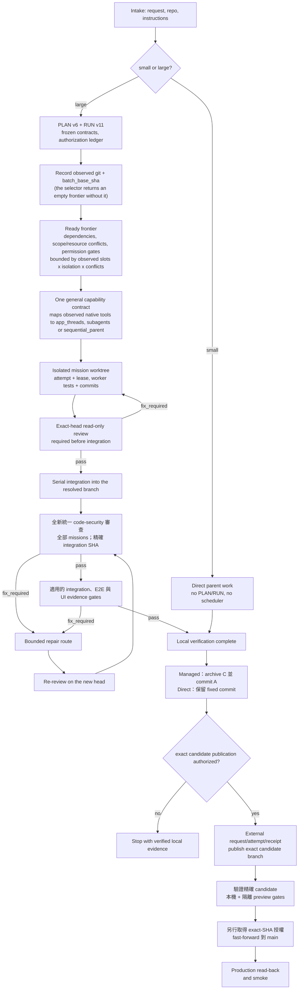

<p align="center">
  
</p>

<p align="center">
  <a href="README.md">English</a> | <strong>繁體中文</strong> | <a href="README.zh-CN.md">简体中文</a> | <a href="README.es.md">Español</a>
</p>

<p align="center">
  <a href="https://github.com/Phlegonlabs/product-delivery-harness/actions/workflows/harness-ci.yml"></a>
  
</p>

# Product Delivery Harness

技能儲存庫，讓你用 Codex、Claude Code、Pi 或任何會探索使用者 skills 目錄的 host，把產品構想或變更需求轉化為經過驗證的交付流程。

它不是提示詞集合。這套技能把產品定義、視覺設計、工程執行、程式安全審查、啟用與 release 後自然流量 review 拆開，讓每個階段都有單一真實來源、清楚的交接邊界，以及自己的驗證方式。

> 定義產品。編譯設計。交付已驗證的軟體。

**使用：** [安裝](#安裝) | [從這裡開始](#從這裡開始) | [常見提示詞](#常見提示詞) | [包含的內容](#包含的內容) | [獨立 skills](#獨立-skills)<br>
**理解：** [各部分如何組合在一起](#各部分如何組合在一起) | [運作參考](#運作參考)<br>
**維護：** [維護技能](#維護技能) | [發佈](#發佈) | [版本紀錄](#版本紀錄)

## 安裝

這是公開儲存庫，不需要存取權。你需要 Python 3.10 以上、Git，以及至少一個會探索 `~/.agents/skills/` 的 host。

clone 前可先執行以下指令，確認能存取公開儲存庫：

```bash
git ls-remote https://github.com/Phlegonlabs/product-delivery-harness.git HEAD
```

### 最快安裝方式

clone 儲存庫並執行安裝腳本。它會先取得整個目的地的單一鎖，只 staging 七個 skill 中已進 Git index 的 runtime 檔案，tests 與 CI 計時資料留在來源儲存庫，把目前與舊版 managed ID 一起移到 `~/.agents/skill-backups/product-delivery-harness/` 下同一個帶時間戳的備份，安裝 staging tree，並在釋放鎖前逐路徑、逐位元組驗證：

```bash
git clone https://github.com/Phlegonlabs/product-delivery-harness.git
cd product-delivery-harness
./install.sh             # macOS / Linux / Git Bash
# Windows PowerShell：powershell -ExecutionPolicy Bypass -File install.ps1
```

驗證前先安裝含 Pillow 的固定 Python 依賴：

```bash
python -m pip install -r skills/delivery-harness/requirements-test.txt
```

更新時沒有安全的 raw-copy 等效做法：手動複製會繞過 tracked-file manifest、目的地鎖、ownership marker、完整驗證與 rollback。若兩個 installer 都無法執行，先停止並修復環境，不要覆蓋既有安裝。

<details>
<summary><b>安裝器防護、舊版遷移、跨技能檢查與依賴</b></summary>

安裝器會忽略可重建的 Python cache，並拒絕其他所有未追蹤或被忽略的來源檔，包括本機 `.env` 與 `.dev.vars` 值；已追蹤的 example 檔仍可安裝。Bash 與 PowerShell updater 共用同一把鎖，兩者都會在 mutation 前後拒絕 tracked symlink/gitlink mode，以及 source、destination、backup、staging、managed target 中的 junction/reparse component。每個新 target 在完整 tree 驗證前都有本次 attempt 的 owner marker，因此 rollback 只會移除本次建立的路徑並還原舊備份；其他程序或使用者建立的路徑一律保留。重跑安裝器仍需明確授權並先結束使用中 session，成功後才重開 host。每次執行都會印出來源 HEAD SHA，以及已追蹤的 `skills/` 檔案是否有未提交變更；安裝成功後會把這一行寫入備份旁的 `<backup>.source`。未提交的 bytes 仍會安裝，但有紀錄可追溯。

從 0.23 或更早版本升級時，讓 installer 在同一份備份中用原 ID 保存各舊目錄，並安裝目前七個 skills：`delivery-harness`、`product-definition-builder`、`ui-design-builder`、`design-system-compiler`、`code-security-review`、`product-activation`、`seo-growth-review`。遷移對應為 `full-harness` → `delivery-harness`、`prd-builder` → `product-definition-builder`、`product-design-builder` → `design-system-compiler`；installer 會驗證舊 ID 已不再可被探索。

七個內建技能可獨立呼叫；跨技能模式會驗證已批准的 Product package 與準確來源身分。保留的 `ui-design/2` 套件直接檢查 PRD → HiFi 的範圍、文案、CSP、離線及瀏覽器證據，並按需要檢查 `design-system/3` pair；`ui-design/3` 另需 `design-system/4` 完整包，Harness 0.59+ RUN 也凍結其衍生 HTML，較舊固定版本不能使用 `ui-design/3`。Harness 會把 `design-system/4` 交給 design-system compiler 的 checker。在 0.59 pin 下，只有通過驗證且凍結的 maintenance record 可保留 `ui-design/2`；enhancement 必須使用 `ui-design/3`。Hybrid `surfaceContracts` 對應每個已批准 UI surface、capture mode 與 responsive set。舊版契約保留原有檢查。Deployment、Activation、Outcome Review 與保存的 SEO 報告共用 production identity。

新專案的 Skill Bindings 會刻意保持 unresolved，直到 session 觀察本機候選且 owner 確認每個 slot 的唯一 skill。Pin 涵蓋完整 skill tree，不只 `SKILL.md`。公開 dependency manifest 會固定兩個必要 UI dependency 的 source locator 與 install route：用目前 host 的 skill installer 從紀錄的 Anthropic path 安裝 `frontend-design`；Impeccable 使用 `npx impeccable install`（目前 npx 路徑需要 Node.js 22.18+）。接著執行 `check_external_skill_dependencies.py`；upstream tree 改變時不得悄悄取代 pinned bytes。Harness 負責 conformance 與 compilation contract，Impeccable workflow 仍需額外授權。

Managed 本機 build／test 預設使用專案工具鏈，不需要 Docker 或 Podman。只有明確選用容器的 verifier 才需要管理員安裝的 runtime 與 machine trust policy，詳見 `runtime-trust.md`。Archive publication 仍須另備 machine trust policy 與簽章設定，詳見 `branch-promotion-contract.md`；installer 不會建立這些高權限政策。

</details>

<details>
<summary><b>Zero-to-one 流程：從產品構想到量測結果</b></summary>

### Zero-to-one 流程（從零開始）

1. 安裝一個受支援的 host 與七個 skills。Installer 會鎖住目的地、備份 managed IDs、只複製 Git-tracked runtime files，tests 與 CI 計時資料留在來源儲存庫，並逐 byte 驗證；完成後重啟 host。
2. 先用 `product-definition-builder` 完成 research-first evidence、candidate drafting/reconciliation、明確 recommendation choices、accepted 變更、coherent stack、typed release targets、tests、Stack Decision Checkpoint 與人工 Product Definition Approval。入口保留 ownership 與 approvals；撰寫、自查、preflight 與 domain routing 走必要的 stage reads。
3. UI 先以 `--ui-contract ui-design/3` 跑 Product Definition 預檢，再進行 intake、三個可渲染方向研究及作者自查、owner 選擇及完整 HiFi。Impeccable／H1–H9 前先驗 HiFi 完整性，最後一次人工 Visual Approval。入口保留 ownership 與 approvals；撰寫、自查、preflight 與 domain routing 走必要的 stage reads。
4. 從已核准來源編譯 `design-system/4` Markdown／JSON pair 及其衍生 HTML，再通過最終 UI 驗證。0.59 RUN 只有在通過驗證且凍結的 maintenance record 支持下才可保留 `ui-design/2`；enhancement 要編譯現行包。保留的 pair 只在 Need Gate 為 `required` 時編譯 schema-3；`not_required` 時記錄既有 pair 處置並綁定 HiFi 替代契約。
5. 再呼叫 `delivery-harness`。Size gate 讓單一小改動維持 direct，且不載入 managed stage file；大型工作依 [mandatory stage routes](skills/delivery-harness/references/stages/managed-delivery.md) 建立 PLAN-v6/RUN-v11。每個會改狀態的動作都要精確授權。
6. Managed launch 前先通過 frozen source joins，並執行 `python "<delivery-harness-skill-root>/scripts/harness_transition.py" --plan docs/goal/PLAN.md --run docs/goal/RUN.md --repo-root <absolute-root> record-observation`；`--probe-sandboxes` 只作診斷。Mission 使用隔離 worktree；candidate commands 預設在本機執行，明確選用容器時保留固定映像與隔離檢查。
7. 完成 exact-head mission reviews、graph-ordered security checks、全新的 unified `code-security-review`、broad regression gates 與 platform-correct UI evidence。
8. 只有 managed 工作要關閉 RUN：用 exact `main` evidence 與絕對 external `--anchor-out` dry-run/apply `archive_run.py`，commit journaled move 與 `ARCHIVE_RECEIPT.json` 為 A，再依 anchor 重驗。Direct 工作保留既有 fixed candidate，跳過 RUN archive。
9. 另行取得 action-time authorization，以 external anchor 與 immutable request/attempt/receipt 準備 A。Trusted host 重新讀取並驗證後執行 exact URL-only no-force publication、簽署 evidence；recovery 驗證 evidence 並讀回 A。本機 agent 不執行該 argv。
10. 對 exact read-back candidate 執行隔離的 non-production gates。若 A 後失敗，從 exact A 建立新的 continuation PLAN/RUN，關閉 C2、綁定先前 publication state，並用新 anchor 收檔 A2。
11. 另行精確授權，把未變的 candidate fast-forward 到 `main`、讀回並驗證 production。
12. 執行 `product-activation`：精確外部動作、獨立 read-back、behavior evidence、readiness 與 verified measurement sources。
13. 每個 target 的 measurement window 結束後執行 append-only Outcome Review；public hosted-web production target 可再選用 `seo-growth-review`。

</details>

<details>
<summary><b>執行已安裝技能與發布檢查</b></summary>

### 執行已安裝技能與發布檢查

將 `<skill-name-skill-root>` 解析為已安裝技能的絕對目錄（通常是 `~/.agents/skills/<skill-name>`），為 script 路徑加引號，工作目錄與 `--repo-root` 保持指向目標專案。reference 中的 `skills/<name>/scripts/` 是邏輯安裝路徑，不代表要把 skills 複製進專案。下方來源儲存庫維護命令仍使用相對路徑。

Skill Bindings 預設檢查全部 slot。Product Definition 使用 `--stage product-definition`，未進入的階段可以保留 `pending`/`pending`；UI 與編譯分別使用 `ui-design`、`design-compilation`，`backend` 僅適用於已確認無 UI 的產品或純後端範圍。每個階段重新驗證必要技能的完整 tree pin，前階段結果不代表後階段通過。

UI 核准使用另行授權的 publication checkout，保留來源 HEAD、完整 Git 歷史與最終邏輯路徑。`check_ui_publication.py` 比對上游 bytes 並執行完整 Product 與最終 UI gates；授權發布後以 `--published` 確認轉移的 bytes 完全相同。`.ui-staging` 只放未核准草稿。Compiler 的 `sourceBindings.uiDesign.sha256` 使用 `ui_approval_digest.py` 排除衍生 pair/replacement linkage；`ui-design/3` 另排除 Package action 與 pair disposition 行，使未變更的 package 可切換為 `reuse`。其餘來源使用原始檔案 hash。單一平台使用全域 responsive set，hybrid 使用每個 surface 的 `surfaceContracts` 與已核准 stack。

0.55.0 的 Design System Compiler 變更：`stylingMechanism` 仍是封閉 enum，但只需對應 `stackSemantics.stylingMechanism` 中逐字保存的 Stack styling approach（例如 `modern vanilla CSS` 對應 `plain CSS`，原生樣式對應 `platform theme`）。無 pair 的 preflight 沒有獨立命令，而是在 `check_design_system_pair.py --repo-root` 內執行。`tokenSources` 與 `primitiveSources` 必須是精確的 repo 相對路徑。`check_color_contrast.py` 接受疊在不透明背景上的 `#RGBA` 與 `#RRGGBBAA` 前景色，`check_type_scale.py` 以 `--root-font-size`（預設 16px）接受 rem 與 em 尺寸；其內文 1.5 與標題 1.1 的行高下限是內部可讀性標準，不是 WCAG AA 規則。Legacy Harness join 現在會以 repository root 檢查 design-system/2 pair。

Private HTTPS 發布可使用 `trusted-host-publication.md` 定義的管理員 credential-helper policy，只允許精確 endpoint。Request 綁定 policy/helper hash，prepare、trusted-host push 與 recovery 都拒絕漂移，也不繼承任意 repo/user helper；evidence 不含憑證。Activation 可在固定 implementation SHA 下準備另行授權的部署前置設定；readiness 與 verified measurement handoff 仍要求精確 deployment evidence。Activation checker 命令須包含 PRD、architecture、deployment、stack-decisions、activation 路徑與 repository root。

Trusted-host publication 與 legacy（0.38 以前）run-branch push 都與 repository hooks、fsmonitor 和 askpass 隔離：`core.hooksPath` 指向全新空目錄，`core.fsmonitor` 關閉，askpass 為空。Git config preflight 把 linked worktree 的共用 config 與 `config.worktree` 視為 repository config，並拒絕 repository 內的 `core.askPass`；限定 URL 的 TLS、header 與 cookie 設定在遠端存取和發佈時會被拒絕，CI checkout 中的本地讀取仍可正常進行。Git 與 verifier 輸出以 UTF-8 讀取。遠端重新檢查與 no-force push 之間仍有短暫空窗，其他人可能把 run branch fast-forward 到 A 的祖先，因此 run-branch push 權限應只給 trusted host。Run-branch publication 使用 trusted host，是因為它的簽名 evidence 屬於 archive 狀態；`main` promotion 是另行授權的一般 no-force push，不需要先把 A 發布到 run branch。

</details>

`deployment/2` 紀錄新增 Release Source Provenance。每個 target 以 hash 綁定一個有界保留 observation JSON：repository、source/resolved ref、source SHA、artifact、觀察時間與實際 command/provider output。呼叫端獨立提供 `repo-root` 與 `expected_repository`；symbolic candidate/1 ref 另需 concrete `candidate_ref`。Validator 只讀取 bytes，不執行 command 或 fetch provider，hash 只證明完整性而非真實性。Pending 準備與歷史檢查仍可用。完整 Deployment 檢查包含 resource isolation 與 record validity，並為 ready closeout、verified sources、SEO 與 Outcome 把關。明確 target subset 不取代完整 inventory；blocked 與 all-n/a 保留相容。

Strict symbolic-candidate proof：

```bash
python "<delivery-harness-skill-root>/scripts/check_deployment.py" --deployment docs/DEPLOYMENT.md --architecture docs/product/architecture.md --require-source-provenance --repo-root <actualFrozenRepo> --expected-repository <owner/repository> --candidate-ref <candidate-ref>
```

## 從這裡開始

| 你目前有什麼 | 從哪個技能開始 | 會得到什麼 |
| --- | --- | --- |
| 一個產品構想 | `product-definition-builder` | 經 owner 核准的 Product Definition，包含完整 frontend/backend 架構、stack、UI 行為、release targets 與 tests |
| 已核准 Product Definition、需要 UI 設計 | `ui-design-builder` | PRD 預檢、intake、方向選擇、完整 HiFi、完整性檢查、Impeccable／H1–H9、Visual Approval 與 design-system 決策 |
| 既有儲存庫中的明確變更 | `delivery-harness` | 小型工作直接實作；大型工作進入受管的 PLAN/RUN 流程 |
| 已固定並完成整合的程式候選 | `code-security-review` | 唯讀、綁定精確 SHA 的安全審查，包含經驗證的 source-to-sink 發現與明確的覆蓋缺口 |
| 已交付、需要外部設定的 release | `product-activation` | 精確授權的 console 動作、已驗證的量測來源，以及逐 target 的 activation readiness |
| 需要 SEO 或自然流量分析的 production 公開網站 | `seo-growth-review` | 唯讀技術與量測 review、按證據排序的關鍵詞／頁面機會，以及已路由的後續動作 |

七個內建技能都可以單獨呼叫；完整流程是選用的。不過每種模式仍會驗證明確宣告的輸入與依賴。

<details>
<summary><b>選用參考庫，以及技術、設計與 Cloudflare 目錄</b></summary>

共用的 optional reference library 提供 19 個技術與設計領域的比較資料，不預選任何技術棧。[selection rule](skills/delivery-harness/references/reference-selection.md) 先從需求出發，只載入 [option-library](skills/delivery-harness/references/option-library/README.md) 中相關領域。它保留健康的既有技術；CSS/Tailwind、icon、Cloudflare、Expo/React Native、GSAP 或任何供應商都不是必選項。採納結論寫入既有 product、architecture、stack、UI 或任務記錄，不新增 gate、register、runtime 或審批權限。

前端目錄把 TanStack Start／Router 與周邊生態分開比較；架構示例涵蓋完整的託管 React、可攜 React、內容、即時、Python 與業務應用技術棧，並補充 server-driven HTML、local-first 同步、durable workflow、租戶資料隔離、headless 內容／條件式商務與獨立 typed API，附失敗檢查及退出成本。成熟度觀察附查核日期，各專案仍由既有 stack checkpoint 決定採納。

設計參考涵蓋元件基礎、八種視覺方向，以及 Mobbin、Dribbble、Awwwards、Refero、MotionSites 的手動搜尋。owner 分享選中的案例／原站連結或截圖，不新增設計參考 MCP 連接。React Bits 提供動效元件，Anime.js 提供動畫引擎；程式重用與相依仍遵循既有 stack 和授權決策。

docs-weight 可見度報告會納入巢狀的選用 reference Markdown，不新增 gate。

Cloudflare 目錄分開 compute、data、agent／search、browser／sandbox、media／email 與分析責任。Basin、K2、Artifacts、框架 adapter、CLI 與技能候選保留當日成熟度或遷移檢查；目錄涵蓋不代表已安裝、帳號可用或已可部署。

Void 是可選的 full-stack SDK／CLI 路線。native 或 framework routing 都是 stack 決策；direct Cloudflare 仍是 `cloudflare`，team Void platform 另做 deployment 決策。 Void Preview 需先證明 build／config 路徑相容，否則使用核准且隔離的 Void 部署。

</details>

<details>
<summary><b>設計轉譯、動效、平台目標與設計有效性</b></summary>

### 設計轉譯與可重用範本

App＋展示 Web 使用同一份 PRD，分別定義 iOS、Android 與公開展示網站；需要登入操作的 Web App 僅在指定範圍內加入。React Native＋Expo 僅是參考方案，不是必選或預設技術；依產品需求選型並保留既有已批准決策。手機尺寸、Web 寬度、共用程式邊界，以及各平台設計、驗收與發布依[App 與展示 Web 規格](skills/product-definition-builder/references/mobile-stack-selection.md#app-and-companion-web-contract)。選用 Expo 不代表已決定網站技術或批准付費 EAS 服務。

內部 HiFi 規則要求實測控制項擠壓、對齊、內容裁切與展開圖層，並依產品任務審查 AI slop。檢查長文案、文字放大及 Web 目標之間的寬度，保留元素層級證據並修正共用原因；隱藏溢出或提高分數不能清除版面缺陷。沿用既有審查關卡，不要求 Hallmark。

[現代設計來源指南](skills/ui-design-builder/references/modern-design-sources.md)把 Web 無障礙、Apple／Android 平台規範及近期 Anthropic／Google Labs AI 設計方法對應到既有 handoff 與審查；區分標準與風格建議，保留平台選型、審閱寬度與修復次數限制。 [頁面設計設定](skills/ui-design-builder/references/page-design-profiles.md)依用途採納 Taste：landing／portfolio 可選有辨識度的字體、桌面一至兩行主標題與必須呈現的表現型動畫；後台總覽、資料頁與表單優先可讀密度及功能回饋。沿用既有 brief，記錄選擇與手機、翻譯、減少動態效果的例外，保留已批准決策。

[動效與媒體路由](skills/ui-design-builder/references/motion-and-media-routing.md)現在有明確的升級順序：CSS／WAAPI，接著是 Motion、GSAP、Three.js，每一層都要已核准的技術棧包含它才使用。Higgsfield 提供生成媒體，包括給已核准 Three.js 區塊用的 GLB 模型。owner 沒表態動效等級時，依頁面實際要展示的內容提出建議，並在方向比較中實際播放。是否使用生成服務、用在哪些區塊、費用上限，都在設計 intake 一次問完。HiFi 的媒體以 `data:` 內嵌；無法在 HiFi 執行的函式庫改用確定性的近似效果，並標記到第一個實作切片驗證。H6 另外評動效工藝；檢視過的參考要留截圖或錄影，採用 template 程式碼時記錄授權。

方向研究與 HiFi 使用 PRD 核准的確切 responsive targets。保留的舊 Wireframe 模板有 390、768、1024、1440 px 範例；它們是審閱寬度，不是強制斷點或新版編寫階段。

設計 Prompt 直接讀 PRD UI Surface Contract。在既有 Design Brief 的 Page-purpose mapping 記錄必守限制與設計自由，不複製每頁需求。先比較主要／壓力案例，再將選定方向展開成完整 HiFi。PRD 決定必要行為與內容，設計者決定構圖和視覺表達。

局部更新保留未指定範圍。明確要求「保留 PRD、整套重做」時，依實際載入規格重新構圖與選擇方向，保留產品、技術、文案約束及已知使用問題；舊設計與批准僅作歷史，替換、歸檔、安裝仍依各自授權。新 iOS 範圍預設 iPhone，以較小／較大手機和 Dynamic Type 檢查；iPad 按需加入，既有 PRD 要求不能直接刪除。HTML 不證明原生行為。

七個 [composition recipes](skills/ui-design-builder/assets/templates/composition-patterns.json) 保留為方向／HiFi 的選用參考：四類 Web、三類 iPhone。按產品選擇、調整或捨棄，保留雙語文案、語言／方向標記、長文案及 PRD 語言矩陣；不強制套用 hero／features／CTA。

Skills 更新後及實作前，執行[設計有效性檢查](skills/ui-design-builder/references/design-freshness.md)，比對產物與上游雜湊、skill 來源及下游依賴。未知身分保持未知；skill 變更需要語意判讀，不等於全部重畫。`check_design_freshness.py` 僅唯讀檢查，不給設計批准；清單包含所有 HiFi 子頁，完整驗證器仍必須執行。確認尚未實作時，先補齊受影響設計再寫程式。


</details>

## 常見提示詞

Codex 接受下列的 `$skill-name` 寫法。在 Claude Code 或其他 host 中，直接用名稱指定技能，例如 `product-definition-builder`。在 Pi 中，可以使用自動找到的 project skill，或用 `--skill` 傳入技能目錄，再直接指定 `delivery-harness`。

```text
Use $product-definition-builder to define this product, including complete frontend/backend architecture, data/auth/deployment choices, coherent stack options, UI behavior, release targets, tests, and Product Definition Approval. Stop before UI design.
```

```text
The Product Definition is approved. Use $ui-design-builder with the `ui-design/3` contract and mandatory $frontend-design. Run the product preflight, read the PRD UI Surface Contract directly, and show three materially different directions over the same representative cases for my selection.
```

```text
I selected a direction. Continue $ui-design-builder with $frontend-design: build the complete connected HiFi, run the HiFi completeness preflight, then run separately authorized $impeccable critique and audit plus H1-H9 grading. Ask for one full Visual Approval covering copy, structure, product menus, tabs, visuals and tokens, then use $design-system-compiler for the required `design-system/4` pair and frozen derived HTML.
```

```text
Use $delivery-harness to implement the approved plan, building each page from its approved HTML reference in docs/design/ui-references/ within the recorded tolerance.
```

```text
Use $delivery-harness to review the existing app, plan the required work, and stop before implementation.
```

```text
Use $delivery-harness to implement the approved plan. Create a branch and commit the verified change, but do not push or open a PR.
```

```text
Use $delivery-harness only if the size gate selects the direct route: implement this bounded change, verify one fixed candidate, and push that non-default branch under this exact authorization. Stop if PLAN/RUN managed delivery is required; managed publication needs a new post-archive request.
```

```text
The delivery is complete. Use $product-activation for the production release targets, configure only the exact external actions I approve, verify each result by read-back, and stop after recording activation readiness and the measurement-window handoff.
```

```text
The RUN is complete on its non-default branch. Use $delivery-harness to dry-run and archive the completed coordination set on that same branch, verify the archive-only candidate, and stop before any push or main promotion.
```

```text
The archive-only candidate A is verified. Prepare its immutable trusted-host publication request from the external anchor and stop. Do not execute the emitted publication command locally; wait for separate trusted-host evidence and recovery.
```

```text
The production measurement window has closed. Use $product-definition-builder to validate the Outcome Review against the exact PRD metrics, TEST signals, deployment, Activation hash, and verified MS sources.
```

```text
Use $seo-growth-review to audit this production website, reconcile Search Console visibility with GA4 on-site outcomes, prioritize evidence-backed keyword and page opportunities, and route every proposed change without modifying the site or external accounts.
```

```text
Use delivery-harness on this host to execute this plan. Observe native capabilities and preserve installed roles, models and fallbacks.
```

多任務交付仍要說清楚本機與遠端結果；建立分支、commit、整合、每次 push、deployment、移除 worktree 與刪除分支都是獨立動作。Post-RUN promotion 只有在 exact action-time authorization、fast-forward 證明、read-back 與完整 candidate 測試齊全時才能更新 `main`。

## 包含的內容

| 技能 | 適用情境 | 主要產出 |
| --- | --- | --- |
| `product-definition-builder` | Discovery、research、security requirements、可量測產品/UI 行為、完整 frontend/backend 架構、coherent stack、release targets、tests 與 Product Definition Approval | 已核准的 `PRD.md`、`architecture.md`、`stack-decisions.md` 與研究產物 |
| `ui-design-builder` | PRD 預檢、intake、預設三方向、完整 HiFi、完整性檢查、Impeccable／H1–H9、Visual Approval 與 Design System Need Gate；必要的 stage reads 管撰寫與 routing 細節 | `docs/design/ui-design.md`、方向研究及已核准完整 HiFi 包 |
| `design-system-compiler` | Visual Approval 後按需把已核准 `ui-design.md` target 編譯成凍結 design-system pair，並產生來源綁定的 HTML specimen book；必要的 stage reads 管編譯、驗證、發布與 routing 細節 | `docs/design/design-system.md`、`docs/design/design-system.json`、`docs/design/design-system-preview.html` |
| `delivery-harness` | 共用的規模判定與 security task gate、PLAN/RUN、授權、本機驗證與整合，外加 runtime adapter 參考文件（`references/runtime-adapters.md`）：由所有 host 共用的能力契約，agent 依觀察到的原生工具自動對應 | 直接動手，或 `PLAN.md` + `RUN.md` |
| `code-security-review` | 實作與統一整合後的唯讀安全審查，優先由 fresh sibling agent 執行；主動滲透測試與修復不屬於本技能；必要的 stage reads 管輸入、工作流程與交接細節 | 精確 SHA 決策、trust-boundary 覆蓋、驗證後的發現與修復測試 |
| `product-activation` | 所有支援的 Web、API/backend、iOS、Android、macOS、Windows、browser-extension 與 hybrid release target 的交付後設定，包含 capability routing、精確外部動作授權、read-back、量測來源與 outcome-review 交接；必要的 stage reads 管輸入、執行、狀態交接與報告細節 | `docs/ACTIVATION.md` |
| `seo-growth-review` | 唯讀的 release 後技術 SEO、量測完整性、關鍵詞研究、自然流量診斷與 query-to-page 機會排序；必要的 stage reads 管輸入、review method 與報告細節 | 預設 inline review；明確要求時才保存日期化報告 |

<details>
<summary><b>交付核心如何判定規模：直接或受管</b></summary>

交付核心在啟動受管編排之前，會先做一個規模決策：

- 小型工作維持直接執行，不建立 PLAN/RUN，但先解析必要角色。UI 作者使用 host 綁定的 frontend worker，不由 parent 代寫；唯讀委派本身不要求受管 RUN。
- [Parent 派工契約](skills/delivery-harness/references/delegation-contract.md) 適用於 Product Definition、UI Design 與交付。有兩個獨立實質研究／探索問題且具備授權與能力時，必須派出不同的 researcher／explorer 實例；容量不足就分批。純資料 API `readonly-assignments/1` 依 assignment、attempt 與凍結輸入身分匯合，允許結果重排，拒絕缺漏、重複、過期或重用 worker 的結果。Parent 的啟動觀察與子代理宣稱分開驗證。啟動前檢查必要角色及外部執行授權，缺少必要 delegate 不得默默交回 parent。Fallback 僅依 host 的可用性錯誤規則，確認終止並保留部分成果。每個 checkout 同時只有一個 writer，包含 parent；獨立審查仍須具備實際所需工具。
- 架構任務先展示呼叫例，再定義狀態 ownership 與失敗恢復。程式審查將這個方法用於受影響邊界；局部修正沿用已接受的決策。
- 大型工作進入受管規劃。它可以用 `PLAN.md` 加 `RUN.md` 走受管循序交付，或處理多任務與可持久的交棒；`new_run.py` 在帶 `--out` 與 `--repo-root` 時寫出初始 `docs/tasks.md`，帶 `--repo-root` 的受管 `accept-wave`、`record-worker-result`、`reject-worker-result`、`record-integration`、`reconcile-candidate-head`、`reconcile-coordination-head`、`reconcile-interrupted`、`reconcile-interrupted-reviews`、`close-wave` 轉換會刷新它並保留 Update Log。Projection 失敗不會回滾 RUN；獨立的 `render_tasks_view.py` 負責修復或檢查這份非權威視圖。本原始碼儲存庫不再另外維護根目錄 `Tasks.md` 流程記錄。

每個必要的整合或 wave 收尾 checkpoint，可先以一個普通直接子提交提交精確 coordination 檔，再新觀察並用 `reconcile-coordination-head` 綁定該 head。守衛只接受支援的精確 coordination/generated-view 路徑，排除產品與凍結設計來源，檢查 live/observed 身分與乾淨產品位元組，保留舊證據並重開目前精確 head 的 review/gate；隔離 mission worker 可繼續，但 parent 端 reviewer 與檢查必須靜止。

- 選擇器會在實際選中的安全寫入 mission 少於兩個時派生 `managed_sequential`，達到兩個或更多時派生 `parallel_graph`。只有後者才啟用 scheduler 扇出；runtime driver 仍是獨立的傳輸事實。核心共用一份能力契約，由 agent 對應目前原生工具，不按 provider 分流。
- RUN 執行不等待遠端 CI；branch promotion 是獨立 closeout。精確 candidate 與適用的隔離 preview environment 驗證完成前，`main` 不得移動。

只有 RUN 與它已宣告的生成 tasks view 例外於乾淨目錄檢查；verifier 仍以雜湊保護兩者。產品修改與手寫 view 仍會阻擋執行。日常 RUN 操作使用 guarded transitions；正式 revision 保留歷史並取得精確的新授權。若套件只有 `Selected`／`Required` layers，沒有新核准 option，維持 `Approved option map: None`，跳過可選的生成器。 檢查器接受不分大小寫的 `None`；只有沒有新增核准 layer 或 option 時，才可省略選項表。

規模指的是協調範圍與影響半徑，而不是原始的檔案或行數。如果小型工作長大了，Harness 會保留已完成的部分，只針對剩下的部分重新規劃。

</details>

## 獨立 skills

[README Studio](standalone-skills/readme-studio/SKILL.md) 協助其他專案撰寫有品牌特色的 GitHub README，包含真實示範、可用的快速上手及各呈現平台的檢查。[附日期的案例庫](standalone-skills/readme-studio/references/case-library.md) 參考 Starship、Bruno、Transformers、tldraw 與 Vite。視覺工作沿用目標專案的 frontend 路由，交付前後對照證據。

Registry 圖片需要可用的目的地 URL；只把圖片放進 package，不能證明它能在該平台呈現。

[Release Packager](standalone-skills/release-packager/SKILL.md) 沿用專案原生工具，為 Node/Bun、Python、Go/Rust、容器及桌面／行動 App 準備適用產物。它檢查實際包內容和使用者安裝／使用路徑，再核對 README 與 release 資訊。建包、簽署、安裝測試和發布分別保留證據；缺少 runner 或簽署資料會明確列為缺口，不會加入自動 CI 流程。

這些來源獨立於七個 skills 的 bundle，`install.sh` 和 `install.ps1` 不會安裝它們。可在 host 中開啟連結的 `SKILL.md` 與 references，或按 host 支援的探索方式註冊完整 skill 目錄。註冊是另一項本機操作，本 repo 不會自動安裝。可用後，以 `$readme-studio` 改善 README，或在準備 release 時使用 `$release-packager`。保留專案語言、授權與已支援渠道；發布沿用原有授權。

## 各部分如何組合在一起

```mermaid
flowchart LR
  Idea["產品構想或變更需求"] --> PRD["Product Definition candidate\nPRD + architecture + stack"]
  PRD --> Market["草稿後市場研究與回填"] --> ProductGate{"Stack Decision + PRD 自查 +\nProduct Definition Approval"}
  ProductGate -->|"UI 產品核准且明確要求"| UIDesign["ui-design-builder\nintake + 方向研究 + UI 自查"]
  UIDesign --> UIReview["選定方向 + 完整 HiFi\n完整性 + 自查 + Impeccable + H1–H9"]
  UIReview --> Design["已核准 HiFi target\n需要時進 design-system-compiler"]
  ProductGate -->|"核准的 headless 產品"| Harness["delivery-harness\n共用交付核心"]
  ProductGate -->|"已核准的限域增強或維護；無受影響設計 gate"| Harness
  Design -->|"核可的全頁面 HTML reference 或設計系統契約"| Harness
  Harness --> Runtime["觀察原生能力\n共用通用契約"]
  Runtime --> Security["code-security-review\n全新統一 exact-SHA 審查"]
  Security --> Evidence["完整最終測試與 UI 佐證"]
  Evidence --> Close["RUN 在精確 integration head 關閉"]
  Close --> Archive["在 run branch 歸檔協作狀態\ncommit + 重驗 archive-only candidate"]
  Archive --> Push["checkout 外部 request/attempt/receipt\n精確 candidate publication"]
  Push --> Candidate["驗證精確 candidate SHA\n本機 + 隔離 preview gates"]
  Candidate --> Main["另行授權 fast-forward\n精確 SHA 到 main"]
  Main --> Activate["product-activation\n外部設定 + read-back"]
  Activate --> Outcome["已驗證量測來源\n後續 outcome review"]
  Activate -.-> SEO["seo-growth-review\n選用自然流量 review"]
  SEO -.-> Outcome
```



<details>
<summary><b>Design system 綁定、token 證據與交付前自查</b></summary>

保留的 `ui-design/2` 套件不再製作灰階 Wireframe 或執行 W1–W5 階段。直接用代表視覺研究探索版面、字體、層級與 responsive，再於 HiFi 驗證。舊 Wireframe 工具只供歷史產物唯讀檢視與驗證。

HiFi 提供完整、取自實際樣式的 Design Tokens 頁。`ui-design/3` 包一定編譯 `design-system/4`：`showcase` 把每個 primitive variant、元件狀態與動效綁到核准 HiFi 元素，`design-system-preview.html` 以 specimen book 呈現，不自行發明樣式。`ui-design/2` 在 Need Gate 要求正式 pair 時才產生 `design-system/3`。兩者都綁定已核准 PRD、architecture、stack、UI contract 與 HiFi 包，不再綁 Wireframe。

HiFi 以內嵌 `ui-hifi-copy/1` 及產品 DOM 綁定保留文案來源。靜態文案、動態顯示契約及成對語言仍可檢查。Tokens 展示實際數值、用途及控件變體；審閱器文字不能代替產品覆蓋。

Token 觀察分別保留來源／顯示原值及瀏覽器正規化後的來源／套用值，讓十六進位色碼、rem 尺寸及關鍵字字重能正確比較。

從任何階段繼續前，先確認其前置條件仍有效。依[交付前自我 review 契約](skills/delivery-harness/references/pre-delivery-self-review.md)，PRD 草稿完成市場研究與已接受建議的回填後，由作者自查整套產品文件；選擇方向前自查 UI 結構與方向；HiFi 完成後先自查，再進獨立審查與 Visual Approval。版本、問題、修正及未解阻擋項記在既有任務紀錄。自查不代替必要的獨立審查或人工核准。UI 產品的初次交付必須完成適用檢查後才進 Harness 執行，不能用「延後 UI」繞過；headless 產品註明 UI 檢查不適用，增強與維護則檢查其已接受範圍。這是 parent 的語義檢查，驗證器成功本身不證明已自查。

Harness 0.57.0 移除 UI 產品初次交付的「延後 UI」捷徑，包括先做 backend 的切片；backend binding 檢查不豁免交接要求。新任務沿用舊核准時，在當前交接點補做適用範圍的自查，記錄核准與 candidate 身分，不回填假日期，也不重開未變動的 owner 決策。較舊 pinned RUN 保留原契約。

</details>

<details>
<summary><b>完整技能生命週期圖、核准關卡、部署、Activation、SEO 與商業規則</b></summary>

### 完整技能生命週期

七個 skill 的完整生命周期，包含每個閘門與橫切機制：

```mermaid
flowchart TB
    user([使用者想法或變更請求])

    subgraph PRD["product-definition-builder — 產品定義"]
        direction TB
        interview[結構化訪談<br/>3 段 free-text + AskUserQuestion]
        pkg["核心套件 candidate<br/>PRD.md + architecture.md<br/>+ stack-decisions.md"]
        mr["market-research.md<br/>（對帳 candidate，可跳過）"]
        rchoice{{"平台優化建議<br/>owner accepts / revise / defer / reject"}}
        revision["只套用 accepted 變更"]
        sgate{{"Stack Decision Checkpoint<br/>Required | Selected | Approved"}}
        pgate{{"Product Definition Approval<br/>所有產品"}}
        ra["research-first 評估<br/>research-assessment.md（可跳過）"]
        rgate{{"Research Gate<br/>go | clarify | stop"}}
        interview --> ra --> rgate --> pkg --> mr --> rchoice
        rchoice -->|accepted| revision --> sgate --> productself["PRD 作者自查"] --> pgate
        rchoice -->|revise proposal| mr
        rchoice -->|none, deferred, or rejected; no blockers| sgate
    end

    subgraph DESIGN["ui-design-builder — UI 設計（owner 明確要求）"]
        direction TB
        intake{{"UI Design Intake<br/>style + motion + media；等待 owner"}}
        preflight["PRD 預檢<br/>operations + states + responsive + copy"]
        studies["frontend-design<br/>預設三個方向"]
        style["frontend-design<br/>Style Integration + HiFi target"]
        hifi_review["Impeccable critique + audit<br/>H1–H9 評分"]
        vgate{{"Human Visual Approval"}}
        dgate{{"Design System Need Gate"}}
        pending["已核准 required/pending marker<br/>綁 Visual Approval digest"]
        pair["design-system-compiler preflight + compile<br/>design-system.md + design-system.json"]
        linked["Owner 連結 pair hashes<br/>final UI validation"]
        intake --> preflight --> studies --> directionself["UI 結構與方向自查"] --> directionChoice{{"方向選擇"}} --> style --> completeness["HiFi 完整性預檢"] --> hifiself["HiFi 作者自查"] --> hifi_review --> vgate --> dgate
        dgate -->|required| pending --> pair --> linked
        dgate -->|not_required| target[核可的 page-faithful target]
    end

    subgraph HARNESS["delivery-harness — 交付核心"]
        direction TB
        route["System Review And Route<br/>（parent-only、read-only）"]
        size{{"Project Size Gate"}}

        subgraph DIRECT["Direct 路線（small）"]
            direct_impl["直接實作 -> 本地驗證<br/>-> code-security 審查 -> 授權 Git 動作"]
        end

        subgraph MANAGED["Managed 路線（large）"]
            direction TB
            plan["PLAN v6<br/>typed graph：missions / reviews / gates<br/>allowed_providers + 原子 task commit"]
            newrun["new_run.py 產生<br/>RUN v11 + 12 鍵授權 ledger"]

            subgraph LOOP["執行迴圈（每個 wave）"]
                direction TB
                lock["--session-id acquire-run-lock<br/>（run lock + heartbeat）"]
                obs["record-observation<br/>live-Git 快照"]
                sel["select_ready_nodes.py<br/>確定性 frontier 選擇"]
                accept["accept-wave<br/>（batch base 綁定）"]
                adapters["依共用契約解析<br/>可用的 agent driver"]
                lease["lease-worker<br/>（worktree + lease + graph 綁定）"]
                workers["fresh bounded agent workers"]
                record["record-worker-result<br/>重驗證佐證 + 原子 RUN 更新"]
                review["exact-head review<br/>（reserve -> reviewer -> record）"]
                integ["record-integration<br/>（序列整合；統一候選 SHA）"]
                lock --> obs --> sel --> accept --> adapters --> lease --> workers --> record --> review --> integ
            end

            plan --> newrun --> LOOP
            security["code-security-review<br/>fresh sibling；全部 missions；精確 SHA"]
            gates2["廣域 final validation<br/>（E2E / 回歸 / UI 證據矩陣）"]
            LOOP --> security --> gates2
        end

        route --> size
        size -->|small| DIRECT
        size -->|large| MANAGED
    end

    subgraph DEPLOY["部署（git-connected 平台）"]
        direction TB
        handoff["Managed：更新 docs/DEPLOYMENT.md<br/>（typed targets + secret 名稱 + console 任務）"]
        archive["關閉 RUN、歸檔協作狀態<br/>commit + 重驗 candidate"]
        push["checkout 外部 request/attempt/receipt<br/>精確 run-branch candidate publication"]
        directhandoff["Direct：更新 deployment record<br/>保留單一 fixed verified candidate"]
        directpush["另行授權 direct<br/>candidate publication"]
        preview["Preview 自動部署<br/>（平台按 push 建置）"]
        merge([另行授權 exact-SHA<br/>fast-forward 到 main])
        prod["Production 部署<br/>（平台從 main 建置）"]
        check["部署後驗證（唯讀）<br/>check_deployment.py"]
        status["核對 deployment 紀錄<br/>（狀態 + 尚待人工處理項目）"]
        handoff --> archive --> push --> preview --> merge --> prod --> check --> status
        directhandoff --> directpush --> preview
    end

    subgraph ACTIVATE["product-activation — 交付後啟用"]
        direction TB
        profiles["選擇 core + surface profiles<br/>docs/ACTIVATION.md"]
        capability["探測 connector / API / CLI<br/>Browser / Computer Use / manual"]
        actions["精確 ACT-* 動作<br/>授權 + read-back"]
        ready["逐 target activation readiness<br/>已驗證 MS-* 來源"]
        profiles --> capability --> actions --> ready
    end

    subgraph SEO["seo-growth-review — 選用 release 後 review"]
        direction TB
        seo_sources["Production 頁面 + 已驗證來源<br/>Search Console / GA4 / estimates"]
        seo_review["技術 SEO + 量測完整性<br/>query-to-page 機會"]
        seo_route["按優先級路由 follow-up<br/>不直接修改"]
        seo_sources --> seo_review --> seo_route
    end

    subgraph OUTCOME["Release 後 outcome review"]
        outcome["docs/product/outcomes/YYYY-MM-DD-release-set.md<br/>（owner 主動要求，量測窗口後）"]
        verdict{{"判定：no_change | enhancement | incident"}}
        outcome --> verdict
    end

    subgraph CROSS["橫切機制（貫穿各階段）"]
        bindings["Skill Bindings<br/>（AGENTS.md 槽位表 + SHA-256 pin）"]
        ledger["授權 ledger<br/>12 個獨立動作鍵"]
        ver["版本閘 + contract digest<br/>（compatible_old 波界）"]
        watch["watchdog + reconcile<br/>（中斷恢復）"]
    end

    user --> interview
    pgate -->|UI 產品核准且明確要求 UI| intake
    pgate -->|已核准 headless 產品| HARNESS
    pgate -->|"已核准的限域增強或維護；無受影響設計 gate"| route
    linked --> route
    target --> route
    DIRECT --> directhandoff
    gates2 --> handoff
    status --> profiles
    ready --> outcome
    ready -.-> seo_sources
    seo_route -.-> outcome
    verdict -.->|下一次 enhancement 請求| interview
```

Product Definition Approval、UI Visual Approval 與合併到 `main` 是分開的人工閘門。Publication authorization 也獨立存在；接受產品內容不代表授權覆寫或移動檔案。

Product Definition 與 UI 的批准／交接回覆，要在對話中逐份列出全部現行文件，附上已驗證的絕對 Markdown 連結、用途與狀態。包括中文審閱副本和英文來源、研究、方向稿、全部 HiFi 頁面、審查證據、必要的 design-system Markdown／JSON／HTML，以及適用的專案／營運文件。兩套完成後，合併成一份清單，在實作前進行整體 review。沿用既有批准，明確標示缺少或稍後階段才產生的文件；預覽面板或文件索引連結不能取代這份清單。

每個可部署版本都以 `docs/DEPLOYMENT.md` 作為操作交接文件。Product Definition 先定義 typed `Surface class` 與 `Public discoverability`；Delivery Harness 再把每個 development/production target 精確 join 到 provider/channel、endpoint 或 typed native disposition、Expected/Deployed SHA、artifact identity、availability evidence 與 checked time。Production 使用不帶 `-prod` 的 `<product-slug>-<surface-suffix>`，development 加 `-dev`。文件只記 secret/variable 名稱與外部 console 任務，永遠不保存 secret 值。

Production deployment 之後，`product-activation` 會從 typed release targets 衍生 profiles，只透過最安全可用路線執行精確授權的動作。Capability、read-back、behavior evidence、measurement sources 與 readiness 都綁定 target、environment、SHA、artifact、provider/channel 和 action digest。後續 strict Outcome Review 會逐字重複 PRD metric 或 TEST definition、baseline、target、window、production release 與相符的 verified `MS-*` evidence。

Activation 預設進入執行：先盤點真實 delta，繼續把 ready 且已授權的 action 做到 mutation/read-back/behavior，最後執行 closeout checker；只有 owner 明確要求時才是 documentation-only。`--require-closeout` 會拒絕停留在 ready、configured、pending、uncertain 或 stale 的 required action。只有 verified 工作或明確 concrete blocker 能關閉動作；blocked 狀態讓 record 保持 blocked。真正的 no-op 不需要合成 action，但每個 target 都必須有 concrete n/a disposition；verified handoff 仍要求 verified sources 與 target readiness。

Activation 之後，`seo-growth-review` 可對 typed public hosted-web production target 做獨立唯讀 review。Dated report 必須對齊 Review date、deployment hostname、exact release、Activation hash、verified source roles、data cutoff 與 PASS integrity checks；它不修改網站或外部帳戶。

保存的 lifecycle SEO review 只要求所審查的 production target 在 Activation 中為 `ready`；其他 target（例如仍在商店審核的 app）可維持 pending。`check_seo_review.py` 只驗證一次 Product Definition package 與 Deployment，把這些 findings 與其他 review findings 一起輸出到 stdout；只有日期的 Data cutoff 會回報為 finding，不再崩潰。`code-security-review` 的 review packet 在 Contract JSON 中列出每個 PLAN `security_review.required_checks` ID，以及它在受審 head 上 PASS 執行的 execution key；結果會把這份清單複製到 `checks`。Reviewer 不回傳 reason code：blocked 結果在 `coverage.gaps` 或 `evidence` 寫明原因，派發阻擋由 parent 的 selector 記錄。

迴圈在兩端都閉合。Research-first evidence 先把關是否起草，並提供適用 baseline；完整 candidate 經過 post-draft reconciliation，owner 對 evidence-based recommendations 做明確決定後，才修訂並進入 Stack Decision Checkpoint 與 Product Definition Approval。Metrics 現在包含 baseline、target/guardrail、measurement window、source/method 與 owner，讓 outcome review 有可執行的量測契約。

Enhancement 會分類 product behavior、UI structure/style、data/integrations、architecture/stack、data trust/AI、commercial channels 與 release/operations。產品內容改變會重開 Product Definition Approval；UI 仍沿用 `none`/`structure`/`style`/`both` 並只更新受影響產物。

0.55.0 調整 Product Definition 檢查。Package 與 Stack Checkpoint digest 現在涵蓋原始檔案文字，包括 fenced code、縮排行與 HTML 註解；只移除批准或 checkpoint 標記區塊，CRLF 視為 LF。舊版記錄的 digest 可能不再相符，因此要重跑 finalize，並重新記錄 Product Definition Approval 與 Stack Decision Checkpoint。Mobile/Desktop stack 需要一列 `Styling approach` layer（例如 `platform theme`）。在 Enhancement Impact Record 中，UI `structure` 或 `both` 列要寫明 Wireframe Validation 與 Visual Approval，`style` 列要寫明 Visual Approval；Copy Freeze、Wireframe Approval 與 Impeccable/H1–H9 不再是必要名稱。`check_product_package.py` 只有在 `--require-filled` 與 `--require-approved` 都執行時才輸出 `complete and owner-approved`。Product Definition agent graph 只接受兩個封閉的 release source policy：development 取自 run 的 integration head，production 取自已驗證的 `main` SHA；tag 與其他 ref 會被拒絕。`--prior-outcome` digest 是前一份紀錄原始 bytes 的 SHA-256，與 `sha256sum` 或 `Get-FileHash` 的結果一致。

Gitignore 衛生同時適用於 direct 與 managed 工作。scope scan 會記錄任務是否改變 local-only artifact 類型，再依實際工具鏈產生最窄的規則。含值的環境與 credential 檔、可重建的 build output、dependency 目錄、cache、log 與本機平台狀態要忽略；source、tests、lockfiles、migrations、受追蹤的設定範例與 schema，以及權威產品或交付產物必須保持可見。程式新增環境變數讀取時，同一個 task 要更新受追蹤的 example 與 ignore 規則。Harness 會以 `git check-ignore`、`git status --ignored` 和 `git ls-files` 驗證代表路徑；它不讀 secret 值、不以規則隱藏 dirty worktree，若可能的 secret 已被 Git 追蹤，就停止並交由 owner 處理。

商業產品現在會經過兩個分開的 Product Definition 決策。Monetization Infrastructure Gate 先解析商業模式、定價／offer 規則、購買 surface、entitlement source 與 merchant-of-record／稅務責任，再比較 native store billing、RevenueCat、Qonversion、Adapty、Superwall、Stripe Billing、Paddle 或 Lemon Squeezy 等現行選項；有定價不代表預設 RevenueCat。Partner Channel Gate 則獨立解析 `none`、affiliate、referral、reseller 或 hybrid，再比較 Rewardful、FirstPromoter 這類 link／commission 工具、PartnerStack 這類完整 partner platform、Lemon Squeezy 的整合 affiliate 路線，或自建 reseller service。Billing、entitlement、paywall、稅務、attribution、commission／payout 與 reseller operations 會保持為分開的 PRD、architecture、stack、UI、mission 與 test 契約。

</details>

每個 assignment 有私人 scratch 和有限期限。清理或重試前，parent 要確認 process tree 已結束，並檢查部分成果、前次操作與證據缺口。403 或「研究找不到可用來源」不是啟動失敗，也不授權合成證據。

## 運作參考

以下分組收錄完整的運作規則。展開分組即可閱讀全部要求。

<details>
<summary><b>驗收、流程對照、雙語審閱與交接檢查點</b></summary>

驗收按 atomic task 跑相關測試，按 mission 檢查受影響整合，再對固定候選完成必要完整 matrix 與一次獨立安全審查。只有已宣告的依賴允許時，資源互不衝突的回歸與審查才可同時進行；Managed selector 與必要檢查的前置條件仍有效。沿用證據時保留原始精確 SHA；修復後重新審查，本地測試不能證明外部狀態。

逐步流程的模板對照表列出每個既有模板的使用時點，包含可選檢視與歷史 Wireframe 模板；不為了用完模板而建立不適用的文件。

CI 回歸會完整解析來源 workflow 與 consumer CI 模板的 YAML，包含多行 candidate 與 diff-base 表達式。只有文字斷言，不能證明 GitHub 能載入 workflow。

使用 skills 的專案保留各自核准的分支政策。這個 skills 來源倉庫供我們自己使用：修改在臨時工作分支完成，透過已審查的 PR 直接合併到 main，不需要 development 分支。歷史 consumer RUN 保留原有契約。

[逐步流程](docs/WORKFLOW.zh-TW.md) 列出每個適用階段的角色、既有模板及驗證邊界。同一 section 可在共享接口凍結後分給多位隔離的 frontend／backend writer；每個 executable task 保留自己的 atomic commit。新的 parent 啟動要先以明確 byte budget 檢查完整 parent-visible UTF-8 訊息。依實際 host 容量派工，使用有界 packet、完成事件、streaming review 與序列整合。不把修改前／後驗證當作重複工作刪除，也不宣稱已有未實作的 rolling writer scheduler。

Product Definition 撰寫英文正式來源 `PRD.md`、`architecture.md` 時，同步產出完整繁體中文審閱版 `PRD.zh-TW.md`、`architecture.zh-TW.md`。Owner 透過中文審閱；實作與核准 digest 以英文為準，接受的修改同步至兩份內容。[雙語審閱契約](skills/product-definition-builder/references/bilingual-review.md) 要求在審閱及成對發佈前核對來源雜湊、ID 與完整語意。 任務檢查發現既有 PRD 或 architecture 只有英文時，agent 會在同一目錄補上完整中文審閱版，保留英文原稿與核准紀錄。只有 PRD 的專案可單獨檢查，不必建立 architecture。唯讀任務只回報缺漏，不自動翻譯封存文件。

`AGENTS.md` 要求在任務開始、重要變更後及結束時檢查本地 repository，即使不使用 Harness 或 PLAN/RUN。將有意義的已提交與未提交變更記錄到對應 Epic，外部修改標示為觀察到但未驗證，並更新 `docs/DOCUMENTS.md`。缺少基線就明確記錄；沒有新變化不重複寫入。唯讀任務只提出紀錄內容，不建立背景監控，也不增加動作授權。

每次交接前都要重做 repository checkpoint，核對受影響的有效文件、對應 Epic 與索引，以及任務紀錄。Managed run 要用 renderer 的 `--check` 比對 PLAN/RUN 與產生的 `docs/tasks.md` 檢視；RUN 才是權威來源，不能手動編輯產生區段。依語意將共用 `AGENTS.md` 規則與已觀察到的安裝版 project template 及版本比對；在既有文件寫入授權內，只就地更新過期的共用規則並保留 repository 自訂規則。授權 bootstrap 會提出缺少的共用區段和同名規則差異；必須先用 reviewed merge plan 綁定觀察雜湊和標題選擇才能附加。附加前須從已開啟檔案重驗核准內容，結果必須精確等於原文加核准區塊；並行差異須報錯並保留全部內容。 Proposed additions 不代表已證明沒有矛盾。依語意 reconciling 時不可覆寫刻意更嚴格的本地規則；後續 `--check --require-resolved` gate 檢查 placeholder，不要求 template byte equality。若 template 未觀察到或語意合併不明，交接時說明缺口。這是交接檢查點，不是定時掃描，也不增加動作授權。

本輪稽核修正統一已安裝 skill 的命令路徑、必要 CLI 參數、500 行職責檢查點、schema-5 Wireframe Validation 與 reviewer shell v3。Activation 依發佈目標選擇正確 profile；security PASS 必須完整覆蓋。Product Definition 審查確認 operations 的完整性；schema-5 UI approval gates 會驗證已宣告的 PRD operations 與 Wireframe／HiFi 的對應。現行 RUN 僅在本機完成，發佈及 main promotion 各自保留授權。

</details>

<details>
<summary><b>核心保證：恢復、核准、設計包、隔離、證據與發佈政策</b></summary>

## 核心保證

- **恢復保留身分與證據。** Launch recording 分開父代理的 `--session-id` 鎖與 `--worker-session-id`。新增的歷史 review admission 對上保留的 attempt；舊 PASS 不涵蓋新 head。沒有中斷 reconciliation receipt 的 blocked sibling review 會阻止 candidate 移動。當前 role-bound 中斷 mission 必須先有確認停止的 failure receipt，才可 reconciliation 和重派。Dual-branch archive 驗證凍結 base 的 ancestry，保留 main 觀察；舊 pins 保留原規則。Review packet 可保留帶 SHA-256 與 name-status 清單的完整外部 diff；截斷預覽必須補完整檢視，security integration review 一律檢查完整 scope。新 UI 入口用 `/3`，保留 `/2` 維持原批准語意。

- **實作前主動提供建議.** 使用者沒有技術偏好時，提出符合產品的預設建議及替代方案，涵蓋前端、部署、後端/runtime 和 agent 編排，說明相容性、成本假設與重新評估條件。Enhancement 先檢視現有 UI，展示受影響範圍的前後比較。研究 template 與 CSS 參考時檢查授權和 stack，手機介面保留原生慣例。明確要求的 hero 和動效持續追蹤至交付。Visual Approval 要求每個動效具備綁定雜湊的正常及 reduced-motion 觀察紀錄；HTML 證據只證明審閱投影。
- **小型工作維持精簡。** 一個有界變更只走檢查、實作、驗證與審查。
- **大型工作明確記錄。** PLAN v6 定義 typed graph；RUN v11 記錄授權、嘗試與佐證。
- **先核准 Product Definition，再進 UI 設計。** Research-first evidence、適用 baseline、完整 candidate、明確 recommendation choices，以及 accepted delta 都在最終 approvals 之前。每種 release surface 都由同一份封閉 applicability matrix 決定必填架構與 stack：hosted UI 需要 frontend，native UI 需要 mobile/desktop，service 與 agent 需要 backend/data/interface，CLI 需要明確 toolchain。Product 與 Stack 核准綁定 canonical content digest、結構化 revision、非未來時間，以及每個保留 open item 的精確接受引用。每個人工 review gate 都會主動提供完整待審版本的已驗證 Markdown 絕對路徑連結，並在明確核准前停止。UI 產品仍只在 owner 明確要求後進 `ui-design-builder`。 CLI 與 `other_nonpublic` 共用標準 `Toolchain` 核准 area（`CLI/toolchain` 為別名），分別記錄 language、toolchain、distribution mechanism 與 testing layers。
- **安全從 Product Definition 開始。** 所有可執行軟體——包含 static site、client、CLI 與 agent——都記錄由人員負責的 Security Requirements Gate。每條 required row 追蹤既有 PRD 需求與資安 TEST；Harness task gate 會在 commit 前實作防護措施，並用 negative tests 證明拒絕存取與沒有未授權副作用；最後仍須執行全新的 exact-SHA code-security review。

安全豁免還須有 documentation-only 產品描述與 Product Archetype，並明確記錄不存在的可執行架構介面。Required security TEST 訊號與 Harness criterion 使用 `denial: rejected (<signal>); no unauthorized side effects: unchanged (<state evidence>)`，兩項斷言皆須有具體觀測。
- **建議不等於實作權威。** 每個適用領域先提供兩到三組 coherent stack。新選擇經核准後標記 `Approved`，既有選擇是 `Selected`，硬限制是 `Required`；`Recommended` 與 `Provisional` 會阻擋 delivery。Checkpoint 的封閉 area set 必須等於適用且已解決的 areas，核准 option 的 layer map 必須等於可執行 stack rows。`render_stack_option_map.py` 會從既有 rows 產生供 owner review 的候選 map；它不能核准或改寫套件。明確 option map 以 `||...||` 包裹；僅用逗號的 legacy map 仍可讀取，但 layer 名稱或 selection 含逗號時必須使用明確形式。Frontend 的 component foundation 可以是一個 headless React primitive 層（Base UI 或 Radix Primitives）加上自訂元件；每個產品只選一個。Radix Themes 屬於 packaged suite。HiFi 依該層的狀態與焦點行為繪製，不改變 stack。
- **完整 UI 包一定附完整 Design System。** 新的初次與完整重設計使用 `UI contract: ui-design/3`：在 `docs/design/directions/<round>/` 預設做三個可渲染方向，每個由同一作者自查；owner 選擇、混合或修改；完整 HiFi 檢查全部核准尺寸及網頁中間寬度；並必須產出 `design-system/4` 的 Markdown／JSON／HTML（`Package action: compile|update|reuse`）。HTML specimen book 以沙盒 plate 展示核准 HiFi 的全部 token、區間、已登記元件 variants、狀態、響應式尺寸與動效，可重播、停止及 reduced motion。每個必要狀態都須有明確分類列，包含 default。動畫證據須綁定 specimen 勝出的 CSS 宣告與具名 keyframes，包含重要性、選擇器優先順序及已解析的自訂屬性。不支援的動畫 CSS、跳脫字元宣告及無效縮寫列為 finding。保留的 `ui-design/2` 只在 required 時編譯 `design-system/3`；其 `not_required` 核准保留原義。 單方向只在 owner 明示選擇、記錄人類 Decision owner 與 Decided on 時成立；研究數量必須符合該選擇。 經驗證的 `none`／`style` maintenance 保留歷史設計，不代表重新核准 pair 或 preview。 沒有相鄰核准網頁寬度時，記錄完整的 `Intermediate width check: not_applicable — no adjacent approved web viewport widths`；原生 size classes 與其他 HiFi 證據仍須完成。
- **保留的設計包直接由 PRD 進入 HiFi。** `UI contract: ui-design/2` 明確選擇保留流程；新的初次與完整重設計使用 `ui-design/3`。PRD 預檢驗證 operations、states、responsive 與 copy status；HiFi 在 Impeccable 前驗證實際文案來源及產品操作覆蓋。預設三方向，選定後一次審閱完整 HiFi。原生 HTML 仍只是設計證據。舊 schema 與固定版本 RUN 保留原義；缺少 Wireframe 不會自動放寬檢查。
- **HiFi 頁面必須由產品控制項連通。** 新增或修訂的 `ui-hifi/2` 以 `index.html` 清單綁定同目錄 HTML 頁面的雜湊與控制項目的地。現行 `ui-output/3` 觀察逐 responsive target 驗證點擊及鍵盤操作；缺頁、過期雜湊、無效控制項、錯誤目的地或未宣告跳轉均阻擋核准。每頁只能呈現分配給該頁的 surface。發布與保留須包含完整套件；schema-1 僅供讀取檢查，正式 Visual Approval 一律要求 HiFi schema 2。歷史 output/2 與 evidence/2 保留原意。指定 Git revision 凍結時，該 revision 必須包含所有子頁面且內容一致。
- **視覺品質有獨立門檻。** HiFi 的 H5（避免模板感）、H7（創意辨識度）與 H9（設計一致性）各須達到 80；總分 90 不能抵銷視覺分項不足。審查須引用已檢視的截圖與已確認的方向原則；數字驗證不代表美感或人工檢視已獲證明。
- **以實際代表畫面選方向。** 各方向使用相同主要／壓力案例與內容，涵蓋適用平台並保存截圖及 hash。小型可播放動態展示 normal／reduced motion，只供選擇，不等於最終證據或 provider 授權。選定後才展開完整連通 HiFi。
- **平台共享品牌，分別定義控制項。** Platform rules 逐核准平台記錄規則。iOS 明確評估 system text styles、Dynamic Type、SF Symbols 與原生操作／版面，不強制套用 Web 元件庫。HTML 僅供審稿；原生實作先以平台工具驗證代表案例，再擴展其他畫面，最後仍須完成全矩陣驗證。
- **Worker 彼此隔離。** 寫入任務使用獨立 worktree 與有界範圍；parent 會驗證每個回傳的 commit 與 diff。
- **每次執行都有紀錄，本機驗證為預設。** 新 PLAN 明確使用 `execution.isolation: "host"`，以專案工具鏈執行 build、lint、test。結果保留 exact SHA、指令身分、工作目錄、退出碼、log 與原始碼／Git 檢查。本機驗證會在最終原始碼／Git 檢查前結束其所屬子程序，逾時也會清理。本機指令循序執行且每次重跑，具有目前使用者的權限；worktree 不是作業系統沙箱。選用 `container` 時仍須通過 Docker/Podman 信任、固定映像與隔離檢查，失敗不會自動改用本機。執行前仍須 reserve，inspector 不會從 phase 推斷程序是否存活。 獨立 worker 在各自 worktree 啟動後才等待結果；本機驗證不會限制 mission 並行數。容量必須依現場觀察更新，不能沿用預設的單一 slot。
- **Runtime binding 明確可驗證。** `lease-worker` 從選取器 directive 衍生 provider、driver、model、effort 與 portable runtime axes；只有 app task 接受 `--task-thread-id`，既有精確目標可直接沿用，新精確目標只能從已啟用的 wildcard 授權 materialize，不會擴大權限。
- **有能力不等於有權限。** 即使執行環境能推送或清理，每個動作仍需要精確授權。
- **Activation 必須讀回驗證。** Activation、Outcome、SEO 會先重驗已核准的 Product/Stack bytes 與完整 Deployment contract。Outcome coverage 保留 PRD method、owner 與逐 target 精確 source map；measurement window 必須在各 target 可用之後開始。Multi-target review 只允許一種 mode，primary fields 綁第一個有序 target，既有 rows 只能 append，aggregate verdict 與 follow-up 由規則決定。
- **SEO growth 必須以證據為準。** Lifecycle SEO review 只接受精確、公開、可索引的 hosted-web production target；不同 mode 必須記錄 market、language、outcome、timezone、comparison windows 與 segmentation。逐 source 的 verified time 與共同 data-coverage boundary 分開，Search Console 與 GA4 仍分開解讀。
- **佐證跟著 SHA。** 新的 commit 會讓舊 head 的閘門與 UI 佐證失效。
- **UI 佐證證明版面，而不只是像素。** 固定到 harness 0.34.0 及之後的 RUN 會在每條 route-breakpoint-state 佐證行記錄真實瀏覽器幾何掃描的 `layout_check`；每個 UI 任務在驗收前分類影響（`none`/`style`/`structure`/`both`），被接受的 parity 偏差連同引用記入 deviation ledger，上線 motion 必須追溯 `ui-design.md` 的 Motion and Media Intent。固定到 0.35.0 及之後的 RUN 還會機器校驗 `deviation_ledger` 與逐 mission 的 `ui_impact_summary`。
- **完成的 managed run 會在晉升前收檔。** `archive_run.py` 會在 no-follow handle 下重驗 C、目前 `main`、完整 coordination inventory、evidence 與 move list，以 durable journal 執行 C→A，並在 recovery 時保留並行使用者資料。Archive-only A 先對 checkout 外部 immutable anchor 重驗；本機 agent 只準備綁定 machine policy、verifier 與 detached trusted-host evidence 的 handoff，永遠不執行 publication argv。Direct 工作保留固定 verified candidate，不虛構 PLAN/RUN archive。
- **Parity 靠實拍，不靠記憶。** hosted-browser surface 逐 route×viewport×state capture；extension、native 與 desktop app 使用平台工具或明確的人工 capture，不能拿 hosted URL 代替。任何未支援的 required group 都讓結果成為 partial、不可作 gate。每列綁定 Git blob、authority hash、baseline、capture method、trusted launcher identity 與 layout result。 截圖檔名包含完整 surface/route/breakpoint/state tuple 的 SHA-256，避免名稱正規化或大小寫不敏感的路徑合併不同證據。
- **讀規則是強制的。** 種子化的專案 `AGENTS.md` 要求：受管工作前必讀已安裝的 `delivery-harness` SKILL.md，影響產品的直接工作前必讀受影響的 PRD 段落；跳過即 blocking review finding。
- **程式安全是全新的最終審查。** 所有 code PLAN 都必須執行 `code-security-review`；`not_applicable` 只允許窄範圍的純文件工作。實際 candidate path 必須落在 mission/security scope，且永遠不能帶入 parent coordination files。專案要求的 security commands 是 graph 排序的 host 或 container verifiers；review 前會核對 exact current-head execution key。PASS 必須綁 exact SHA、完整 coverage、零 exclusion，且不可沿用舊結果。
- **Release source 改用分支 Preview，再進 main。** 新版 0.63+ 使用 `main-preview/1`。一般功能與 hotfix 都凍結 remote main，使用暫時工作分支，完成精確 candidate 的審查與 PR／分支 Preview 驗收，再另行授權合併 protected main 並驗證正式部署。不再要求永久 development 分支。Managed RUN 仍在 C 以 local-only 關閉；archive A、trusted-host publication 與 main 授權保持分開。歷史 RUN 和 correction lineage 保留原有版本規則；這次更新不刪除既有分支。

Cloudflare 優先使用原生 Workers Previews：專案 Wrangler 4.135.0+、`wrangler preview`，記錄固定 deployment URL／ID 與精確 SHA。D1／KV／R2、secret、登入與付款需明確隔離。Service binding、Workflow、Queue、Cron 或 route 的必要流程若受限制，改用隔離方案或保持 blocked。Pages Preview 仍需 owner 選用。

前端 release source 以明示 `main-preview/1` 標記連接 candidate Preview 與已驗證 main。歷史 dual-branch/1 與無標記 candidate/1 保留原有語意。

建立 RUN 前，只有 PLAN 的驗證會一起檢查明示的分支政策及 architecture 標記。缺少 RUN 不代表舊版本固定，也不授予執行權限。

</details>

<details>
<summary><b>統一設計審閱：HiFi 審閱器、設計 intake 與 PRD 補全</b></summary>

新組裝的方向研究用 `assemble_ui_review.py --mode direction` 與封閉的 `ui-direction-review/1` profile。`--mode hifi` 仍是預設，HiFi 契約不變。Profile 為每個案例指定 surface、platform、核准 target family 與精確像素寬度。組裝器重用共用 reviewer CSS 和 HiFi runtime，只顯示該案例核准的 targets，並把案例與 target 帶到其他研究。

## 統一設計審閱

HiFi 使用與產品 CSS 隔離的中性審閱器，按 App、Web 前台及管理後台分組，一次顯示一個產品畫布，保留平台尺寸、狀態與取自實際樣式的 Design Tokens 頁。歷史 Wireframe 保留原審閱器及檢查。

審閱控制與面板使用 Shadow DOM，產品畫布留在一般 DOM。實際狀態控制會切換狀態及尺寸內容；審閱選擇依套件與平台保存，不跨套件混用。

`frontend-design` 直接讀 PRD，預設提出三個可比較方向，owner 選定後才製作完整連通 HiFi。明確指定方向時可做一個；未改方向的 enhancement 沿用既有決策。編寫前先驗 PRD，Impeccable／H1–H9 前先跑便宜的 HiFi 完整性檢查。一次 Visual Approval 涵蓋文案、結構、可操作的選單／Tab、互動、視覺及 tokens。Home、返回、取消、鍵盤、Escape 與焦點返回依 PRD operations 驗證。

方向研究或 HiFi 編寫前，檢查 UI-stage bindings，並由實際作者完整讀取已固定版本的 `frontend-design`。父級讀取及 shell 組裝不等於設計。受管設計派發仍需 `ui-design-builder` 與 `frontend-design`。

初次設計走完整流程；enhancement 只製作受影響頁面及連接流程，並比較保留頁面。日常修改直接驗證目前產品及有效需求，不強制重建歷史 HiFi。區分 source、已安裝和 session 實際載入版本。新 `ui-output/3`／`ui-evidence/3` 保留真實觀測、時間、工具、環境與候選雜湊；機器結果不能偽造人工批准。舊格式保留歷史語義。詳見[審閱流程](skills/ui-design-builder/references/review-workflow.md)及[證據契約](skills/ui-design-builder/references/review-evidence.md)。

0.55.0 收緊 UI Design Builder 規則。Visual Approval 前必須完成 Impeccable critique 與 audit；其副作用仍需另行授權，owner 拒絕授權時 HiFi review 為 `blocked`。舊 Wireframe Approval 標題不會保留舊的 HiFi evidence 規則。2026-09-27 當天或之後決定的 legacy Visual Approval，或含有該日起執行的任何 HiFi Review 或動效 receipt 者，一律需要 `ui-evidence/3`、reviewer shell v3 與 direction/hifi 的 Frontend Design Usage 列；提交或回填較早日期都不會讓它變成歷史紀錄，其 Decided on 日期也不得早於這些 evidence。更早的批准只在 Approved target 與 HEAD 已提交的版本相同時，才保留其 `ui-evidence/2` HiFi receipt。Publication、design-system compiler preflight 與要求 Harness 0.55.1 或更新版本的 run 的 UI join 及 pair join 都會強制執行這條日期規則；只有 `check_ui_publication.py` 另外比對 target 與 HEAD。Schema-5 wireframe receipt 使用由 architecture Release Targets 推導的單一檢查名稱（`wireframe-browser`、`-extension`、`-desktop`、`-native`，hybrid 為 `-mixed`）與 wireframe 自身的案例順序，因此同一組 receipt 可同時通過結構關卡與 Visual Approval。日期早於最新 HiFi、Impeccable、評分或動效 receipt 的 Visual Approval 會被拒絕。

既有設計 intake 會明確詢問 owner 是否有參考圖片、截圖、網站、Figma 畫面或產品，以及想學習與避開的部分。文字問題收集連結與偏好，圖片透過對話附件提供。沿用已回答的內容；沒有參考也可以，由 agent 研究合適方向並提出建議。在 `ui-design.md` 內以簡短 Design Brief 把已批准 UI ID 對應到頁面用途／profile，再連結字體／密度／標題約束、動效意圖、已檢視參考、具體視覺約束與避免規則，沿用 REF／RP、Style Integration 和動效紀錄。參考角色與避免例子是可選的；使用時必須有具體原因。已接受的 brief 決策會帶入方向、HiFi、H1–H9，以及後續 compiler／實作權威。不另建文件或批准關卡，也不要求回填歷史 brief。詳見 [intake](skills/ui-design-builder/references/ui-design-intake.md)。

PRD 會在整個交付流程中持續補全。首次交付批准前，UI 與技術視角共同檢查同一版草稿的完整使用流程、跨功能依賴、資料、權限、失敗恢復與營運準備，區分必需補齊、已明確延後及待擁有者決定的事項。後續設計、實作、測試與上線觀察，透過既有產品流程回填證據及穩定 ID。維持一份現行 PRD 與中文審閱副本，不默默擴大範圍、降低驗收標準或改寫已凍結的批准。沿用既有角色與檢查點，不新增設計階段或批准關卡。見 [PRD 補全規則](skills/product-definition-builder/references/prd-refinement.md)。

</details>

<details>
<summary><b>交付模型：Epic、驗收與 eval 契約、受管 wave 與修復路線</b></summary>

Source authority 與 availability evidence 分開。每個 target 的 provenance ref 來自 architecture source policy。Strict 檢查把 ref、observed source SHA、Expected SHA、Deployed SHA 和 artifact hash 連接起來。Target-review subset 必須明確；Activation 仍盤點每個 active target，而 concrete n/a 只能依 owner 規則取代不可用 target。

Strict Outcome Review 需要 stack-decisions.md，並只驗證一次 Product Definition package。它把已驗證 context 傳給 Activation，要求 Deployment 有 provenance，且只檢查這次 review 的 production-target subset。保存的 SEO review 傳送相同 source context，只檢查受審 target。

## 交付模型

驗收會拒絕嵌入文字的身分佔位符，並要求證據使用 checkout 相對路徑，讓保留的結果能跨 checkout 使用。

文件檢查會列出變更來源、受影響成果與必須重驗項目。父代理擁有全域 inventory；子代理提供完整自身範圍，且不能取代父代理 snapshot。父代理審查語意差異；雜湊與分流提示不代表批准。既有 `document-sync/1` snapshot 保持可讀。未知載入身分維持未知。
子代理檢查 source hashes，並回報自身 loaded/read evidence。

倉庫治理改用簡短入口與必要觸發路由。完整的任務、開發、產品契約、原始碼維護及受管交付規則放在 `skills/delivery-harness/references/governance/`；消費端路徑從已觀察的安裝版 Harness 根目錄解析。

完整 enhancement 使用 `docs/epics/` 中有索引的 Epic，引用現行 PRD，不複製另一份。小修正追加到對應 Epic，必要時連結詳細的直接任務紀錄。目標、寫入範圍、設計來源、依賴與驗收方式整理到該紀錄或既有 PLAN/RUN，不增加中介規格。

實作前先選紀錄方式：新的已接受目標建立 Epic；同一目標的小修追加到原 Epic 的 Change Log；獨立小修建立精簡 Epic 條目，可連結直接任務紀錄。記下原因、影響範圍、commit、測試和未完成事項，不改寫已結束的歷史。UI enhancement 預設增量修改：只新增或修改指定的 HiFi 頁面及必要入口／返回控制項，保留其餘版面、內容、樣式與 ID，沿用已批准方向。改共用元件前先列出受影響頁面。完整畫面覆蓋和全套回歸，不代表全部重新設計。

專案 AGENTS 保留入口、必讀、文件分工、分流、同步、授權與完成條件。商業、啟用與 managed RUN 細節移到按情境必讀的參考文件。供使用專案套用的 AGENTS 模板要求 KISS、第一性原理、依職責拆分模組，以及不寫推測性的相容程式碼。使用專案的新程式碼／測試模組採 500 實體行硬上限；此限制不套用至 Harness 原始碼，也不要求重構 Harness。

新寫或修改的文件採用 [ASD-STE100 Issue 9](https://www.asd-ste100.org/about_STE.html) 的核心寫作規則：主動語態、一句一個重點，以及一致的術語。程序每步寫一個指令，必要條件放在指令前。英文程序句最多 20 詞，說明句最多 25 詞；程式碼與原樣字串不計入一般文字的詞數。其他語言使用自然表達與一致術語，不套用英文詞數限制。保留技術含義、需求強度、批准與歷史。這是 STE-informed 專案準則，沿用既有文件審查，不新增交付 gate，也不宣稱完整符合標準。

HiFi 審閱從主要產品頁開始，側欄可前往 Overview、各頁與設計規格。產品互動、審閱導航及來源綁定 tokens 分別保留證據。歷史包件保持可讀。

HiFi 一次顯示一個產品畫布，設定實際審閱寬度並保留適用輸入與狀態。瀏覽器驗證產品控件及狀態變體，token specimens 綁定來源頁。

HiFi validator 會檢查側欄中指向目前頁面的連結是否帶有 `aria-current="page"`，包含巢狀連結。父層或其他連結的標記不能代替它。

審閱證據也須涵蓋未知連結、從各審閱面板按瀏覽器返回，以及在每個目標尺寸結束審閱後恢復主要產品頁。

Full-stack 依完整流程實作畫面、API、權限、資料保存與回饋。agent-browser 用於 Web 探索，重要流程另保留本機／CI 可重跑測試；登入、拒絕存取、重試與副作用都要有實際證據。發布涵蓋 migration、健康檢查、監控、成本告警與恢復，交付、發布、啟用及產品效果分開報告。SEO 只套用適用的公開頁面。

升級至 0.50.0 時，先讓使用 skills 的工作到達安全停止點，再執行 canonical installer，保留備份並開新 session；不可熱更新已載入的 worker。依文件同步影響清單局部更新現行文件，保留自訂 AGENTS 規則與歷史證據。既有 document-sync/1 與 ui-hifi/2 仍可檢查；新的 HiFi 批准須補左側審閱介面及綁定各頁的 ui-output/2 reviewer 觀察，只重做受影響證據，不改寫舊批准。小修正沿用對應 Epic，不建立 PLAN／RUN；沒有適合的 Epic 才建立精簡紀錄。重跑受影響的 owner gates 與必需最終驗證。 0.49.0 在實作前檢查設計有效性，嚴格 schema-5 編製檢查須提供綁定區域的 motionSpec；保留歷史批准。 0.50.0 保留既有產品排版與已批准產物；新 Wireframe 預設顯示註解。每個 HiFi token 須加上支援的 data-token-preview 屬性及對應來源用法，再重建受影響的 reviewer 觀察；保留歷史批准。

每次調用 skill 都先套用共用的[文件同步契約](skills/delivery-harness/references/document-sync-contract.md)，檢查現行指引、skill/runtime 身分與產品文件的變動，不改寫歷史批准或 RUN。現行 PRD 持續作為下一輪 enhancement 的基準，被取代的 PRD 保留連結供參考。[有界 enhancement](skills/delivery-harness/references/bounded-enhancement.md) 沿用一次確認的範圍，執行修復、範圍內 module 重寫與重測，不反覆要求批准。達修復上限就把未解決需求移交下一輪；本輪結束不等於交付 PASS，也不授權發布。

[Generate、Verify、Correct 指引](skills/delivery-harness/references/gen-verify-correct.md) 把每個 stage 對應到 author、verifier 與 corrector。先用最短有效 focused check，到 mission、feature、platform 與 integration 才擴大，PASS 即停止。唯讀 finding 帶 expected／actual evidence 回到 owning flow；精確候選證據與既有 budget 繼續有效。

[交付驗收契約](skills/delivery-harness/references/delivery-acceptance-contract.md) 把必要 PRD TEST ID、凍結的情境／平台矩陣與精確版本證據串起來。只在已授權的隔離測試環境準備合成帳號與本輪擁有的資料。Mock 登入不能證明真實認證通過；Web、原生 iOS 與 agent 工具結果各需自己的證據。Production 登入後門、含祕密的 fixture、跳過必要測試、過期 build 或延後處理的阻塞問題，都不能算 PASS。檢查器驗證覆蓋與保留證據，不宣稱能證明人工聲明或外部觀測的真實性。

[Eval policy](skills/product-definition-builder/references/eval-policy-contract.md) 在已批准 PRD 凍結 rubric、樣本分母、重跑次數、pass rate、slice、critical 規則及 judge 輸入。必須使用 `json` code fence，讓 review 畫面顯示每個欄位；前綴的換行及空白行須符合 Markdown 規則。已批准輸入在 staging／發布時保持原路徑，舊版本保留。新 package 的批准及發布檢查使用 `--repo-root <root> --eval-policy eval-policy/1` 驗證已批准輸入的 bytes；一般產品填寫有理由的豁免。必要功能 TEST 仍須全部通過。Legacy package 沒有 marker 沿用原檢查；已加入 marker 就會驗證。

新授權 whole-platform 順序的 authoring 會加入 `--platform-delivery platform-delivery/1`。Checker 讀取 active architecture sequence、精確 release inventory、shared API/interface ARCH authority rows、human decision 及 Required-Yes PRD tests；只有 approved status 可以執行。Draft、duplicate、hidden、malformed、omitted 或 shared-label bypass 一律失敗。沒有 section 的 legacy package 維持原讀法。

Harness 會把該契約接到 PLAN v6。Architecture order 決定 stage 順序；顯式 UI owner 按 release surface 只映射一次，shared ARCH 先行，並以 pass-only dependency 到達 completion mission 與下一平台。single-mission pre-integration runtime review 不能承載該路徑。Fresh completion integration 與 final gates 覆蓋 platform TEST；retained integration PASS 只是歷史 handoff。沒有 marker 的 PLAN 維持 legacy。

在已標記流程中，每個 planned `PRD-*` must trace 都要指定 fresh acceptance gates。其 TEST ID 來自 canonical Required-Yes PRD obligations，可加入其他必要 regression；無 marker 的 legacy PLAN 保持可選。

[Eval 驗收契約](skills/delivery-harness/references/eval-acceptance-contract.md) 從 policy 推導執行契約，再重算每個已規劃 trial。品質失敗留在分母，prohibited 或 critical 失敗直接阻擋驗收。兩份 full report 保留 output、judge／tool 觀測、身分、時間和用量；handoff report 在乾淨 checkout 重跑。

`check_eval_acceptance.py` 在乾淨 H2 將兩份 report 接上現有 delivery register，驗證凍結 hash 及 H1 等價，再執行 delivery acceptance。凍結契約、已批准輸入及交付檔案必須已存在，內容、類型及 Git mode 符合 H1，即使同時登記為 evidence。交付的 [eval runbook](skills/delivery-harness/assets/templates/EVAL_RUNBOOK.template.md) 記錄 setup、full／quick 指令、限額、失敗案例重跑和自有 fixture 清理。Checker 不執行 runner 指令；review 仍核對證據來源。

RUN pin >=0.60.0 的 readiness 需要明確 eval applicability；required 時凍結 eval／delivery source，並強制 always-run gate：broad final checks → eval acceptance → delivery acceptance → closeout。錯誤 hash、替換 checker 或斷開 gate 都失敗。舊 pin 沒有 marker 保留原契約；加入 marker 即採用新檢查。
兩個 acceptance checker 使用安裝目錄及已觀測 Python 的絕對路徑，
明確在 host 執行，
避免 image 在同一路徑放入替代 checker。
舊 pin 也必須安全讀取 PRD authority；
無法讀取是驗證缺口，不能當作沒有 policy。
解析 policy 有／無之前，讀到的 bytes 都須符合
凍結 hash 及已宣告的 Git revision。

Harness 是圍繞明確的邊界所打造的：

1. 檢視目前的專案，找出需要做的工作。
2. 凍結相關的契約、來源、範圍與驗證步驟。
3. 當任務大到需要時，先規劃相依關係，再開始實作。
4. 只有在至少兩個安全寫入 mission 實際被選中、工作彼此獨立且隔離，並且每個動作都經過明確授權時，才使用平行 worker；受管循序路線仍要證明隔離 writer、scope/head 與 review gates。
5. 驗證任務結果與整合，執行全新的統一 code-security 審查，再驗證相關 UI 流程與最終 diff。單一 mission 不會憑空增加跨 mission batch gate。
6. Harness 0.38+ RUN 在 C 以 local-only 結束，RUN 不會 push。完成 archive-only A 並重驗後，任何 run-branch publication 都要使用新的 action-time instruction 與 checkout 外部 request/attempt/receipt；驗證 A 後，才可另行授權把它 fast-forward 到 `main` 並 read-back、驗證 production。

對於有計畫支撐的工作，它會記錄任務範圍、相依關係、worker 歸屬、驗證指令，以及各動作專屬的授權。測試通過並不代表授權推送、移除 worktree 或刪除分支。Harness 0.38+ 會讓 RUN push 保持 false；archive protocol 從 archive 推導 C 與 branch，驗證精確 C→A relocation 以及 remote pre-state，綁定規範 URL 與已觀察的 trust policy/verifier，只準備精確 URL-only no-force publication handoff 並交給 trusted host；recovery 先驗證簽名 evidence 再讀回 A。Legacy pinned run 只保留舊流程供 recovery。

wave 接受前，Harness 會重新檢查觀測到的非預設整合分支及乾淨產品樹，把 batch 綁到該精確 head，重跑 selector，並且只接受完整的目前 frontier。clean-tree gate 只排除 transition 必然更新的那個精確 tracked RUN 檔案；其他任何變更仍會阻斷。整合分支位於 linked worktree 時，該 checkout 會正確記錄為 parent，Git 的乾淨主要 checkout 則保留為已識別的同層項目。持久 run lock 負責 dispatch；短期作業系統鎖會序列化每一次 RUN 的讀取、驗證與寫入交易。凍結的 PRD、wireframe 與 design-system source 會在獨立驗證和 transition 寫入路徑中按位元組 hash 綁定；即使 PLAN 聲稱 UI surface 為空，凍結的 PRD 仍會被解析。每個結構化 PRD surface 只擁有一個 literal route；帶 UI 的翻譯 PRD 只能有一對語言無關的邊界標記，並且每個條目各有一個 `route` 與 `states` 錨點；各產物的 ID、route 與 state 必須完全一致。design-system 的 Markdown 與 JSON 各有獨立 source row，其 generated contract 與 compiler namespace 必須一致；每個 PLAN `DS-*` trace 也必須在同一個全域唯一的 JSON 註冊表中解析。product-definition-builder 會按問題工具實際的每次容量分批詢問所有適用的封閉決策；沒有 Codex 專屬的呼叫次數目標，也不會為了配合 host 次數而丟掉問題。

0.55.0 新增的規則只套用於要求 Harness 0.55.0 或更新版本的 run；較舊的 run 沿用記錄時的規則。清理類 lifecycle 節點（`archive_worker_tasks`、`remove_worktrees`、`delete_branches`）即使有 run 範圍的 `*` 授權，也必須有精確 PLAN target：PLAN 驗證會拒絕缺少 target 的節點，selector 以 `action_not_authorized` 延後它，`delete_branches` 也永遠不涵蓋 `main`、`development` 或觀察到的預設分支。Subagent reviewer 與 mission worker 一樣會取得精確的 `worker:<id>` `spawn_subagents` receipt。在每個 RUN-v11 版本中，mission 啟動與 `app_threads` reviewer 的啟動授權都要列出精確 `mission_ids`：selector 會以 `action_not_authorized` 延後 `*` mission 範圍，`lease-worker` 也會拒絕它。RUN-v11 `integration.coordination_paths` 只能列出 run 協調檔案（`docs/tasks.md`、`docs/DOCUMENTS.md`、`docs/goal/` 下的 PLAN/RUN/DECISIONS/REFINEMENT_BACKLOG/tasks，以及 `docs/epics/*.md`）；產品與凍結設計來源會被拒絕。`required_harness_version` 為 null 或格式錯誤時，這項檢查與受保護的 `delete_branches` 授權檢查同樣適用；只有低於 0.55.0 的 pin 會略過它們。Closeout 接受 run 未走過路線上的 dormant edge 與未使用的 repair 節點；實際走過的路徑仍須全部完成。若 `record-integration` 要重新啟用的 gate 或 integration review 已沒有剩餘嘗試次數，它會拒絕新的 head。傳入的 route 是 OR、dependency 是 AND，因此多個 reviewer 匯入時，每個 review 各用一個 gate，再以 dependency edge 匯合。PLAN 與 RUNBOOK template 已納入 delivery PLAN 要加入的 delivery-acceptance 項目：來源 `SRC-004`、位於 `final-check` 與 `final-closeout` 之間的 `delivery-acceptance` final gate、節點 `N-ACCEPTANCE-GATE`，以及 edge `E-FINAL-ACCEPTANCE` 與 `E-ACCEPTANCE-CLOSEOUT`；舊 pin 沒有 eval marker 時不強制檢查；適用的新 eval 契約會強制這些 join。PLAN 宣告該 gate 時，worker-result 驗證會在所有 workspace 模式（含 shared checkout）拒絕 worker 對 register 或 evidence 路徑的變更。腳本不會派發跨 provider runtime；`invoke_external_runtime` 保留作 schema 相容，以及 parent 自己啟動的程序。RUN transition、`archive_run.py --apply` 與 `check_design_system_pair.py --write` 保留原子交換提交，現在也能在 macOS 執行（Linux 用 `renameat2` `RENAME_EXCHANGE`，macOS 用 `renameatx_np` `RENAME_SWAP`）。



</details>

<details>
<summary><b>通用執行環境適配：host 能力、契約採用與 host 交接</b></summary>

Reviewer 需要瀏覽器時，能力必須符合該 reviewer 的 binding。Native reviewer 要證明 host provider 與 driver；external bridge 還要證明 model provider 與保留的 probe session。Host 專屬模型放在 host policy；共用 skills 保留設定角色與已授權 fallback。

## 通用執行環境適配

已授權的修復讓 candidate 前進時，續跑保留同一個 RUN 與已完成 mission。歷史 verifier receipt 保留原 SHA 與 attempt；目前的 PASS 仍須綁定目前精確 SHA。Candidate reconciliation 在剩餘次數內重開失效 gate，並要求新的 integration 與 security review，不授權修復、不重設次數，也不重開已完成 RUN。續跑檢查 parent 與目前綁定的工作目錄，無關 linked worktree 不會阻擋。`[slug]` 等 changed-file 路徑以實際檔名處理，與 write-scope pattern 分開。

所有 host 共用 `delivery-harness/references/runtime-adapters.md` 的能力契約。Agent 讀取當前原生工具說明、觀察能力，再把實際呼叫對應到 `app_threads`、`subagents` 或 `sequential_parent`。不再提供平台專屬 adapter、固定模型預設或原生 workflow 腳本。

以 lazy filesystem reference 提供技能的 host，可能無法得知 session 啟動時實際載入的七技能 bundle。在 owner 授權的靜止邊界，RUN-v11 可改記錄 `adopted` receipt：parent 提供已審閱 digest、owner 來源與閱讀證據；transition 檢查正在執行的 Harness 版本，若新算出的安裝 digest 不同就拒絕寫入。歷史 loaded digest 保持 null。Runtime-worker 選擇時會重新檢查一次 live digest，漂移即阻擋派發；每個新 worker/reviewer 也必須自行重算、閱讀並回報固定契約。Owner 與閱讀證據是 attestation，不是模型攝入內容的密碼學證明。從 0.55.1 起，在已採用的契約下，每個 worker 與 reviewer 都要回傳 `contract_adoption_check`（`digest`、`matched`、`reading_evidence`）。Worker-result 與 review 的記錄 transition 會拒絕檢查缺漏、digest 不同或 `matched` 不是 `true` 的通過 worker 結果或非 blocked review。`record-review-attempt` 以 `--contract-adoption-check` 接收它，檔案可放原始物件或包裝後的回覆；security reviewer 把它放在 security result 旁邊，絕不放在裡面。Blocked review 可以回報不相符，attempt log 會保留為 `contract_adoption_mismatch:<digest>`。這項檢查是子代理自己的 attestation；live bundle 的比對在派發時進行。

Provider 身分只控制 PLAN 明確允許的 host。Driver 順序由觀察到的適用能力決定；平台名稱不代表能力。委派必須有任務建立、結果回傳及適用工作目錄的證據。能力未知就不能啟動。模型與 effort 為 null 時保留已安裝的角色、模型與 fallback；明確指定但不支援的選項會阻擋該節點，不會偷偷替換。

授權、PLAN/RUN、lease、隔離寫入、精確 SHA 驗證與循序整合仍由 parent 掌握。Reviewer 使用新 context，所需工具必須在它自己的 session 內驗證。原生完成、重試與快取不取代這些關卡。明確要求的獨立 app task 不能默默換成直接子代理。

Product Definition 只在獲授權時執行有界的唯讀分析圖。`product_agent_graph.cjs` 驗證凍結輸入並產生交接資料，不啟動 agent。Parent 派發指定角色並保留既有決策與發布關卡。無法強制唯讀邊界時，阻擋受影響的 assignment；容量只有一個時循序派出不同 delegate，不改由 parent 代做。

Managed 角色結果使用 [parent 保留的執行收據](skills/delivery-harness/references/agent-execution-receipts.md)，核對實際 host session、原始保留內容與接收的 payload。啟動失敗有獨立收據，可按設定處理明確的模型／provider 不可用錯誤，不捏造成功啟動。Hash 綁定證據內容，不是對不可信 parent adapter 的身分認證。

舊原生 workflow driver、啟動模板與 `workflow_runs` 相容路徑已移除。歷史使用者檔案保持不動；使用舊 binding 的未完成工作，需要明確重新規劃並重驗能力與授權，不會自動遷移。

Runtime 提速路徑只移除重複工作，不搬動 gate。`docs_weight.py` 用一次 `cat-file --batch` 讀取已解析 baseline 的 blobs；verifier 結果可記錄唯讀的 setup、guard、snapshot、command 與 postcheck 耗時；review packet 只移除 diff 內重複出現的材料；同一 batch 可重用 immutable archive bytes，但每個 verifier 仍有自己通過檢查的解壓目錄；verifier slot 會補入無衝突工作，不等整個 wave；只有同一 runner 產生的 deterministic opted-in PASS 可在重新檢查 guard 與 runtime/image trust 後重用 container 結果。container 結果不進入持久 cache。 新接受的重用必須在目前 parent 觀察到的 batch 中附帶原始執行；只有 RUN 歷史紀錄不足以授權。

Worker 與 reviewer 不能再次分派。Parent 保持每個隔離 worktree 只有一個 writer、串行整合，再派發 fresh reviewers 執行 exact-head review。唯讀與寫入範圍保持分離；profile 名稱不能證明 permission-level tool removal。PLAN 的 host 不符時以 `runtime_unavailable` 延後，不會啟動另一個 runtime。

一次執行只有一個 active host。same-repository handoff 只有在 Host A 關閉 wave、且 `RUN.active_wave.status` 既不是 `active` 也不是 `proposed` 後才允許；`active_wave` 物件仍保留在 RUN 中，不能把物件缺失當成交接訊號：Host B 保留 PLAN/RUN 與 graph state，重新探測 runtime，並在選取下一波前審查目前的 exact SHA。若需要修復，路由回 Host A 且舊 review 立即失效；除非未來 schema 增加可攜式的儲存庫／狀態身分，否則不支援 cross-machine handoff。

</details>

<details>
<summary><b>在目前 host 上的原生執行</b></summary>

## 原生執行

依目前 session 的工具選擇啟動方式，不按 runtime 名稱套規則。只有觀察並授權任務、worktree 與回傳契約後才建立獨立 app task；具備新子代理與終端結果能力時使用 sibling agents；其餘可由 parent 執行的工作採循序方式。獨立 review 仍需要新的 reviewer，能力不足就阻擋。

保留使用者要求的拓撲、已安裝角色、模型選擇與有效專案指令。解析延遲載入工具、綁定真實身分、先啟動所有選定 sibling 再等待，優先使用事件或游標等待。建立結果不明時先核對現有任務，不能自動建立重複任務。

</details>

## 儲存庫結構

```text
skills/                                      標準技能來源
skills/delivery-harness/references/option-library/   選用跨領域參考目錄
assets/                                              README 封面
.github/workflows/harness-ci.yml                     契約、單元與 E2E 檢查
install.sh / install.ps1                             一鍵安裝進 ~/.agents/skills/
```

## 維護技能

只編輯 `skills/` 中的標準來源，接著跑核心驗證套件：

```bash
python -m pip install -r skills/delivery-harness/requirements-test.txt
python skills/delivery-harness/scripts/check_skill_spec.py
python -m pyflakes skills/delivery-harness/scripts skills/product-definition-builder/scripts skills/ui-design-builder/scripts skills/design-system-compiler/scripts skills/product-activation/scripts skills/seo-growth-review/scripts
python skills/delivery-harness/scripts/docs_weight.py
python -m unittest discover -s skills/delivery-harness/scripts/tests -v
python -m unittest discover -s skills/product-definition-builder/scripts/tests -v
python -m unittest discover -s skills/ui-design-builder/scripts/tests -v
python -m unittest discover -s skills/design-system-compiler/scripts/tests -v
python -m unittest discover -s skills/product-activation/scripts/tests -v
python -m unittest discover -s skills/seo-growth-review/scripts/tests -v
git diff --check
```

CI 也會執行端到端主幹檢查。POSIX shell 使用 `HARNESS_GOLDEN_PATH=1 python -m unittest discover -s skills/delivery-harness/scripts/tests -p "test_golden_path.py" -v`；PowerShell 使用 `$env:HARNESS_GOLDEN_PATH='1'; python -m unittest discover -s skills/delivery-harness/scripts/tests -p "test_golden_path.py" -v; Remove-Item Env:HARNESS_GOLDEN_PATH`。它會用合成產品套件走真實 CLI 主幹。在 macOS 上，先執行 `export TMPDIR="$(cd "$TMPDIR" && pwd -P)/"`，讓測試 repo 避開 `/var` symlink；並讓 `PATH` 中的 `/usr/bin` 排在 Homebrew 前面，Harness 才會找到由 root 擁有的 Git。

<details>
<summary><b>驗證與執行量測：CI、瀏覽器測試、計時與驗收證據</b></summary>

`check_ui_diagnostic_wave.py` 連接 browser、critique、audit、grading、PRD、manifest 與 subject 身分。完整觀察到的 FAIL rows 仍是 complete 且可在既有授權下 repair-eligible，但 strict final approval 仍失敗。缺少、blocked、部分、過期或超出範圍的證據會阻擋 handoff；partial report 不會得到 repair approval。Direction `--overwrite` 會比較 destination、author sources 與 manifest 的檔案身分並拒絕 hardlink，保留輸入。Outcome 與 SEO checkers 把必要的 Product／Stack context 帶進 strict Activation checks。

## 驗證與執行量測

CI 會先安裝釘選的 Node／Playwright 套件與 Chromium，再執行必要的 reviewer 瀏覽器測試；缺少相依套件會失敗。本機要執行同樣檢查，先跑 `npm ci` 與 `npx playwright install chromium`，設定 `PDH_REQUIRE_BROWSER_TESTS=1`，並讓 `PLAYWRIGHT_MODULE` 指向此 checkout 的 `node_modules/playwright`，再執行 UI suite。一般本機檢查仍可在瀏覽器不可用時跳過。

Source CI 對 feature branch 只透過 pull request 驗證一次。`main` push、merge queue candidate 與手動 release 分開執行。每個 suite job 都 checkout 並驗證同一個完整 candidate SHA；手動 release 必須指定該 SHA 和完整的祖先 `base_sha`，並以 candidate 作 concurrency identity，後續 branch push 無法取消它。resolver 會讓無法解析或非祖先的 base 失敗，並在 PR 和 merge queue 使用驗證過的 merge base，因此 fork 後只在 base 上的變更會被排除。若 push base 缺少或全為零，它會把 candidate tree 和 Git 推導的 empty tree 比較，而不是做空白 self-diff。內建的 consumer template 使用等效的 inline Git 檢查，不需要 skills checkout。最終 `validate` job 要求每個相依結果都是 `success`，包含所有 matrix shard。

Harness suite 在每個 POSIX 平台分成四個 deterministic shard；Windows 的明確 native 檔案也分成四個 shard。`ci-test-timings.json` 記錄的是 Windows scheduling sample，不是通過測試或 release 證據。把這些權重用來切分 macOS 和 Linux 只是排程決定。未量測的新發現檔案只有在 `--allow-unmeasured` 時，才會用最大已量測權重保守排程，並明確回報為 fallback。這些觀察不能證明 hosted 環境提速。

必要瀏覽器模式會直接啟動 Playwright 隨附的 Chromium。HiFi 案例超過總時限時會回報最後完成的階段；每個瀏覽器操作仍有自己的時限，所有產品斷言都會執行。

`design_workflow.py` 納入標準 goal PLAN／RUN 路徑，並區分檔案存在與執行存活。Maintenance 的 UI impact 必須是 `none` 或 `style`；結構或未知影響需要對應設計檢查。共同的 schema-5 lifecycle 測試使用真實 compiler、Harness、Activation 與 SEO 檢查器。UI checker 會在 Harness 移除暫時匯入路徑前載入自身相依模組；SEO 也會把 stack 與 repo context 傳給 Activation。

0.55.0 調整的 gate 檢查：Deployment Environment Status 列只要有 status 或 Checked 值，就需要 URL、帶時區的 RFC3339 Checked 時間（只有日期會失敗）、完整 SHA，PASS 時 Expected 必須等於 Deployed。`check_ui_contract.py` 只允許單純的 `:root` 規則（可帶 attribute selector）與完全相符的 `@media (prefers-reduced-motion: reduce)` 區塊保留原始值；使用 `--token-source` 或 `--primitive-source` 會輸出 `NOT CONTRACT-CLEAN` 並以 1 結束。Verifier PASS 只看 exit code 0；`pass_signal` 只是寫成 `exit 0` 的標籤。沒有磁碟 verifier cache，request 中的 `cache_root` 會被忽略。`check_delivery_acceptance.py` 從 working tree 讀取 register 與 evidence。從 0.55.1 起，它需要 `--candidate-sha <sha>` 或 `--candidate-from-head`；在 Git checkout 中，register 的 `candidate_sha` 必須是 HEAD 或其祖先，之後的 commit 只能變更 register、它列出的 evidence 檔案與 run 協調檔案。在 candidate H1 執行情境，只 commit register 與其 evidence 得到 H2，再從乾淨 checkout 在 H2 執行 review 與所有 final gate。Managed run 中，H1 是最後一個 mission 合併後的 head，並在統一 review 前執行 `record-integration --integrated-sha H2`；register 路徑列在該 mission 的 `write_scope` 與 security review 範圍，不列為協調路徑。H2 之後重跑 acceptance 需要 PLAN revision。

成功的 Harness 寫入轉移會記錄實測準備階段耗時，`inspect_harness_run.py` 將它與 verifier timings 分開呈現。最終驗證、保存與後續輸出不包含在準備區間內。未知的整體時間、critical path、等待和模型用量仍保留未知；合成 CLI 基準不能代表模型或完整交付速度。

Document sync 只略過明確退役清單中的舊名稱；實際引用與未知的載入版本仍會提示。只有同一 session、當前檔案位元組相同、完整舊內容仍可讀且適用規則相同時，才可沿用先前閱讀；每次調用的檢查仍要執行。不新增持久閱讀快取或批准資料庫。

中文 review 檢查除來源 hash 與 trace IDs 外，也會偵測缺少的標題層級數、表格形狀／資料列及數值字面值。翻譯標題可以不同；檢查器不能證明意思或章節順序一致，仍須完整人工語義比對。

### Git checkout 中的驗收證據

當 `--repo-root` 是 Git checkout 根目錄時，交付驗收 gate 會以同一個固定 `HEAD` SHA 比對 register、所有 evidence 和候選樹；檢查結束時若 HEAD 不再指向該 SHA，就會失敗。Git diff 設定不能隱藏 submodule 變更。上面的 H1/H2 檢查也有同一根目錄要求。即使記錄的 hash 符合工作目錄內容，被忽略、未追蹤或已修改的證據仍會失敗。先在候選 H1 之前為 register 與證據路徑加入並提交 `-text -filter` 屬性，避免 Windows 換行或 Git filter 改變位元組。在 H1 執行測試後，只提交 register 與證據成為 H2，再執行最終 gate。

</details>

## 維持 README 與時俱進

README 是紀錄文件：每個新增或改動 skill、規則、表格、圖或文件化流程的變更，都要在同一份變更裏更新 README 的對應描述段落，四種語言一起改。版本 badge 與版本紀錄條目屬於發佈時的工作，照下面《發佈》的規則走。

## 發佈

技能原始碼維護在每個 atomic task 跑 focused checks，固定 release candidate 才跑完整必要 matrix。相容的測試依賴可沿用；同 SHA、同輸入的 deterministic 結果保留來源後引用，不快取 PASS，也不沿用失效的 security、browser、live 或 migration 證據。Consumer 產品訪談、UI 核准與真實 Activation 不屬於本來源庫發布步驟。正式 release 驗證成功且 bundle digest 改變後，才在安全載入邊界用正式 installer 更新一次本機技能，保留備份與驗證。Feature／development push 不取代使用中的正式版本；安裝成功且有載入需要才重啟相關 host。

CI 會以同一個精確 candidate SHA 執行 Linux、macOS 和 Windows job。Aggregate 回歸會從公開 CLI 驗證成功、失敗、skipped、cancelled 和缺少 job 結果的情況。失敗或執行零個測試的 shard 會失敗；穩定的 `validate` aggregate 也會讓任何 skipped 或 cancelled job 失敗。Feature branch 只由 pull request 驗證一次；`main`、merge queue 和精確 SHA release run 保持分開。瀏覽器測試在 Linux 執行；macOS 保留非瀏覽器 UI suite。Windows 保留 native Harness、installer 和 Design System 檢查。測試資料在綁定執行檔或儲存庫身分前先解析暫存路徑，包括 Windows 8.3 別名。macOS 無法執行綁定的檔案描述符，所以在 macOS 上 sandbox container verifier 和瀏覽器 parity capture 會直接報錯（fail closed）；trusted-host 簽章驗證只在使用受 SIP 保護的 `/usr/bin/ssh-keygen` 時可用。

HiFi 範例以固定 LF 換行維持跨平台位元組雜湊。Wireframe 的 Node 測試透過 stdin 讀取多行程式，避免 Windows 啟動器默默截斷斷言。

每個落在 `main` 的流程就是一次 release，版本號提升要在同一份變更裏完成——預設升 patch，skill bundle 有破壞性變更升 minor。以下幾個地方要一起更新：

1. `package.json` 的 `version` 欄位與 `skills/delivery-harness/VERSION` 中會隨技能目錄複製的版本。
2. 四份 README（`README.md`、`README.zh-TW.md`、`README.zh-CN.md`、`README.es.md`）的版本 badge，以及 `CHANGELOG.md` 的版本紀錄條目。
3. `skills/delivery-harness/assets/templates/MISSION_RUNBOOK.template.md` 的 RUNBOOK `required_harness_version` 預設值。
4. 不需修改測試字面值：`skills/delivery-harness/scripts/tests/test_skill_contract.py` 會讀取 `VERSION`，上述任何位置不一致時就失敗。

接著跑完上面的完整驗證、檢視整份 diff，並將這個來源候選透過已審查的 PR 直接合併到 `main`。Consumer 的 promotion 仍遵守 `branch-promotion-contract.md`。Repository protection 要求時使用 PR；若 provider 產生新的 main SHA，必須先證明其 tree 與 verified candidate 相同，並立即在該 exact main SHA 上重跑完整 suite 與 security review，才能 tag 或宣告 release 完成。落地之後，在 `main` 的 release commit 上打上對應的 `v<版本>` tag（例如 `v0.30.0`）；tag 是 release 的一部分，不是可有可無的附加動作。每個釋出的版本都要有它的 tag——`git tag` 和 `package.json` 必須說同一個故事。

## 安全性與資料安全

- 別把 GitHub token 及其他憑證放進這個儲存庫。
- 在確認新的技能副本能正確載入之前，別刪掉舊的安裝副本。
- 編排技能對於每一個會改變狀態的 GitHub 或生命週期動作，都要求明確授權。
- `code-security-review` 預設唯讀；沒有另外的明確授權時，它不會安裝 scanner、啟用網路、修復程式或探測 live target。

## 授權

本儲存庫採用 MIT 授權，全文見 [LICENSE](LICENSE)。

## 版本紀錄

每個版本的發佈說明都在 [CHANGELOG.md](CHANGELOG.md)。
