<p align="center">
  
</p>

<p align="center">
  <a href="README.md">English</a> | <strong>繁體中文</strong> | <a href="README.zh-CN.md">简体中文</a> | <a href="README.es.md">Español</a>
</p>

<p align="center">
  <a href="https://github.com/Phlegonlabs/product-delivery-harness/actions/workflows/harness-ci.yml"></a>
  
</p>

# Product Delivery Harness

這套技能讓 Codex、Claude Code、Pi 或其他支援 skills 的 host，把產品構想與變更需求轉成經過驗證的軟體。產品定義、設計、實作、安全與外部設定各自保留來源、證據及 owner 決定。

## 安裝

需要 Python 3.10 以上、Git，以及能探索 `~/.agents/skills/` 的 host。Windows 請在 Git Bash 執行 `./install.sh`。

```bash
git clone https://github.com/Phlegonlabs/product-delivery-harness.git
cd product-delivery-harness
./install.sh
```

安裝器會鎖定目的地，只暫存 Git index 已追蹤的 bundle 檔案。它把目前與舊版 managed ID 備份到 `~/.agents/skill-backups/product-delivery-harness/`，再逐路徑、逐位元組驗證安裝結果。

安裝器拒絕不安全的連結與非預期來源檔案。Attempt ownership marker 讓 rollback 只處理本次建立的路徑，保留外來路徑與舊備份。來源收據記錄 source SHA 與未提交狀態。安裝器會印出新安裝的 five-skill contract digest 與被取代的那一個，並與收據一起保存；`harness_contract.py --skills-root <dir>` 可印出任一 skills tree 的 digest。

安裝器複製 scripts、references、assets 與 templates。測試保留在來源 checkout，請在該處執行。驗證前先安裝固定的 Python 依賴：

```bash
python -m pip install -r skills/delivery-harness/requirements-test.txt
```

更新沿用同一安裝器，不能用 raw-copy 覆蓋。先取得授權、暫停相關 skill session 並保留備份；驗證成功後才開啟新的 host session。安裝失敗會 rollback；後續驗證失敗時，從前一個 release tag 重跑安裝器。consumer repository 接著依 [bundle adoption](skills/delivery-harness/references/bundle-adoption.md) 採用新 bundle：更新 `AGENTS.md` 的 `## Harness Version` 項目，執行 `check_skill_bindings.py --previous-skill-dir <installer backup>` 把每個變動的 pin 標為 `previous_release` 或 `owner_pin`，並在 Epic 的 Change Log 記一列。

從 0.23 或更早版本升級時，在同一份備份中用原 ID 保存各舊目錄：`full-harness` → `delivery-harness`、`prd-builder` → `product-definition-builder`、`product-design-builder` → `design-system-compiler`。自 0.73.0 起安裝器也會退役 `code-security-review`（改為 `delivery-harness/references/security-review.md`）、`product-activation`（改為 deployment record 與 `references/external-setup.md`）與 `seo-growth-review`（改為 `growth-review`）。

UI 工作另需 [dependency manifest](skills/delivery-harness/assets/external-skill-dependencies.json) 固定的完整 `frontend-design` 與 `impeccable` tree。依紀錄的路徑安裝，再執行 `check_external_skill_dependencies.py`。更新 full-tree pin 前須審查變更；專案 Skill Bindings 保留 owner 已確認的選擇，不可悄悄換 skill。

## 從這裡開始

| 目前起點 | Skill | 結果 |
| --- | --- | --- |
| 產品構想 | `product-definition-builder` | 已批准的 PRD、architecture、stack、TEST 義務與 BDD feature 檔案 |
| 已批准且包含 UI 的 Product Definition（Product Thesis 之後即可開始設計，可先做選用的探索輪） | `ui-design-builder` | 方向、journey map、完整 HiFi、瀏覽器證據與 Visual Approval |
| 已批准且需要設計系統的 HiFi | `design-system-compiler` | 凍結的 pair 與來源綁定衍生 HTML |
| 有界實作或維護 | `delivery-harness` | Direct 工作或 managed PLAN/RUN；驗收 scenario 由 PRD 的 feature 檔案產生；UI mission 依已批准的 journey 進行 |
| 已發布且有任何可被發現 surface 的產品 | `growth-review` | 逐 surface 的唯讀增長 review，以及已路由後續工作 |

五個核心 skills 與四個獨立 skills 都只在你明確點名呼叫時啟動，例如 `$delivery-harness`；亦可繼續已呼叫的工作。一般任務不會自動跑 Harness 分流、文件同步、Epic 紀錄或 PLAN/RUN。安裝、專案指令與既有文件都不代表呼叫。被呼叫的 skill 保留必要檢查與依賴；新的頂層階段需要明確要求。Codex 設定為 `allow_implicit_invocation: false`，其他 host 依同一指令邊界執行。

相關選擇尚未解決，或既有決定需要參考背景時，使用[參考選擇規則](skills/delivery-harness/references/reference-selection.md)與[可選目錄](skills/delivery-harness/references/option-library/README.md)。兩者都不是前置條件，也不授予執行權限；既有決定與批准仍有效。

## 常見提示詞

Codex 使用 `$skill-name`；其他 host 可直接指定 skill 名稱。說明準確寫入範圍，以及本機或遠端的預期結果。

```text
Use $product-definition-builder to define this product, including complete frontend/backend architecture, data/auth/deployment choices, coherent stack options, UI behavior, release targets, tests with their feature files, and Product Definition Approval. Stop before UI design.
```

```text
The Product Definition is approved. Use $ui-design-builder with the `ui-design/3` contract and mandatory $frontend-design. Run the product preflight, read the PRD UI Surface Contract directly, and show three materially different directions over the same representative cases for my selection.
```

```text
I selected a direction. Continue $ui-design-builder with $frontend-design: build the complete connected HiFi, run the HiFi completeness preflight, then run separately authorized $impeccable critique and audit plus H1-H9 grading. Ask for one full Visual Approval covering copy, structure, product menus, tabs, visuals and tokens, then use $design-system-compiler for the required `design-system/4` pair and frozen derived HTML.
```

```text
Use $delivery-harness to implement the approved plan. Create a branch and commit the verified change, but do not push or open a PR.
```

```text
The delivery is complete. Use $delivery-harness to perform the external setup rows in docs/DEPLOYMENT.md for the production release targets, configure only the exact actions I approve, verify each result by read-back, and record the Measurement Sources status.
```

```text
Use $growth-review to read back every surface of this released product with its own lens, reconcile the verified measurement sources against the Growth Contract, prioritize evidence-backed opportunities per surface, and route every proposed change without modifying the product or external accounts.
```

## 包含的內容

| Skill | 負責範圍 |
| --- | --- |
| `product-definition-builder` | 含 `## Ambition`、At a Glance `Shape` 列與 `## Growth Contract` 的 `PRD.md`、`architecture.md`、`stack-decisions.md`、`docs/product/features/` 內的 feature 檔案、研究、各輪 PRD delta 與 Product Definition Approval；多模組產品的 `program` 交付檔（程式級 PRD 加每模組一個[模組套件](skills/product-definition-builder/assets/templates/PROGRAM_PRD.template.md)，逐模組驗證）、[AI 功能契約](skills/product-definition-builder/references/ai-feature-contract.md) 與多模組產品的 modular monolith 模式；每張 stack 表都有 `BDD runner` 列，批准區塊帶 `Feature files` digest，Test Obligations 一旦指明其 feature 檔案，套件 checker 就檢查 feature 覆蓋（含 eval-policy 的 scenario id） |
| `ui-design-builder` | 由 `UI_DESIGN.template.md` 建立的 `docs/design/ui-design.md`、方向研究與完整已批准 HiFi 包，另有集中缺陷 ledger（`UI_DEFECT_LEDGER.template.json`）以及 grader、Impeccable operator 與 scoped 複查 packet（`UI_REVIEW_PACKET.template.md`）的模板 |
| `design-system-compiler` | 凍結的 `design-system.md`／`design-system.json` 與 `design-system-preview.html`；`check_design_system_pair.py --write-bindings` 由 `ui-design.md` 填入 `sourceBindings`，`--write` 把 `contrastPairs` 與 `typeSteps` 的比值寫入產生的證據區塊，`design-system/4` 的 JSON token 須與 HiFi CSS 中的同名宣告一致 |
| `delivery-harness` | 範圍路由、授權、任務、整合、驗證、由 PRD feature 檔案加一份 run profile 產生的交付驗收 register、PRD delta 規則（新增或修訂需求的每個 Required TEST 都須有新增或改動的 scenario）、安全 lens、`docs/DEPLOYMENT.md` 內的外部設定與量測來源（含 [GA4 後台設定](skills/delivery-harness/references/ga4-admin-setup.md) 與 AI 供應商設定）、[效能與成本預算](skills/delivery-harness/references/performance-and-cost-budget.md)、跑完會清掉自己產物的原生驗證，需要時的 PLAN/RUN，以及 managed stage cards 與自主執行用的 launch brief；初始化的專案 `AGENTS.md` 含 `Harness Version` 與 `Behavior Specs` 段落，另有 direct 路線的 [assignment](skills/delivery-harness/assets/templates/ASSIGNMENT.template.md) 與 [review brief](skills/delivery-harness/assets/templates/DIRECT_REVIEW_BRIEF.template.md) 模板、由 `build_delivery_results.py` 轉成 `delivery-results.json` 的 [delivery evidence](skills/delivery-harness/assets/templates/DELIVERY_EVIDENCE.template.md) 檔案，以及對既有 app 先取證再改的 [open-ended refinement](skills/delivery-harness/references/open-ended-refinement.md) |
| `growth-review` | 依 Surface Catalog 逐 surface 各用一個 lens：搜尋與答案引擎、商店列表、registry 與目錄、bot 平台、桌面 app，以及團隊經營的帳號；含 `pre_launch`、`baseline`、Day 7 與 Day 30 `growth_review` 與 `traffic_drop` 模式，直接回覆；與 `docs/gtm/MESSAGING.md` 矛盾的線上文案算 finding |

## 獨立 skills

[Go To Market](standalone-skills/go-to-market/SKILL.md) 選擇渠道與實驗、每個專案保留一份 messaging record、把 PRD 的 Launch Window 延伸成 launch runbook、為 Growth Contract 的再觸及機制撰寫 lifecycle messaging，並準備各渠道草稿、素材、日曆與附兩個 hook 的各渠道變體，涵蓋開發者渠道與商店 listing。

[Customer Discovery](standalone-skills/customer-discovery/SKILL.md) 規劃使用者訪談、整理去識別化筆記，並把 `RA-*` 候選發現交回 Product Definition。[README Studio](standalone-skills/readme-studio/SKILL.md) 用實際展示編寫專案 README，有 messaging record 時從中取第一行。[Release Packager](standalone-skills/release-packager/SKILL.md) 驗證 release artifact 與使用者安裝路徑。

這四個完整 skill 目錄須另行向 host 註冊；`install.sh` 只安裝五個核心 skills。註冊、build、下載、簽章、發佈、排程與帳戶變更保留各自授權。沿用既有產品與量測紀錄，不新增 review wave。

## 各部分如何組合在一起

```mermaid
flowchart LR
  Product["Product Definition 與 Ambition、Growth Contract、feature 檔案、owner 批准"] --> UI["UI 方向、journey map 與完整 HiFi"] --> Design["Visual Approval 與必要設計系統 pair"]
  Product -.->|"Product Thesis 之後的選用探索輪 R0"| UI
  Product -->|"無 UI，或限域增強或維護"| Harness["Direct 或 managed 交付"]
  Design -->|"mission 依已批准的 journey 進行"| Harness
  Harness --> Review["最終 SHA 的一次合併 review"] --> Tests["一次 broad final validation 與交付驗收 register"] --> C["固定候選 C"]
  C -->|managed| A["僅 managed：archive-only A"] --> Publish["已授權候選發佈與適用 Preview"]
  C -->|direct| Publish
  Publish --> Main["另行授權 exact-SHA main landing"] --> Setup["逐 target 外部設定讀回"] --> Outcome["量測成效與可選 growth review"]
```



初次 UI 交付須先完成設計與所有適用自查，才能進入 Harness 執行。依[作者自查](skills/delivery-harness/references/pre-delivery-self-review.md)，在下表的 Product、方向與 HiFi 既有出口完成檢查。

## 運作規則

以下流程規則只適用於你明確呼叫的 skill 工作。

Delivery core 只做一次規模判斷：一位 writer 配一段連貫驗證即可完成的工作走 direct。可獨立寫入的 missions、持久交接或有界 correction graph 使用 PLAN/RUN。Mission 是功能批次，細 task 各自保留 atomic commit。owner 選擇 `Delivery profile: mvp` 時，小型專案或一週 MVP 走壓縮路線：stack 與產品批准一次合併呼叫、必要頁面才做 HiFi、一次合併交付 review 併入 Final UI Acceptance，owner gate 最多四個；證據、安全與資料保護規則不變。

- [進場與交接](skills/delivery-harness/references/governance/task-and-handoff.md)：檢查目前指令與來源；未知的 loaded identity 維持未知。目前 Epic 就是 `docs/DOCUMENTS.md` 的 `Current Epic:` 行所指的那份；索引只留一列 `docs/epics/`，各 Epic 的狀態寫在自己的檔案。初始化會從 `PROJECT_GITATTRIBUTES.template` 建立缺少的 `.gitattributes`，讓雜湊綁定的檔案逐位元組保存（[gitattributes 契約](skills/delivery-harness/references/gitattributes-contract.md)）；`configure_project_context.py --check` 不寫入任何檔案，回報 attribute 缺口、每個過時 `AGENTS.md` 段落的 diff，加上 `--documents` 時也回報 `docs/DOCUMENTS.md` 的偏差。managed run 從 inspector 的 `Next` 區塊恢復；停滯的 `running` RUN 先要 owner 決定，自主執行從已簽署的 launch brief 開始。
- [分工](skills/delivery-harness/references/delegation-contract.md)：agent 設定與 AGENTS 決定 executor、model、effort 與 fallback。每個 checkout 只有一位 writer；被分派的 worker 不能再次分派。brief 與 review packet 在啟動前先依路線的時間、turn 與 byte 上限切好大小。期限已到卻沒有 verdict，視為環境受阻，改以較小的 scoped 呼叫重新分派。變動邊界的設計與 review 依 [architecture method](skills/delivery-harness/references/architecture-method.md) 進行。
- [驗證](skills/delivery-harness/references/verification-gates.md)：必要證據綁定準確候選；缺能力或證據維持 blocked。瀏覽器矩陣的獨立 review 採先驗證再抽樣：驗證 receipt，檢查 FAIL 與經 diff 標記的列，再抽樣 PASS 列。瀏覽器能力探測在同一 session 內重複使用。沙箱內跑不了 git 的 reviewer 以 `review_input.py` packet 證明身分與 checkout 乾淨。`build_verifier_request.py` 依 live lease 建立 worker 與 task 的 verifier request；`security_review_result.py --result <file> --reviewed-sha <sha>` 不寫入任何檔案，檢查 direct 路線的安全審查結果。
- [交付驗收](skills/delivery-harness/references/delivery-acceptance-contract.md)：feature 檔案是 owner 批准的 PRD 內容，step definition 是程式碼。交付驗收 register 由 feature 檔案產生，不能手動編輯。改 scenario 文字是產品決定，須走 PRD delta；只改 step definition 是現有 Epic 上的小修正。BDD runner 是 stack 決策的一部分。run profile 的 `variants` 與 `assign` 對照可產生混合平台的 register；`render_delivery_acceptance.py --check` 只回報偏差，不寫入。
- [候選發佈與晉升](skills/delivery-harness/references/branch-promotion-contract.md)：保留準確 target、授權與遠端讀回，不得 force-push。[Card 8](skills/delivery-harness/references/stages/stage-cards.md#card-8-archive-publish-and-promote) 依序列出歸檔、發佈與晉升指令。
- [來源維護](skills/delivery-harness/references/governance/source-maintenance.md)：每個 atomic task 跑聚焦檢查，固定候選跑一次完整 matrix。

每次交接前，核對來源雜湊（source hashes）、Epic 紀錄與文件一致性，並原地重寫 Epic 的 `## Handoff` 區塊（階段、有效核准、剩餘工作、下一步）；每個 skill 進場先讀這個區塊。文件同步計算每份 Epic 的雜湊時不含該區塊，所以重寫它不算 drift。`docs/tasks.md` 由 RUN 衍生，交付驗收 register 由 `render_delivery_acceptance.py` 從 feature 檔案產生；不能手動編輯產生區段。[文件同步](skills/delivery-harness/references/document-sync-contract.md)、[有界修復](skills/delivery-harness/references/bounded-enhancement.md) 與[交付驗收](skills/delivery-harness/references/delivery-acceptance-contract.md) 擁有這些檢查規則。

| 階段 | 預設 review 與停止條件 |
| --- | --- |
| Product Definition | 草稿與研究對帳完成後，作者自查整套文件一次；owner 批准前重查受影響變更；之後再做一次獨立唯讀 PRD review 與一次定向複查，owner 依十題 review 指南決定。其後的缺陷走隔離修復加 scoped review。 |
| 方向 | 原作者先檢查並修復已渲染的研究，再交 owner 選擇。三個研究，由 owner 選定。 |
| HiFi | 完整性 preflight 後，原作者先自查及修復，再交獨立 review。Impeccable `critique` **與** `audit` 完成，且四捨五入的 H1–H9 總平均 **至少 85**、每項 **至少 80** 後，才取得 Visual Approval。 |
| 交付 | `review_policy: final_candidate`：固定最終 SHA 上一次合併 code、適用 UI visual 與 security review（UI 使用真實瀏覽器），另加一次定向複查。之後每個剩餘缺陷各成一筆有界修復，只對其修復差異做 scoped review。 |
| Release | 一個 owner 指令可指定多個準確 release 動作。Archive-only A 與 tree 相同的 server main S 按下列規則繼承已驗證證據；tree 不同就是新候選。 |
| 外部設定 | `docs/DEPLOYMENT.md` 每個動作一列 External Console Setup，另有 Measurement Sources 表，每次 release 在 Release Log 記一列。逐 release target 驗證授權、獨立讀回與適用行為；前置準備與 production readiness 分開。商店或安裝程式 target 須有安裝或下載證明；只有上傳時維持 `pending`。 |

## 通用 runtime adapter

目前 driver 為 `subagents` 與 `sequential_parent`，由 [runtime adapter](skills/delivery-harness/references/runtime-adapters.md) 對應實際觀察到的 native 工具。Parent 執行不能替代獨立 review。Host verifier 使用目前使用者權限，不提供檔案系統或網路隔離；有能力不等於有授權。

保留十二個[動作權限](skills/delivery-harness/references/execution-state-model.md#authorization-action-ledger)：

```text
invoke_external_runtime, spawn_subagents, create_user_owned_tasks,
create_local_worktrees, create_app_managed_worktrees, create_local_branches,
create_local_commits, integrate_locally, push, archive_worker_tasks,
remove_worktrees, delete_branches
```

目前 RUN 在本機以 `local_only` 結束，`push` 為 false，`pushed_head_sha` 為 null。發佈、受保護分支 landing、部署、安裝、歸檔與清理保留各自授權。任務通過時 worker 回傳 `WORKER_RESULT`，阻塞或失敗時回傳 `worker_result: null` 的 graph node result，驗證、review 與整合權保留在 parent。

## 儲存庫結構

| 路徑 | 用途 |
| --- | --- |
| `skills/` | 五個 canonical skills、references、assets、templates 與來源測試 |
| `standalone-skills/` | 另行註冊的可選 skills |
| `assets/` | README 封面素材 |
| `docs/` | 現行索引與任務紀錄 |
| `.github/workflows/harness-ci.yml` | Exact-candidate CI |
| `install.sh` | 經驗證的 bundle 安裝與更新 |

## 維護技能

修改 canonical 來源時，同步更新四種語言 README 的說明。依變動檔案選擇聚焦測試與反例；在來源 checkout 執行：

```bash
python skills/delivery-harness/scripts/check_skill_spec.py
python -m unittest discover -s skills/delivery-harness/scripts/tests -p "test_skill_contract.py"
python skills/delivery-harness/scripts/docs_weight.py
python skills/delivery-harness/scripts/prepare_release.py --check
git diff --check
```

[必要 matrix](skills/delivery-harness/references/governance/source-maintenance.md#required-verification) 在固定候選上透過 CI 跑一次，只有 CI 不可用時才在本機用 `python skills/delivery-harness/scripts/ci_test_shards.py matrix --base <released main SHA> --log-dir <new directory>` 執行完整 matrix，它為每一步寫一份 log 與 `summary.txt`。保留瀏覽器與 native 覆蓋，失敗或輸入變更時重驗受影響部分；沿用證據須保留原始來源。

## 發佈

遵循[來源 Git flow](skills/delivery-harness/references/governance/source-maintenance.md#git-flow) 與[必要驗證](skills/delivery-harness/references/governance/source-maintenance.md#required-verification)。已審查的來源候選經必要 PR 進入受保護 `main`，並在該 commit 加上 `v<version>` tag。設定版本時，把四段版本紀錄寫進同一目錄的 `en.md`、`zh-TW.md`、`zh-CN.md` 與 `es.md`（各一行），再執行 `python skills/delivery-harness/scripts/prepare_release.py --version <X.Y.Z> --entries <dir>`。任何版本欄位不一致時它會拒絕；一致時把新版本寫進 `VERSION`、`package.json`、`package-lock.json` 與四份 README，並把 README 最舊的一筆紀錄移到 `CHANGELOG.md`。測試從 `VERSION` 讀取版本，不新增 hard-coded literal。

Archive-only A 須為 C 的直接子 commit，通過準確、receipt-bound 歸檔驗證後才繼承 C 的證據。差異只可包含收據列出的 coordination／evidence 搬移、可選的衍生 `docs/tasks.md`、`docs/DOCUMENTS.md` 更新與 `ARCHIVE_RECEIPT.json`，其他路徑保持不變。保留 C 已審 SHA 與各結果的原始來源，不把繼承證據當作 A 的新執行。Server 產生的 main SHA S 若 tree 相同，連同原始來源繼承候選證據，由 `promotion_readback.py post` 的 JSON 證明；不因 tree 相同而重跑完整 suite 或安全審查。Tree 不同則重新驗證新候選。

發佈須綁定 owner 授權的準確 SHA 與 branch，使用 no-force push 並讀回遠端。一個 release 指令可同時綁定這些授權；遇到 drift 或 gate 失敗就停止。正式 release 驗證完成後，若已安裝 bundle 不同，在相關 session 靜止時以官方安裝器更新，保留備份及驗證。Badge 不能證明已安裝或已部署。

## 安全與資料保護

憑證與使用者資料不得進入儲存庫。保留無關檔案、worktree 與備份，刪除或替換須有準確 owner 授權。唯讀安全審查不會擅自安裝 scanner、改程式或探測線上 target。詳見[安全審查](skills/delivery-harness/references/security-review.md)與[資料保護](skills/delivery-harness/references/governance/development-rules.md#protect-local-data)。

## 授權

[MIT](LICENSE)。重用第三方程式與素材時保留授權與署名。

## 版本紀錄

- **0.79.1** — 0.79.0 PR 經 Codex review 後的補丁。`hifi_matrix_capture.py` 對產品控制項不可見或焦點沒有單獨落在控制項上的互動改記 FAIL，不再出現 `focusCorrect: false` 卻 PASS 的列；reviewer pass 改點擊帶 surface 條件的狀態控制項，同一頁兩個 surface 共用 `ready` 等狀態時不再誤報「reviewer control missing」。frozen package 的 join 會把 PRD 宣告的 `docs/product/features` 目錄傳給 Product Definition checker，核准後改動 scenario 會以 feature 檔 digest 不符擋下 readiness，與 CLI 行為一致。bundle 位元組改變，consumer 需重 pin 五技能契約。

- **0.79.0** — 整套 review 第二輪。0.78.0 那次審查留下的十項在此版落地。RUN 裡權限最高的幾個改動現在都有守衛的 transition：`harness_transition.py record-grant`、`open-run`、`close-run`、`record-runtime` 會取鎖、帶著 owner 的原話、從 RUN 填入 run_id 與 plan revision 和 digest、寫入前驗證整個 pair，並拒絕 `push`；`lease-worker --packet-out` 直接從已租用的 RUN 渲染並檢查 worker goal 封包大小，Card 4 因此拿掉獨立的渲染與檢查步驟。`build_verifier_request.py --layer mission_integration` 產生 integration verifier 的 request，builder 與兩個 validator 現在共用同一個 `verifier_context`。`promotion_readback.py pre` 與 `post` 以唯讀方式證明 main 的前狀態、祖先關係與 tree 相等；README 以 `post` 的 JSON 作為 tree 相等的證明。`hifi_matrix_capture.py` 會點擊並以鍵盤觸發 manifest 的每個互動、量測 reviewer 列、用 `--color-scheme dark` 跑完整基礎矩陣、用 `--intermediate` 寫出中間寬度的輸出，並新增 `reflow-320` 軸。`parity_capture.py --hifi-package` 透過 reviewer 控制項比對 ui-hifi/2 套件，route map 用 `PARITY_ROUTE_MAP.template.json`。consumer 會察覺的變化，在 0.79.0 pin 之後：eval policy 為 `not_required` 的 managed PLAN 仍須凍結 delivery-acceptance source、宣告 acceptance 與 closeout gate 及 pass-only 鏈；system-conformance 的 `target_comparison` 必須引用凍結的已核准 HiFi。pin 在 0.79.0 之前的 run 維持現行行為。bundle 新增契約，因此升 minor 版本。

- **0.78.0** — 整套 review。一次唯讀的整套審查問了三件事：哪裡能簡化、哪些該做成模板、還缺什麼；91 項已驗證的發現中，78 項分兩波在此版落地，另外十項較大的留待第二輪。各入口行動前必讀的字數下降：delivery-harness 由 43,863 降到約 31,100（managed 路線由 41,245 降到 28,389），product-definition-builder 由 41,185 降到約 37,700，ui-design-builder 由 32,758 降到約 30,800。新模板：`UI_DESIGN`、`UI_DEFECT_LEDGER`、`UI_REVIEW_PACKET`、`PROJECT_GITATTRIBUTES`、`DIRECT_REVIEW_BRIEF`、`ASSIGNMENT` 與 `DELIVERY_EVIDENCE`，初始化的紀錄另有 Release Log、`Current Epic:` 行與 `Harness Version` 段落。新 reference：architecture method、gitattributes 契約、bundle adoption、open-ended refinement 與 Card 8。新指令：`build_delivery_results.py`、`build_verifier_request.py`、`prepare_release.py`、`ci_test_shards.py matrix`、`security_review_result.py` 的 CLI、`render_delivery_acceptance.py --check` 與 profile variants，以及 `check_design_system_pair.py --write-bindings` 和自動計算的對比與字級證據。consumer 會察覺的變化：JSON 與 HiFi CSS 不一致的既有 `design-system/4` pair 可能在 token 值檢查失敗；商店與安裝程式 target 須有安裝或下載證明；`MISSION_RUNBOOK.template.md` 已移除，它的預設值不再是版本欄位；帶 pre-0.66 anchor key 的 archive receipt 會失敗；Epic 雜湊不含 Handoff 區塊。bundle 新增契約，因此升 minor 版本。

- **0.77.0** — 可執行的 scenario。`docs/product/features/` 下的 feature 檔案納入 PRD 套件，與 PRD 一起批准。每個 scenario 恰好帶一個 `@TEST-*` tag，每個 `Required: Yes` 的 Test Obligation 至少要有一個 scenario。`check_feature_coverage.py` 雙向檢查，新套件執行 `check_product_package.py` 時另加 `--features <dir>`。`render_delivery_acceptance.py` 由 feature 檔案加一份 run profile 產生交付驗收 register；`@platform:`、`@auth:` 與 `@env:` tag 只針對單一 scenario 覆寫 profile，register 不能手動編輯。加上 `--features` 與 `--features-base` 時，`check_prd_delta_scope.py` 要求 delta 中每個新增或修訂需求的 Required TEST 都有新增或改動的 scenario，否則拒絕。專案 AGENTS 模板新增 Behavior Specs 段落，Greenfield scaffold 會設定已批准的 BDD runner（新的 stack 層）及其 step definition 目錄。改 scenario 文字是產品決定，須走 PRD delta；只改 step definition 是現有 Epic 上的小修正。

- **0.76.1** — 更快的 review 循環。motion receipt 按單一 intent 在代表性 target 上的離線 receipt 校驗，沙箱為 allowlisted-local-pages，不再要求 HiFi bundle 的 interaction、navigation 與 reviewer 證據，motion collector 因此能通過安裝的契約。沙箱內跑不了 git 的 reviewer 改用父程序以 `review_input.py` 產生的 packet（detached clone、按範圍切分的 diff、父程序 status 與全檔 SHA-256 清單）證明候選身分與 checkout 乾淨；有該 packet 時 git 失敗不再算 environment block。targeted re-check 後若仍有多個 finding family，合併成一次 consolidated repair，用一個 review point 審查，只有 packet 超過路線上限時才按路徑組拆分；pre-review gate 要求基線對比控件，對綁定的 base 位元組記錄每個案例的預期轉變（無效輸入 old=accept new=reject，恢復的合法行為 old=reject new=accept，保留的正向樣本兩邊都 accept）。

較早版本：[英文 CHANGELOG.md](CHANGELOG.md)。
