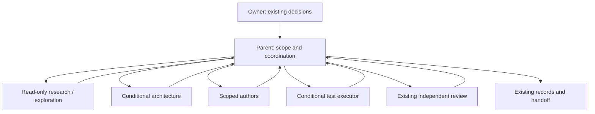

# Parent-Owned Delegation

Apply this contract before choosing direct or managed execution. It governs Product Definition, UI Design, code exploration and delivery. Delegation alone does not require PLAN/RUN. Existing product, design, security and publication gates still apply. An installed role or available tool grants no action.

For managed role-bound results and availability recovery, use [parent-retained execution receipts](agent-execution-receipts.md).

## Delivery Collaboration Overview

This overview explains how stage roles fit together. It does not replace [execution task decomposition](execution-task-decomposition.md), [task and handoff governance](governance/task-and-handoff.md), [worker results](worker-result-contract.md), [runtime adapters](runtime-adapters.md), or [execution receipts](agent-execution-receipts.md).

| Role | When it is needed | Authority and result |
| --- | --- | --- |
| Human owner | Existing gates | Product, stack, visual and action decisions |
| Parent | Throughout delivery | Scope, canonical coordination, sibling dispatch, reconciliation, serial integration and handoff |
| Researcher / explorer | Substantive unanswered questions | Read-only sourced findings, file evidence and unknowns |
| Code architect | Unresolved interface, state, trust or migration boundary | Proposes contracts and failure behavior; the parent reconciles and freezes within approved decisions |
| Product / design author | Applicable upstream stage | Assigned artifacts under the owning skill; UI uses the host frontend binding |
| Backend / general author | Accepted implementation | Scoped code and focused checks; no frontend substitution |
| Test executor | Separate verification is useful | Actual command, environment and outcome evidence; no approval or review substitution |
| Independent reviewer | Existing required review points | Read-only findings on the exact candidate with its required tools available |

Arrows show parent dispatch and returned evidence; they grant no actions. Every delegate is a parent-dispatched sibling.
Roles are selected by stage, and the parent resolves the minimum topology. Independent substantive research questions keep their distinct assignments; mandatory frontend and reviewer bindings do not disappear.
One writer owns each checkout. Parallel writers need authorized isolation and nonconflicting scopes. A worker PASS is only a candidate; existing reviews, repair budgets, failure records and exact-source checks remain binding.

## Decompose Before Launch

The parent lists the substantive questions and implementation outcomes, their frozen inputs, dependencies, required skills, tools, result shape and acceptance checks. A role is reusable; each assignment and launch attempt has its own identity. Business roles such as `frontend-platform` remain separate from execution roles such as `code_architect`.

When at least two independent substantive research or exploration questions exist and matching capability and authorization are available, dispatch at least two distinct `market_researcher` or `code_explorer` instances. Assign different questions or explicitly justified independent corroboration. Do not split trivial questions to inflate the count. Record why a single assignment suffices when that is the selected route. This applies to pre-draft research, post-draft market reconciliation, UI reference research, enhancement deltas and code exploration.

Launch dependency-ready siblings before waiting. Limit a wave by observed slots, memory, tools and exclusive resources, not a fixed small worker count. Capacity of one means sequential execution of distinct assignments, not collapsing required delegates into parent work. Do not reuse a grading-specialist count limit as a research limit.

The parent owns every launch, result reconciliation, canonical coordination record, approval interaction and integration. Assigned authors write their scoped product artifacts. Workers never spawn children or approve product decisions. Researchers return sourced findings; code explorers return file/symbol evidence and unknowns. The parent resolves conflicts and freezes the interface before dependent writers begin. Independent work can continue while another dependency is blocked.

## Architecture Method

Apply this method to initial architecture and scoped changes to state, trust, integration or migration boundaries.
For a repair with unchanged boundaries, reuse the accepted design and verify the affected behavior.

1. Start with a concrete caller example and its expected result.
2. Derive responsibilities and interfaces from that example.
3. For mutable state, name its owner, readers and permitted transitions.
4. State invariants, invalid states and trust boundaries.
5. For side effects, define repeat-call behavior and recovery after failure between steps.
6. Link those observable outcomes to existing acceptance checks and `TEST-*` obligations when available.

Product Definition records conceptual contracts in the existing architecture package.
Implementation design derives signatures and types inside the accepted write scope.
It does not select an unapproved stack or change product decisions.

When coupling, durability, trust or migration remains unresolved, compare the smallest viable structural alternatives.
Explain each alternative's effect on the caller, state ownership and failure recovery.
Do not require alternatives for every local fix.

When repeated failures challenge the design, recheck its premises before another repair.
Count the applicable actors, load and concurrent operations from evidence.
Classify tool and environment failures separately from design failures.
This review does not reset repair budgets, authorize a rewrite or replace existing owner decisions.
Code reviewers apply the same method only to the affected boundaries.
Use existing review outcomes and task evidence; do not create another gate or decision ledger.

## Resolve Roles Before Direct Or Managed Work

All UI authoring and implementation, including pages, components, markup, styling, layout, design-system conformance and visual repairs, requires the host's `frontend_worker` binding. Backend and general implementers cannot take this work; the parent cannot author it directly. The actual author reads the complete pinned `frontend-design` and applicable project design skills in its own context before editing. UI research remains read-only and may have multiple sibling researchers while one frontend author owns the candidate.

Every frontend dispatch packet carries an explicit maximum-creativity brief. It directs the writer to pursue the most distinctive, high-craft visual concept the frozen PRD allows — ambitious hierarchy, typography, composition and motion rather than a generic template or a mechanical section recipe. The PRD bounds pages, operations, states and copy; it does not cap creative ambition. Direction and HiFi launch prompts restate this brief; a bare task list is not a valid frontend dispatch.

Apply [Frontend Visual Inputs](frontend-visual-inputs.md) in the actual task for every frontend stage. Pass current selected screens, font and asset sources, concrete visual-feature sources and inspection duties. Preserve source authority and stage-specific pending decisions.

Independent review requires the host's reviewer binding and the tools required by the review. A source reviewer without browser access cannot pass a visual inspection; the parent's browser session is not that reviewer's capability. A role title or prompt restriction does not prove tool isolation.

Resolve the logical role against effective host policy and observed capabilities. Record the actual native agent type or external bridge, explicit model and effort when required, permissions, required tools and allowed fallback. Host-specific models and launch paths belong to host policy, not shared skill defaults. Keep the parent host identity separate from the worker's model provider; a bridge does not bypass `allowed_providers`.

An external bridge needs `invoke_external_runtime` and applicable delegation authorization; user-owned chats additionally need their own explicit creation authority. Worktree, branch, commit and integration actions retain their existing gates. Never infer these grants from role resolution. Resolve mandatory roles before launch; missing bindings, capabilities or grants block the dependent assignment. No silent parent or generic-worker substitution is allowed once delegation is mandatory.

## Assignment And Result Evidence

Each assignment carries a unique assignment ID, attempt ID, execution role, question IDs or bounded outcome, input identity, dependencies, checkout, read/write scope, required skills/tools, acceptance criteria and result contract. Input identity includes the relevant source hashes as well as the base SHA when inputs contain uncommitted files. Give the worker a fresh bounded packet, not the full parent transcript. Include the effective instruction paths and source hashes when the bridge disables automatic discovery. The child reads those sources independently, verifies their hashes, and reports its own loaded/read evidence; a parent claim does not substitute. For every NEW parent launch, state an explicit observed or task `max_message_bytes`. Check the complete parent-visible UTF-8 bytes before launch. Overflow means use smaller scoped optional content or defer; it does not authorize a larger default.

Keep requested execution identity distinct from observed worker/session identity, role, model and effort. The parent checks the actual launch and result evidence; echoing requested values is not proof they were used. Join by assignment and attempt identity, not by array position or role name. Accept reordering, reject duplicates, unknown assignments, stale inputs, wrong roles/models and missing required results. A partial or failed result remains explicit and cannot satisfy a required barrier. A 403 or missing-research result is a finding, not a launch failure or permission to synthesize evidence; preserve applicable research skip rules without claiming completed delegation.

Give each assignment and attempt its own scratch area. Set a finite deadline and verify that the owning process tree exits before reporting cleanup. If a worktree is interrupted, inspect the prior operation and partial results before any retry. Keep checkpoints bounded and make them with the same author.

For managed work, keep evidence with existing selector directives, leases, reserved review attempts and result transitions. Reserve before launch and revalidate at acceptance. Direct work retains the same evidence in its existing Epic/task record. No second scheduler or delegation database is needed.

## Ownership And Recovery

One writer owns a checkout at a time, including the parent. Different filenames do not authorize simultaneous writers in one checkout. Parallel writers need separately authorized isolated workspaces and nonconflicting scopes. Read-only helpers may share a checkout only when their tools do not mutate it; tests, caches and services require their actual resource and lifecycle controls. Review evidence binds the exact candidate it inspected.

Fallback follows the host's declared mapping only after an explicit model/provider availability error, confirmed worker termination and inspection of partial work. Preserve the original assignment, restrictions, completed work and remaining work with a new attempt identity. Quota exhaustion, silence, polling timeout, task deadline, test failure, permission denial and missing browser/tools do not authorize availability fallback. A missing fallback role is a host-definition gap, not permission to select another model. Never duplicate a possibly live writer.

Do not rewrite legacy or active pinned PLAN/RUNs to adopt this contract. New machine fields require versioned validation, selector and transition enforcement. Documentation alone cannot make a legacy driver support a bridge or prove actual execution identity.
